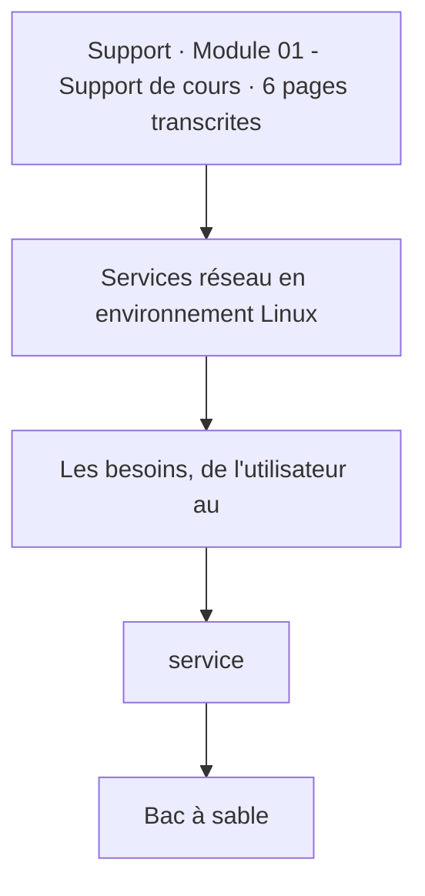
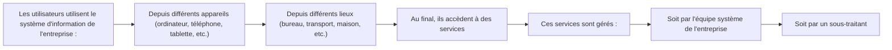
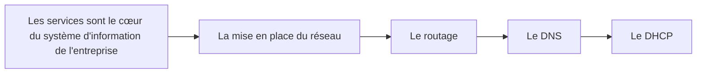
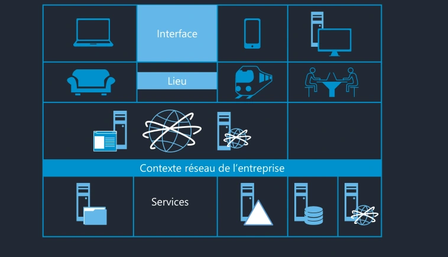
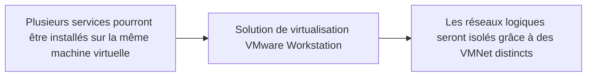
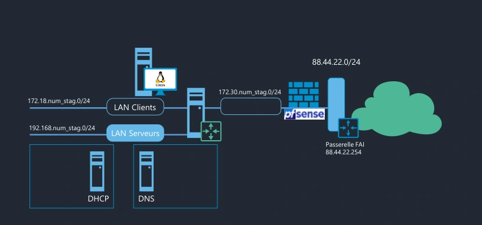

# Module 01 — Introduction

Les parties ci-dessous reprennent le cours original, dans le même ordre. Les encadrés et les schémas répètent ses formulations.

## Parcours de lecture

1. Support · Module 01 - Support de cours · 6 pages transcrites
2. Services réseau en environnement Linux
3. Les besoins, de l'utilisateur au
4. service
5. Bac à sable

**Visuel externe**

SOURCE DRIVE · TRANSCRIPTION DU SUPPORT

Le contenu des documents du dossier TSSR est transcrit ci-dessous, page par page. Les textes et tableaux sont intégrés à la page Web. Aucun fichier PDF, aucune diapositive entière ni aucune reproduction de page n’est affiché. Seuls des croquis ou visuels isolés et vérifiés peuvent accompagner la transcription. Les versions et les consignes restent celles des supports de formation. Les compléments IA sont conservés dans leur onglet distinct.

## Support · Module 01 - Support de cours · 6 pages transcrites

## Services réseau en environnement Linux

Module 01 - Introduction

### Services réseau en environnement Linux

### Objectifs

!!! note "À retenir"
    Définir les besoins en services Présenter la maquette

- Définir les besoins en services
- Présenter la maquette

### Services réseau en environnement Linux

### Public ciblé

- Techniciens système et réseaux

### Services réseau en environnement Linux

## Les besoins, de l'utilisateur au

## service

### Les besoins, de l’utilisateur au service

### Des besoins au service

**Visuel externe**

- Les utilisateurs utilisent le système d'information de l'entreprise :
- Depuis différents appareils (ordinateur, téléphone, tablette, etc.)
- Depuis différents lieux (bureau, transport, maison, etc.)
- Au final, ils accèdent à des services
- Ces services sont gérés :
- Soit par l'équipe système de l'entreprise
- Soit par un sous-traitant

### Les besoins, de l’utilisateur au service

### Des besoins au service

!!! note "À retenir"
    Les services sont le cœur du système d'information de l'entreprise Nous allons voir les principaux services d'un système d'information d'entreprise : La mise en place du réseau Le routage Le DNS Le DHCP

**Visuel externe**

- Les services sont le cœur du système d'information de l'entreprise
- Nous allons voir les principaux services d'un système d'information d'entreprise :
- La mise en place du réseau
- Le routage
- Le DNS
- Le DHCP

### Les besoins, de l’utilisateur au service

### Des besoins au service

!!! note "À retenir"
    Du poste et du lieu aux services du système d’information Interface, lieu et contexte réseau de l’entreprise donnent accès aux services.

Du poste et du lieu aux services du système d’information

Interface, lieu et contexte réseau de l’entreprise donnent accès aux services.

Interface

Lieu

Contexte réseau de l’entreprise

Services

### Services réseau en environnement Linux

## Bac à sable

### Bac à sable

### Principe

!!! note "À retenir"
    Les services seront installés sur des machines virtuelles (OS : pfSense et Linux Debian 10) Plusieurs services pourront être installés sur la même machine virtuelle Solution de virtualisation VMware Workstation Les réseaux logiques seront isolés grâce à des VMNet distincts

**Visuel externe**

- Les services seront installés sur des machines virtuelles (OS : pfSense et Linux Debian 10)
- Plusieurs services pourront être installés sur la même machine virtuelle
- Solution de virtualisation VMware Workstation
- Les réseaux logiques seront isolés grâce à des VMNet distincts

### Bac à sable

### Bac à sable

!!! note "À retenir"
    Maquette des LAN Clients et Serveurs, liaison VMNet2 et sortie FAI LAN Clients 172.18.num_stag.0/24.

Maquette des LAN Clients et Serveurs, liaison VMNet2 et sortie FAI

LAN Clients 172.18.num_stag.0/24. LAN Serveurs 192.168.num_stag.0/24 avec DHCP et DNS. Liaison 172.30.num_stag.0/24 vers pfSense. Réseau de la maquette 88.44.22.0/24 et passerelle FAI 88.44.22.254.

88.44.22.0/24

172.30.num_stag.0/24

LAN Clients 172.18.num_stag.0/24

192.168.num_stag.0/24

LAN Serveurs

Passerelle FAI 88.44.22.254

DHCP

DNS

### Bac à sable

### Quelques précautions

!!! note "À retenir"
    Ici 88.44.22.0/24 à remplacer par le réseau de votre FAI, par exemple souvent 192.168.1.0/24 Adapter l'adressage réseau du LAN de votre FAI.

Ici 88.44.22.0/24 à remplacer par le réseau de votre FAI, par exemple souvent 192.168.1.0/24

Adapter l'adressage réseau du LAN de votre FAI.

Ici 88.44.22.254 à remplacer par l'adresse IP de votre BOX, par exemple 192.168.1.1 ou 192.168.1.254

Adapter l'adresse IP de la passerelle FAI.

Référence du document : 1QedZ-aTakzBiscNG1kxep6mnwEyr7B6J · SHA-256 38092b351a91ee7c…
