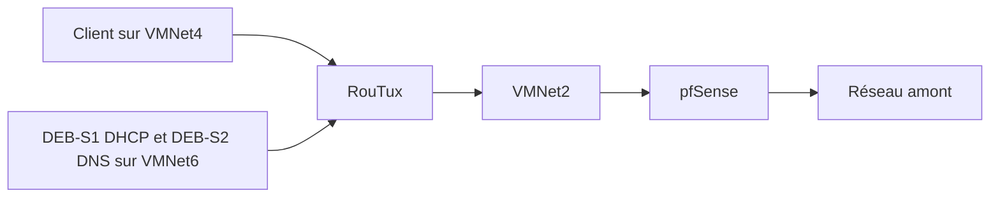

# Module 01 — Introduction

## Objectifs

- Relier les besoins des utilisateurs aux services étudiés.
- Lire le plan des réseaux Clients, Serveurs et Interconnexion.
- Identifier le rôle de chaque machine et les contrôles à faire dans l’ordre.

## Des besoins des utilisateurs aux services

Les utilisateurs accèdent au système d’information depuis un ordinateur, une tablette ou un téléphone. L’accès peut venir du bureau, du domicile ou d’un déplacement. Le service rendu reste le point de départ. L’équipe interne ou un prestataire assure son installation et son exploitation.

Pour atteindre un service, le poste doit d’abord être raccordé à un réseau et posséder une configuration IP. Quand la cible appartient à un autre réseau, le routage relie les deux segments. La résolution DNS permet d’atteindre la cible par son nom. DHCP distribue automatiquement les paramètres nécessaires aux postes qui le demandent. SSH fournit ensuite un canal d’administration aux techniciens.

| Besoin observé | Élément étudié dans le cours | Contrôle attendu |
|---|---|---|
| Joindre une machine du même segment | Adressage de l’interface | Adresse et préfixe compatibles |
| Joindre un autre réseau | Route et passerelle | Aller et retour empruntent un chemin valable |
| Atteindre Internet depuis la maquette | Route de sortie et NAT | Connectivité vers une adresse extérieure |
| Administrer les serveurs | SSH | Session vers le bon hôte et compte |
| Employer des noms | DNS résolveur puis autorité locale | Réponse du serveur attendu |
| Configurer des postes automatiquement | DHCP et relais | Bail, passerelle et DNS reçus |

## Organisation de la maquette

La source cible les techniciens systèmes et réseaux. Elle utilise VMware Workstation, des VM Debian 10 et une appliance pfSense. Les segments sont séparés par des VMNet. Plusieurs rôles peuvent cohabiter sur une même VM, comme le DNS résolveur et l’autorité de zone sur DEB-S2.

Dans les TP, `X` représente `num_stag`, un nombre de 1 à 30. Choisir une valeur unique et la garder dans les adresses, les routes, les plages DHCP et les noms des zones inverses. Le tableau réunit les valeurs des premiers ateliers.

| Segment | Préfixe | Raccordements du scénario |
|---|---|---|
| LAN Clients sur VMNet4 | `172.18.X.0/24` | Cli-db-10 `.10` et RouTux `.254` |
| LAN Serveurs sur VMNet6 | `192.168.X.0/24` | DEB-S1 `.11`, DEB-S2 `.12`, RouTux `.254` |
| Interconnexion sur VMNet2 | `172.30.X.0/24` | pfSense LAN `.1`, RouTux `.254`, client `.10` temporaire |
| Amont WAN de pfSense | Réseau du laboratoire réel | Carte en pont, adresse et passerelle du réseau amont |

Le schéma historique utilise `88.44.22.0/24` et la passerelle `88.44.22.254` pour l’amont. La source demande de remplacer ces valeurs par le réseau et l’adresse de la box effectivement utilisés. L’adresse de DNS FAI `66.55.44.33` des ateliers est aussi une valeur de maquette. Les segments de laboratoire et le WAN ont des rôles distincts.

## Progression des manipulations

1. Préparer le client graphique et les serveurs en console, puis vérifier chaque segment séparément.
2. Donner trois interfaces à RouTux et établir le routage entre LAN.
3. Ajouter pfSense et vérifier le chemin vers l’extérieur.
4. Centraliser l’administration depuis le client via SSH.
5. Utiliser DEB-S2 pour la résolution DNS, puis ajouter DHCP sur DEB-S1 et le relais sur RouTux.
6. Héberger la zone directe et les zones inverses. Vérifier la copie secondaire sur DEB-S1.

!!! info "Actualisation externe"
    Les supports datent du scénario Debian 10. Debian indique que le LTS de Buster s’est terminé le 30 juin 2024. Lors d’une reproduction sur une version maintenue, relever les différences de dépôts, de paquets et de gestion réseau. [Informations de version Debian Buster](https://www.debian.org/releases/buster/).

### Cas d’application — Préparer le schéma de la maquette

Le module introduit le parcours et ne fournit pas d’énoncé de TP. Pour préparer les manipulations suivantes, choisir le `X` attribué et construire un relevé avec le nom de la machine, le VMNet, le préfixe, l’adresse d’hôte et le rôle. Vérifier que les trois segments sont distincts et que l’adresse WAN correspond à l’environnement de formation.

| Si le poste échoue à joindre un service | Vérifier dans cet ordre |
| --- | --- |
| Même segment | VMNet, interface active, adresse et masque. |
| Segment distant | Passerelle, routes d’aller et de retour, filtrage. |
| Adresse joignable mais nom en échec | Résolveur configuré, nom demandé et réponse DNS. |
| Nom résolu mais service indisponible | Écoute du service, protocole et autorisations. |

## Schéma explicatif complémentaire

## À retenir

Commencer par la carte, l’adresse et le segment, puis vérifier le routage. Tester ensuite le DNS et le service attendu. La variable X reste identique dans l’adressage, les options DHCP et les zones inverses.

## Mini-quiz — 5 questions {#autoevaluation}

1. Quel segment relie RouTux à l’interface LAN de pfSense ?
2. Sur quelle VM se trouve le DNS résolveur ?
3. Pourquoi la valeur X reste-t-elle identique d’un exercice à l’autre ?
4. Quel contrôle précède un test DNS entre deux réseaux ?
5. Quels rôles distincts assurent DHCP et SSH ?

??? success "Réponses commentées"

    1. VMNet2, avec le réseau 172.30.X.0/24.
    2. DEB-S2, sur le LAN Serveurs.
    3. Les préfixes, les options DHCP et les zones inverses doivent rester cohérents pour la même maquette.
    4. Vérifier les adresses, les routes et la connectivité IP d’aller et de retour.
    5. DHCP distribue les paramètres réseau. SSH permet d’administrer une machine à distance.

## Pour travailler ce module

- [Fiche de révision](../../revision/services-reseau-linux/module-01-introduction.md)
- [Travaux pratiques](../../tp/services-reseau-linux/index.md)
- [Kahoot existant](../../kahoot/services-reseau-linux-module-01.md)
- [Sommaire du cours](index.md)
