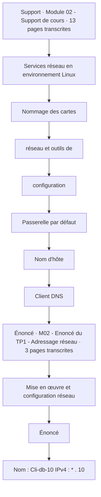
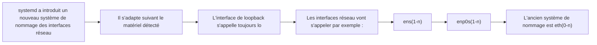
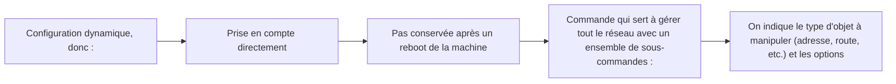
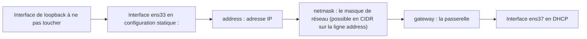
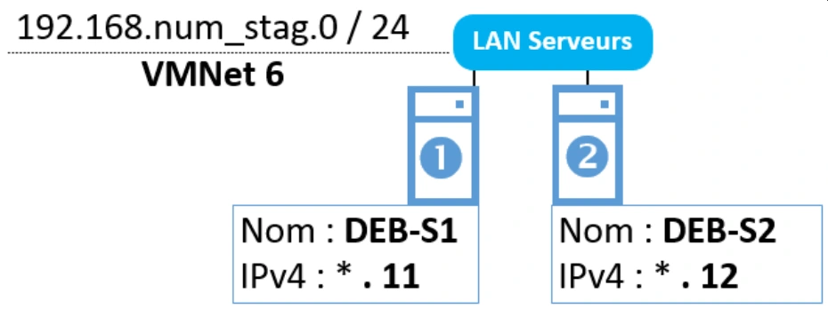

# Module 02 — Adressage réseau

Les parties ci-dessous reprennent le cours original, dans le même ordre. Les encadrés et les schémas répètent ses formulations.

## Parcours de lecture

1. Support · Module 02 - Support de cours · 13 pages transcrites
2. Services réseau en environnement Linux
3. Nommage des cartes
4. réseau et outils de
5. configuration
6. Passerelle par défaut
7. Nom d'hôte
8. Client DNS
9. Énoncé · M02 - Enoncé du TP1 - Adressage réseau · 3 pages transcrites
10. Mise en œuvre et configuration réseau
11. Énoncé
12. Nom : Cli-db-10 IPv4 : * . 10
13. LAN Clients 172.18.num_stag.0 / 24 VMNet 4
14. Correction · M02 - Solution du TP1 - Adressage réseau · 4 pages transcrites
15. Mise en œuvre et configuration réseau
16. Solution
17. Nom : Cli-db-10 IPv4 : * . 10
18. LAN Clients 172.18.num_stag.0 / 24 VMNet 4
19. Etape 3 - Préparation d’un serveur supplémentaire

**Visuel externe**



SOURCE DRIVE · TRANSCRIPTION DU SUPPORT

Le contenu des documents du dossier TSSR est transcrit ci-dessous, page par page. Les textes et tableaux sont intégrés à la page Web. Aucun fichier PDF, aucune diapositive entière ni aucune reproduction de page n’est affiché. Seuls des croquis ou visuels isolés et vérifiés peuvent accompagner la transcription. Les versions et les consignes restent celles des supports de formation. Les compléments IA sont conservés dans leur onglet distinct.

## Support · Module 02 - Support de cours · 13 pages transcrites

!!! note "À retenir"
    Les noms et chemins de formation portant le nom de l’éditeur ont été neutralisés.

Les noms et chemins de formation portant le nom de l’éditeur ont été neutralisés. Les adresses numériques et les consignes restent celles de la source.

## Services réseau en environnement Linux

Module 02 - Adressage réseau

### Adressage réseau

### Objectifs

!!! note "À retenir"
    Paramétrer les interfaces réseau d'un serveur Linux Découvrir les différentes méthodes de paramétrage

- Paramétrer les interfaces réseau d'un serveur Linux
- Découvrir les différentes méthodes de paramétrage

### Adressage réseau

### Public ciblé

- Techniciens système et réseaux

### Adressage réseau

## Nommage des cartes

## réseau et outils de

## configuration

### Nommage des cartes réseaux et outils de configuration

### Nommage et outils

!!! note "À retenir"
    systemd a introduit un nouveau système de nommage des interfaces réseau Il s'adapte suivant le matériel détecté L'interface de loopback s'appelle toujours lo Les interfaces réseau vont s'appeler par exemple : ens[1-n] enp0s[1-n] L'ancien système de nommage est eth[0-n]

**Visuel externe**



- systemd a introduit un nouveau système de nommage des interfaces réseau
- Il s'adapte suivant le matériel détecté
- L'interface de loopback s'appelle toujours lo
- Les interfaces réseau vont s'appeler par exemple :
- ens[1-n]
- enp0s[1-n]
- L'ancien système de nommage est eth[0-n]

### Nommage des cartes réseaux et outils de configuration

### Nommage et outils

!!! note "À retenir"
    On va distinguer 3 façons de configurer le réseau : De façon dynamique avec la commande ip De façon statique avec le « fichier interfaces » Avec l'outil NetworkManager

**Visuel externe**


- On va distinguer 3 façons de configurer le réseau :
- De façon dynamique avec la commande ip
- De façon statique avec le « fichier interfaces »
- Avec l'outil NetworkManager

### Nommage des cartes réseaux et outils de configuration

### Configuration avec la commande IP

!!! note "À retenir"
    Configuration dynamique, donc : Prise en compte directement Pas conservée après un reboot de la machine Commande qui sert à gérer tout le réseau avec un ensemble de sous-commandes : Transcription du détail du support.

**Visuel externe**



- Configuration dynamique, donc :
- Prise en compte directement
- Pas conservée après un reboot de la machine
- Commande qui sert à gérer tout le réseau avec un ensemble de sous-commandes :

Transcription du détail du support.

```
ip [ OPTIONS ] OBJECT { COMMAND | help }
OBJECT := { link | addr | addrlabel | route | rule | neigh | ntable | tunnel | tuntap
          | maddr | mroute | mrule | monitor | xfrm | netns | l2tp }
```

- On indique le type d'objet à manipuler (adresse, route, etc.) et les options

### Nommage des cartes réseaux et outils de configuration

### Configuration avec la commande IP

!!! note "À retenir"
    Pour afficher les informations d'adressage : Transcription du détail du support.

- Pour afficher les informations d'adressage :

Transcription du détail du support.

```
$ ip a
1: lo: <LOOPBACK,UP,LOWER_UP> mtu 16436 qdisc noqueue state UNKNOWN
    link/loopback 00:00:00:00:00:00 brd 00:00:00:00:00:00
    inet 127.0.0.1/8 scope host lo
    inet6 ::1/128 scope host
       valid_lft forever preferred_lft forever
2: ens33: <BROADCAST,MULTICAST,UP,LOWER_UP> mtu 1500 qdisc pfifo_fast state UP qlen 1000
    link/ether 00:0c:29:4d:bc:c2 brd ff:ff:ff:ff:ff:ff
    inet6 fe80::20c:29ff:fe4d:bcc2/64 scope link
       valid_lft forever preferred_lft forever
```

- Ajout ou suppression d'adresses :

Transcription du détail du support.

```
# ip a add 10.11.12.13/24 dev ens33
# ip a del 172.16.0.1/16 dev ens37
# ip a flush ens33
```

### Nommage des cartes réseaux et outils de configuration

### Configuration avec la commande IP

!!! note "À retenir"
    Activer ou désactiver une interface : Transcription du détail du support.

- Activer ou désactiver une interface :

Transcription du détail du support.

```
# ip link set ens33 down
# ip l set ens37 up
```

- N'oubliez pas le man :

Transcription du détail du support.

```
$ man ip
$ man ip-address
```

### Nommage des cartes réseaux et outils de configuration

### Configuration avec le fichier interfaces

!!! note "À retenir"
    Configuration stabilisée dans le temps même après redémarrage du serveur Fichier /etc/network/interfaces Transcription du détail du support.

- Configuration stabilisée dans le temps même après redémarrage du serveur
- Fichier /etc/network/interfaces

Transcription du détail du support.

```
# L’interface réseau de loopback => il ne faut pas la modifier
auto lo
iface lo inet loopback

# L’interface ens33 est configurée manuellement.
auto ens33
iface ens33 inet static
    address 192.168.66.6
    netmask 255.255.0.0

# L’interface ens37 est quant à elle configurée via DHCP.
auto ens37
iface ens37 inet dhcp
```

### Nommage des cartes réseaux et outils de configuration

### Configuration avec le fichier interfaces

**Visuel externe**



- Interface de loopback à ne pas toucher
- Interface ens33 en configuration statique :
- address : adresse IP
- netmask : le masque de réseau (possible en CIDR sur la ligne address)
- gateway : la passerelle
- Interface ens37 en DHCP

### Nommage des cartes réseaux et outils de configuration

### Configuration avec le fichier interfaces

Ne pas oublier de redémarrer le réseau après configuration.

```
# systemctl restart networking
```

### Nommage des cartes réseaux et outils de configuration

### Configuration avec Network Manager

- Si Network Manager est installé, il faut utiliser les commandes adéquates et ne pas configurer dans le « fichier interfaces »

Transcription du détail du support.

```
# systemctl status NetworkManager
● NetworkManager.service - Network Manager
   Loaded: loaded (/lib/systemd/system/NetworkManager.service; enabled; vendor p…)
   Active: active (running) since Mon 2019-05-20 12:24:14 CEST; 66h 6min ago
```

- La commande nmcli est utilisée pour gérer les interfaces réseau
- Possible aussi d'utiliser nmtui et l'interface graphique si installée

### Nommage des cartes réseaux et outils de configuration

### Configuration avec Network Manager

- Exemple avec nmcli pour afficher la configuration

Transcription du détail du support.

```
$ nmcli
ens33: connecté to Wired connection 1
       "Intel 82545EM"
       ethernet (e1000), 00:0C:29:08:4B:4C, hw, mtu 1500
       ip4 default
       inet4 172.16.6.6/24
       route4 172.16.6.0/24
       [...]

lo: non-géré
    "lo"
    loopback (unknown), 00:00:00:00:00:00, sw, mtu 65536

DNS configuration:
    servers: 10.0.0.1
    domains: demo.example
    interface: ens33
```

### Nommage des cartes réseaux et outils de configuration

### Configuration avec Network Manager

- Modification de l'IP :

Transcription du détail du support.

```
# nmcli connection modify Wired\ connection\ 1 ipv4.addresses 192.168.66.6/24
# nmcli connection modify Wired\ connection\ 1 ipv4.addresses 192.168.66.6/24 ipv4.method manual
# nmcli connection modify Wired\ connection\ 1 +ipv4.addresses 192.168.1.1/24
```

### Adressage réseau

## Passerelle par défaut

### Passerelle par défaut

### Modification de la passerelle par défaut

- La passerelle par défaut est modifiable avec les différentes méthodes :
- Avec Network Manager :

Transcription du détail du support.

```
# nmcli connection modify Wired\ connection\ 1 ipv4.gateway 192.168.66.254
```

- Dans le fichier interfaces :

Transcription du détail du support.

```
# L’interface ens33 est configurée manuellement.
auto ens33
iface ens33 inet static
    address 192.168.66.6
    netmask 255.255.0.0
    gateway 192.168.66.254
```

### Passerelle par défaut

### La commande ip

- Avec la commande ip

Transcription du détail du support.

```
$ man ip-route
Affichage de la table de routage : itinéraires et passerelles :
$ ip r
default via 192.168.0.254 dev ens37
10.11.0.0/16 dev ens33 proto kernel scope link src 10.11.12.13
192.168.0.0/24 dev ens37 proto kernel scope link src 192.168.0.1

Ajouter une route par défaut :
# ip r add default via 10.11.0.254
Modifier la route par défaut :
# ip r change default via 10.11.255.254
Supprimer la route par défaut :
# ip route del default via 192.168.0.254
```

Dans tous les cas, la commande « ip r » permet d'afficher la table de routage de la machine.

### Adressage réseau

## Nom d'hôte

### Nom d’hôte

### Caractéristiques

- Le nom d'hôte de la machine peut être :
- Un nom court
- Un FQDN (Full Qualified Domain Name)
- Il est configuré dans le fichier /etc/hostname qui ne doit contenir que le nom d'hôte (court ou long)
- Le nom d'hôte doit être résolvable localement. On doit donc le retrouver dans le fichier /etc/hosts

### Nom d’hôte

### Fichiers du nom d'hôte

- Fichier /etc/hostname

Transcription du détail du support.

```
srv-lan.demo.example
```

- Fichier /etc/hosts

Transcription du détail du support.

```
127.0.0.1       localhost
127.0.1.1       srv-lan.demo.example   srv-lan
```

- La commande hostname permet d'afficher le nom d'hôte

### Adressage réseau

## Client DNS

### Client DNS

### La résolution DNS

- Autre élément de configuration du réseau : la résolution DNS
- Elle va se faire :
- Localement grâce au fichier /etc/hosts
- Avec un serveur DNS configuré avec Network Manager ou avec le fichier /etc/resolv.conf

### Client DNS

### La résolution DNS

- L'ordre de résolution est défini :
- Dans le fichier /etc/nsswitch.conf

Transcription du détail du support.

```
$ grep hosts /etc/nsswitch.conf
hosts: files dns
```

- Ou avec une interface graphique :

Transcription du détail du support.

```
# grep hosts /etc/nsswitch.conf
hosts: files mdns4_minimal [NOTFOUND=return] dns myhostname
```

- Il faudra interpréter l'ordre : 1. fichier /etc/hosts 2. mdns4_minimal : interrogation mDNS (multicast DNS) pour les noms d’hôtes IPv4 en .local 3. serveur DNS 4. myhostname : résolution des noms locaux du poste

### Client DNS

### La résolution DNS

- Pour configurer la résolution DNS en tant que client DNS :
- Avec Network Manager

Transcription du détail du support.

```
# nmcli connection modify Wired\ connection\ 1 ipv4.dns 192.168.66.1
```

- Dans le fichier /etc/resolv.conf

Transcription du détail du support.

```
search demo.example ad.formation.example
domain ad.formation.example
nameserver 10.0.0.3
nameserver 10.100.0.3
```

- nameserver : pour définir les serveurs DNS
- search et domain pour définir les suffixes DNS
- Si la configuration est en DHCP, c'est ce dernier qui fournit la configuration DNS

Référence du document : 1zPFqVRivViktyikdvOrkv5ylNUNNdjsB · SHA-256 59d3b9ffb6ff15f3…

## Énoncé · M02 - Enoncé du TP1 - Adressage réseau · 3 pages transcrites

Les noms et chemins de formation portant le nom de l’éditeur ont été neutralisés. Les adresses numériques et les consignes restent celles de la source.

Services réseau en environnement Linux

## Mise en œuvre et configuration réseau

### TP 01 du Module 02 – Adressage réseau

Avant de démarrer ce TP, il convient d’avoir suivi les vidéos des modules 1 à 2 et d’avoir réalisé les TP proposés.

Durée estimée

3 heures

## Énoncé

### Objectifs

- Créer des machines virtuelles conformément à un cahier des charges.
- Configurer l’adressage réseau sous GNU/Linux Debian.

### Prérequis

- VMware Workstation doit être installé sur votre machine physique.

Récupérer l’image ISO du système d’exploitation indiqué dans le tableau de l’étape 1. Il est conseillé de télécharger l’ISO du DVD au départ ; les machines virtuelles n’auront pas obligatoirement accès à Internet :

https://cdimage.debian.org/debian-cd/current/amd64/iso-dvd/

### Notes

- Pour toutes les configurations réseau, remplacer num_stag par un chiffre entre 1 et 30, par exemple 10.
- Installer une seule fois la Debian sans interface bureautique et faire des clones permettra d’accélérer les déploiements des VMs.
- Veiller à bien lire toutes les instructions pour chaque VM.

Services réseau en environnement Linux

### Etape 1 - Configuration du LAN Clients

Création de la machine virtuelle cliente :

| Nom de la VM | Système d’exploitation | RAM | Réseau |
| --- | --- | --- | --- |
| Cli-db-10 | Linux Debian 10.x 64 bits | 1024 MB | Custom / VMNet4 |

## Nom : Cli-db-10 IPv4 : * . 10

## LAN Clients 172.18.num_stag.0 / 24 VMNet 4

### Installation du système d’exploitation :

- Installer le système d’exploitation. Ne pas configurer l’adressage réseau pendant l’installation (il sera configuré post installation).

### L’environnement de bureau Debian doit être installé sur Cli-db-10. Configuration système :

- Configurer l’adressage réseau IPv4 des postes en vous référant au précédent schéma.

Vous utiliserez le Network Manager pour configurer le réseau de Cli-db-10.

- Vérifier le nom du poste, le renommer au besoin.

### Etape 2 - Configuration du LAN Serveurs

Création des machines virtuelles serveur :

Créer les machines virtuelles suivantes

| Nom de la VM | Système d’exploitation | RAM | Réseau |
| --- | --- | --- | --- |
| DEB-S1 | Linux Debian 10.x 64 bits | 1024 MB | Custom / VMNet6 |
| DEB-S2 | Linux Debian 10.x 64 bits | 1024 MB | Custom / VMNet6 |

Services réseau en environnement Linux


LAN Serveurs sur VMNet6. DEB-S1 se termine par .11 et DEB-S2 par .12.

Installation du système d’exploitation sur les machines virtuelles :

- Installer le système d’exploitation indiqué dans le tableau sur les machines virtuelles créées précédemment.
- Ne pas configurer l’adressage réseau pendant l’installation (il sera configuré post installation).

L’environnement de bureau Debian NE DOIT PAS être installé (ni aucun autre environnement graphique…) sur ces machines.

Configuration système des machines :

- Configurer au moyen de la commande ip l’adressage réseau IPv4 des postes en vous référant au précédent schéma.
- S’assurer qu’ils communiquent bien entre eux.
- Une fois le point précédent vérifié, purger la configuration précédemment établie (flush) puis reporter dans le fichier de configuration des interfaces leur configuration respective.
- Redémarrer le service networking et vérifier la bonne prise en compte de la configuration de vos interfaces.
- Vérifier le nom des postes, les renommer au besoin.
- Vérifier que les postes communiquent bien entre eux (ping).

### Etape 3 - Préparation d’un serveur supplémentaire

Créer une machine virtuelle avec les caractéristiques suivantes :

| Nom de la VM | Système d’exploitation | RAM | Réseau |
| --- | --- | --- | --- |
| RouTux | Linux Debian 10.x 64 bits | 1024 MB | Aucune carte réseau |

- Installer son système d’exploitation. NE PAS INSTALLER l’environnement de bureau Debian, ne pas configurer le réseau.
- Vérifier le nom d’hôte de la machine (le modifier au besoin)

Référence du document : 1qf439STpGg6CjXLb56PDeWq-eR2WLeqw · SHA-256 937392f18a03f083…

## Correction · M02 - Solution du TP1 - Adressage réseau · 4 pages transcrites

Les noms et chemins de formation portant le nom de l’éditeur ont été neutralisés. Les adresses numériques et les consignes restent celles de la source.

Correction originale : à consulter après avoir tenté l’exercice.

Services réseau en environnement Linux

## Mise en œuvre et configuration réseau

### TP 01 du Module 02 – Adressage réseau

Avant de démarrer ce TP, il convient d’avoir suivi les vidéos des modules 1 à 2 et d’avoir réalisé les TP proposés.

Durée estimée

3 heures

## Solution

### Etape 1 - Configuration du LAN Clients

Création de la machine virtuelle cliente :

| Nom de la VM | Système d’exploitation | RAM | Réseau |
| --- | --- | --- | --- |
| Cli-db-10 | Linux Debian 10.x 64 bits | 1024 MB | Custom / VMNet4 |

## Nom : Cli-db-10 IPv4 : * . 10

## LAN Clients 172.18.num_stag.0 / 24 VMNet 4

```
# nmcli connection modify Wired\ connection\ 1  ipv4.addresses
172.18.X.10/24 ipv4.method  manual
```

Services réseau en environnement Linux

+ Désactivation/Activation connexion via nmtui

ou configuration + activation interactive via nmtui

ou configuration via l’interface graphique

Pour cli-deb-10, nommage de la machine à l’installation

```
Ou # nmcli general hostname cli- deb-10
```

Ou configuration interactive avec nmtui

### Etape 2 - Configuration du LAN Serveurs

Création des machines virtuelles serveur :

Créer les machines virtuelles suivantes

| Nom de la VM | Système d’exploitation | RAM | Réseau |
| --- | --- | --- | --- |
| DEB-S1 | Linux Debian 10.x 64 bits | 1024 MB | Custom / VMNet6 |
| DEB-S2 | Linux Debian 10.x 64 bits | 1024 MB | Custom / VMNet6 |



LAN Serveurs sur VMNet6. DEB-S1 se termine par .11 et DEB-S2 par .12.

### Pour une configuration dynamique

Sur deb-s1

```
 # ip a add 192.168.X.11 dev  ens33
```

Sur deb-s2

```
 # ip a add 192.168.X.12 dev  ens33
```

Pour flusher les interfaces :

```
 # ip a flush dev ens33
```

### Pour une configuration définitive

##### Sur deb-s1

```
 # vi /etc/network/interface
 auto ens33
 iface ens33 inet static

address  192.168.X.11

netmask  255.255.255.0
```

Sur deb-s2

Même chose que pour deb-s1 avec IP 192.168.X.12

Ne pas oublier de redémarrer la configuration.

```
# systemctl restart  networking.service
```

##### Configurer le nom d’hôte

```
# vi /etc/hostname

deb-s1
# hostname –F  /etc/hostname
# vi /etc/hosts
 127.0.1.1 deb-s1
```

Même chose avec deb-s2

Services réseau en environnement Linux

## Etape 3 - Préparation d’un serveur supplémentaire

Créer une machine virtuelle avec les caractéristiques suivantes :

| Nom de la VM | Système d’exploitation | RAM | Réseau |
| --- | --- | --- | --- |
| RouTux | Linux Debian 10.x 64 bits | 1024 MB | Aucune carte réseau |

Même chose qu’à l’étape 2 sans configuration de réseau pour l’instant.

Référence du document : 1XzrvZsfEVxEIGPrQNLhbPcmPEkfOmpGv · SHA-256 83cc3b4c3b97718f…

## Fiche de synthèse

Les lignes reprennent les titres du cours et la première phrase de chaque partie.

| Partie | Repère du cours |
| --- | --- |
| Support · Module 02 - Support de cours · 13 pages transcrites | Les noms et chemins de formation portant le nom de l’éditeur ont été neutralisés. |
| Énoncé · M02 - Enoncé du TP1 - Adressage réseau · 3 pages transcrites | Les noms et chemins de formation portant le nom de l’éditeur ont été neutralisés. |
| Correction · M02 - Solution du TP1 - Adressage réseau · 4 pages transcrites | Les noms et chemins de formation portant le nom de l’éditeur ont été neutralisés. |
| LAN Clients 172.18.num_stag.0 / 24 VMNet 4 | Services réseau en environnement Linux + Désactivation/Activation connexion via nmtui ou configuration + activation interactive via nmtui ou configuration via l’interface graphi… |
| Etape 3 - Préparation d’un serveur supplémentaire | Créer une machine virtuelle avec les caractéristiques suivantes : Même chose qu’à l’étape 2 sans configuration de réseau pour l’instant. |
