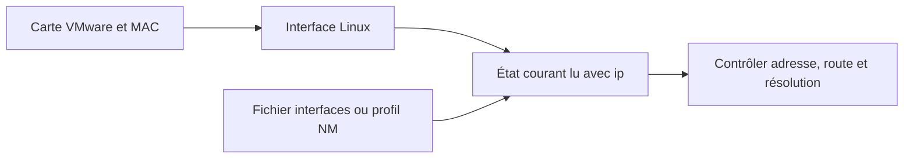

# Module 02 — Adressage réseau

Le cours optimisé reprend la leçon et ses manipulations. Les précisions et exemples complémentaires sont indiqués dans le texte. L’onglet Original donne accès aux transcriptions des supports.

## Identifier interfaces et profils

Le support présente les noms prévisibles issus de la détection du matériel, tels que `ens33` et `enp0s…`, et l’ancien schéma `eth0`, `eth1`. `lo` est l’interface de boucle locale. Dans la maquette, une adresse MAC permet de relier la carte affichée par VMware à l’interface reconnue par Debian. Relever cette correspondance avant de configurer plusieurs cartes.

```bash
ip link show
ip address show
ip route show
```

L’état de liaison, les adresses et la table de routage se lisent séparément. Les abréviations `ip l`, `ip a` et `ip r` apparaissent dans les exemples. Les manuels `man ip`, `man ip-address` et `man ip-route` expliquent les objets et leurs opérations.

## Configurer l’état courant avec ip

```bash
ip link set ens33 up
ip address add 192.168.10.11/24 dev ens33
ip address show dev ens33
ip address del 192.168.10.11/24 dev ens33
```

Ces commandes agissent immédiatement dans le noyau. La configuration persistante est lue au redémarrage par le gestionnaire retenu. Le TP demande une première configuration avec `ip`, un test entre DEB-S1 et DEB-S2, puis la suppression de cet état avant le paramétrage durable. Pour retirer seulement les adresses IPv4 de l’interface identifiée, utiliser `ip -4 address flush dev ens33` depuis la console du laboratoire.

## Écrire une configuration ifupdown

Le fichier `/etc/network/interfaces` conserve les paramètres des interfaces gérées par ifupdown. La déclaration de boucle locale reste en place. L’exemple suivant prend `X=10` pour DEB-S1. La route par défaut sera ajoutée au module suivant.

```text
auto lo
iface lo inet loopback

auto ens33
iface ens33 inet static
    address 192.168.10.11/24
```

Le support montre aussi l’écriture `address` accompagnée de `netmask`, ainsi que `iface ens37 inet dhcp` pour une autre carte. `systemctl restart networking` recharge le service dans ce scénario. Contrôler l’adresse, le préfixe et l’état de l’interface après l’action.

## Configurer un profil NetworkManager

Sur Cli-db-10, utiliser l’interface graphique, `nmtui` ou `nmcli`. Distinguer le nom du profil et celui de la carte. `nmcli connection show` affiche les profils. `nmcli device show ens33` lit l’état associé à cette carte. Le profil d’exemple ci-dessous doit correspondre au nom réellement relevé.

```bash
nmcli connection show
nmcli connection modify 'Wired connection 1' ipv4.method manual ipv4.addresses 172.18.10.10/24
nmcli connection up 'Wired connection 1'
```

Le préfixe `+` devant `ipv4.addresses` ajoute une valeur à la liste. La réactivation applique les paramètres du profil à la connexion. Les lignes ifupdown et le profil NetworkManager correspondent à deux modes de gestion. Identifier le propriétaire de l’interface avant de choisir où rendre le réglage permanent. [Manuel nmcli](https://networkmanager.dev/docs/api/latest/nmcli.html).

## Passerelle par défaut

La route par défaut sert lorsque la table ne possède pas de route plus spécifique. Dans les exemples du support, elle peut être ajoutée, changée ou supprimée via `ip route`. Une modification persistante se fait dans le profil NetworkManager avec `ipv4.gateway` ou dans la configuration ifupdown avec `gateway`. La passerelle doit être joignable sur le réseau de l’interface concernée. Vérifier `ip route` après le changement et examiner les métriques si plusieurs profils proposent une sortie.

## Nom d’hôte et résolution du poste

| Emplacement | Rôle |
|---|---|
| `/etc/hostname` | Nom configuré pour la machine |
| `/etc/hosts` | Associations locales entre adresses et noms |
| `/etc/nsswitch.conf` | Ordre des méthodes de résolution de la bibliothèque système |
| `/etc/resolv.conf` ou gestionnaire réseau | Serveurs et suffixes de recherche DNS |

Le support montre un nom court et un FQDN. `hostname` affiche le nom courant. `getent hosts` permet de vérifier une recherche suivant les méthodes du système. Une ligne `hosts: files dns` interroge d’abord les fichiers locaux. Dans le second exemple, `mdns4_minimal [NOTFOUND=return]` participe à la recherche des noms en `.local` et peut interrompre la chaîne sur un résultat donné. `myhostname` traite les noms locaux du poste.

`nameserver` identifie un serveur DNS. `search` fournit une liste de suffixes pour les noms relatifs. Les exemples historiques affichent aussi `domain`. En complément, retenir que `domain` est une forme à un seul suffixe et que les directives de recherche successives peuvent se remplacer. Si le fichier est généré, appliquer la modification dans le gestionnaire qui le produit. En DHCP, les options reçues alimentent la configuration selon le profil client. [resolv.conf(5)](https://manpages.debian.org/trixie/manpages/resolv.conf.5.en.html).

## Atelier d’adressage

Créer Cli-db-10 avec bureau, 1024 MB et VMNet4. Préparer DEB-S1 et DEB-S2 sans bureau sur VMNet6, chacun avec 1024 MB. Installer RouTux sans interface réseau pour le module suivant. Sur le client, renseigner `172.18.X.10/24` via NetworkManager. Sur les serveurs, tester `.11` et `.12` dans `192.168.X.0/24` avec `ip`, puis reporter les adresses dans la configuration durable. Vérifier les noms de machines et le ping entre les deux serveurs après le redémarrage du service réseau.

La correction abrège les commandes dynamiques sans préciser `/24` et écrit une fois `interface` au singulier. L’adressage demandé nécessite le préfixe `/24`. Le fichier employé par ifupdown est `/etc/network/interfaces`.

## Schéma explicatif complémentaire



## Autoévaluation

1. Quel réglage est relu au démarrage dans un serveur ifupdown ?
2. Comment relier une carte VMware à une interface Linux ?
3. Quel fichier décrit l’ordre des méthodes de résolution ?

??? success "Réponses"
    1. Les déclarations de `/etc/network/interfaces` et des fichiers qu’il inclut.
    2. Comparer leurs adresses MAC.
    3. `/etc/nsswitch.conf`.

## Pour travailler ce module

- [Fiche de révision](../../revision/services-reseau-linux/module-02-adressage-reseau.md)
- [Travaux pratiques](../../tp/services-reseau-linux/module-02/index.md)
- [Sommaire du cours](index.md)
