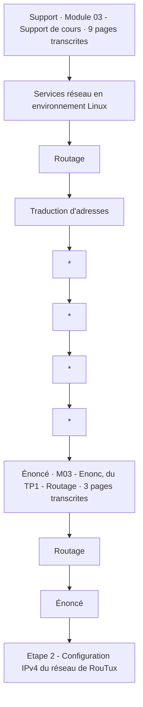
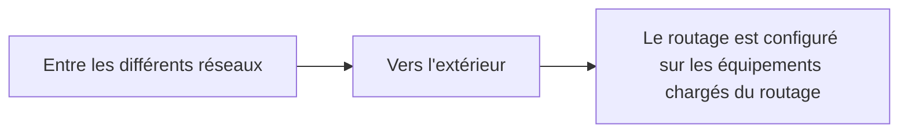
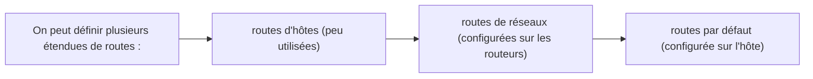
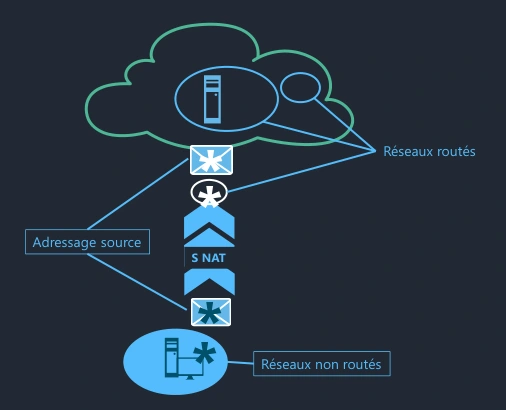
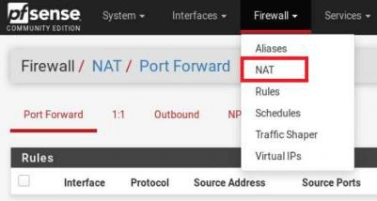
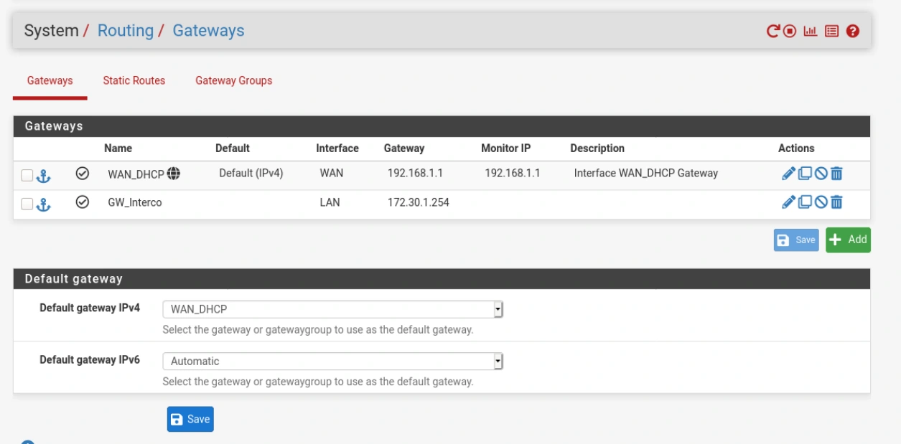
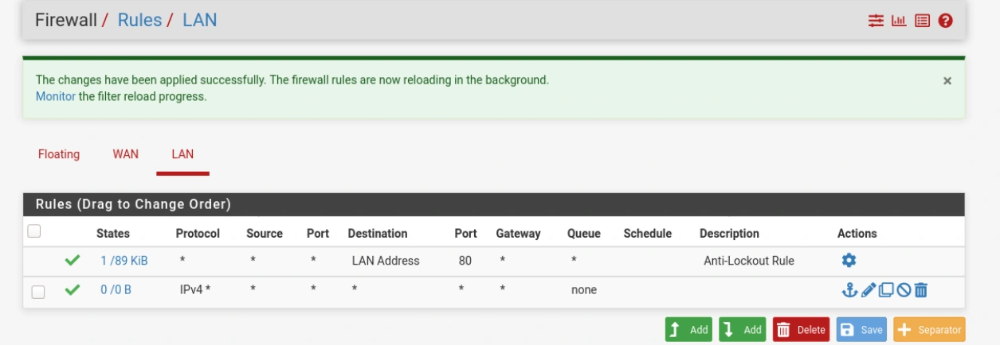
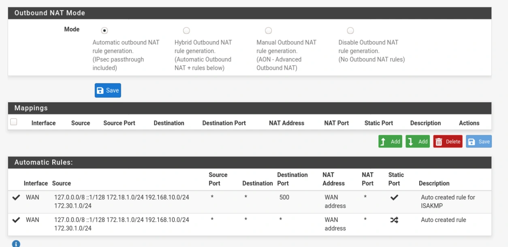

# Module 03 — Routage et traduction d’adresses

Les parties ci-dessous reprennent le cours original, dans le même ordre. Les encadrés et les schémas répètent ses formulations.

## Parcours de lecture

1. Support · Module 03 - Support de cours · 9 pages transcrites
2. Services réseau en environnement Linux
3. Routage
4. Traduction d'adresses
5. *
6. *
7. *
8. *
9. Énoncé · M03 - Enonc‚ du TP1 - Routage · 3 pages transcrites
10. Routage
11. Énoncé
12. Etape 2 - Configuration IPv4 du réseau de RouTux
13. Énoncé · M03 - Enonc‚ du TP2 - Int‚gration d'un routeur NAT sous PfSense · 3 pages transcrites
14. Intégration d’un routeur NAT sous pfSense
15. Énoncé
16. Correction · M03 - Solution du TP1- Routage · 2 pages transcrites
17. Routage
18. Solution
19. Etape 2 - Configuration IPv4 du réseau de RouTux
20. Correction · M03 - Solution du TP2 - Int‚gration d'un routeur NAT sous PfSense · 5 pages transcrites
21. Intégration d’un routeur NAT sous pfSense
22. Solution

**Visuel externe**



SOURCE DRIVE · TRANSCRIPTION DU SUPPORT

Le contenu des documents du dossier TSSR est transcrit ci-dessous, page par page. Les textes et tableaux sont intégrés à la page Web. Aucun fichier PDF, aucune diapositive entière ni aucune reproduction de page n’est affiché. Seuls des croquis ou visuels isolés et vérifiés peuvent accompagner la transcription. Les versions et les consignes restent celles des supports de formation. Les compléments IA sont conservés dans leur onglet distinct.

## Support · Module 03 - Support de cours · 9 pages transcrites

## Services réseau en environnement Linux

!!! note "À retenir"
    Module 03 - Routage et traduction d’adresses

Module 03 - Routage et traduction d’adresses

### Routage et traduction d’adresses

### Objectifs

!!! note "À retenir"
    Définir et mettre en place le routage Définir et mettre en place la traduction d’adresses

- Définir et mettre en place le routage
- Définir et mettre en place la traduction d’adresses

### Routage et traduction d’adresses

## Routage

### Routage

### Définition

!!! note "À retenir"
    Le routage est le processus permettant la communication entre des hôtes de réseaux logiques distincts.

- Le routage est le processus permettant la communication entre des hôtes de réseaux logiques distincts.

### Routage

### Fonctionnement

!!! note "À retenir"
    Routage de l’hôte A vers l’hôte C par la passerelle B Hôte A, 172.16.6.6 et masque 255.255.255.0, dans le LAN Brest.


Routage de l’hôte A vers l’hôte C par la passerelle B

Hôte A, 172.16.6.6 et masque 255.255.255.0, dans le LAN Brest. Passerelle B. Hôte C, 172.16.2.9, dans le LAN Quimper.

172.16. 6. 6 255.255.255.0

172.16. 2. 9

A C

LAN Brest

LAN Quimper

B

- L’hôte (A), au moyen de son adresse IP d’hôte et de son masque de réseau, détermine si l’hôte distant (C) est sur le même réseau logique que lui.
- Dans le cas contraire, il recherche dans sa propre table de routage si une route permet de joindre le réseau de destination ; il en extrait l’adresse de passerelle (B).

### Routage

### Fonctionnement

!!! note "À retenir"
    Il va falloir mettre en place l'ensemble des routes nécessaires à la communication : Entre les différents réseaux Vers l'extérieur Le routage est configuré sur les équipements chargés du routage Un équipement terminal (poste de travail, serveurs) utilise le routeur qui correspond à son réseau

**Visuel externe**



- Il va falloir mettre en place l'ensemble des routes nécessaires à la communication :
- Entre les différents réseaux
- Vers l'extérieur
- Le routage est configuré sur les équipements chargés du routage
- Un équipement terminal (poste de travail, serveurs) utilise le routeur qui correspond à son réseau

### Routage

### Les routes

!!! note "À retenir"
    On peut définir plusieurs étendues de routes : routes d'hôtes (peu utilisées) routes de réseaux (configurées sur les routeurs) routes par défaut (configurée sur l'hôte)

**Visuel externe**



- On peut définir plusieurs étendues de routes :
- routes d'hôtes (peu utilisées)
- routes de réseaux (configurées sur les routeurs)
- routes par défaut (configurée sur l'hôte)

### Routage

### Gestion dynamique

!!! note "À retenir"
    La commande ip route va permettre de gérer les routes de façon dynamique.

**Visuel externe**


- La commande ip route va permettre de gérer les routes de façon dynamique.
- Afficher les routes :

Transcription du détail du support.

```
$ ip route
default via 172.16.6.254 dev ens33 proto dhcp metric 100
172.16.6.0/24 dev ens33 proto kernel scope link src 172.16.6.6 metric 100
```

- Ajouter les 3 types de routes :

Transcription du détail du support.

```
# ip route add 10.11.12.3 via 172.16.6.123
# ip route add 10.56.0.0/16 via 172.16.6.253
# ip route add default via 172.16.6.1
```

### Routage

### Gestion dynamique

!!! note "À retenir"
    Changer une route : Transcription du détail du support.

- Changer une route :

Transcription du détail du support.

```
# ip route change default via 10.9.0.200
```

- Supprimer une route :

Transcription du détail du support.

```
# ip route del 10.56.0.0/16
```

### Routage

### Gestion statique

**Visuel externe**


- Pour conserver les routes, il faut les configurer :
- Soit via un export de la commande ip route
- Soit dans le fichier interfaces (à privilégier)

### Routage

### Activation

- Par défaut, une machine Linux ne route pas les paquets entre les réseaux. Il faut l'activer dans le fichier /etc/sysctl.conf :

Transcription du détail du support.

```
# vi /etc/sysctl.conf
net.ipv4.ip_forward=1
```

- Il faut ensuite lancer la commande :

Transcription du détail du support.

```
# sysctl -p
```

- Et vérifier (si 1 : activé, si 0 désactivé) :

Transcription du détail du support.

```
# sysctl net.ipv4.ip_forward
net.ipv4.ip_forward = 0
```

### Routage et traduction d’adresses

## Traduction d'adresses

### Traduction d’adresses

### Tables de routage

- Le routage ne fonctionne que si les réseaux sont dans les tables de routage.
- Dans les cas suivants, ce n'est pas suffisant :
- Réseaux non routables
- Réseaux privés non routables sur Internet
- Réseaux privés non connus des routeurs (pour des maquettes par exemple)

### Traduction d’adresses

### NAT

- Pour que les machines de ces réseaux puissent accéder à d'autres réseaux (sortir vers Internet), il faut mettre en place une solution de NAT, pour :
- Remplacer l'adresse IP source des paquets : NAT de Source ou SNAT
- Remplacer l'adresse IP de destination : NAT de destination ou DNAT

### Traduction d’adresses

### NAT



Traduction d’adresse source entre les réseaux non routés et routés

Le croquis montre le SNAT de l’adressage source lors de la sortie des réseaux non routés vers les réseaux routés.

## *

Réseaux routés

## *

Adressage source

S NAT

## *

## *

Réseaux non routés

### Traduction d’adresses

### iptables

- Sous Linux, il est possible d'utiliser des règles d'iptables.
- Il est aussi possible d'utiliser des frameworks comme Shorewall qui vont créer les règles à partir de fichiers de définition des règles.
- Des outils comme PfSense (utilisé dans ce cours) sont des outils avancés de gestion des règles.

### Traduction d’adresses

### SNAT

- Une fiche annexe est proposée pour la configuration détaillée de pfSense pour mettre en place le SNAT.



Accès au menu Firewall puis NAT dans pfSense.


Mode Outbound NAT automatique dans pfSense.


Exemples de règles Outbound NAT générées automatiquement.

Référence du document : 1MQyXuZisBhM7i8ZmSFLw1L-ljYwOeMVh · SHA-256 7747643d654e4e24…

## Énoncé · M03 - Enonc‚ du TP1 - Routage · 3 pages transcrites

Le nom du fichier Drive présente une anomalie historique d’encodage. Son nom est conservé ; le titre interne est transcrit dans le document. Les noms et chemins de formation portant le nom de l’éditeur ont été neutralisés. Les adresses numériques et les consignes restent celles de la source.

Services réseau en environnement Linux

## Routage

### TP 01 du Module 03 – Routage et traduction d’adresses

Avant de démarrer ce TP, il convient d’avoir suivi les vidéos des modules 1 à 3 et d’avoir réalisé les TP proposés.

Durée estimée

1 heure

## Énoncé

### Objectifs

- Configurer l’adressage réseau sous GNU/Linux Debian.
- Activer le routage et configurer des routes par défaut sous GNU/Linux.

### Prérequis

- Toutes les VMs de l’atelier 1 doivent être opérationnelles.

### Notes

- Pour toutes les configurations réseau, vous remplacerez num_stag par un chiffre entre 1 et 30, par exemple 10.

Services réseau en environnement Linux

### Etape 1 - Ajout de cartes réseau à la machine RouTux

- Dans les propriétés (VMware Workstation) de la machine virtuelle RouTux, lui ajouter des cartes réseau pour qu’elle dispose de 3 cartes réseau.
- Réaliser les associations de cartes réseau suivantes :

| Carte | Connexion | Adresse MAC |
| --- | --- | --- |
| Network Adapter | Custom / VMNet4 |  |
| Network Adapter 2 | Custom / VMNet6 |  |
| Network Adapter 3 | Custom / VMNet2 |  |

- Compléter le tableau précédent en renseignant les adresses MAC

## Etape 2 - Configuration IPv4 du réseau de RouTux

Nom de l interface

VMNet4

LAN Clients 172.18.num_stag.0 / 24

VMNet2

172.30.num_stag.0 / 24

192.168.num_stag.0 / 24

LAN Serveurs

VMNet6

- Reporter les noms des cartes réseau sur le schéma ci-dessus.
- Configurer l’adressage IP des 3 cartes réseau de RouTux, leur affecter pour numéro d’hôte la dernière adresse d’hôte du réseau.
- S’assurer que RouTux communique bien avec tous les hôtes des réseaux du LAN Clients et LAN Serveurs.

Services réseau en environnement Linux

### Etape 3 - Activation du routage sur RouTux

- Activer dynamiquement et durablement le paramètre noyau de routage sur RouTux.
- Configurer la passerelle par défaut des postes des réseaux LAN Client et LAN Serveur.
- Vérifier que les postes du LAN Clients communiquent bien avec les postes du LAN Serveurs

Référence du document : 1qtWj0BV--Chf44LSZJDfW5kokGciPDZ8 · SHA-256 1fc070c91f74bd53…

## Énoncé · M03 - Enonc‚ du TP2 - Int‚gration d'un routeur NAT sous PfSense · 3 pages transcrites

Le nom du fichier Drive présente une anomalie historique d’encodage. Son nom est conservé ; le titre interne est transcrit dans le document. Les noms et chemins de formation portant le nom de l’éditeur ont été neutralisés. Les adresses numériques et les consignes restent celles de la source.

## Intégration d’un routeur NAT sous pfSense

### TP 02 du Module 03 – Routage et traduction d’adresses

Avant de démarrer ce TP, il convient d’avoir suivi les vidéos des modules 1 à 3 et d’avoir réalisé les TP proposés.

Durée estimée

2 heures

## Énoncé

### Objectifs

- Intégrer une Appliance pfSense et configurer son adressage IP
- Créer des règles de filtrage sur pfSense
- Configurer des routes sous Debian et pfSense

### Prérequis

- Toutes les VMs de l’atelier 1 doivent être opérationnelles et l’atelier 2 en place.
- Télécharger l’ISO de pfSense sur le site officiel de pfSense https://www.pfsense.org/download/

### Notes

- Pour toutes les configurations réseau, vous remplacerez num_stag par un chiffre entre 1 et 30 par exemple 10.

### Etape 1 - Ajout d’une carte VMNet2 à une VM Client

- Dans les propriétés de la machine virtuelle VM Cli-db-10, ajouter une carte réseau pour qu’elle dispose de 2 cartes réseau.
- Associer la carte Network Adapter 2 à la connexion Custom / VMNet2.
- Configurer l’adressage réseau de la nouvelle carte avec l’adresse 172.30.num_stag.10/24

### Etape 2 - Ajout d’une machine virtuelle pfSense

- Créer une nouvelle machine virtuelle nommée pfSense.
- Configurer son adressage réseau :
- Son interface réseau LAN correspond à sa carte raccordée au réseau

VMNet2 ; utiliser la première adresse d’hôte utilisable sur ce réseau.

- Son interface WAN doit être liée à sa carte réseau Bridged.
- Utiliser comme adresse IP celle qui est disponible sur votre réseau ; le

WAN pourrait être configuré en DHCP sur votre réseau local par exemple.

- Configurer l’adresse de votre passerelle locale comme adresse de

passerelle par défaut.

- S’assurer que le serveur pfSense communique bien avec le serveur

Internet ayant l’adresse IP 9.9.9.9

- Sur le schéma, le réseau 88.44.22.0/24 correspond au réseau local de notre maquette.

88.44.22.0 / 24

172.30.num_stag.0 / 24 Bridged

9.9.9.9

VMNet2

Passerelle FAI

88.44.22.254

- Se connecter à l’interface web pfSense depuis la VM Cli-db-10 avec l’URL https://IP_interface_LAN (par défaut login : admin, mot de passe : pfsense).
- Ajouter la passerelle et les routes pour joindre les réseaux LAN CLIENT et LAN SERVEUR via RouTux.
- Modifier la règle de filtrage préconfigurée pour IPv4 sur la carte LAN pour autoriser les flux provenant de toutes les sources (source : any).
- S’assurer que les postes des réseaux LAN CLIENT et LAN SERVEUR communiquent avec votre pfSense (via son adresse en 172.30.num_stag.0/24).

### Etape 3 - Configuration du routage et de la résolution DNS client

Sur RouTux, configurer l’adresse de votre serveur pfSense comme adresse de passerelle par défaut.

Infrastructure Ecole

Cli-db-10

ftp.fr.debian.org

RouTux

LAN Clients VMNet2

9.9.9.9

LAN Serveurs

Passerelle FAI

88.44.22.254

66.55.44.33

Infrastructure Stagiaire

DNS FAI DEB-S1 DEB-S2

- Vérifier les paramétrages par défaut NAT du routeur pfSense.
- Mode Automatic outbound NAT activé
- Règles Outbound automatiques activées pour tous les sous-réseaux

sources. Quelles sont leurs fonctions ? Pour quels besoins sont-elles configurées ?

- S’assurer que les postes des réseaux LAN CLIENT et LAN SERVEUR communiquent avec le DNS FAI (adresse IP du DNS de votre FAI).
- Configurer tous vos postes sous GNU/Linux afin qu’ils soient client DNS du DNS FAI ou le 9.9.9.9 (sur notre maquette : 66.55.44.33 à remplacer par le DNS de votre FAI).
- Faire un test de liaison de chacun des postes vers ftp.fr.debian.org
- Une fois le serveur pfSense correctement configuré, vous pouvez désactiver la carte réseau connectée au VMNet2 sur la VM Cli-db-10.

Référence du document : 1PQYWZkPS5zjN7us_U4ZDzsAMHDjzW2NC · SHA-256 3f4fc1032340368d…

## Correction · M03 - Solution du TP1- Routage · 2 pages transcrites

Les noms et chemins de formation portant le nom de l’éditeur ont été neutralisés. Les adresses numériques et les consignes restent celles de la source.

Correction originale : à consulter après avoir tenté l’exercice.

Services réseau en environnement Linux

## Routage

### TP 01 du Module 03 – Routage et traduction d’adresses

Avant de démarrer ce TP, il convient d’avoir suivi les vidéos des modules 1 à 3 et d’avoir réalisé les TP proposés.

Durée estimée

1 heure

## Solution

### Etape 1 - Ajout de cartes réseau à la machine RouTux

- Rajouter les interfaces réseau dans VMware. Veiller à bien les mettre dans le même ordre que sur le tableau.

Pour récupérer les adresses MAC, récupérer la ligne link/ether avec # ip a ou # ip link

## Etape 2 - Configuration IPv4 du réseau de RouTux

Nom de l interface

VMNet4

LAN Clients 172.18.num_stag.0 / 24

VMNet2

172.30.num_stag.0 / 24

192.168.num_stag.0 / 24

LAN Serveurs

VMNet6

```
Configuration statique à faire :

 # vi /etc/network/interfaces
 # LAN Clients
 auto ens33
 iface ens33 inet static
```

Services réseau en environnement Linux

```
address  172.18.X.254

netmask  255.255.255.0

 # LAN Serveurs
 auto ens36
 iface ens36 inet static

address  192.168.X.254

netmask  255.255.255.0

 # Interco
 auto ens37
 iface ens37 inet static

address  172.30.X.254

netmask  255.255.255.0
```

Ne pas oublier de redémarrer le réseau : # systemctl restart networking.service

### Etape 3 - Activation du routage sur RouTux

Pour activer le routage :

```
# vi /etc/sysctl.conf
```

```
net.ipv4.ip_forward=1
```

Décommenter la ligne

```
# sysctl -p
```

Pour rajouter les gateway sur les serveurs :

Sur cli-deb-10

```
# nmcli connection modify  Wired\ connection\ 1  ipv4.gateway 172.18.X.254
```

+ Désactivation/Activation connexion via nmtui ?

Ou via l’interface graphique

Sur deb-s1

```
 # vi /etc/network/interfaces
```

Ajouter la directive pour ens33 :

```
gateway  192.168.X.254
```

Idem sur deb-s2

Pour vérifier depuis deb-s1 par exemple, pinguer cli-db-10. Si cela fonctionne, cela signifie que le routage est opérationnel sur RouTux.

Référence du document : 1z8PsvT5YcJSkBP-cJXWYJVyc04C0RUp4 · SHA-256 6c5a45e9a7350964…

## Correction · M03 - Solution du TP2 - Int‚gration d'un routeur NAT sous PfSense · 5 pages transcrites

Le nom du fichier Drive présente une anomalie historique d’encodage. Son nom est conservé ; le titre interne est transcrit dans le document. Les noms et chemins de formation portant le nom de l’éditeur ont été neutralisés. Les adresses numériques et les consignes restent celles de la source.

Correction originale : à consulter après avoir tenté l’exercice.

## Intégration d’un routeur NAT sous pfSense

### TP 02 du Module 03 – Routage et traduction d’adresses

Avant de démarrer ce TP, il convient d’avoir suivi les vidéos des modules 1 à 3 et d’avoir réalisé les TP proposés.

Durée estimée

2 heures

## Solution

### Etape 1 - Ajout d’une carte VMNet2 à une VM Client

- On rajoute ici une seconde carte réseau sur la machine Cli-Db-10 pour accéder à l’interface Web de pfSense.
- Rajouter la carte sur le VM Net2 dans VMware et configurer son IP avec Network Manager.
- Il est conseillé de désactiver la première interface le temps de la configuration de pfSense, d’activer la seconde et la configurer. Les interfaces graphiques ne supportent pas tellement les multi-cartes réseau.

### Etape 2 - Ajout d’une machine virtuelle pfSense

- Configurer dans le bon ordre les interfaces pour pfSense.

Conseil pour le WAN : mettre en DHCP sur votre réseau local.

88.44.22.0 / 24

172.30.num_stag.0 / 24 Bridged

9.9.9.9

VMNet2

Passerelle FAI

88.44.22.254

- Se connecter à l’interface web pfSense depuis la VM Cli-db-10 avec l’URL

https://IP_interface_LAN (par défaut login : admin, mot de passe : pfsense)

NB : si l’interface ne fonctionne pas en HTTPS :

1. Reboot de pfSense

2. Accès en HTTP

Configurer la passerelle pour l’interface LAN

Menu Système / Routage, onglet Passerelles

Ajouter une passerelle

Interface : LAN

Nom : GW_Interco

Passerelle : 172.30.X.254

Désactiver la surveillance

Enregistrer

Appliquer les modifications

Configurer la route vers le LAN Clients

Menu Système / Routage, onglet Routes statiques

Ajouter une route

Réseau de destination = 172.18.X.0 /24

Passerelle = GW_Interco - 172.30.X.254

Enregistrer

Appliquer les modifications

Configurer la route vers le LAN Serveurs

Ajouter une route

Réseau de destination = 192.168.X.0 /24

Passerelle = GW_Interco - 172.30.X.254

Enregistrer

Appliquer les modifications

Voici les captures d’écran des différents menus :



Passerelles de pfSense. WAN par DHCP et passerelle d’interconnexion côté LAN.

Il faut aussi autoriser le LAN à aller vers le pfSense et vers l’extérieur dans le firewall.



Règles de filtrage IPv4 sur l’interface LAN de pfSense.

### Etape 3 - Configuration du routage et de la résolution DNS client

Infrastructure Ecole

Cli-db-10

ftp.fr.debian.org

RouTux

LAN Clients VMNet2

9.9.9.9

LAN Serveurs

Passerelle FAI

88.44.22.254

66.55.44.33

Infrastructure Stagiaire

DNS FAI DEB-S1 DEB-S2

Sur Routux :

```
 # vi /etc/network/interfaces
```

- Ajouter la directive suivante pour la carte ens37/vmnet2

```
gateway 172.30.X.1
```

```
 # systemctl restart  networking.service
```

Configuration sur pfSense du SNAT :



Modes et règles automatiques de NAT sortant dans pfSense.

- Quelles sont leurs fonctions ? Pour quels besoins sont-elles configurées ?
- Source NAT pour tous les paquets sortant de l’interface publique => IP source

remplacée par IP publique carte WAN

- Attendre les ressources dans le réseau public

- DNS FAI
- Dépôt Debian ftp.fr.debian.org
- Une fois le NAT activé depuis un Deb-S1 par exemple, pinguer une IP

extérieure comme la 9.9.9.9

- Sur toutes les machines, de façon provisoire, utiliser le serveur DNS du FAI ou le

9.9.9.9

Référence du document : 1jUH0IN6TnZEoNPYOYzd07FVMK_hQueno · SHA-256 ba2ed8fd7a5075db…

## Fiche de synthèse

Les lignes reprennent les titres du cours et la première phrase de chaque partie.

| Partie | Repère du cours |
| --- | --- |
| Services réseau en environnement Linux | Module 03 - Routage et traduction d’adresses |
| Énoncé · M03 - Enonc‚ du TP1 - Routage · 3 pages transcrites | Le nom du fichier Drive présente une anomalie historique d’encodage. |
| Etape 2 - Configuration IPv4 du réseau de RouTux | Nom de l interface VMNet4 LAN Clients 172.18.num_stag.0 / 24 VMNet2 172.30.num_stag.0 / 24 192.168.num_stag.0 / 24 LAN Serveurs VMNet6 Reporter les noms des cartes réseau sur le… |
| Énoncé · M03 - Enonc‚ du TP2 - Int‚gration d'un routeur NAT sous PfSense · 3 pages transcrites | Le nom du fichier Drive présente une anomalie historique d’encodage. |
| Correction · M03 - Solution du TP1- Routage · 2 pages transcrites | Les noms et chemins de formation portant le nom de l’éditeur ont été neutralisés. |
| Etape 2 - Configuration IPv4 du réseau de RouTux | Nom de l interface VMNet4 LAN Clients 172.18.num_stag.0 / 24 VMNet2 172.30.num_stag.0 / 24 192.168.num_stag.0 / 24 LAN Serveurs VMNet6 Services réseau en environnement Linux Ne… |
| Correction · M03 - Solution du TP2 - Int‚gration d'un routeur NAT sous PfSense · 5 pages transcrites | Le nom du fichier Drive présente une anomalie historique d’encodage. |
