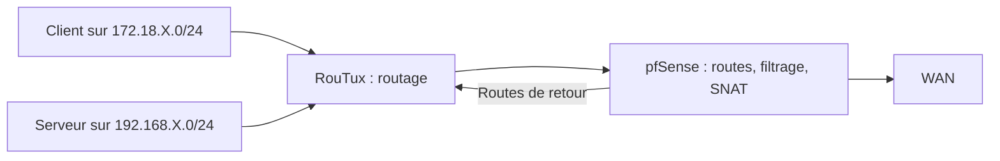

# Module 03 — Routage et traduction d’adresses

## Objectifs

- Choisir une route selon le préfixe de destination et le prochain saut.
- Configurer et vérifier le routage IPv4 de RouTux.
- Distinguer le routage, le NAT et les règles de pare-feu.
- Éprouver les chemins aller et retour depuis chaque LAN.

## Du réseau de départ au réseau de destination

Le routage relie des réseaux logiques. L’hôte A du support compare son adresse et son masque à la destination C. A est dans le LAN Brest avec `172.16.6.6/24`. C est dans le LAN Quimper avec `172.16.2.9`. A consulte sa table de routage et remet le paquet à la passerelle B si elle fournit le prochain saut adapté. Le réseau distant doit aussi disposer d’un chemin de retour.

| Étendue de la route | Exemple de destination | Usage |
|---|---|---|
| Hôte | `10.11.12.3/32` | Atteindre une adresse précise |
| Réseau | `10.56.0.0/16` | Atteindre un ensemble d’adresses |
| Défaut | `default` | Traiter les destinations sans route plus spécifique |

Le choix commence par le préfixe le plus spécifique. Une métrique et d’autres règles de routage départagent des chemins selon la configuration. Les routes connectées apparaissent lorsqu’une interface possède une adresse et un préfixe actifs.

## Lire et modifier les routes

```bash
ip route show
ip route get 192.168.10.11
ip route add 10.56.0.0/16 via 172.16.6.253
ip route del 10.56.0.0/16
```

Les deux dernières lignes reprennent le réseau de l’exemple source. Elles supposent le prochain saut accessible dans le scénario choisi. Le support montre aussi l’ajout d’une route d’hôte, le changement et la suppression de la route par défaut. Les modifications apportées avec `ip route` concernent l’état courant. Pour la persistance, utiliser la configuration réseau de la machine, puis relire la route obtenue après application.

## TP guidé — Router entre les LAN avec RouTux {#faire-de-routux-un-routeur-ipv4}

Associer ses trois cartes à VMNet4, VMNet6 et VMNet2. La correction utilise `ens33`, `ens36` et `ens37`. Vérifier les MAC avant de reprendre ces noms. Chaque carte reçoit la dernière adresse utilisable de son `/24`.

| Interface de l’exemple | Segment | Adresse RouTux |
|---|---|---|
| ens33 | Clients | `172.18.X.254/24` |
| ens36 | Serveurs | `192.168.X.254/24` |
| ens37 | Interconnexion | `172.30.X.254/24` |

Le paramètre `net.ipv4.ip_forward=1` autorise le noyau à transmettre des paquets IPv4 entre interfaces. La lecture du paramètre doit rendre `1`. La capture source affichant `0` illustre l’état désactivé. Pour le test dynamique, `sysctl -w net.ipv4.ip_forward=1` applique la valeur. Pour la persistance, le corrigé la renseigne dans `/etc/sysctl.conf` et exécute `sysctl -p`. Les règles de filtrage applicables au trafic transmis restent à vérifier. [Documentation du noyau Linux](https://www.kernel.org/doc/html/latest/networking/ip-sysctl.html).

Les postes du LAN Clients utilisent `172.18.X.254` comme passerelle. Ceux du LAN Serveurs utilisent `192.168.X.254`. Tester les adresses de RouTux depuis chaque segment, puis tester de Cli-db-10 vers les serveurs et en sens inverse. Vérifier les adresses de retour avant de modifier le NAT.

Pour la correction, relever l’interface et le prochain saut annoncés par `ip route get` des deux côtés. Après redémarrage, contrôler que les trois adresses et `net.ipv4.ip_forward=1` sont toujours présentes. Un ping vers l’interface locale de RouTux ne prouve pas encore qu’il transmet un paquet d’un LAN à l’autre.

## Traduction et filtrage

SNAT transforme l’adresse source. Le cas de sortie du laboratoire utilise l’adresse de l’interface WAN de pfSense pour les connexions dont la source se trouve dans les réseaux de la maquette. DNAT transforme l’adresse de destination, comme dans une redirection vers un service interne. La table de routage choisit le chemin et le pare-feu contrôle quels flux sont admis. La traduction intervient à une étape du traitement des paquets. Le support cite iptables, Shorewall et pfSense.

## TP guidé — Intégrer pfSense et vérifier le NAT {#integrer-pfsense-sur-linterconnexion}

Le TP ajoute temporairement `172.30.X.10/24` à Cli-db-10 sur VMNet2 pour configurer l’appliance. L’interface LAN de pfSense prend `172.30.X.1/24`. Son WAN est en pont avec une adresse du réseau amont et la passerelle correspondante. L’interface Web est atteinte depuis le segment LAN du laboratoire.

1. Créer `GW_Interco` sur LAN vers `172.30.X.254`, l’adresse de RouTux.
2. Ajouter les routes de retour vers `172.18.X.0/24` et `192.168.X.0/24` via cette passerelle.
3. Appliquer la règle LAN IPv4 demandée pour le laboratoire et relire sa source, sa destination et sa position.
4. Configurer la sortie de RouTux via `172.30.X.1` sur VMNet2.
5. Examiner les règles de NAT sortant automatiques sur WAN. Les réseaux connus par routes statiques entrent dans ce calcul.
6. Depuis DEB-S1 puis Cli-db-10, joindre l’interface LAN de pfSense, puis une adresse de test extérieure autorisée et un nom avec le DNS prévu. Relever l’interface de sortie et la règle appliquée. Désactiver la carte temporaire VMNet2 du client et répéter le contrôle depuis son LAN habituel.

Le corrigé montre plusieurs interfaces et un accès Web de dépannage. Le complément consiste à conserver la correspondance LAN/WAN et à observer la passerelle effectivement sélectionnée. Une source `any` appartient au scénario isolé. Les tests séparent route de retour, permission du flux, traduction et DNS. [Routes statiques pfSense](https://docs.netgate.com/pfsense/en/latest/routing/static.html), [NAT sortant pfSense](https://docs.netgate.com/pfsense/en/latest/nat/outbound.html).

## Schéma explicatif complémentaire



## À retenir

Le routage joint les préfixes, le pare-feu décide du passage et le NAT modifie une adresse. Tester d’abord la passerelle locale, puis le retour, la sortie et le DNS.

## Mini-quiz — 5 questions {#autoevaluation}

1. Quelle valeur permet la transmission IPv4 sur RouTux ?
2. Quel prochain saut pfSense utilise-t-il pour joindre les deux LAN ?
3. Quel champ est modifié par SNAT ?
4. Que vérifier lorsqu’un client atteint sa passerelle mais pas l’autre LAN ?
5. Pourquoi retirer la carte VMNet2 temporaire avant de refaire le dernier test ?

??? success "Réponses commentées"

    1. net.ipv4.ip_forward=1. Vérifier aussi la persistance et le filtrage du trafic transmis.
    2. 172.30.X.254, l’adresse de RouTux sur VMNet2.
    3. L’adresse source, et éventuellement le port selon la règle.
    4. La transmission sur RouTux, la route de retour du destinataire et les règles applicables.
    5. Pour prouver que le client passe par son LAN, RouTux et pfSense plutôt que joindre pfSense directement.

## Pour travailler ce module

- [Fiche de révision](../../revision/services-reseau-linux/module-03-routage-et-traduction-d-adresses.md)
- [Travaux pratiques](../../tp/services-reseau-linux/module-03/index.md)
- [Énoncés](../../tp/services-reseau-linux/module-03/enonces.md) et [corrections](../../tp/services-reseau-linux/module-03/corrections.md)
- [Kahoot existant](../../kahoot/services-reseau-linux-module-03.md)
- [Sommaire du cours](index.md)
