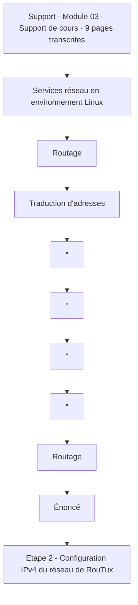
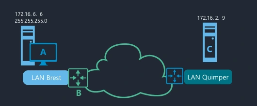
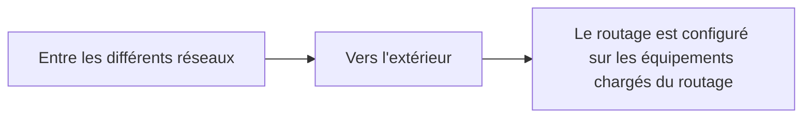
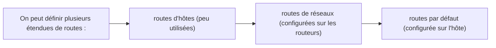
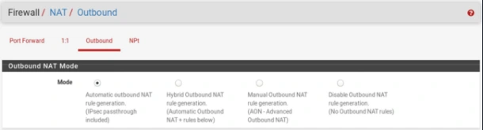
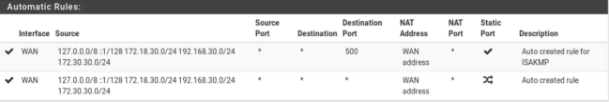

# Module 03 — Routage et traduction d’adresses

[Travaux pratiques](../../tp/services-reseau-linux/module-03/index.md)

Les parties ci-dessous reprennent le cours original, dans le même ordre. Les encadrés et les schémas répètent ses formulations.

## Parcours de lecture

1. Support · Module 03 - Support de cours · 9 pages transcrites
2. Services réseau en environnement Linux
3. Routage
4. Traduction d'adresses
5. *
6. *
7. *
8. *
9. Routage
10. Énoncé
11. Etape 2 - Configuration IPv4 du réseau de RouTux
12. Intégration d’un routeur NAT sous pfSense
13. Énoncé
14. Routage
15. Solution
16. Etape 2 - Configuration IPv4 du réseau de RouTux
17. Intégration d’un routeur NAT sous pfSense
18. Solution

**Visuel externe**



SOURCE DRIVE · TRANSCRIPTION DU SUPPORT

Le contenu des documents du dossier TSSR est transcrit ci-dessous, page par page. Les textes et tableaux sont intégrés à la page Web. Aucun fichier PDF, aucune diapositive entière ni aucune reproduction de page n’est affiché. Seuls des croquis ou visuels isolés et vérifiés peuvent accompagner la transcription. Les versions et les consignes restent celles des supports de formation. Les compléments IA sont conservés dans leur onglet distinct.

## Support · Module 03 - Support de cours · 9 pages transcrites

## Services réseau en environnement Linux

!!! note "À retenir"
    Module 03 - Routage et traduction d’adresses

Module 03 - Routage et traduction d’adresses

### Routage et traduction d’adresses

### Objectifs

!!! note "À retenir"
    Définir et mettre en place le routage Définir et mettre en place la traduction d’adresses

- Définir et mettre en place le routage
- Définir et mettre en place la traduction d’adresses

### Routage et traduction d’adresses

## Routage

### Routage

### Définition

!!! note "À retenir"
    Le routage est le processus permettant la communication entre des hôtes de réseaux logiques distincts.

- Le routage est le processus permettant la communication entre des hôtes de réseaux logiques distincts.

### Routage

### Fonctionnement

!!! note "À retenir"
    Routage de l’hôte A vers l’hôte C par la passerelle B Hôte A, 172.16.6.6 et masque 255.255.255.0, dans le LAN Brest.



Routage de l’hôte A vers l’hôte C par la passerelle B

Hôte A, 172.16.6.6 et masque 255.255.255.0, dans le LAN Brest. Passerelle B. Hôte C, 172.16.2.9, dans le LAN Quimper.

172.16. 6. 6 255.255.255.0

172.16. 2. 9

A C

LAN Brest

LAN Quimper

B

- L’hôte (A), au moyen de son adresse IP d’hôte et de son masque de réseau, détermine si l’hôte distant (C) est sur le même réseau logique que lui.
- Dans le cas contraire, il recherche dans sa propre table de routage si une route permet de joindre le réseau de destination ; il en extrait l’adresse de passerelle (B).

### Routage

### Fonctionnement

!!! note "À retenir"
    Il va falloir mettre en place l'ensemble des routes nécessaires à la communication : Entre les différents réseaux Vers l'extérieur Le routage est configuré sur les équipements chargés du routage Un équipement terminal (poste de travail, serveurs) utilise le routeur qui correspond à son réseau

**Visuel externe**



- Il va falloir mettre en place l'ensemble des routes nécessaires à la communication :
- Entre les différents réseaux
- Vers l'extérieur
- Le routage est configuré sur les équipements chargés du routage
- Un équipement terminal (poste de travail, serveurs) utilise le routeur qui correspond à son réseau

### Routage

### Les routes

!!! note "À retenir"
    On peut définir plusieurs étendues de routes : routes d'hôtes (peu utilisées) routes de réseaux (configurées sur les routeurs) routes par défaut (configurée sur l'hôte)

**Visuel externe**



- On peut définir plusieurs étendues de routes :
- routes d'hôtes (peu utilisées)
- routes de réseaux (configurées sur les routeurs)
- routes par défaut (configurée sur l'hôte)

### Routage

### Gestion dynamique

!!! note "À retenir"
    La commande ip route va permettre de gérer les routes de façon dynamique.

**Visuel externe**


- La commande ip route va permettre de gérer les routes de façon dynamique.
- Afficher les routes :

Transcription du détail du support.

```
$ ip route
default via 172.16.6.254 dev ens33 proto dhcp metric 100
172.16.6.0/24 dev ens33 proto kernel scope link src 172.16.6.6 metric 100
```

- Ajouter les 3 types de routes :

Transcription du détail du support.

```
# ip route add 10.11.12.3 via 172.16.6.123
# ip route add 10.56.0.0/16 via 172.16.6.253
# ip route add default via 172.16.6.1
```

### Routage

### Gestion dynamique

!!! note "À retenir"
    Changer une route : Transcription du détail du support.

- Changer une route :

Transcription du détail du support.

```
# ip route change default via 10.9.0.200
```

- Supprimer une route :

Transcription du détail du support.

```
# ip route del 10.56.0.0/16
```

### Routage

### Gestion statique

**Visuel externe**


- Pour conserver les routes, il faut les configurer :
- Soit via un export de la commande ip route
- Soit dans le fichier interfaces (à privilégier)

### Routage

### Activation

- Par défaut, une machine Linux ne route pas les paquets entre les réseaux. Il faut l'activer dans le fichier /etc/sysctl.conf :

Transcription du détail du support.

```
# vi /etc/sysctl.conf
net.ipv4.ip_forward=1
```

- Il faut ensuite lancer la commande :

Transcription du détail du support.

```
# sysctl -p
```

- Et vérifier (si 1 : activé, si 0 désactivé) :

Transcription du détail du support.

```
# sysctl net.ipv4.ip_forward
net.ipv4.ip_forward = 0
```

### Routage et traduction d’adresses

## Traduction d'adresses

### Traduction d’adresses

### Tables de routage

- Le routage ne fonctionne que si les réseaux sont dans les tables de routage.
- Dans les cas suivants, ce n'est pas suffisant :
- Réseaux non routables
- Réseaux privés non routables sur Internet
- Réseaux privés non connus des routeurs (pour des maquettes par exemple)

### Traduction d’adresses

### NAT

- Pour que les machines de ces réseaux puissent accéder à d'autres réseaux (sortir vers Internet), il faut mettre en place une solution de NAT, pour :
- Remplacer l'adresse IP source des paquets : NAT de Source ou SNAT
- Remplacer l'adresse IP de destination : NAT de destination ou DNAT

### Traduction d’adresses

### NAT


Traduction d’adresse source entre les réseaux non routés et routés

Le croquis montre le SNAT de l’adressage source lors de la sortie des réseaux non routés vers les réseaux routés.

*

Réseaux routés

*

Adressage source

S NAT

*

*

Réseaux non routés

### Traduction d’adresses

```
iptables
```

- Sous Linux, il est possible d'utiliser des règles d'iptables.
- Il est aussi possible d'utiliser des frameworks comme Shorewall qui vont créer les règles à partir de fichiers de définition des règles.
- Des outils comme PfSense (utilisé dans ce cours) sont des outils avancés de gestion des règles.

### Traduction d’adresses

SNAT

- Une fiche annexe est proposée pour la configuration détaillée de pfSense pour mettre en place le SNAT.


Accès au menu Firewall puis NAT dans pfSense.



Mode Outbound NAT automatique dans pfSense.



Exemples de règles Outbound NAT générées automatiquement.

Référence du document : 1MQyXuZisBhM7i8ZmSFLw1L-ljYwOeMVh · SHA-256 7747643d654e4e24…

| Services réseau en environnement Linux | Module 03 - Routage et traduction d’adresses |
| Etape 2 - Configuration IPv4 du réseau de RouTux | Nom de l interface VMNet4 LAN Clients 172.18.num_stag.0 / 24 VMNet2 172.30.num_stag.0 / 24 192.168.num_stag.0 / 24 LAN Serveurs VMNet6 Reporter les noms des cartes réseau sur le… |
| Etape 2 - Configuration IPv4 du réseau de RouTux | Nom de l interface VMNet4 LAN Clients 172.18.num_stag.0 / 24 VMNet2 172.30.num_stag.0 / 24 192.168.num_stag.0 / 24 LAN Serveurs VMNet6 Services réseau en environnement Linux Ne… |
