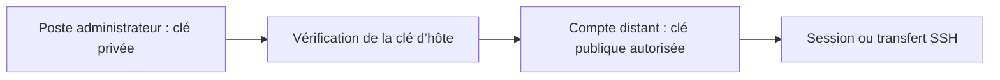

# Module 04 — Administration à distance

## Objectifs

- Installer et vérifier SSH sur les trois cibles Debian.
- Distinguer clé d’hôte, authentification du compte et phrase secrète.
- Tester l’accès par clé et comprendre la portée de la politique root.
- Récupérer les configurations de chaque serveur et vérifier les fichiers reçus.

## Ouvrir un canal d’administration

SSH chiffre les échanges entre le client et le serveur. Le client vérifie l’identité de l’hôte via sa clé. Le serveur authentifie ensuite le compte demandé. Le support utilise le client OpenSSH et cite PuTTY, mRemoteNG et MobaXterm. Le TP fait de Cli-db-10 le poste d’administration, avec Terminator pour organiser les terminaux.

Le paquet `openssh-server` fournit le service sur RouTux, DEB-S1 et DEB-S2. Le client doit pouvoir atteindre leurs adresses avant de configurer les clés. Les lignes Buster du TP appartiennent à Debian 10. Utiliser des dépôts qui correspondent à la version installée dans un laboratoire récent. [Informations Debian Buster](https://www.debian.org/releases/buster/).

```bash
dpkg -l openssh-server
systemctl status ssh.service
ssh utilisateur@192.168.10.11
```

Une clé d’hôte nouvelle ou changée demande une vérification de l’empreinte attendue. Le journal du service aide à distinguer un défaut d’authentification d’un échec réseau. Le code d’exemple utilise `X=10` et suppose un compte `utilisateur` créé sur le serveur.

## Générer et installer une clé

`ssh-keygen` produit une clé privée et une clé publique. La clé privée reste sur le poste administrateur. Le contenu public est ajouté aux clés autorisées du compte distant. Le support montre une paire RSA `id_rsa` et `id_rsa.pub` et cite des algorithmes historiques. Un choix explicite du fichier facilite le suivi quand plusieurs paires coexistent.

```bash
mkdir -p ~/.ssh
chmod 700 ~/.ssh
ssh-keygen -t ed25519 -f ~/.ssh/tssr-lab
ssh-copy-id -i ~/.ssh/tssr-lab.pub utilisateur@192.168.10.11
ssh -i ~/.ssh/tssr-lab utilisateur@192.168.10.11
```

Cet exemple complémentaire emploie Ed25519 pour un environnement compatible. Avec l’option `-i`, `ssh-copy-id` reçoit le fichier public voulu. Sans cette option, le choix dépend des clés exposées par l’agent et des fichiers disponibles. Le support généralise le choix de `id_rsa`, qui correspond à sa démonstration. Le compte distant garde ses autorisations dans `~/.ssh/authorized_keys`. Vérifier propriétaire et droits du répertoire et du fichier. [ssh-copy-id(1)](https://manpages.debian.org/trixie/openssh-client/ssh-copy-id.1.en.html).

Une phrase secrète protège la clé privée au repos. Une connexion par clé peut demander cette phrase sans demander le mot de passe du compte distant. Le support illustre une clé sans phrase secrète pour une automatisation. Pour un accès humain, conserver la protection adaptée et utiliser un agent si nécessaire.

## Politique d’accès root

Le support recommande les comptes ordinaires et présente aussi l’accès root par clé dans sa dernière démonstration. Le corrigé copie les clés autorisées d’un utilisateur vers root. L’effet dépend de la configuration du serveur, dont `PermitRootLogin`, et des droits des fichiers. Un compte d’administration ordinaire peut obtenir les privilèges nécessaires après connexion selon la délégation locale.

En complément, `PermitRootLogin prohibit-password` permet certaines méthodes comme la clé selon les autres réglages. `PermitRootLogin no` interdit la connexion root via SSH. Contrôler la configuration effective avec `sshd -T`, et la syntaxe avec `sshd -t` avant rechargement. Tester une nouvelle session en conservant une console d’administration disponible. [sshd_config(5)](https://man.openbsd.org/sshd_config).

## Copier un fichier avec scp

```bash
mkdir -p conf_deb-s1
scp utilisateur@192.168.10.11:/etc/resolv.conf conf_deb-s1/
scp exemple.conf utilisateur@192.168.10.11:/tmp/
```

Dans la première copie, la source est distante et la destination locale. Dans la seconde, le fichier local part vers le serveur. Le compte doit avoir les droits de lecture sur la source et d’écriture à la destination. Le TP récupère les fichiers de configuration réseau, DNS et APT des trois machines. Vérifier le nom du fichier et son contenu après chaque transfert. Le support cite WinSCP et MobaXterm côté Windows. Depuis OpenSSH 9.0, `scp` utilise SFTP par défaut pour le transfert. [Notes OpenSSH 9.0](https://www.openssh.org/txt/release-9.0).

## TP guidé — Sessions et copies sécurisées

1. Depuis Cli-db-10, vérifier l’accès IP aux trois serveurs. Installer **Terminator** sur le client du scénario et vérifier `openssh-server` sur RouTux, DEB-S1 et DEB-S2, avec les dépôts correspondant à leur version.
2. Relever les empreintes d’hôte attendues. Avec le compte d’administration prévu sur Cli-db-10, générer une paire de clés et transférer **la partie publique** vers le compte ordinaire de chaque serveur. Pour `X=10`, les adresses du scénario sont `172.18.10.254`, `192.168.10.11` et `192.168.10.12`.
3. Tester une nouvelle session par cible. Dans chacune, relever `hostname` et `whoami` pour prouver le serveur et le compte. Distinguer une phrase secrète locale du mot de passe du compte distant.
4. Le corrigé montre une copie de clés autorisées vers root. Vérifier la politique serveur avant un essai de ce cas historique. Conserver une console de secours et vérifier un accès ordinaire autorisé avant de recharger SSH.
5. Créer un dossier de réception par machine. Copier les fichiers réseau, DNS et APT demandés depuis chacune, avec les droits du compte prévu. Vérifier chemins et contenu à l’arrivée. Si un fichier exige des droits supplémentaires, employer le chemin de copie autorisé par le laboratoire.

## Schéma explicatif complémentaire



## À retenir

La clé privée reste sur le client. La clé publique va dans le compte distant. Tester l’identité du serveur, la connexion et les permissions avant de conclure qu’une copie a réussi.

## Mini-quiz — 5 questions {#autoevaluation}

1. Quel fichier passe sur le serveur avec ssh-copy-id -i ?
2. Pourquoi une phrase secrète peut-elle encore être demandée ?
3. Dans scp hote:/etc/resolv.conf ., où se trouve la source ?
4. Que faut-il vérifier si l’empreinte de l’hôte a changé ?
5. Pourquoi créer un dossier de réception par serveur ?

??? success "Réponses commentées"

    1. La clé publique désignée. La clé privée reste sur Cli-db-10.
    2. Elle protège la clé privée sur le poste local et joue un autre rôle que le mot de passe du compte distant.
    3. Sur l’hôte distant. Le point indique la destination locale.
    4. L’identité et l’empreinte attendues par un canal de confiance avant d’accepter la nouvelle clé.
    5. Plusieurs serveurs ont des fichiers de même nom. Les séparer conserve leur provenance et évite l’écrasement.

## Pour travailler ce module

- [Fiche de révision](../../revision/services-reseau-linux/module-04-administration-a-distance.md)
- [Travaux pratiques](../../tp/services-reseau-linux/module-04/index.md)
- [Énoncés](../../tp/services-reseau-linux/module-04/enonces.md) et [corrections](../../tp/services-reseau-linux/module-04/corrections.md)
- [Kahoot existant](../../kahoot/services-reseau-linux-module-04.md)
- [Sommaire du cours](index.md)
