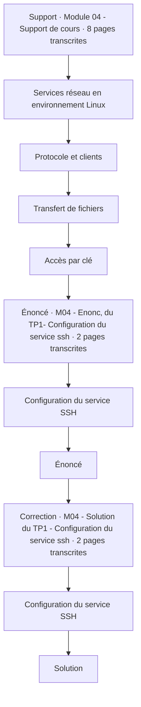
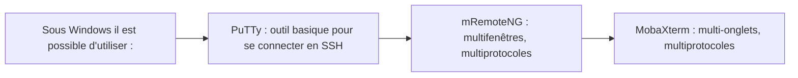
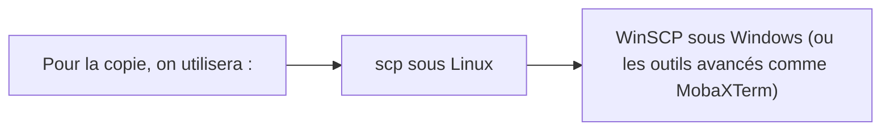
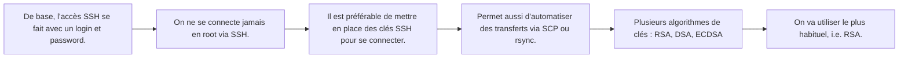
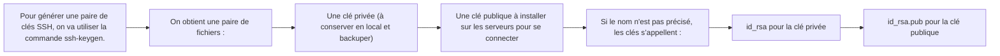
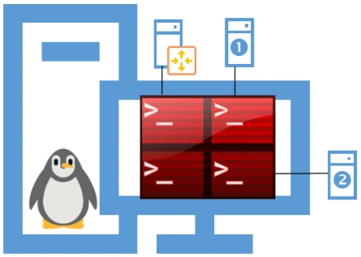

# Module 04 — Administration à distance

Les parties ci-dessous reprennent le cours original, dans le même ordre. Les encadrés et les schémas répètent ses formulations.

## Parcours de lecture

1. Support · Module 04 - Support de cours · 8 pages transcrites
2. Services réseau en environnement Linux
3. Protocole et clients
4. Transfert de fichiers
5. Accès par clé
6. Énoncé · M04 - Enonc‚ du TP1- Configuration du service ssh · 2 pages transcrites
7. Configuration du service SSH
8. Énoncé
9. Correction · M04 - Solution du TP1 - Configuration du service ssh · 2 pages transcrites
10. Configuration du service SSH
11. Solution

**Visuel externe**



SOURCE DRIVE · TRANSCRIPTION DU SUPPORT

Le contenu des documents du dossier TSSR est transcrit ci-dessous, page par page. Les textes et tableaux sont intégrés à la page Web. Aucun fichier PDF, aucune diapositive entière ni aucune reproduction de page n’est affiché. Seuls des croquis ou visuels isolés et vérifiés peuvent accompagner la transcription. Les versions et les consignes restent celles des supports de formation. Les compléments IA sont conservés dans leur onglet distinct.

## Support · Module 04 - Support de cours · 8 pages transcrites

!!! note "À retenir"
    Les noms et chemins de formation portant le nom de l’éditeur ont été neutralisés.

Les noms et chemins de formation portant le nom de l’éditeur ont été neutralisés. Les adresses numériques et les consignes restent celles de la source.

## Services réseau en environnement Linux

Module 04 - Administration à distance

### Administration à distance

### Objectifs

!!! note "À retenir"
    Mettre en place les accès SSH aux serveurs

- Mettre en place les accès SSH aux serveurs

### Administration à distance

## Protocole et clients

### Protocole et clients

### Les outils

!!! note "À retenir"
    Pour administrer un serveur Linux, on va s'y connecter à distance via un protocole sécurisé : SSH C'est un protocole normalisé et sécurisé permettant de chiffrer les communications entre le client et le serveur Support réseau SSH SSH SSH SSH SSH SSH SSH SSH SSH SSH SSH Client Serveur Protocole utilisé

- Pour administrer un serveur Linux, on va s'y connecter à distance via un protocole sécurisé : SSH
- C'est un protocole normalisé et sécurisé permettant de chiffrer les communications entre le client et le serveur

Support réseau

SSH SSH SSH SSH SSH SSH SSH SSH SSH SSH SSH

Client

Serveur

Protocole utilisé

### Protocole et client

### Côté client

!!! note "À retenir"
    Sous Linux et macOS, le client sera le client openssh-client fourni avec la commande ssh, utilisable aussi sous Windows Server 2019 maintenant.

**Visuel externe**



- Sous Linux et macOS, le client sera le client openssh-client fourni avec la commande ssh, utilisable aussi sous Windows Server 2019 maintenant.
- Sous Windows il est possible d'utiliser :
- PuTTy : outil basique pour se connecter en SSH

https://www.chiark.greenend.org.uk/~sgtatham/putty

- mRemoteNG : multifenêtres, multiprotocoles

https://mremoteng.org/ - https://mremoteng.readthedocs.io/

- MobaXterm : multi-onglets, multiprotocoles

https://mobaxterm.mobatek.net/

### Administration à distance

## Transfert de fichiers

### Transfert de fichiers

### Commande scp

!!! note "À retenir"
    Il est possible de transférer des fichiers de façon sécurisée grâce au protocole SSH avec la commande scp.

**Visuel externe**



- Il est possible de transférer des fichiers de façon sécurisée grâce au protocole SSH avec la commande scp.

Transcription du détail du support.

```
SSH + CP = SCP
```

- Pour la copie, on utilisera :
- scp sous Linux
- WinSCP sous Windows (ou les outils avancés comme MobaXTerm)

### Transfert de fichiers

### La commande scp

!!! note "À retenir"
    La commande fonctionne dans les deux sens, soit on transfère un fichier du client vers le serveur soit du serveur vers le client.

!!! example "Exemple"
    Exemple de copie d'un fichier d'un serveur vers le local : # scp user@ip:/etc/exemple.conf /tmp /etc/exemple.conf Réseau SSH SSH SSH SSH SSH SSH SSH SSH SSH SSH SSH Client SSH Serveur SSH /tmp

- La commande fonctionne dans les deux sens, soit on transfère un fichier du client vers le serveur soit du serveur vers le client.
- Exemple de copie d'un fichier d'un serveur vers le local : # scp user@ip:/etc/exemple.conf /tmp

/etc/exemple.conf

Réseau

SSH SSH SSH SSH SSH SSH SSH SSH SSH SSH SSH

Client SSH Serveur SSH

/tmp

### Administration à distance

## Accès par clé

### Accès par clé

### Clés SSH

!!! note "À retenir"
    De base, l'accès SSH se fait avec un login et password.

**Visuel externe**



- De base, l'accès SSH se fait avec un login et password.
- On ne se connecte jamais en root via SSH.
- Il est préférable de mettre en place des clés SSH pour se connecter.
- Permet aussi d'automatiser des transferts via SCP ou rsync.
- Plusieurs algorithmes de clés : RSA, DSA, ECDSA
- On va utiliser le plus habituel, i.e. RSA.

### Accès par clé

### Génération de la clé

**Visuel externe**



- Pour générer une paire de clés SSH, on va utiliser la commande ssh-keygen.
- On obtient une paire de fichiers :
- Une clé privée (à conserver en local et backuper)
- Une clé publique à installer sur les serveurs pour se connecter
- Si le nom n'est pas précisé, les clés s’appellent :
- id_rsa pour la clé privée
- id_rsa.pub pour la clé publique

### Accès par clé

### Génération de la clé

Transcription du détail du support.

```
fred@cli-debian:~$ ssh-keygen
Generating public/private rsa key pair.
Enter file in which to save the key (/home/fred/.ssh/id_rsa):
Enter passphrase (empty for no passphrase):
Enter same passphrase again:
Your identification has been saved in /home/fred/.ssh/id_rsa.
Your public key has been saved in /home/fred/.ssh/id_rsa.pub.
The key fingerprint is:
SHA256:HZrJ3cZaWa4nrrwHqve4oLVVUgfxcPauRZyBbAA8ip8 fred@cli-debian
The key’s randomart image is shown for an RSA 2048-bit key.
```

### Accès par clé

### Génération de la clé

- Suivant le contexte, on mettra ou pas une passphrase :
- Accès sécurisé sur un serveur : passphrase
- Synchronisation de données entre deux machines : pas de passphrase

### Accès par clé

### Copie de la clé

- Une fois la clé générée, on va la copier sur la machine distante.
- On utilise la commande ssh-copy-id.

Transcription du détail du support.

```
fred@cli-debian:~$ ssh-copy-id admin@192.168.6.66
/usr/bin/ssh-copy-id: INFO: Source of key(s) to be installed: "/home/admin/.ssh/id_rsa.pub"
/usr/bin/ssh-copy-id: INFO: attempting to log in with the new key(s), to filter out any that are already installed
/usr/bin/ssh-copy-id: INFO: 1 key(s) remain to be installed -- if you are prompted now it is to install the new keys
fred@192.168.6.66's password:

Number of key(s) added: 1

Now try logging into the machine, with: "ssh 'admin@192.168.6.66'"
and check to make sure that only the key(s) you wanted were added.
```

### Accès par clé

### Copie de la clé

- Par défaut, elle copie la clé id_rsa, si besoin préciser le nom de la clé à copier
- Elle génère le fichier authorized_keys sur le serveur
- Dans le répertoire $HOME/.ssh

### Accès par clé

### Clé pour root

- Il n'est pas autorisé de se connecter en root via un login / pass
- Par contre, c'est possible avec une clé SSH
- Pour sa mise en place :

Transcription du détail du support.

```
root@srv-debian:~# mkdir /root/.ssh
root@srv-debian:~# chmod 700 /root/.ssh
root@srv-debian:~# cp /home/admin/.ssh/authorized_keys /root/.ssh/
```

Référence du document : 1Dn8otCfssD-wTKjFRq7274ZvWMMI_KAB · SHA-256 bcbd1729184530a0…

## Énoncé · M04 - Enonc‚ du TP1- Configuration du service ssh · 2 pages transcrites

Le nom du fichier Drive présente une anomalie historique d’encodage. Son nom est conservé ; le titre interne est transcrit dans le document. Les noms et chemins de formation portant le nom de l’éditeur ont été neutralisés. Les adresses numériques et les consignes restent celles de la source.

## Configuration du service SSH

### TP 01 du Module 04 – Administration à distance

Avant de démarrer ce TP, il convient d’avoir suivi les vidéos des modules 1 à 4 et d’avoir réalisé les TP proposés.

Durée estimée

1 heure

## Énoncé

### Objectifs

- Installer et configurer le service SSH

### Prérequis

- Les ateliers précédents doivent être fonctionnels

### Notes

- Pour toutes les configurations réseau, vous remplacerez num_stag par un chiffre entre 1 et 30, par exemple 10.

### Etape 1 - Installation du serveur SSH sur TOUS les serveurs Debian

- Configurer le fichier sources.list de tous vos serveurs afin qu’ils ne contiennent que les lignes suivantes :

```
deb http://ftp.fr.debian.org/debian/ buster main
deb http://security.debian.org/debian-security buster/updates main
deb http://ftp.fr.debian.org/debian/ buster-updates main
```

- Mettre à jour le gestionnaire de dépendances
- Vérifier l’état d’installation du paquet openssh-server, l’installer au besoin.

### Etape 2 - Configuration du service SSH

- Installer Terminator sur la machine Cli-db-10 ; vous utiliserez cette machine pour centraliser l’administration de vos serveurs GNU/Linux.



Poste Linux utilisé pour centraliser l’accès aux serveurs du laboratoire.

- Configurer le service SSH pour permettre la connexion à vos différents serveurs sans avoir à saisir de mot de passe (échange de clés).
- Vous allez devoir vous connecter depuis la machine Cli-db-10 sur les serveurs : RouTux, Deb-S1, Deb-S2.

### Etape 3 - Utilisation des commandes de copie sécurisée

- Sur la machine Cli-db-10, utiliser la commande scp pour copier les fichiers de configuration paramétrés sur chacune des machines Debian (interfaces, resolv.conf, sources.list…).

Référence du document : 1Zs40kPBB9hVOO2m-tubv3SpuMGSrrMEa · SHA-256 2fb77fc967dabe2b…

## Correction · M04 - Solution du TP1 - Configuration du service ssh · 2 pages transcrites

Les noms et chemins de formation portant le nom de l’éditeur ont été neutralisés. Les adresses numériques et les consignes restent celles de la source.

Correction originale : à consulter après avoir tenté l’exercice.

## Configuration du service SSH

### TP 01 du Module 04 – Administration à distance

Avant de démarrer ce TP, il convient d’avoir suivi les vidéos des modules 1 à 4 et d’avoir réalisé les TP proposés.

Durée estimée

1 heure

## Solution

### Etape 1 - Installation du serveur SSH sur TOUS les serveurs Debian

- Modifier le fichier sources.list sur chaque machine et y ajouter les données demandées : # vi /etc/apt/sources.list

```
deb http://ftp.fr.debian.org/debian/ buster main
```

```
deb http://security.debian.org/debian-security buster/updates main
```

```
deb http://ftp.fr.debian.org/debian/ buster-updates main
```

Mettre à jour le gestionnaire :

```
# apt update
```

Vérifier la présence d’openssh-server :

```
# apt install openssh-server
```

ou

```
# dpkg -l |grep openssh-server
```

### Etape 2 - Configuration du service SSH

- Installer Terminator sur la machine Cli-db-10 : # apt install terminator

Créer la clé SSH :

Sur cli-db-10

```
# ssh-keygen
```

=> sans phrase de passe

Envoyer la clé SSH sur les serveurs :

```
# ssh-copy-id  user@192.168.X.11
```

```
# ssh user@192.168.X.11
```

=> connexion sans mot de passe avec le compte utilisateur standard

Sur deb-s1

```
 $ su -
```

```
 # mkdir .ssh
```

```
 # chmod 700 .ssh
```

```
 # cp  /home/user/.ssh/authorized _keys /root/.ssh
```

= > connexion sans mot de passe avec root

### A réaliser également sur deb-s2 et routux

### Etape 3 - Utilisation des commandes de copie sécurisée

- Recopier les fichiers en local, par exemple ici avec le fichier /etc/resolv.conf :

```
$ mkdir conf_deb-s1
```

```
$ scp  root@192.168.X.11:/etc/resolv.conf conf_deb-s1
```

Référence du document : 1Q4bxGyPu9nc9S_OIkQyoacBFsQUjR4iV · SHA-256 3e49ebce5a1945fc…

## Fiche de synthèse

Les lignes reprennent les titres du cours et la première phrase de chaque partie.

| Partie | Repère du cours |
| --- | --- |
| Support · Module 04 - Support de cours · 8 pages transcrites | Les noms et chemins de formation portant le nom de l’éditeur ont été neutralisés. |
| Énoncé · M04 - Enonc‚ du TP1- Configuration du service ssh · 2 pages transcrites | Le nom du fichier Drive présente une anomalie historique d’encodage. |
| Correction · M04 - Solution du TP1 - Configuration du service ssh · 2 pages transcrites | Les noms et chemins de formation portant le nom de l’éditeur ont été neutralisés. |
