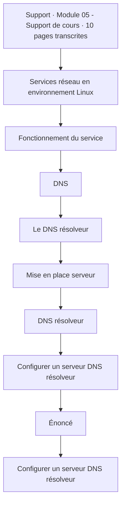
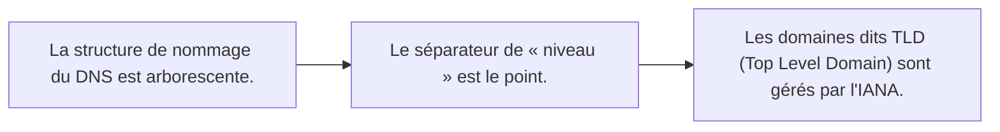

# Module 05 — DNS résolveur

[Travaux pratiques](../../tp/services-reseau-linux/module-05/index.md)

Les parties ci-dessous reprennent le cours original, dans le même ordre. Les encadrés et les schémas répètent ses formulations.

## Parcours de lecture

1. Support · Module 05 - Support de cours · 10 pages transcrites
2. Services réseau en environnement Linux
3. Fonctionnement du service
4. DNS
5. Le DNS résolveur
6. Mise en place serveur
7. DNS résolveur
8. Configurer un serveur DNS résolveur
9. Énoncé
10. Configurer un serveur DNS résolveur
11. Solution

**Visuel externe**



SOURCE DRIVE · TRANSCRIPTION DU SUPPORT

Le contenu des documents du dossier TSSR est transcrit ci-dessous, page par page. Les textes et tableaux sont intégrés à la page Web. Aucun fichier PDF, aucune diapositive entière ni aucune reproduction de page n’est affiché. Seuls des croquis ou visuels isolés et vérifiés peuvent accompagner la transcription. Les versions et les consignes restent celles des supports de formation. Les compléments IA sont conservés dans leur onglet distinct.

## Support · Module 05 - Support de cours · 10 pages transcrites

## Services réseau en environnement Linux

Module 05 – DNS Résolveur

### DNS Partie 1

### Objectifs

!!! note "À retenir"
    Comprendre le fonctionnement du service DNS Mettre en place un serveur DNS résolveur

- Comprendre le fonctionnement du service DNS
- Mettre en place un serveur DNS résolveur

### DNS Partie 1

## Fonctionnement du service

## DNS

### Fonctionnement du service DNS

### Fonctionnement DNS

!!! note "À retenir"
    Le service DNS va, entre autres, permettre : De faire la correspondance entre un FQDN et une adresse IP Et inversement, d'indiquer le nom d'hôte à partir d'une IP De connaître les serveurs de messagerie d'un domaine Service essentiel au fonctionnement d'Internet Protocole standardisé par l'IETF

**Visuel externe**


- Le service DNS va, entre autres, permettre :
- De faire la correspondance entre un FQDN et une adresse IP
- Et inversement, d'indiquer le nom d'hôte à partir d'une IP
- De connaître les serveurs de messagerie d'un domaine
- Service essentiel au fonctionnement d'Internet
- Protocole standardisé par l'IETF

### Fonctionnement du service DNS

### Fonctionnement DNS

!!! note "À retenir"
    Toute machine (client, serveur, mobile, etc.) va constamment faire des requêtes sur le serveur DNS associé pour obtenir des IP.

!!! example "Exemple"
    Requête DNS et réponse IPv4 de l’exemple source L’exemple du support demande l’adresse de www.baidu.com.

Toute machine (client, serveur, mobile, etc.) va constamment faire des requêtes sur le serveur DNS associé pour obtenir des IP.


Requête DNS et réponse IPv4 de l’exemple source

L’exemple du support demande l’adresse de www.baidu.com. Le serveur répond 103.235.46.39.

@IP de www.baidu.com . ?

@IP de www.baidu.com .

= 103.235.46.39

### Fonctionnement du service DNS

### Fonctionnement DNS

!!! note "À retenir"
    La structure de nommage du DNS est arborescente.

**Visuel externe**



- La structure de nommage du DNS est arborescente.
- Une URL va se lire de la droite vers la gauche pour descendre l'arborescence DNS.
- Le séparateur de « niveau » est le point.
- Les domaines dits TLD (Top Level Domain) sont gérés par l'IANA.

### Fonctionnement du service DNS

#### Nom d’hôte pleinement qualifié

!!! note "À retenir"
    Le schéma affiche `https://www.indiatimes.com.`.

Le schéma affiche `https://www.indiatimes.com.`. Les repères (1), (2) et (3) identifient les points expliqués dans le tableau.

| Élément | Signification |
| --- | --- |
| . (1) | Le point par lequel se termine tout nom de domaine représente la racine de l’espace de nom DNS. |
| com. | Nom de domaine, sous-domaine du domaine racine |
| . (2) | Point / caractère de séparation entre domaines |
| indiatimes.com. | Nom de domaine, sous-domaine du domaine « com. » |
| . (3) | Point / caractère de séparation entre le nom du domaine et le nom d’un hôte de ce domaine |
| www.indiatimes.com. | Nom d’hôte pleinement qualifié |

#### Noms de domaine internes et publics

!!! note "À retenir"
    Le protocole DNS peut aussi être utilisé pour des domaines non résolvables sur Internet pour des réseaux internes.

- Le protocole DNS peut aussi être utilisé pour des domaines non résolvables sur Internet pour des réseaux internes.
- On utilise alors des suffixes non publics.

| Domaine | Utilité |
| --- | --- |
| masuperentreprise.bzh | Nom de domaine utilisé pour référencer les services de mon entreprise accessibles depuis l’Internet |
| enigmes.corp | Nom de domaine propre à mon entreprise dans lequel sont référencées les ressources hébergées et accessibles uniquement localement dans l’entreprise |

### Fonctionnement du service DNS

### Fonctionnement DNS

!!! note "À retenir"
    On distingue deux « types » de résolution DNS : Résoudre les requêtes clientes relatives à tout domaine => résolveur DNS complet Être source d'information pour un ou plusieurs domaines ciblés => DNS faisant autorité

- On distingue deux « types » de résolution DNS :
- Résoudre les requêtes clientes relatives à tout domaine => résolveur DNS complet
- Être source d'information pour un ou plusieurs domaines ciblés => DNS faisant autorité

### DNS Partie 1

## Le DNS résolveur

### Le DNS résolveur

### Rôle

**Visuel externe**


- Un serveur DNS résolveur complet doit répondre aux requêtes des clients.
- Pour y répondre, il doit faire appel à d'autres serveurs DNS.
- Il n'est pas source d'information de domaines.


Interrogations du résolveur vers les autres serveurs DNS

1. Le client adresse sa requête au résolveur. 2. Le résolveur interroge les autres serveurs DNS.

1 2

### Le DNS résolveur

### Fonctionnement

**Visuel externe**


- Un serveur DNS résolveur complet interroge avec des requêtes itératives :
- Les serveurs DNS racines
- Les serveurs DNS faisant autorité sur les TLD
- Les serveurs DNS faisant autorité sur le domaine
- Il peut utiliser un serveur DNS « redirecteur » (forwarder) pour limiter les requêtes qu'il va faire.

### Le DNS résolveur

### Fonctionnement

- On parle de redirecteur inconditionnel quand un serveur DNS lui adresse des requêtes récursives pour résoudre TOUTES les requêtes des clients.
- On parle de redirecteur conditionnel pour indiquer pour un espace de nom donné le serveur à qui adresser la requête récursive de résolution.
- Les deux peuvent être complémentaires.

### Le DNS résolveur

### Fonctionnement

- Les serveurs DNS gardent les réponses des requêtes en cache.
- La durée de conservation en cache est définie par les serveurs faisant autorité sur l'enregistrement.

### DNS Partie 1

## Mise en place serveur

## DNS résolveur

### Mise en place serveur DNS résolveur

### Mise en place

- Le serveur DNS utilisé est bind9

| Nom du paquet | bind9 |
| --- | --- |
| Fichier de configuration | /etc/bind/named.conf (découpé en plusieurs fichiers inclus) |
| Nom du service | bind9 |
| Commandes | named-checkconf named-checkzone rndc |
| Fichier journal | /var/log/syslog |

### Mise en place serveur DNS résolveur

### Mise en place

- Le fichier de configuration inclut d'autres fichiers :

### /etc/bind/named.conf

| Instruction | Rôle |
| --- | --- |
| include /etc/bind/named.conf.options ; | Configuration des options |
| include /etc/bind/named.conf.local ; | Configuration des zones hébergées localement |
| include /etc/bind/named.conf.default-zones ; | Configuration des zones par défaut |

### Mise en place serveur DNS résolveur

### DNS résolveur

- Fichier /etc/bind/named.conf
- définition d’ACLs et des includes

Transcription du détail du support.

```
// rsxclts = réseaux des postes clients de l’entreprise
acl rsxclts { 127.0.0.0/8; 192.168.53.0/24; 192.168.1.0/24; };

include /etc/bind/named.conf.options ;
include /etc/bind/named.conf.local;
include /etc/bind/named.conf.default-zones ;
```

### Mise en place serveur DNS résolveur

### DNS résolveur

- Fichier /etc/bind/named.conf.options

Transcription du détail du support.

```
options {
    // Répertoire de travail de Bind9
    directory "/var/cache/bind";

    // Redirection exclusive (pas d’appel aux racines en cas d’indisponibilité)
    // vers les serveurs quad9
    forward only;
    forwarders { 9.9.9.9; };

    // Restriction des hôtes auxquels répond le serveur
    allow-query { rsxclts; };

    // Restriction des hôtes autorisés à adresser des requêtes récursives
    allow-recursion { rsxclts; };

    // Communication DNSSEC désactivée
    dnssec-enable no;
    dnssec-validation no;

    // Information de version non communiquée
    version none;
};
```

### Mise en place serveur DNS résolveur

### DNS résolveur

- Fichier /etc/bind/named.conf.default-zones
- Définit les zones par défaut
- Définit les adresses des serveurs racines
- Aucun changement à appliquer
- Fichier /etc/bind/named.conf.local sera vu dans la seconde partie sur le DNS

Référence du document : 1FH2JveLw64dsNm5dgFXqMSiz7DAdCg9P · SHA-256 e323a04269a38662…
