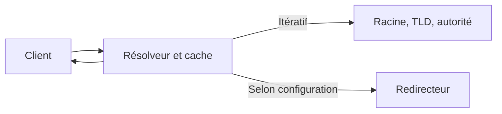

# Module 05 — DNS résolveur

Le cours optimisé reprend la leçon et ses manipulations. Les précisions et exemples complémentaires sont indiqués dans le texte. L’onglet Original donne accès aux transcriptions des supports.

## Les noms et les réponses DNS

DNS permet de trouver les adresses d’un hôte, le nom associé à une adresse quand une zone inverse le publie, ou les serveurs de messagerie d’un domaine. Un FQDN, *Fully Qualified Domain Name*, décrit la position complète d’un nom dans l’arborescence DNS. Le point final représente la racine. En lisant `www.indiatimes.com.` depuis la racine, on passe par `com.`, puis `indiatimes.com.`, puis l’hôte `www`.

Le support place un schéma `https://` devant son exemple. La hiérarchie DNS porte sur la partie **nom d’hôte** de l’URL. Le schéma, le port et le chemin appartiennent à d’autres éléments de l’URL. Les TLD se trouvent sous la racine. Les zones publiques et privées suivent la même organisation en labels. Le support illustre une zone interne et une zone publiée sur Internet avec deux noms distincts.

## Autorité, résolution et cache

| Rôle | Travail effectué |
|---|---|
| Client | Demande une réponse au résolveur configuré |
| Résolveur récursif | Recherche la réponse et peut la garder en cache |
| Serveur faisant autorité | Publie les données de sa zone |
| Redirecteur | Effectue la résolution des requêtes transmises par le résolveur |

Dans le parcours itératif illustré par le support, le résolveur contacte une racine. Elle lui indique les serveurs du TLD. Ces serveurs le dirigent vers l’autorité du domaine. Les délégations orientent la recherche jusqu’à l’autorité pertinente. Un cache déjà renseigné réduit les interrogations. Le TTL limite la durée pendant laquelle une réponse peut être réutilisée.

Le support présente deux formes de redirection. La redirection générale traite les recherches non couvertes localement. La redirection conditionnelle cible un espace de noms, par exemple une zone d’un partenaire. Les deux peuvent coexister. Avec BIND, `forward only` réserve les recherches transférées aux redirecteurs configurés. Avec `forward first`, BIND peut poursuivre selon son propre mécanisme si les redirecteurs échouent. [Référence BIND 9](https://bind9.readthedocs.io/en/latest/reference.html).

## Préparer le résolveur BIND de DEB-S2

| Élément | Rôle dans la distribution du TP |
|---|---|
| `bind9` | Paquet et nom de service du support |
| `/etc/bind/named.conf` | Point d’entrée et inclusions |
| `/etc/bind/named.conf.options` | Options du serveur et redirecteurs |
| `/etc/bind/named.conf.local` | Déclarations de zones locales étudiées au module 7 |
| `/etc/bind/named.conf.default-zones` | Zones fournies par défaut et configuration de la racine selon le paquet |
| `named-checkconf`, `named-checkzone`, `rndc` | Contrôles et administration de BIND |

Le chemin historique `/var/log/syslog` dépend du service de journalisation installé. `systemctl status` et `journalctl -u` permettent d’identifier l’unité et ses messages sur la machine réelle. Le TP installe `dnsutils` sur le client pour employer `dig`.

Le scénario limite la récursion aux LAN Clients et Serveurs. Dans le bloc `options` existant, déclarer la politique de récursion, puis indiquer les réseaux admis. L’exemple complémentaire prend `X=10` et conserve la validation DNSSEC. Dans un fichier inclus, placer l’ACL au niveau global, puis les options dans le bloc `options` existant.

```text
acl lab_clients {
    127.0.0.1;
    172.18.10.0/24;
    192.168.10.0/24;
};

options {
    directory "/var/cache/bind";
    recursion yes;
    allow-query { lab_clients; };
    allow-recursion { lab_clients; };
    dnssec-validation auto;
};
```

!!! info "Correction de contexte"
    La solution historique place des directives de récursion et de validation dans `named.conf.local`. Elles s’insèrent dans le bloc de configuration prévu par BIND, généralement `options` pour la politique du serveur de ce TP. Le support demande aussi de désactiver DNSSEC pour son laboratoire. La validation DNSSEC contrôle l’authenticité et l’intégrité des données signées. BIND 9.18 rejette l’option `dnssec-enable` des captures. Conserver la validation dans le scénario courant et examiner la version utilisée. [Référence BIND 9](https://bind9.readthedocs.io/en/latest/reference.html), [Notes de version BIND 9.18](https://bind9.readthedocs.io/en/v9.18.0/notes.html).

## Vérifier la résolution avant et après redirection

1. Valider la configuration avec `named-checkconf`, puis appliquer la modification avec `rndc reload` ou le mécanisme de l’unité installée.
2. Diriger Cli-db-10, DEB-S1, DEB-S2 et RouTux vers `192.168.X.12` avec leur gestionnaire réseau respectif.
3. Interroger explicitement le résolveur, puis effectuer la même recherche en utilisant le DNS configuré sur le poste.
4. Renseigner les redirecteurs voulus dans `options`, valider et recharger. Le corrigé propose `rndc flush` pour vider son cache avant comparaison.

```bash
dig @192.168.10.12 www.isc.org A
dig @192.168.10.12 www.yahoo.fr A
dig www.isc.org A
```

Comparer le code de réponse, le serveur interrogé, les enregistrements et leur TTL. Les IP publiques relevées dans la source correspondent à ses observations. Pour établir le mécanisme emprunté par BIND, rapprocher la configuration et les traces réseau ou journaux des recherches. Un résultat identique côté client peut provenir du cache, d’un redirecteur ou du chemin itératif. La commande `dig +trace` lance une recherche itérative depuis son propre poste.

Exemple de redirection du laboratoire à ajouter au bloc `options` après le test itératif.

```text
forward only;
forwarders { 9.9.9.9; };
```

## Schéma explicatif complémentaire



## Autoévaluation

1. À quoi sert le point final d’un FQDN ?
2. Quelle règle limite les clients autorisés à demander la récursion ?
3. Quel mécanisme de sortie utilise `forward only` ?

??? success "Réponses"
    1. Il représente la racine et marque le nom absolu.
    2. `allow-recursion` avec l’ACL voulue.
    3. Les redirecteurs configurés pour les recherches transférées.

## Pour travailler ce module

- [Fiche de révision](../../revision/services-reseau-linux/module-05-dns-resolveur.md)
- [Travaux pratiques](../../tp/services-reseau-linux/module-05/index.md)
- [Sommaire du cours](index.md)
