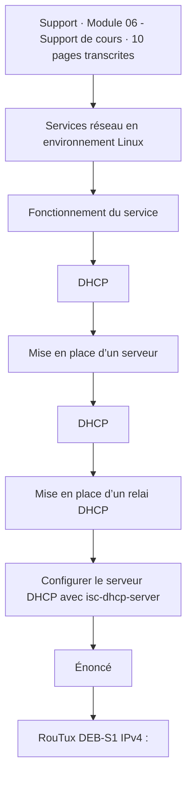
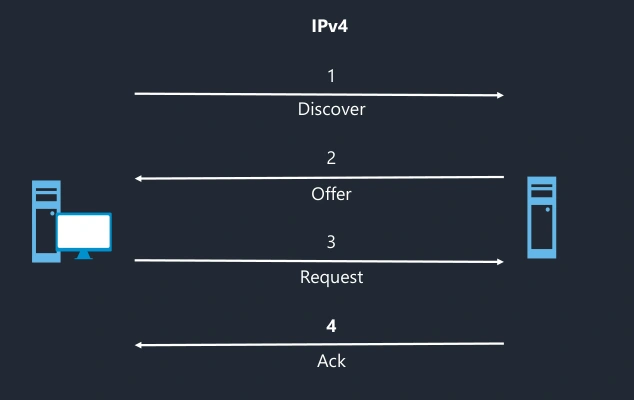
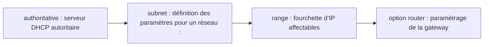

# Module 06 — Le DHCP

[Travaux pratiques](../../tp/services-reseau-linux/module-06/index.md)

Les parties ci-dessous reprennent le cours original, dans le même ordre. Les encadrés et les schémas répètent ses formulations.

## Parcours de lecture

1. Support · Module 06 - Support de cours · 10 pages transcrites
2. Services réseau en environnement Linux
3. Fonctionnement du service
4. DHCP
5. Mise en place d’un serveur
6. DHCP
7. Mise en place d’un relai DHCP
8. Configurer le serveur DHCP avec isc-dhcp-server
9. Énoncé
10. RouTux DEB-S1 IPv4 :
11. Configurer le serveur DHCP avec isc-dhcp-server
12. Solution
13. RouTux DEB-S1 IPv4 :

**Visuel externe**



SOURCE DRIVE · TRANSCRIPTION DU SUPPORT

Le contenu des documents du dossier TSSR est transcrit ci-dessous, page par page. Les textes et tableaux sont intégrés à la page Web. Aucun fichier PDF, aucune diapositive entière ni aucune reproduction de page n’est affiché. Seuls des croquis ou visuels isolés et vérifiés peuvent accompagner la transcription. Les versions et les consignes restent celles des supports de formation. Les compléments IA sont conservés dans leur onglet distinct.

## Support · Module 06 - Support de cours · 10 pages transcrites

!!! note "À retenir"
    Les noms et chemins de formation portant le nom de l’éditeur ont été neutralisés.

Les noms et chemins de formation portant le nom de l’éditeur ont été neutralisés. Les adresses numériques et les consignes restent celles de la source.

## Services réseau en environnement Linux

Module 06 - Le DHCP

### Le DHCP

### Objectifs

!!! note "À retenir"
    Comprendre le fonctionnement du service DHCP Mise en place d'un service DHCP Mise en place d'un relai DHCP

**Visuel externe**


- Comprendre le fonctionnement du service DHCP
- Mise en place d'un service DHCP
- Mise en place d'un relai DHCP

### Le DHCP

## Fonctionnement du service

## DHCP

### Fonctionnement du service DHCP

### Fonctionnement DHCP

!!! note "À retenir"
    Le DHCP permet de fournir des configurations IP aux équipements qui l'utilisent Normalisé par une série de RFC Centralise la configuration de l'adresse IP Optimisation de l'utilisation des plages IP Propage les mises à jour de configuration

**Visuel externe**


- Le DHCP permet de fournir des configurations IP aux équipements qui l'utilisent
- Normalisé par une série de RFC
- Centralise la configuration de l'adresse IP
- Optimisation de l'utilisation des plages IP
- Propage les mises à jour de configuration

### Fonctionnement du service DHCP

#### Les requêtes DHCP (en IPv4)



Séquence DHCPv4 Discover, Offer, Request, Ack

1. DHCP DISCOVER : le client broadcast sur le réseau pour demander une configuration IP
2. DHCP OFFER : le serveur DHCP fait une proposition de configuration (toujours en broadcast)
3. DHCP REQUEST : le client accepte l'offre
4. DHCP ACK : le serveur prend acte de l'acceptation et envoi le bail DHCP

### Fonctionnement du service DHCP

### Les serveurs DHCP

!!! note "À retenir"
    Pour mettre en place un service DHCP on a les serveurs suivants : isc-dhcp-server : + service répondu + facile à mettre en œuvre - n'évolue plus kea : + nouveau produit - moins utilisé - plus compliqué à configurer

**Visuel externe**


- Pour mettre en place un service DHCP on a les serveurs suivants :
- isc-dhcp-server :
- + service répondu
- + facile à mettre en œuvre
- - n'évolue plus
- kea :
- + nouveau produit
- - moins utilisé
- - plus compliqué à configurer

### Fonctionnement du service DHCP

### Les serveurs DHCP

!!! note "À retenir"
    Les deux produits sont soutenus par l’ISC.

- Les deux produits sont soutenus par l’ISC.
- Pour ce cours, le travail sera fait sur isc-dhcp-server.

### Le DHCP

## Mise en place d’un serveur

## DHCP

### Mise en place serveur DHCP

### Caractéristiques serveur DHCP

| Nom du paquet | isc-dhcp-server |
| --- | --- |
| Fichiers de configuration | /etc/default/isc-dhcp-server /etc/dhcp/dhcpd.conf |
| Fichier de baux | /var/lib/dhcp/dhcpd.leases |
| Nom du service | isc-dhcp-server |
| Fichier journal | /var/log/syslog |

### Mise en place serveur DHCP

### Le fichier /etc/default/isc-dhcp-server

!!! note "À retenir"
    Le fichier /etc/default/isc-dhcp-server permet de définir sur quelle(s) interface(s) va écouter le service DHCP.

- Le fichier /etc/default/isc-dhcp-server permet de définir sur quelle(s) interface(s) va écouter le service DHCP.

Transcription du détail du support.

```
# vi /etc/default/isc-dhcp-server

INTERFACESv4="ens35"
INTERFACESv6=""
```

### Mise en place serveur DHCP

### Configuration serveur DHCP

!!! note "À retenir"
    La configuration se fera dans le fichier /etc/dhcp/dhcpd.conf Transcription du détail du support.

- La configuration se fera dans le fichier /etc/dhcp/dhcpd.conf

Transcription du détail du support.

```
# vi /etc/dhcp/dhcpd.conf

option domain-name "demo.example";
option domain-name-servers 172.16.17.18;
# 6H 6m 6s = 21966s
default-lease-time 21966;
max-lease-time 42000;

ddns-update-style none;

authoritative;
log-facility local7;

subnet 192.168.42.0 netmask 255.255.255.0 {
}

subnet 172.19.0.0 netmask 255.255.0.0 {
    range 172.19.2.0 172.19.9.255;
    option routers 172.19.1.1;
}

host wifi-hp-04 {
    hardware ethernet 08:00:07:26:c0:a5;
    fixed-address 172.20.0.2;
}
```

### Mise en place serveur DHCP

### Configuration serveur DHCP

!!! note "À retenir"
    option domain-name et option domain-name-servers : définition du nom de domaine et du serveur DNS default-lease-time et max-lease-time : définition du bail par défaut et du bail maximum ddns-update-style : permet de définir l'interaction entre le DNS et le DHCP ici aucune

- option domain-name et option domain-name-servers : définition du nom de domaine et du serveur DNS
- default-lease-time et max-lease-time : définition du bail par défaut et du bail maximum
- ddns-update-style : permet de définir l'interaction entre le DNS et le DHCP ici aucune

### Mise en place serveur DHCP

### Configuration serveur DHCP

**Visuel externe**



- authoritative : serveur DHCP autoritaire
- subnet : définition des paramètres pour un réseau :
- range : fourchette d’IP affectables
- option router : paramétrage de la gateway

### Mise en place serveur DHCP

### Configuration serveur DHCP

- host : affectation d'une adresse IP pour une machine :
- hardware ethernet : son adresse MAC
- fixed-address : l'adresse IP
- La commande dhcp -t permet de tester la configuration

### Mise en place serveur DHCP

### Configuration serveur DHCP

- Il faut ensuite redémarrer le service :
- Soit avec la commande

```
systemctl (status|stop|start|restart) isc-dhcp-server
```

- Soit en mode debug

```
dhcpd -d
```

### Le DHCP

## Mise en place d’un relai DHCP

### Mise en place relai DHCP

### Relai DHCP

- La mise en place d'un relai DHCP est nécessaire si le serveur DHCP est en dehors du domaine de diffusion des clients.
- Paquet à mettre en place : isc-dhcp-relay
- Paramètres à mettre en place :
- SERVERS : pour définir le ou les serveurs DHCP
- INTERFACES : les interfaces d'écoute du service

### Mise en place relai DHCP

### Relai DHCP

Transcription du détail du support.

```
# vi /etc/default/isc-dhcp-relay

# Defaults for isc-dhcp-relay initscript

# What servers should the DHCP relay forward requests to?
SERVERS="192.168.42.2"

# On what interfaces should the DHCP relay (dhrelay) serve DHCP requests?
INTERFACES="ens33 ens35"

# Additional options that are passed to the DHCP relay daemon?
OPTIONS=""
```

Référence du document : 1knV_w8hId0Rb7jH43kvBj_VUl9X2_a-o · SHA-256 f934c07341c3f053…

| Support · Module 06 - Support de cours · 10 pages transcrites | Les noms et chemins de formation portant le nom de l’éditeur ont été neutralisés. |
| RouTux DEB-S1 IPv4 : | LAN Serveurs LAN Clients 172.18.num_stag.0 / 24 Nom de l interface |
| RouTux DEB-S1 IPv4 : | LAN Serveurs LAN Clients 172.18.num_stag.0 / 24 Nom de l interface Sur RouTux chercher le paquet : # apt search ^isc-dhcp |
