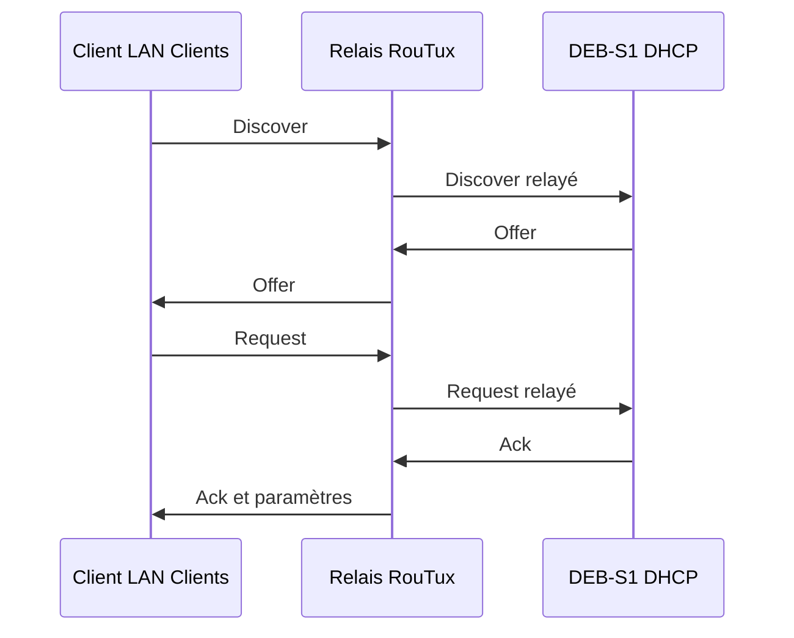

# Module 06 — Le DHCP

Le cours optimisé reprend la leçon et ses manipulations. Les précisions et exemples complémentaires sont indiqués dans le texte. L’onglet Original donne accès aux transcriptions des supports.

## Paramètres distribués aux clients

DHCP fournit une configuration temporaire sous forme de bail. Le client peut recevoir une adresse, un masque, une route par défaut, des serveurs DNS et un suffixe de domaine. Le serveur maintient ses baux et peut attribuer une adresse prévue pour une machine. Le support compare l’implémentation ISC DHCP et Kea, puis réalise l’atelier avec les paquets historiques `isc-dhcp-server` et `isc-dhcp-relay`.

## Séquence DHCPv4

| Message | Sens | Effet |
|---|---|---|
| Discover | Client vers serveurs ou relais | Chercher une configuration disponible |
| Offer | Serveur vers client, éventuellement via relais | Proposer une adresse et des options |
| Request | Client vers serveur | Demander la configuration retenue |
| Ack | Serveur vers client | Confirmer le bail et ses paramètres |

L’envoi initial Discover est diffusé sur le lien du client. L’Offer peut être diffusée ou remise par un autre mode selon les indicateurs du client, l’étape de l’échange et la présence d’un relais. La formulation « toujours en broadcast » appartient au support historique. [RFC 2131](https://www.rfc-editor.org/rfc/rfc2131).

## Rôle du relais entre les segments

DEB-S1 se trouve sur LAN Serveurs et le client sur LAN Clients. Le relais placé sur RouTux reçoit la demande côté Clients et la transmet au serveur. Il indique le sous-réseau d’origine, notamment par le champ `giaddr`. Le serveur sélectionne ainsi l’étendue `172.18.X.0/24`, même si sa propre carte se trouve sur `192.168.X.0/24`. Le chemin retour du relais reste nécessaire.

## Fichiers de l’atelier ISC DHCP

| Élément | Emplacement historique |
|---|---|
| Interfaces d’écoute IPv4 et IPv6 | `/etc/default/isc-dhcp-server` |
| Sous-réseaux, options, réservations | `/etc/dhcp/dhcpd.conf` |
| Baux | `/var/lib/dhcp/dhcpd.leases` |
| Configuration du relais | `/etc/default/isc-dhcp-relay` |
| Journaux | `/var/log/syslog` ou destination rsyslog configurée |

`default-lease-time` et `max-lease-time` s’expriment en secondes. `option domain-name-servers` fournit les serveurs DNS. `option domain-name` fournit le suffixe demandé lors de l’atelier DNS. `ddns-update-style none` indique le choix de ne pas effectuer de mises à jour DNS dynamiques dans le scénario. `authoritative` indique que le serveur fait autorité pour les sous-réseaux déclarés. Une réservation associe `hardware ethernet` et `fixed-address` dans un bloc `host`. Choisir l’adresse dans le sous-réseau du client et tenir compte de la plage dynamique pour éviter un conflit.

## Configurer le serveur de DEB-S1

Le TP demande quatre jours de bail par défaut, huit jours au maximum et la plage `.100` à `.200` pour le LAN Clients. Avec `X=30`, le DNS DEB-S2 est `192.168.30.12` et la passerelle client RouTux `172.18.30.254`. La déclaration sans plage du LAN Serveurs décrit le segment où DEB-S1 écoute.

```text
default-lease-time 345600;
max-lease-time 691200;
option domain-name-servers 192.168.30.12;
ddns-update-style none;
authoritative;

subnet 192.168.30.0 netmask 255.255.255.0 {
}

subnet 172.18.30.0 netmask 255.255.255.0 {
    range 172.18.30.100 172.18.30.200;
    option routers 172.18.30.254;
}
```

Dans `/etc/default/isc-dhcp-server`, le corrigé associe `INTERFACESv4` à la carte du LAN Serveurs du serveur. Identifier cette carte, `ens33` dans l’exemple. Tester la syntaxe avec `dhcpd -t -cf /etc/dhcp/dhcpd.conf`. La commande `dhcp -t` imprimée dans le support comporte une coquille.

## Configurer le relais et suivre les échanges

Sur RouTux, la configuration du paquet relais indique `SERVERS` et `INTERFACES`. Le TP fait relancer l’assistant du relais avec `dpkg-reconfigure isc-dhcp-relay`. La cible DHCP est DEB-S1 à `192.168.X.11`. La correction mélange par endroits l’adresse de DEB-S2 et le nom du paquet serveur. Vérifier ces deux valeurs avant de lancer le relais.

```bash
dhcrelay -d -iu ens36 -id ens33 192.168.30.11
```

Dans cet exemple, `ens33` reçoit les demandes du LAN Clients et `ens36` communique avec le serveur. Lancer le binaire du serveur `dhcpd -d` sur DEB-S1 dans un terminal distinct après arrêt de son service. Procéder de même avec le relais sur RouTux. Passer ensuite le client en DHCP, observer les messages, puis vérifier adresse, préfixe, route et DNS. Arrêter les deux binaires de débogage avant de relancer leurs services sur les machines correspondantes. Contrôler séparément l’état actuel et l’activation au démarrage.

Le corrigé illustre la redirection des messages `local7` dans rsyslog. Le nom de facility est `local7` et doit correspondre à `log-facility local7;`. En cas de fichier PID restant, vérifier d’abord l’absence du processus qui l’a créé.

!!! info "Actualisation externe"
    ISC a arrêté la maintenance d’ISC DHCP en 2022. Le TP conserve ce logiciel dans son contexte historique. ISC présente Kea comme un serveur successeur et signale que sa distribution ne fournit pas le relais de l’ancien produit. Les fichiers et commandes du scénario décrivent ISC DHCP. [Statut d’ISC DHCP](https://www.isc.org/dhcp/), [Documentation Kea](https://www.isc.org/kea/).

## Schéma explicatif complémentaire



## Autoévaluation

1. Quelle VM reçoit les requêtes relayées du TP ?
2. Pourquoi le serveur possède-t-il une déclaration pour le LAN Clients ?
3. Quels paramètres vérifier sur le client après obtention du bail ?

??? success "Réponses"
    1. DEB-S1, adresse `192.168.X.11`.
    2. Le serveur doit choisir une étendue pour le réseau du client, identifié via le relais.
    3. Adresse, préfixe, passerelle, DNS et durée du bail.

## Pour travailler ce module

- [Fiche de révision](../../revision/services-reseau-linux/module-06-dhcp.md)
- [Travaux pratiques](../../tp/services-reseau-linux/module-06/index.md)
- [Sommaire du cours](index.md)
