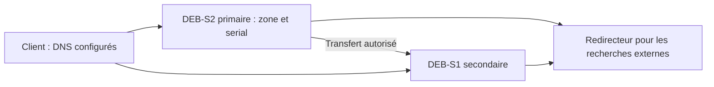

# Module 07 — DNS autoritaire sur zone

## Objectifs

- Déclarer et vérifier une zone directe et les deux zones inverses.
- Lire les enregistrements et les paramètres d’un fichier de zone.
- Autoriser le transfert depuis DEB-S1 et vérifier la réponse du secondaire.
- Éprouver la continuité des réponses autoritaires et des recherches externes.

## Autorité par zone

Une zone regroupe des données administrées ensemble. Le serveur primaire charge la version de référence. Un secondaire obtient une copie et répond lui aussi de façon autoritaire. Le rôle est attribué zone par zone. Une instance BIND peut héberger des zones primaires et secondaires en même temps. Elle peut également fournir la résolution récursive aux clients autorisés selon sa configuration.

Une zone directe contient les noms et les données associées. Une zone inverse IPv4 utilise `in-addr.arpa` et les octets dans l’ordre inverse. Pour `192.168.30.0/24`, `30.168.192.in-addr.arpa.` désigne la zone. L’entrée `11 PTR deb-s1.tssr.example.` correspond à `192.168.30.11`. Les suffixes de formation ont été neutralisés dans les exemples publiés. Les IP et les rôles du scénario sont conservés.

## Enregistrements et fichier de zone

| Type | Rôle |
|---|---|
| SOA | Paramètres d’autorité, contact administratif, numéro de série et temporisations |
| NS | Serveurs qui font autorité sur la zone |
| A | Adresse IPv4 associée à un nom |
| AAAA | Adresse IPv6 associée à un nom |
| CNAME | Alias vers un nom canonique |
| MX | Serveur de courrier et préférence |
| SRV | Service décrit par priorité, poids, port et nom cible |
| PTR | Nom associé à l’adresse dans l’espace inverse |

`$ORIGIN` fournit le suffixe des noms relatifs. `$TTL` fixe le TTL par défaut. `@` représente le sommet de la zone. Un point final marque un nom absolu. Dans le SOA, le numéro de série aide les secondaires à détecter une version plus récente. Le format `AAAAMMJJxx` est la convention du support. Le mécanisme DNS compare les numéros de série selon les règles d’arithmétique de série. [RFC 1982](https://www.rfc-editor.org/rfc/rfc1982).

## TP guidé — Zone directe et zones inverses sur DEB-S2 {#declarer-la-zone-directe-sur-deb-s2}

La solution de l’atelier emploie `type master`, un nom historique pour le rôle primaire. Les fichiers de zone peuvent être référencés par un chemin absolu. Dans l’exemple pour `X=30`, le chemin est identique dans la déclaration et dans la commande de contrôle.

```text
zone "tssr.example" {
    type master;
    file "/var/cache/bind/db.tssr.example";
    allow-transfer { 192.168.30.11; };
};
```

Exemple de fichier cohérent avec les hôtes demandés dans l’énoncé.

```dns
$ORIGIN tssr.example.
$TTL 86400
@ IN SOA deb-s2.tssr.example. admin.tssr.example. (
    2026110501 86400 7200 3600000 3600 )
@       IN NS    deb-s2.tssr.example.
deb-s1  IN A     192.168.30.11
deb-s2  IN A     192.168.30.12
routux  IN A     172.18.30.254
routux  IN A     192.168.30.254
pfsense IN A     172.30.30.1
ns1     IN A     192.168.30.12
test    IN CNAME ns1.tssr.example.
```

Le TP demande que NS1 pointe vers DEB-S2. Le `.11` du corrigé désigne DEB-S1. Employer `.12` dans cette étape. Le corrigé présente aussi des noms relatifs involontaires et plusieurs noms de fichiers. Le point final et le chemin cohérent évitent un suffixe doublé ou une zone introuvable.

```bash
named-checkzone tssr.example /var/cache/bind/db.tssr.example
named-checkconf -z
rndc reload
dig @192.168.30.12 tssr.example SOA +norecurse
dig @192.168.30.12 tssr.example NS +norecurse
dig @192.168.30.12 test.tssr.example A
```

Dans la réponse directe de l’autorité, relever le drapeau `aa`. Pour un nom court, le client a besoin du suffixe de recherche. Le TP complète les options DHCP, renouvelle le bail et vérifie les deux formes de nom.

## Déclarer les zones inverses

Pour `X=30`, créer `30.18.172.in-addr.arpa` et `30.168.192.in-addr.arpa`. Chaque fichier contient son SOA et ses NS. Le LAN Clients associe `254` à RouTux. Le LAN Serveurs associe `11` à DEB-S1, `12` à DEB-S2 et `254` à RouTux. Les numéros 10 et 30 du corrigé proviennent d’exemples différents. Garder le même `X` entre le nom de zone, les IP, le fichier et les requêtes de test.

```bash
dig @192.168.30.12 -x 172.18.30.254
dig @192.168.30.12 -x 192.168.30.11
dig @192.168.30.12 -x 192.168.30.12
dig @192.168.30.12 -x 192.168.30.254
```

## TP guidé — Copie secondaire et redondance DNS {#ajouter-la-copie-secondaire-sur-deb-s1}

Le premier contrôle demande un transfert explicite avec `dig @192.168.30.12 tssr.example AXFR`. Le faire depuis le client puis depuis DEB-S1 pour vérifier la restriction d’origine. La permission effective de transfert dépend de la configuration et de la version. Déclarer explicitement `allow-transfer` pour l’hôte secondaire et vérifier le résultat. Le transport de zone AXFR utilise TCP. [RFC 5936](https://www.rfc-editor.org/rfc/rfc5936).

Sur le primaire, ajouter `deb-s1.tssr.example.` comme NS et augmenter le serial. Sur DEB-S1, déclarer la zone secondaire et le primaire `.12`. Le chemin de copie se trouve dans un répertoire accessible en écriture à BIND. Voici la syntaxe historique corrigée du scénario.

```text
zone "tssr.example" {
    type slave;
    masters { 192.168.30.12; };
    file "/var/cache/bind/db.tssr.example.secondary";
};
```

La solution imprimée donne `master` au singulier dans ce bloc et `192.169.X.12`. La configuration historique attend `masters` et le LAN `192.168.X.0/24`. Les versions actuelles emploient aussi les termes `secondary` et `primaries`. Valider la syntaxe et relire les messages du service avant de tester SOA, NS, serial et réponse autoritaire depuis le client. [Référence BIND 9](https://bind9.readthedocs.io/en/latest/reference.html).

## Éprouver la continuité et observer les transferts

Interroger d’abord chaque serveur avec `dig @adresse`. Arrêter le primaire dans le scénario et renouveler les requêtes vers le secondaire. Pour un test de résolution normal sur le poste, le profil client doit disposer des deux DNS. Déclarer le secondaire dans les NS de la zone assure l’annonce de son rôle d’autorité. Le paramètre DNS du poste détermine à quel résolveur il s’adresse.

Le support demande ensuite de suivre les requêtes avec `rndc querylog` et le journal de l’unité BIND. Ajouter un enregistrement sur le primaire, incrémenter le serial et recharger. Comparer les SOA. Un transfert complet est un AXFR. Un IXFR transmet les différences disponibles. Selon l’historique et la configuration du serveur, une demande incrémentale peut aboutir à un transfert complet. Identifier le type réellement observé. [RFC 1995](https://www.rfc-editor.org/rfc/rfc1995).

Enfin, configurer DEB-S1 pour les recherches externes selon les mêmes règles d’accès et de redirection que DEB-S2. Le TP demande de constater la portée de cette redondance. Avec la seule zone directe copiée, les deux zones inverses restent à déclarer et à transférer si leur continuité est requise. Le service du primaire est rétabli à la fin de l’exercice.

### Preuves à relever

| Essai | Résultat à vérifier |
| --- | --- |
| Zone directe | Interroger DEB-S2 pour SOA, NS, adresses des serveurs, alias et réponse autoritaire. Comparer FQDN et nom court après renouvellement DHCP. |
| Zones inverses | Vérifier chaque PTR de l’énoncé en interrogeant DEB-S2 avec l’adresse correspondant au `X` de la maquette. |
| Autorisation de transfert | Comparer AXFR depuis le client et depuis DEB-S1. La politique finale permet l’origine autorisée uniquement. |
| Copie secondaire | Comparer SOA, NS, serial et un nouvel enregistrement sur DEB-S1. Tester ensuite primaire arrêté. |
| Résolution externe | Tester via DEB-S1 avec le primaire arrêté, puis rétablir le primaire et la journalisation normale. |

## Schéma explicatif complémentaire



## À retenir

Vérifier l’autorité avec le serveur interrogé et le drapeau aa. Le secondaire maintient la copie d’une zone, repérable par le SOA et un enregistrement témoin. Chaque zone inverse et la résolution externe ont leurs propres conditions de continuité.

## Mini-quiz — 5 questions {#autoevaluation}

1. Quel enregistrement donne le numéro de série ?
2. Quelle zone inverse correspond à 192.168.30.0/24 ?
3. Le transfert de la zone directe transfère-t-il les inverses ?
4. Comment vérifier qu’un secondaire répond avec autorité ?
5. Comment distinguer IXFR et AXFR dans les observations du TP ?

??? success "Réponses commentées"

    1. Le SOA. Comparer sa valeur sur le primaire et le secondaire.
    2. 30.168.192.in-addr.arpa. Les octets du réseau apparaissent dans l’ordre inverse.
    3. Chaque zone inverse possède sa propre déclaration et son propre transfert.
    4. Interroger directement son adresse avec +norecurse et vérifier le drapeau aa et l’enregistrement attendu.
    5. IXFR porte sur les différences disponibles. AXFR transfère la zone entière. Vérifier le type effectivement observé.

## Pour travailler ce module

- [Fiche de révision](../../revision/services-reseau-linux/module-07-dns-autoritaire-sur-zone.md)
- [Travaux pratiques](../../tp/services-reseau-linux/module-07/index.md)
- [Énoncés](../../tp/services-reseau-linux/module-07/enonces.md) et [corrections](../../tp/services-reseau-linux/module-07/corrections.md)
- [Kahoot existant](../../kahoot/services-reseau-linux-module-07.md)
- [Sommaire du cours](index.md)
