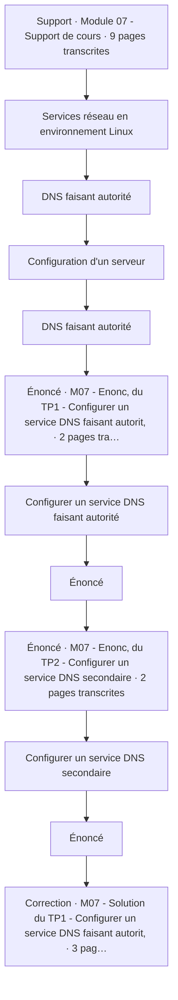
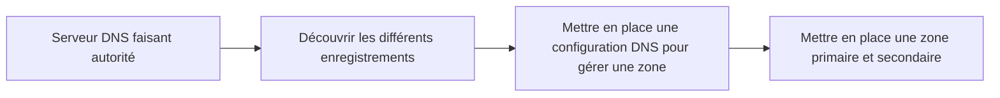
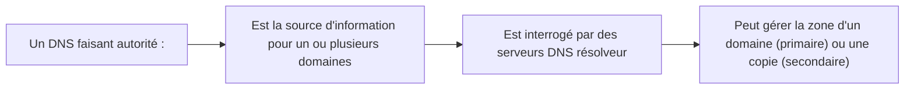
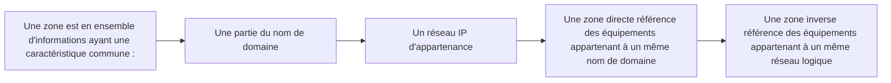

# Module 07 — DNS autoritaire sur zone

Les parties ci-dessous reprennent le cours original, dans le même ordre. Les encadrés et les schémas répètent ses formulations.

## Parcours de lecture

1. Support · Module 07 - Support de cours · 9 pages transcrites
2. Services réseau en environnement Linux
3. DNS faisant autorité
4. Configuration d'un serveur
5. DNS faisant autorité
6. Énoncé · M07 - Enonc‚ du TP1 - Configurer un service DNS faisant autorit‚ · 2 pages transcrites
7. Configurer un service DNS faisant autorité
8. Énoncé
9. Énoncé · M07 - Enonc‚ du TP2 - Configurer un service DNS secondaire · 2 pages transcrites
10. Configurer un service DNS secondaire
11. Énoncé
12. Correction · M07 - Solution du TP1 - Configurer un service DNS faisant autorit‚ · 3 pages transcrites
13. Configurer un service DNS faisant autorité
14. Solution
15. Correction · M07 - Solution du TP2 - Configurer un service DNS secondaire · 3 pages transcrites
16. Configurer un service DNS secondaire
17. Solution

**Visuel externe**



SOURCE DRIVE · TRANSCRIPTION DU SUPPORT

Le contenu des documents du dossier TSSR est transcrit ci-dessous, page par page. Les textes et tableaux sont intégrés à la page Web. Aucun fichier PDF, aucune diapositive entière ni aucune reproduction de page n’est affiché. Seuls des croquis ou visuels isolés et vérifiés peuvent accompagner la transcription. Les versions et les consignes restent celles des supports de formation. Les compléments IA sont conservés dans leur onglet distinct.

## Support · Module 07 - Support de cours · 9 pages transcrites

!!! note "À retenir"
    Les noms et chemins de formation portant le nom de l’éditeur ont été neutralisés.

Les noms et chemins de formation portant le nom de l’éditeur ont été neutralisés. Les adresses numériques et les consignes restent celles de la source.

## Services réseau en environnement Linux

Module 07 – DNS autoritaire sur zone

### DNS Partie 2

### Objectifs

!!! note "À retenir"
    Serveur DNS faisant autorité Découvrir les différents enregistrements Mettre en place une configuration DNS pour gérer une zone Mettre en place une zone primaire et secondaire

**Visuel externe**



- Serveur DNS faisant autorité
- Découvrir les différents enregistrements
- Mettre en place une configuration DNS pour gérer une zone
- Mettre en place une zone primaire et secondaire

### DNS Partie 2

## DNS faisant autorité

### DNS faisant autorité

### Définition

!!! note "À retenir"
    Un DNS faisant autorité : Est la source d'information pour un ou plusieurs domaines Est interrogé par des serveurs DNS résolveur Peut gérer la zone d'un domaine (primaire) ou une copie (secondaire)

**Visuel externe**



- Un DNS faisant autorité :
- Est la source d'information pour un ou plusieurs domaines
- Est interrogé par des serveurs DNS résolveur
- Peut gérer la zone d'un domaine (primaire) ou une copie (secondaire)

### DNS faisant autorité

### Zones

!!! note "À retenir"
    Une zone est en ensemble d'informations ayant une caractéristique commune : Une partie du nom de domaine Un réseau IP d'appartenance Une zone directe référence des équipements appartenant à un même nom de domaine Une zone inverse référence des équipements appartenant à un même réseau logique

**Visuel externe**



- Une zone est en ensemble d'informations ayant une caractéristique commune :
- Une partie du nom de domaine
- Un réseau IP d'appartenance
- Une zone directe référence des équipements appartenant à un même nom de domaine
- Une zone inverse référence des équipements appartenant à un même réseau logique

### DNS faisant autorité

### Zones

### Domaine : demo.example

### Zone directe demo.example

| Hôte | Type | Adresse |
| --- | --- | --- |
| DB10-FS1 | A | 10.9.9.5 |
| DB10-FS2 | A | 10.9.9.10 |
| DB10-INFRA1 | A | 10.9.9.9 |
| DB10-INFRA1 | AAAA | 2001:DBB::EC01:e |

### Zone inverse 42.168.192.IN-ADDR.ARPA

Réseau 192.168.42.0/24.

| Dernier octet | Type | Nom |
| --- | --- | --- |
| 103 | PTR | SPX.PE.JO. |
| 104 | PTR | GLS.PE.JO. |
| 205 | PTR | GTI.PE.JO. |

### DNS faisant autorité

### Enregistrements

!!! note "À retenir"
    Les données d'une zone sont stockées sous forme d'enregistrements.

- Les données d'une zone sont stockées sous forme d'enregistrements.

| Type | Utilité |
| --- | --- |
| SOA | Contient les caractéristiques de la zone, identifie par un FQDN résolvable le serveur qui peut y écrire |
| NS | Identifie par un FQDN résolvable le·s serveur·s qui dispose·nt d’un exemplaire de la zone et fait / font autorité pour celle-ci |
| A | Correspondance entre un nom (connu) et une adresse IPv4 (attendue) |
| AAAA | Correspondance entre un nom (connu) et une adresse IPv6 (attendue) |
| SRV | Correspondance entre un type de service et le FQDN du serveur le fournissant |
| MX | Permet d’identifier le·s serveur·s de messagerie d’un domaine donné |
| CNAME | Correspondance entre un nom et un autre nom |
| PTR | Correspondance entre une adresse d’hôte (connue) et un FQDN (attendu) Enregistrements uniquement présents dans des zones inverses |

### DNS faisant autorité

### Serveur primaire / Serveur secondaire

!!! note "À retenir"
    Un serveur faisant autorité sur une zone peut être source d'information et source de modification.

- Un serveur faisant autorité sur une zone peut être source d'information et source de modification.
- Il est possible d'y modifier les enregistrements de la zone.
- On parle de serveur primaire pour la zone (ou serveur maître).

### DNS faisant autorité

### Serveur primaire / Serveur secondaire

!!! note "À retenir"
    Inversement, un serveur faisant autorité sur une zone peut ne disposer que d'une copie de cette zone.

- Inversement, un serveur faisant autorité sur une zone peut ne disposer que d'une copie de cette zone.
- Il récupère la zone et ses mises à jour depuis le serveur primaire.
- On parle de serveur secondaire ou serveur esclave pour la zone.

### DNS faisant autorité

### Serveur primaire / Serveur secondaire

!!! note "À retenir"
    La notion de primaire et secondaire se met en place au niveau de chaque zone.

La notion de primaire et secondaire se met en place au niveau de chaque zone.

- Un serveur physique hébergeant le service DNS peut avoir des zones primaires et des zones secondaires.

### DNS Partie 2

## Configuration d'un serveur

## DNS faisant autorité

### Configuration d’un serveur DNS faisant autorité

### Serveur DNS faisant autorité

- Pour mettre en place une gestion de zone sur un serveur DNS Bind9, il faut :
- Définir les paramètres de la zone dans le fichier /etc/bind/named.conf.local
- Définir le fichier de données de la zone, i.e. la base de données des enregistrements

### Configuration d’un serveur DNS faisant autorité

### Zone DNS primaire

- Configuration d'une zone primaire :

Transcription du détail du support.

```
# vi /etc/bind/named.conf.local

zone "formation.demo" {
    type master;
    file "db.formation.demo";
    allow-transfer { 10.11.0.53; };
};
```

Déclaration de la zone directe principale en chargeant le fichier db.formation.demo. Autorisation du transfert de zone.

- Configuration d'une zone primaire inverse :

Transcription du détail du support.

```
# vi /etc/bind/named.conf.local

zone "42.168.192.in-addr.arpa" {
    type master;
    file "db.192.168.42.inv";
};
```

Déclaration de la zone inverse principale en chargeant le fichier db.192.168.42.inv.

### Configuration d’un serveur DNS faisant autorité

### Zone DNS secondaire

- Configuration d'une zone secondaire :

Transcription du détail du support.

```
# vi /etc/bind/named.conf.local

zone "formation.demo" {
    type slave;
    masters { 10.5.3.10; };
    file "db.formation.demo";
    allow-query { any; };
};
```

Déclaration de la zone directe secondaire à partir du serveur principal en chargeant le fichier db.formation.demo. Autorisation des requêtes par le client.

### Configuration d’un serveur DNS faisant autorité

### Fichier de zone

- Le fichier de zone contient les données de la zone. On va distinguer 3 parties :
- Les directives globales de la zone

Transcription du détail du support.

```
; fichier de zone du domaine ecole.example
; point-virgule = commentaire en début / en cours de ligne

$ORIGIN ecole.example.
$TTL 86400
```

Directives de configuration s’appliquant à tous les enregistrements suivants.

### Configuration d’un serveur DNS faisant autorité

### Fichier de zone

- Le SOA et les NS

Transcription du détail du support.

```
@ SOA dns1.ecole.example. hostmaster.ecole.example. (
2019100253 ; serial
86400      ; refresh 1 day
7200       ; retry 2 hours
3600000    ; expire
3600 )     ; negative TTL
;
@ NS dns1.ecole.example.
@ NS dns2.ecole.example.
```

Enregistrements SOA et NS relatifs à la zone.

Vous devez toujours modifier le serial à chaque modification de la zone sous la forme AAAAMMJJxx.

### Configuration d’un serveur DNS faisant autorité

### Fichier de zone

- Les enregistrements de la zone

Transcription du détail du support.

```
dns1 A     44.0.5.3
dns1 AAAA  2001:0db8::ec01:e
dns2 AAAA  2001:0db8::ec01:e53
www  A     44.0.0.80
rdsgw A    35.12.13.15
smtp A     44.0.0.25
ww   CNAME www.ecole.example.
wwww CNAME www.ecole.example.
@    MX    10 smtp.ecole.example.
@    MX    20 mx0.mail.ovh.net.
```

Autres enregistrements de la zone.

### Configuration d’un serveur DNS faisant autorité

### Fichier de zone

- Pour une zone inverse

Transcription du détail du support.

```
; zone inverse pour le réseau 192.168.42.0/24

$TTL 86400
@ SOA dns1.formation.demo. hostmaster.formation.demo. (
2019100253 ; serial
86400      ; refresh 1 day
7200       ; retry 2 hours
3600000    ; expire
3600 )     ; negative TTL
;
@ NS dns1.formation.demo.

1   PTR srv01.formation.demo.
2   PTR srv02.formation.demo.
13  PTR lucky.formation.demo.
254 PTR gw42.infra.example.
```

Directives de configuration, enregistrements SOA et NS relatifs à la zone, puis autres enregistrements PTR.

Référence du document : 1o0qylhYeFfVYqspFoHRgK-PRZQIoYNeX · SHA-256 d9893c9905e7e576…

## Énoncé · M07 - Enonc‚ du TP1 - Configurer un service DNS faisant autorit‚ · 2 pages transcrites

Le nom du fichier Drive présente une anomalie historique d’encodage. Son nom est conservé ; le titre interne est transcrit dans le document. Les noms et chemins de formation portant le nom de l’éditeur ont été neutralisés. Les adresses numériques et les consignes restent celles de la source.

## Configurer un service DNS faisant autorité

### TP 01 du Module 07 – DNS autoritaire sur zone

Avant de démarrer ce TP, il convient d’avoir suivi les vidéos des modules 1 à 7 et d’avoir réalisé les TP proposés.

Durée estimée

2 heures

## Énoncé

### Objectifs

- Configurer un service DNS hébergeur permettant la résolution directe et inverse des zones dont il assure la gestion.

### Prérequis

- Les ateliers précédents doivent être fonctionnels

### Notes

- Pour toutes les configurations réseau, vous remplacerez num_stag par un chiffre entre 1 et 30, par exemple 10.

### Etape 1 - Configurer le serveur DEB-S2 pour qu’il héberge une zone directe

- Modifier la configuration de Bind9 mise en place à l’atelier 5 afin que votre serveur héberge la zone tssr.example.
- Dans votre zone, créer des enregistrements d’hôtes pour : DEB-S1, DEB-S2 et RouTux (pour ses adresses sur LAN Clients et LAN Serveurs uniquement).
- Créer un enregistrement d’hôte pour votre appliance pfSense en référençant son adresse sur le réseau VMNet2.
- Créer un enregistrement d’hôte pour NS1 pointant vers l’adresse de DEB-S2.
- Créer un alias pour test via NS1
- Avant de relancer le service faire un contrôle syntaxique du fichier de zone. En l’absence d’erreur, recharger la configuration de Bind9 au moyen de la commande

```
# rndc reload
```

### Etape 2 - Tests de résolution depuis le poste client Debian

Pour tous les tests de résolution demandés ci-dessous, vous utiliserez la commande dig depuis le poste client Cli-db-10.

- Faire un test de résolution successivement des enregistrements SOA puis NS de la zone. Ces enregistrements sont-ils corrects ?
- Faire les tests de résolution des différents enregistrements créés précédemment.
- Faire un test de connectivité avec les serveurs DEB-S1 et DEB-S2, d’abord avec le nom FQDN puis uniquement avec le nom d’hôte.
- Si besoin, adapter la configuration DHCP pour permettre la résolution des enregistrements de votre domaine sans avoir à préciser le nom de domaine.

### Etape 3 - Configuration de zones inverses

- Modifier la configuration du service DNS de DEB-S2 afin qu’il prenne en charge la résolution inverse pour les réseaux LAN Clients et LAN Serveurs.
- Pour LAN Clients, y inscrire un enregistrement inverse pour RouTux.
- Pour LAN Serveurs, les adresses IP de DEB-S1, DEB-S2 et RouTux devront être résolues.
- Faire les tests de résolution depuis Cli-db-10.

Référence du document : 1bRkQA-NSikuZ7u3jM95K2E3c-F_Gp-Hx · SHA-256 f9aa1328f14ab9e3…

## Énoncé · M07 - Enonc‚ du TP2 - Configurer un service DNS secondaire · 2 pages transcrites

Le nom du fichier Drive présente une anomalie historique d’encodage. Son nom est conservé ; le titre interne est transcrit dans le document. Les noms et chemins de formation portant le nom de l’éditeur ont été neutralisés. Les adresses numériques et les consignes restent celles de la source.

## Configurer un service DNS secondaire

### TP 02 du Module 07 – DNS autoritaire sur zone

Avant de démarrer ce TP, il convient d’avoir suivi les vidéos des modules 1 à 7 et d’avoir réalisé les TP proposés.

Durée estimée

2 heures

## Énoncé

### Objectifs

- Configurer un service DNS secondaire

### Prérequis

- Les ateliers précédents doivent être fonctionnels.

### Notes

- Pour toutes les configurations réseau, vous remplacerez num_stag par un chiffre entre 1 et 30, par exemple 10.

### Etape 1 - Autoriser le transfert des zones hébergées pour DEB-S1 uniquement

- Depuis le client Cli-db-10, requêter le service Bind9 de DEB-S2 et lui faire une demande de transfert de zone de votre zone directe. Pour ce faire, exécuter la commande suivante : # dig axfr tssr.example

Le transfert a-t-il abouti ?

- Modifier la configuration de votre zone directe afin de n’autoriser son transfert que pour l’hôte DEB-S1.
- Au moyen de la commande dig effectuée précédemment, vérifier la bonne prise en compte de la restriction de transfert. Cette commande devra être réalisée successivement depuis Cli-db-10 et DEB-S1.

### Etape 2 - Ajout d’un service DNS secondaire sur DEB-S1

- Sur DEB-S2, modifier votre zone directe afin que DEB-S1 soit référencé comme serveur DNS faisant autorité pour cette zone (en complément de DEB-S2).
- Installer le service DNS de Bind9 sur DEB-S1.
- Configurer le service DNS de DEB-S1 afin qu’il héberge une copie de votre zone tssr.example

à partir de DEB-S2.

- Avant de relancer le service, faire un contrôle syntaxique de la configuration. En l’absence d’erreur, recharger la configuration de Bind9.

### Etape 3 - Test de résolution de noms depuis les clients

- Faire un test de résolution des enregistrements SOA et NS de votre domaine en interrogeant spécifiquement le serveur DEB-S1.
- Sur DEB-S2, arrêter le service Bind9. Depuis vos clients, vérifier la connectivité vers les serveurs DEB-S1 et DEB-S2 en utilisant leurs FDQN. La résolution a-t-elle fonctionné ?
- Sur DEB-S2, redémarrer le service Bind9

### Etape 4 - Test de résolution de noms depuis les clients

**Visuel externe**


- Sur DEB-S2, activer le suivi des requêtes DNS dans les logs avec la commande rndc.
- Suivre ensuite les logs relatifs au démon named.
- Sur DEB-S2, ajouter un enregistrement dans la zone directe et recharger la zone.
- Analyser les requêtes de transfert entre DEB-S2 et DEB-S1. Quel est le type de transfert ?
- Sur DEB-S2, arrêter le service Bind9. Depuis vos clients, vérifier la connectivité vers l’extérieur.

Sur DEB-S1, définir les options de configuration Bind9 pour :

- Désactiver DNSSEC.
- Autoriser les requêtes provenant des réseaux LAN Clients et LAN Serveurs.
- Résoudre des requêtes DNS vers les domaines extérieurs à votre infrastructure via le redirecteur FAI (66.55.44.33 ou 9.9.9.9).

Pour quelles requêtes DNS la redondance n’est-elle pas assurée par DEB-S1 ?

Que faudrait-il mettre en place pour résoudre la problématique ?

- Sur DEB-S2, redémarrer le service Bind9.

Référence du document : 1f6mCWGVDD6qX96Qp0pijNTE4IdbKCwuX · SHA-256 c9c822b5d3a43d2d…

## Correction · M07 - Solution du TP1 - Configurer un service DNS faisant autorit‚ · 3 pages transcrites

Le nom du fichier Drive présente une anomalie historique d’encodage. Son nom est conservé ; le titre interne est transcrit dans le document. Les noms et chemins de formation portant le nom de l’éditeur ont été neutralisés. Les adresses numériques et les consignes restent celles de la source.

Correction originale : à consulter après avoir tenté l’exercice.

## Configurer un service DNS faisant autorité

### TP 01 du Module 07 – DNS autoritaire sur zone

Avant de démarrer ce TP, il convient d’avoir suivi les vidéos des modules 1 à 7 et d’avoir réalisé les TP proposés.

Durée estimée

2 heures

## Solution

### Etape 1 - Configurer le serveur DEB-S2 pour qu’il héberge une zone directe

```
Ajouter les infos dans le fichier named.conf.local pour identifier la nouvelle zone :

# vi /etc/bind/named.conf.local

# Zone directe tssr.example
 zone "tssr.example
         type master;
         file "db.tssr";
 };
```

```
Créer le fichier de zone :
# vi  /var/cache/bind/db.tssr.example
 ;
 ; Zone directe tssr.example
 ;
 $ORIGIN tssr.example
$TTL    86400
 @       IN      SOA  deb-s2.tssr.example. admin.tssr.example. (
                               1         ; Serial
                           86400         ;  Refresh
                            7200         ;  Retry
                         3600000         ;  Expire
                            3600 )       ;  Negative Cache TTL
 ;
 @       IN      NS      deb-s2.tssr.example
```

```
Rajouter les enregistrements :
 deb-s1  IN      A        192.168.30.11
 deb-s2  IN      A        192.168.30.12
 routux  IN      A        192.168.30.254
 routux  IN      A        172.18.30.254
```

```
Puis :
 pfsense IN      A        172.30.30.1
```

```
Puis :
 ns1     IN      A        192.168.30.11
```

```
Pour l’alias :
 test    IN      CNAME    ns1.tssr.example.
```

```
Pour tester et relancer :
 # named-checkzone tssr.example /var/cache/bind/db.tssr.example
```

```
Ou/et
# named-checkconf -z
```

Relancer bind : # rndc reload

### Etape 2 - Tests de résolution depuis le poste client Debian

Pour les tests par exemple : $ dig ns1.tssr.example

- Dans la configuration du DHCP, rajouter dans le fichier /etc/dhcp/dhcpd.conf :

```
option domain-name "tssr.example";
```

et redémarrer isc-dhcp-server

### Etape 3 - Configuration de zones inverses

```
Pour les zones inverses :

# vi /etc/bind/named.conf.local

# Zone inverse LAN Clients - 172.18.10.0/24
 zone "10.18.172.in- addr.arpa" {
         type master;
         file "db.inv.172.18.30";
 };

 # Zone inverse LAN Serveurs - 192.168.10.0/24
 zone "10.168.192.in- addr.arpa" {
         type master;
         file "db.inv.192.168.10";
 };
```

```
Pour les fichiers de zone :

 # vi /var/cache/bind/db.inv.172.18.30
 ;
 ; Zone inverse 172.18.30.0/24
 ;
 $TTL    86400
 @       IN      SOA     deb- s2.tssr.example. admin.tssr.example. (
                               1         ; Serial
                           86400         ;  Refresh
                            7200         ;  Retry
                         3600000         ;  Expire
                            3600 )       ;  Negative Cache TTL
 ;
 @       IN      NS      deb- s2.tssr.example.
 254     IN      PTR     routux.tssr.example.

 # vi /var/cache/bind/db.inv.192.168.30
 ;
 ; Zone inverse 192.168.30.0/24
 ;
 $TTL    86400
 @       IN      SOA     deb- s2.tssr.example. Admin.tssr.example. (
                               1         ; Serial
                           86400         ;  Refresh
                            7200         ;  Retry
                         3600000         ;  Expire
                            3600 )       ;  Negative Cache TTL
 ;
 @       IN      NS      deb- s2.tssr.example.
 254     IN      PTR     routux.tssr.example.
 11      IN      PTR     deb- s1.tssr.example.
 12      IN      PTR     deb- s2.tssr.example.
```

Relancer bind9 : # rndc reload

```
Tester :
 $ dig -x 172.18.10.254
 $ dig -x 192.168.10.254
```

Référence du document : 1tTSJ6MWShpsRhItD5k2p-Fphs_ecK2wM · SHA-256 d0d0838acdef953a…

## Correction · M07 - Solution du TP2 - Configurer un service DNS secondaire · 3 pages transcrites

Les noms et chemins de formation portant le nom de l’éditeur ont été neutralisés. Les adresses numériques et les consignes restent celles de la source.

Correction originale : à consulter après avoir tenté l’exercice.

## Configurer un service DNS secondaire

### TP 02 du Module 07 – DNS autoritaire sur zone

Avant de démarrer ce TP, il convient d’avoir suivi les vidéos des modules 1 à 7 et d’avoir réalisé les TP proposés.

Durée estimée

2 heures

## Solution

### Etape 1 - Autoriser le transfert des zones hébergées pour DEB-S1 uniquement

```
Depuis db-cli-10
# dig axfr tssr.example
```

Le transfert a-t-il abouti ?

=> Oui de base le transfert est autorisé vers tous les hôtes.

```
 # vi  /etc/bind/named.conf.local
 # Zone directe tssr.example
 zone "tssr.example" {
         type master;
         file "db.tssr.example";
         allow-transfer  { 192.168.X.11; } ;
 };

 # named-checkconf –z
 # rndc reload
```

Refaire la commande dig sur db-cli-10 (ne fonctionne pas) et sur deb-s1 (fonctionne) : # dig axfr tssr.example

### Etape 2 - Ajout d’un service DNS secondaire sur DEB-S1

- Sur DEB-S2, modifier votre zone directe afin que DEB-S1 soit référencé comme serveur DNS faisant autorité pour cette zone (en complément de DEB-S2).

```
 # vi /var/cache/bind/db.tssr.example.example
 ;
 ; Zone directe tssr.example.example
 ;
 $TTL    86400
 @       IN      SOA     deb- s2.tssr.example. admin.tssr.example. (

2019100251 ; serial
                           86400         ;  Refresh
                            7200         ; Retry
                         3600000         ;  Expire
                            3600 )       ;  Negative Cache TTL
 ;
 @       IN      NS      deb- s2.tssr.example.
 @       IN      NS      deb-s1.tssr.example.

 # named-checkconf –z
 # rndc reload
```

```
Sur Deb-S1
# apt install bind9
```

```
Configurer la zone secondaire sur deb-s1 :
 # vi  /etc/bind/named.conf.local
 # Zone directe tssr.example
 zone "tssr.example" {
         type slave;
         file "db.tssr.example";
         master { 192.169.X.12; };
 };

 # named-checkconf –z
 # rndc reload
```

### Etape 3 - Test de résolution de noms depuis les clients

```
Depuis cli-db-10 :
$ dig soa tssr.example  @192.168.X.11
$ dig ns tssr.example @192.168.X.11
```

```
Arrêter le service Bind sur deb-s2
$ ping  deb-s1.tssr.example.
$ ping  deb-s2.tssr.example.
```

Que se passe-t-il ?

### Etape 4 - Test de résolution de noms depuis les clients

- Sur DEB-S2, activer le suivi des requêtes DNS dans les logs avec la commande rndc.

```
 # rndc querylog
```

```
 # journalctl -fu bind9.service
```

- Rajouter un enregistrement dans la zone deb-s2 et vérifier les requêtes, bien analyser les logs pour voir la requête IXFR passer.
- Couper deb-s2 et tester une requête vers l’extérieur depuis un client.
- Paramétrer le serveur deb-s1 comme deb-s2 pour renvoyer les requêtes vers un forwarder.

La redondance n’est pas activée pour la zone inverse ; il faudrait modifier la zone primaire pour autoriser le transfert et créer les paramétrages sur le second serveur pour gérer la zone secondaire.

Référence du document : 1Nvs7N3q1eYmz10spKGEXFY1W9tTPsssD · SHA-256 2e94eb5f566018da…

## Fiche de synthèse

Les lignes reprennent les titres du cours et la première phrase de chaque partie.

| Partie | Repère du cours |
| --- | --- |
| Support · Module 07 - Support de cours · 9 pages transcrites | Les noms et chemins de formation portant le nom de l’éditeur ont été neutralisés. |
| Énoncé · M07 - Enonc‚ du TP1 - Configurer un service DNS faisant autorit‚ · 2 pages transcrites | Le nom du fichier Drive présente une anomalie historique d’encodage. |
| Énoncé · M07 - Enonc‚ du TP2 - Configurer un service DNS secondaire · 2 pages transcrites | Le nom du fichier Drive présente une anomalie historique d’encodage. |
| Correction · M07 - Solution du TP1 - Configurer un service DNS faisant autorit‚ · 3 pages transcrites | Le nom du fichier Drive présente une anomalie historique d’encodage. |
| Correction · M07 - Solution du TP2 - Configurer un service DNS secondaire · 3 pages transcrites | Les noms et chemins de formation portant le nom de l’éditeur ont été neutralisés. |
