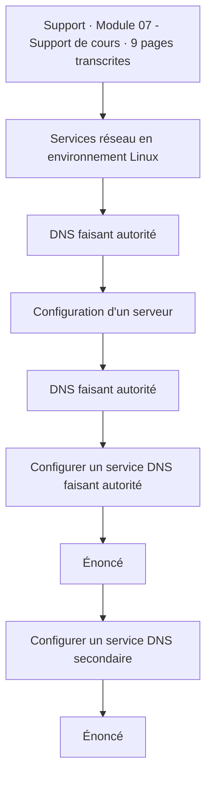
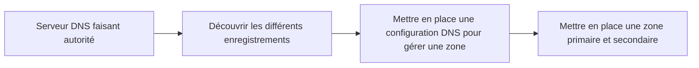
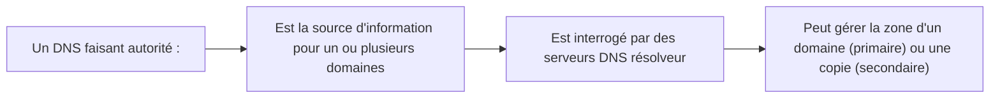
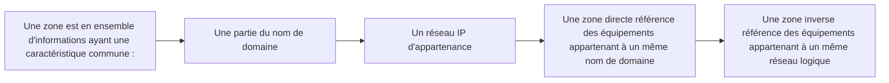

# Module 07 — DNS autoritaire sur zone

[Travaux pratiques](../../tp/services-reseau-linux/module-07/index.md)

Les parties ci-dessous reprennent le cours original, dans le même ordre. Les encadrés et les schémas répètent ses formulations.

## Parcours de lecture

1. Support · Module 07 - Support de cours · 9 pages transcrites
2. Services réseau en environnement Linux
3. DNS faisant autorité
4. Configuration d'un serveur
5. DNS faisant autorité
6. Configurer un service DNS faisant autorité
7. Énoncé
8. Configurer un service DNS secondaire
9. Énoncé
10. Configurer un service DNS faisant autorité
11. Solution
12. Configurer un service DNS secondaire
13. Solution

**Visuel externe**



SOURCE DRIVE · TRANSCRIPTION DU SUPPORT

Le contenu des documents du dossier TSSR est transcrit ci-dessous, page par page. Les textes et tableaux sont intégrés à la page Web. Aucun fichier PDF, aucune diapositive entière ni aucune reproduction de page n’est affiché. Seuls des croquis ou visuels isolés et vérifiés peuvent accompagner la transcription. Les versions et les consignes restent celles des supports de formation. Les compléments IA sont conservés dans leur onglet distinct.

## Support · Module 07 - Support de cours · 9 pages transcrites

!!! note "À retenir"
    Les noms et chemins de formation portant le nom de l’éditeur ont été neutralisés.

Les noms et chemins de formation portant le nom de l’éditeur ont été neutralisés. Les adresses numériques et les consignes restent celles de la source.

## Services réseau en environnement Linux

Module 07 – DNS autoritaire sur zone

### DNS Partie 2

### Objectifs

!!! note "À retenir"
    Serveur DNS faisant autorité Découvrir les différents enregistrements Mettre en place une configuration DNS pour gérer une zone Mettre en place une zone primaire et secondaire

**Visuel externe**



- Serveur DNS faisant autorité
- Découvrir les différents enregistrements
- Mettre en place une configuration DNS pour gérer une zone
- Mettre en place une zone primaire et secondaire

### DNS Partie 2

## DNS faisant autorité

### DNS faisant autorité

### Définition

!!! note "À retenir"
    Un DNS faisant autorité : Est la source d'information pour un ou plusieurs domaines Est interrogé par des serveurs DNS résolveur Peut gérer la zone d'un domaine (primaire) ou une copie (secondaire)

**Visuel externe**



- Un DNS faisant autorité :
- Est la source d'information pour un ou plusieurs domaines
- Est interrogé par des serveurs DNS résolveur
- Peut gérer la zone d'un domaine (primaire) ou une copie (secondaire)

### DNS faisant autorité

### Zones

!!! note "À retenir"
    Une zone est en ensemble d'informations ayant une caractéristique commune : Une partie du nom de domaine Un réseau IP d'appartenance Une zone directe référence des équipements appartenant à un même nom de domaine Une zone inverse référence des équipements appartenant à un même réseau logique

**Visuel externe**



- Une zone est en ensemble d'informations ayant une caractéristique commune :
- Une partie du nom de domaine
- Un réseau IP d'appartenance
- Une zone directe référence des équipements appartenant à un même nom de domaine
- Une zone inverse référence des équipements appartenant à un même réseau logique

### DNS faisant autorité

### Zones

### Domaine : demo.example

### Zone directe demo.example

| Hôte | Type | Adresse |
| --- | --- | --- |
| DB10-FS1 | A | 10.9.9.5 |
| DB10-FS2 | A | 10.9.9.10 |
| DB10-INFRA1 | A | 10.9.9.9 |
| DB10-INFRA1 | AAAA | 2001:DBB::EC01:e |

### Zone inverse 42.168.192.IN-ADDR.ARPA

Réseau 192.168.42.0/24.

| Dernier octet | Type | Nom |
| --- | --- | --- |
| 103 | PTR | SPX.PE.JO. |
| 104 | PTR | GLS.PE.JO. |
| 205 | PTR | GTI.PE.JO. |

### DNS faisant autorité

### Enregistrements

!!! note "À retenir"
    Les données d'une zone sont stockées sous forme d'enregistrements.

- Les données d'une zone sont stockées sous forme d'enregistrements.

| Type | Utilité |
| --- | --- |
| SOA | Contient les caractéristiques de la zone, identifie par un FQDN résolvable le serveur qui peut y écrire |
| NS | Identifie par un FQDN résolvable le·s serveur·s qui dispose·nt d’un exemplaire de la zone et fait / font autorité pour celle-ci |
| A | Correspondance entre un nom (connu) et une adresse IPv4 (attendue) |
| AAAA | Correspondance entre un nom (connu) et une adresse IPv6 (attendue) |
| SRV | Correspondance entre un type de service et le FQDN du serveur le fournissant |
| MX | Permet d’identifier le·s serveur·s de messagerie d’un domaine donné |
| CNAME | Correspondance entre un nom et un autre nom |
| PTR | Correspondance entre une adresse d’hôte (connue) et un FQDN (attendu) Enregistrements uniquement présents dans des zones inverses |

### DNS faisant autorité

### Serveur primaire / Serveur secondaire

!!! note "À retenir"
    Un serveur faisant autorité sur une zone peut être source d'information et source de modification.

- Un serveur faisant autorité sur une zone peut être source d'information et source de modification.
- Il est possible d'y modifier les enregistrements de la zone.
- On parle de serveur primaire pour la zone (ou serveur maître).

### DNS faisant autorité

### Serveur primaire / Serveur secondaire

!!! note "À retenir"
    Inversement, un serveur faisant autorité sur une zone peut ne disposer que d'une copie de cette zone.

- Inversement, un serveur faisant autorité sur une zone peut ne disposer que d'une copie de cette zone.
- Il récupère la zone et ses mises à jour depuis le serveur primaire.
- On parle de serveur secondaire ou serveur esclave pour la zone.

### DNS faisant autorité

### Serveur primaire / Serveur secondaire

!!! note "À retenir"
    La notion de primaire et secondaire se met en place au niveau de chaque zone.

La notion de primaire et secondaire se met en place au niveau de chaque zone.

- Un serveur physique hébergeant le service DNS peut avoir des zones primaires et des zones secondaires.

### DNS Partie 2

## Configuration d'un serveur

## DNS faisant autorité

### Configuration d’un serveur DNS faisant autorité

### Serveur DNS faisant autorité

- Pour mettre en place une gestion de zone sur un serveur DNS Bind9, il faut :
- Définir les paramètres de la zone dans le fichier /etc/bind/named.conf.local
- Définir le fichier de données de la zone, i.e. la base de données des enregistrements

### Configuration d’un serveur DNS faisant autorité

### Zone DNS primaire

- Configuration d'une zone primaire :

Transcription du détail du support.

```
# vi /etc/bind/named.conf.local

zone "formation.demo" {
    type master;
    file "db.formation.demo";
    allow-transfer { 10.11.0.53; };
};
```

Déclaration de la zone directe principale en chargeant le fichier db.formation.demo. Autorisation du transfert de zone.

- Configuration d'une zone primaire inverse :

Transcription du détail du support.

```
# vi /etc/bind/named.conf.local

zone "42.168.192.in-addr.arpa" {
    type master;
    file "db.192.168.42.inv";
};
```

Déclaration de la zone inverse principale en chargeant le fichier db.192.168.42.inv.

### Configuration d’un serveur DNS faisant autorité

### Zone DNS secondaire

- Configuration d'une zone secondaire :

Transcription du détail du support.

```
# vi /etc/bind/named.conf.local

zone "formation.demo" {
    type slave;
    masters { 10.5.3.10; };
    file "db.formation.demo";
    allow-query { any; };
};
```

Déclaration de la zone directe secondaire à partir du serveur principal en chargeant le fichier db.formation.demo. Autorisation des requêtes par le client.

### Configuration d’un serveur DNS faisant autorité

### Fichier de zone

- Le fichier de zone contient les données de la zone. On va distinguer 3 parties :
- Les directives globales de la zone

Transcription du détail du support.

```
; fichier de zone du domaine ecole.example
; point-virgule = commentaire en début / en cours de ligne

$ORIGIN ecole.example.
$TTL 86400
```

Directives de configuration s’appliquant à tous les enregistrements suivants.

### Configuration d’un serveur DNS faisant autorité

### Fichier de zone

- Le SOA et les NS

Transcription du détail du support.

```
@ SOA dns1.ecole.example. hostmaster.ecole.example. (
2019100253 ; serial
86400      ; refresh 1 day
7200       ; retry 2 hours
3600000    ; expire
3600 )     ; negative TTL
;
@ NS dns1.ecole.example.
@ NS dns2.ecole.example.
```

Enregistrements SOA et NS relatifs à la zone.

Vous devez toujours modifier le serial à chaque modification de la zone sous la forme AAAAMMJJxx.

### Configuration d’un serveur DNS faisant autorité

### Fichier de zone

- Les enregistrements de la zone

Transcription du détail du support.

```
dns1 A     44.0.5.3
dns1 AAAA  2001:0db8::ec01:e
dns2 AAAA  2001:0db8::ec01:e53
www  A     44.0.0.80
rdsgw A    35.12.13.15
smtp A     44.0.0.25
ww   CNAME www.ecole.example.
wwww CNAME www.ecole.example.
@    MX    10 smtp.ecole.example.
@    MX    20 mx0.mail.ovh.net.
```

Autres enregistrements de la zone.

### Configuration d’un serveur DNS faisant autorité

### Fichier de zone

- Pour une zone inverse

Transcription du détail du support.

```
; zone inverse pour le réseau 192.168.42.0/24

$TTL 86400
@ SOA dns1.formation.demo. hostmaster.formation.demo. (
2019100253 ; serial
86400      ; refresh 1 day
7200       ; retry 2 hours
3600000    ; expire
3600 )     ; negative TTL
;
@ NS dns1.formation.demo.

1   PTR srv01.formation.demo.
2   PTR srv02.formation.demo.
13  PTR lucky.formation.demo.
254 PTR gw42.infra.example.
```

Directives de configuration, enregistrements SOA et NS relatifs à la zone, puis autres enregistrements PTR.

Référence du document : 1o0qylhYeFfVYqspFoHRgK-PRZQIoYNeX · SHA-256 d9893c9905e7e576…

| Support · Module 07 - Support de cours · 9 pages transcrites | Les noms et chemins de formation portant le nom de l’éditeur ont été neutralisés. |
