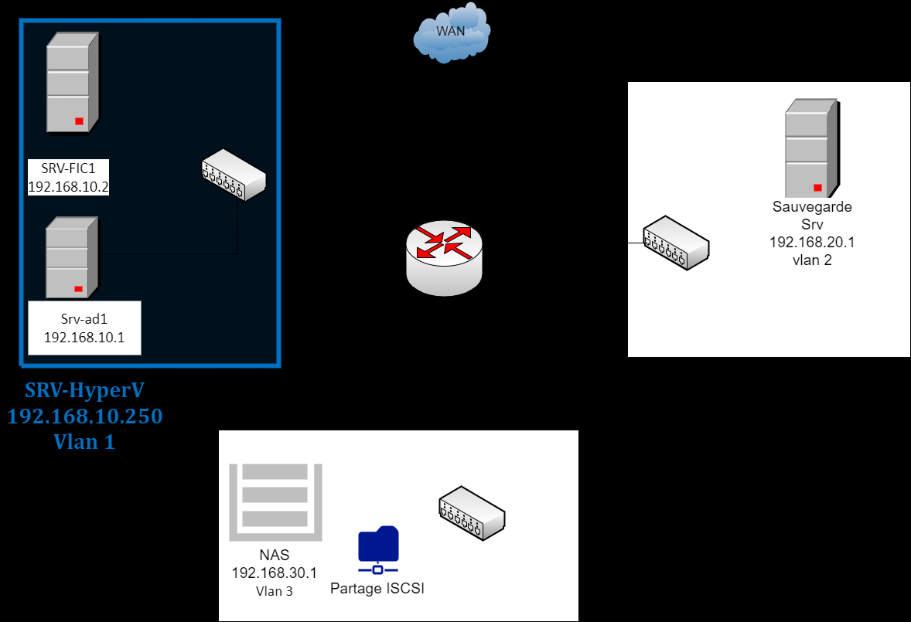
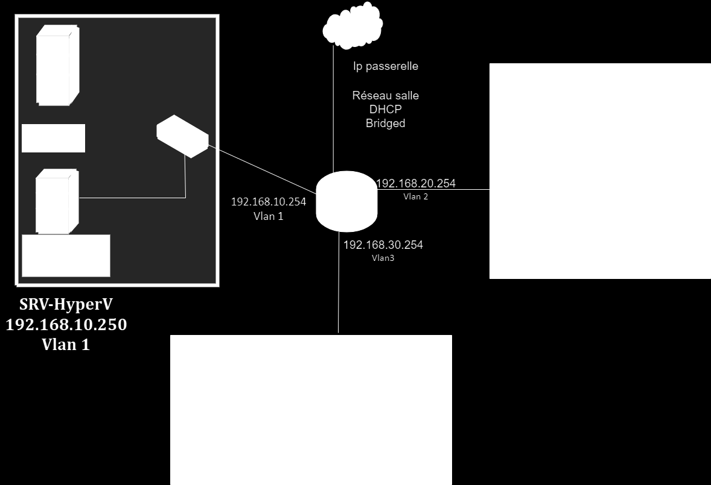

# Module 01 — Concept, enjeux et définition

Support « Sauvegarde, restauration, disponibilité », module 1, et énoncé de création de l’infrastructure. Durée indiquée du TP : 1 heure.

La transcription du support et l’aide pédagogique sont séparées pour rendre leur provenance explicite.

=== "Cours Original"

    Module 1 Concept, enjeux et définition

    ## SOMMAIRE

    Concept et enjeux

    Bonnes pratiques

    Sauvegarde et archivage

    ## Sauvegarde et archivage

    Inexistant

    Restauration

    Règle 3-2-1

    PCA / PRA / Plan de sauvegarde

    Éditeur de solution de sauvegarde

    - Veritas Backup EXE Veritas Backup Exec
    - VEEAM Backup & Réplication

    ## CONCEPT D’UNE

    L’objectif des sauvegardes est de :

    SAUVEGARDE

    - Garantir la pérennité des données.
    - Assurer la récupération des informations indispensables au fonctionnement du système d’information à la suite d’un incident ou d’un sinistre.
    - Répondre aux demandes de disponibilité des données.

    ## ENJEUX D’UNE

    - Prévenir la perte de données. SAUVEGARDE
    - Avoir un plan de secours en cas de défaillance matérielle ou logicielle.
    - Garantir la rétention des données réglementaires.
    - Avoir une protection contre les cyberattaques.
    - Prévenir l'intrusion, l'incendie...

    ## BONNES

    - Créer un compte dédié à la sauvegarde sur votre AD :
    ## PRATIQUES

    - Plus sécurisé, aucune permission NTFS sur les dossiers à sauvegarder.
    ## POUR UNE

    - En cas de problème, il procure une meilleure traçabilité dans les logs.
    ## SAUVEGARDE

    - Pour les clients Windows, utiliser le groupe opérateur de sauvegarde.
    - Renseigner et générer un plan de sauvegarde.

    RESTAURATION

    - La restauration de données en informatique est la récupération de fichiers, données ou logiciels perdus, endommagés ou inaccessibles depuis des supports de stockage suite à une panne, suppression ou catastrophe. Ce processus vise à restaurer les données à un état utilisable, réduisant la perte d'informations et les interruptions d'activité.

    ## RÈGLE 3-2-1

    Trois copies de données : Ce lot de copies comporte les données originales que x3 l’on souhaite sécuriser, et au minimum deux sauvegardes.

    Deux types de stockage différents : Les données sauvegardées doivent être conservées sur deux x2 supports de stockage distincts pour minimiser les risques de défaillance.

    Une copie hors site : Conserver au moins une copie des données en dehors de l’entreprise. x1 Prévention contre les sinistres, un acte de malveillance (cyberattaque, ransomware…) ou encore une erreur humaine.

    ## PCA ET PRA

    PCA - Plan de Continuité d'Activité

    Regroupe les processus mis en place avant, pendant et après une situation de crise, il concerne :

    - Le rétablissement du système d'information.
    - La gestion de la communication interne et externe.
    - Le repli physique des utilisateurs.
    - La gestion de la sécurité et des risques sanitaires.
    - La gouvernance de la gestion de crise.

    ## PCA ET PRA

    PRA - Plan de Reprise d'Activité

    Regroupe l'ensemble des procédures et moyens nécessaires à la continuité du système d'information, il comprend :

    - La politique ou plan de sauvegarde.
    - La gestion du stockage des éléments nécessaires à la restauration.
    - La procédure de restauration du système et des données.
    - Les licences des différentes applications utilisées.
    - Le plan de reprise d'activité n'est qu'une des composantes du plan de continuité d'activité.

    ## PLAN DE

    Procédure qui détaille les données qui doivent être sauvegardées,

    ## SAUVEGARDE

    l'infrastructure de sauvegarde, le calendrier des copies à réaliser et les méthodes de récupération et restauration. Il intègre a minima les éléments suivants :

    - Le périmètre (liste des ressources à sauvegarder)
    - Les contraintes
    - Les différents types de sauvegarde
    - La fréquence/périodicité des sauvegardes
    - Les informations de stockage
    - Les procédures de test de restauration
    - La destruction des supports ayant contenu les sauvegardes

    ## ÉDITEURS DE

    Les éditeurs de solutions de sauvegarde sont nombreux sur le marché avec des solutions gratuites

    ## SOLUTIONS DE

    ou payantes. SAUVEGARDE ARCSERVE Unified Data Protection DELL EMC Data Protection Suite

    ATEMPO Time Navigator HYCU Backup & recovery

    COHESIT DataPlateform SPECTRUM Protect

    COMMVAULT complete Backup & recovery RUBRIK Cloud Data Management

    STORAGECRAFT OneXafe / ShadowXafe VEEAM Backup and Replication

    Veritas Netbackup / Backup Exec (solution utilisée pour la suite du module)

    ## PRÉSENTATION

    Veritas Backup Exec est un logiciel de sauvegarde et restauration de

    ## DE VERITAS

    données. Il fournit des fonctionnalités de sauvegarde et de restauration.

    ## BACKUP EXEC

    Bouton Backup Exec

    Ruban commandes Gestion Volet de travaux sélection

    Volet d'informations

    ## PRÉSENTATION

    - Veeam Backup & Replication est un logiciel de sauvegarde
    ## DE VEEAM

    des données et de reprise d’activité pour les machines virtuelles VMware vSphere et Microsoft Hyper−V. BACKUP &

    ## RÉPLICATION

    - Prise en charge du protocole VSS pour la sauvegarde de bases de données Microsoft.
    - De nombreuses fonctionnalités de sauvegarde sont prises en charge.

    ## PRÉSENTATION

    - Veeam permet de faire de la sauvegarde complète de VM
    ## DE VEEAM

    et ensuite implémenter une restauration soit full (VM complète) soit granulaire (données issues de la VM). BACKUP &

    ## RÉPLICATION

    SRV−ESX

    SRV−VEEAM

    ## PRÉSENTATION

    - La réplication est une solution de récupération d’urgence
    ## DE VEEAM

    en cas de défaillance matérielle ou de crash système.

    ## BACKUP &

    - Elle permet une remise en état rapide du service
    ## RÉPLICATION

    en démarrant le réplica de la machine impactée.

    - Les réplicas devront obligatoirement être stockés sur un datastore ESXi ou Hyper−V monté.
    - La taille du réplica est identique à celle de la VM.

    ## PRÉSENTATION

    Un réplica ne doit pas être démarré manuellement mais

    ## DE VEEAM

    uniquement via la console Veeam Backup & Replication.

    ## BACKUP &

    - Cette fonctionnalité est
    ## RÉPLICATION

    un élément clé dans les calculs de RTO.

    - Une fois la VM endommagée remise en état, on peut « merger » les 2 VM pour éviter la perte de données.

    ## PRÉSENTATION

    - Avant toute chose, il faudra définir les différents supports
    ## DE VEEAM

    de stockage dans la partie Backup Repositories et les assigner.

    - Disques locaux
    ## BACKUP &

    - Partages CIFS / SMB / NFS
    ## RÉPLICATION

    - Disques durs externes…
    - Il est possible de :
    - Sauvegarder l’intégralité des VM
    - Exclure certains disques
    - Choisir le mode de Backup
    - Incrémental
    - Reverse Incremental

    ## PRÉSENTATION

    - Mise en place des Jobs permet de gérer la planification
    ## DE VEEAM

    des travaux de sauvegarde et restauration. BACKUP & RÉPLICATION

    ## PRÉSENTATION

    - La configuration des alertes mail permet d’envoyer des rapports pour les backups et réplications. DE VEEAM BACKUP & RÉPLICATION

    TRAVAUX TRAVAUX PRATIQUES Mise en place PRATIQUES

    ## N°1

    de l’environnement


    ## Création de l'infrastructure

    ## TP du Module 01 – Concepts, enjeux et définitions

    Avant de démarrer ce TP, il convient d’avoir suivi le module 1. Pour ce module l’accès au gestionnaire Hyper-V est nécessaire sur votre machine de salle. Vous devez avoir accès au partage distrib.

    ## Durée estimée

    ## 1 heure

    ## Objectifs

    - Installer le rôle HyperV sur le poste de salle
    - Déployer l’infrastructure sous HyperV pour l’exécution des ateliers
    ## Énoncé

    En vous basant sur les informations fournies ci-dessous, vous importerez l’environnement de maquettage via les bundles disponible dans : R:\Distrib\Bundles\TSSR\RES24_0160B - Sauvegarde & restauration

    Import des machines virtuelles dans l’environnement Hyper-V:

    - Créez une arborescence de stockage de machine virtuelle sur le disque D:\ de votre machine de salle. Chaque machine virtuelle sera stockée dans un dossier dédié.
    - Importez les machines virtuelles suivantes (voir lien ci-dessus) :
    - Les machines SRV-AD1 et SRV-FIC1 ne sont pas à importer, elles sont intégrées au serveur SRV-HyperV
    Mot de Nom Type systèmes Domaine Login passe Windows Serveur Srv-backup Mondomaine.local Administrateur Pa$$w0rd SRV-Nas Freebsd – truenas Mondomaine.local admin *

    Routeur Freebsd - pfsense Mondomaine.local admin * Windows Serveur SRV-HyperV WORKGROUP Administrateur *

    Windows Serveur SRV-AD1 Mondomaine.local Administrateur * Windows Serveur SRV-FIC1 Mondomaine.local Administrateur *

    | Nom | Type systèmes | Domaine | Login | Mot de passe |
    |---|---|---|---|---|
    | Srv-backup | Windows Serveur 2019 | Mondomaine.local | Administrateur | Pa$$w0rd |
    | SRV-Nas | Freebsd – truenas | Mondomaine.local | admin | * |
    | Routeur | Freebsd - pfsense | Mondomaine.local | admin | * |
    | SRV-HyperV | Windows Serveur 2019 | WORKGROUP | Administrateur | * |
    | SRV-AD1 | Windows Serveur 2019 | Mondomaine.local | Administrateur | * |
    | SRV-FIC1 | Windows Serveur 2019 | Mondomaine.local | Administrateur | * |

    Schéma de l’infrastructure :

    

    

    Vérification après import : L’objectif est de contrôler que notre infrastructure est opérationnelle et de finaliser certaines configurations.

    Allumer toutes les VM de notre infrastructure.

    - Ouvrir une session sur toutes vos VM :
        - o Administrateur / Pa$$w0rd

    - Depuis srv-backup
        - o Vérifier la connectivité vers les serveurs suivants et ajuster les pare-feu Windows au besoin : ▪ SRV-AD1 ▪ SRV- Fic1 ▪ SRV-NAS
        - o Préparation du NAS depuis SRV_Backup
        - o Ouvrir chrome, vérifier que le portail web du serveur NAS est opérationnel ▪ URL : https://192.168.30.1 ▪ Login : admin / Pa$$w0rd ▪ Dans le menu « paramètres systèmes » - « Console » effectuer la commande « sudo wbinfo -t » pour vérifier que l’intégration AD est ok. ▪ Aller sur le menu « service » et activer le service « ISCSI ».
    - Sur srv-fic1
        - o Se connecter sur la VM : ▪ Administrateur ▪ Pa$$w0rd
        - o Effectuer les pings suivants : ▪ srv-ad1 ▪ srv-backup ▪ truenas

=== "Cours Optimisé IA"

    ## Objectifs

    - Expliquer pourquoi une sauvegarde existe et ce qu’elle ne remplace pas.
    - Appliquer la règle 3-2-1 et distinguer PCA et PRA.
    - Lister le contenu minimal d’un plan de sauvegarde.
    - Situer Backup Exec et Veeam dans la maquette, sans confondre sauvegarde et réplica.
    - Importer l’infrastructure du TP et prouver la connectivité avant le module suivant.

    ## 1. Ce qu’une sauvegarde doit garantir

    Le support relie trois objectifs : les données durent, le système d’information peut être reconstruit après un incident, et la disponibilité demandée est tenue. Les enjeux ajoutent la rétention réglementaire, la défaillance matérielle ou logicielle, les cyberattaques, l’intrusion et l’incendie.

    | Besoin | Réponse attendue du plan | Ce que le support ne détaille pas ici |
    |---|---|---|
    | Pérennité | Copies conservées sur la durée utile | Durée chiffrée : **Inexistant** dans ce module |
    | Après sinistre | Récupération de l’indispensable | Procédure nominative : renvoyée au plan de sauvegarde |
    | Disponibilité | Délai compatible avec l’activité | Chiffres de RTO : seulement cités plus loin pour le réplica |
    | Réglementaire | Rétention des données concernées | Liste des textes : **Inexistant** |
    | Malveillance | Copie hors d’atteinte de l’incident | Produit nommé : non imposé à ce stade |

    !!! success "À retenir"
        Une sauvegarde sert à revenir à un état utilisable. Le support le répète au module 2 : on ne constate pas un problème de sauvegarde, on constate un problème de restauration.

    ## 2. Compte de sauvegarde

    Le support demande un compte dédié, sans permission NTFS sur les dossiers à sauvegarder, pour la traçabilité. Sur les clients Windows, il cite le groupe Opérateurs de sauvegarde. Le plan de sauvegarde doit être rédigé, pas seulement pensé.

    ## 3. Règle 3-2-1

    **Illustration IA / externe au cours — lecture de la règle 3-2-1 du support.**

    ```mermaid
    flowchart LR
        O["Données d’origine"] --> C1["Copie 1"]
        O --> C2["Copie 2"]
        C1 --> S1["Support A"]
        C2 --> S2["Support B"]
        C2 --> H["Une copie hors site"]
    ```

    Les trois copies comptent l’original. Les deux supports doivent être de types distincts. La copie hors site couvre le sinistre du site, la malveillance et l’erreur humaine. Le module 3 rappellera cette règle au moment de choisir une sauvegarde locale ou distante.

    ## 4. PCA et PRA

    | | PCA | PRA |
    |---|---|---|
    | Portée lue sur le support | Avant, pendant et après la crise, y compris hors système d’information | Continuité du système d’information |
    | Contenu cité | SI, communication, repli des personnes, sécurité, risques sanitaires, gouvernance | Plan de sauvegarde, stockage des éléments à restaurer, procédure, licences |
    | Rapport | Englobe l’entreprise, pas seulement le SI | Une composante du PCA |

    La note manuscrite « Un PCA englobe toute l’entreprise pas seulement le SI ! » est le bon garde-fou : un PRA réussi ne suffit pas si personne ne sait où se replier ni comment communiquer.

    ## 5. Plan de sauvegarde

    Le support en fait une procédure, pas une intention. Sept rubriques minimales : périmètre, contraintes, types, fréquence, stockage, tests de restauration, destruction des supports. Le test de restauration est déjà annoncé ici ; le module 2 le rend obligatoire.

    ## 6. Deux produits annoncés pour la suite

    Le support énumère des éditeurs puis retient Veritas Backup Exec pour la suite du module, et présente Veeam juste après. Les noms sont recopiés dans l’onglet Cours Original, y compris les graphies inhabituelles. Cette fiche ne corrige pas ces noms.

    | Produit | Rôle dans ce cours | Limite dite par le support |
    |---|---|---|
    | Backup Exec | Sauvegarde et restauration, interface à sept zones | Le détail des jobs est au module 2 |
    | Veeam Backup & Replication | VM vSphere et Hyper-V, VSS Microsoft, restauration full ou granulaire | Les réplicas vivent sur un datastore ESXi ou Hyper-V |

    **Illustration IA / externe au cours — schéma Veeam reconstruit d’après la diapositive SRV-ESX / SRV-VEEAM / SRV-NAS.**

    ```mermaid
    flowchart LR
        E["SRV-ESX · VM"] --> V["SRV-VEEAM"]
        V --> N["SRV-NAS"]
        V --> R["Restauration full ou granulaire"]
    ```

    Un réplica n’est pas une sauvegarde allégée : le support dit que sa taille est celle de la VM, qu’il se stocke sur un datastore monté, et qu’il ne se démarre pas à la main. Le démarrage passe par la console, parce que le RTO se calcule sur cette action. Après réparation de la VM d’origine, le support propose de fusionner les deux VM.

    Les modes cités avant les jobs : intégralité des VM ou exclusion de disques, incrémental ou reverse incremental. Les dépôts : disques locaux, CIFS, SMB, NFS, disques externes. Les jobs planifient. Les alertes mail rendent compte des sauvegardes et des réplications.

    Les diapositives de démonstration de ce module ne contiennent pas de pas-à-pas. Démonstration filmée ou détaillée : **Inexistant**.

    ## 7. TP guidé — Importer la maquette

    Le pas-à-pas suit l’énoncé. Les valeurs d’accès sont celles du document de formation, à utiliser seulement dans cette maquette. Correction fournie : **Inexistant**.

    1. Installer le rôle Hyper-V sur le poste de salle si le gestionnaire n’est pas déjà disponible.
    2. Créer sur `D:\` un dossier par machine virtuelle.
    3. Importer les bundles depuis `R:\Distrib\Bundles\TSSR\RES24_0160B - Sauvegarde & restauration`. Ne pas importer SRV-AD1 ni SRV-FIC1 : ils sont déjà dans SRV-HyperV.
    4. Contrôler le tableau des comptes. Seul Srv-backup a un mot de passe écrit dans la grille (`Pa$$w0rd`). Les autres cellules affichent `*`. Plus loin, l’énoncé demande malgré tout la session Administrateur / Pa$$w0rd sur toutes les VM, et admin / Pa$$w0rd sur le portail du NAS. Choix de lecture : appliquer les valeurs écrites dans la section « Vérification », et traiter l’astérisque du tableau comme une cellule non renseignée, pas comme un mot de passe littéral.
    5. Allumer toutes les VM et ouvrir les sessions demandées.
    6. Depuis srv-backup, joindre SRV-AD1, SRV-Fic1 et SRV-NAS. Ajuster le pare-feu Windows seulement si le test de connectivité échoue.
    7. Depuis srv-backup, ouvrir `https://192.168.30.1`, session admin / Pa$$w0rd. Dans paramètres systèmes puis Console, `sudo wbinfo -t` doit confirmer l’intégration à l’annuaire. Activer le service ISCSI.
    8. Depuis srv-fic1, ping vers srv-ad1, srv-backup et truenas.

    **Illustration IA / externe au cours — plan d’adresses relevé sur la figure du TP.**

    ```mermaid
    flowchart TB
        W["WAN · passerelle salle · DHCP · pont"] --> R["Routeur"]
        subgraph v1["VLAN 1 · 192.168.10.0"]
            H["SRV-HyperV · .250"]
            A["Srv-ad1 · .1"]
            F["SRV-FIC1 · .2"]
        end
        subgraph v2["VLAN 2 · 192.168.20.0"]
            B["Sauvegarde Srv · .1"]
        end
        subgraph v3["VLAN 3 · 192.168.30.0"]
            N["NAS · .1 · iSCSI"]
        end
        H --- R
        B --- R
        N --- R
        R --- W
    ```

    Les interfaces du routeur lues sur la figure sont `.254` dans chaque VLAN : `192.168.10.254`, `192.168.20.254`, `192.168.30.254`. Le nom du routeur dans le tableau des VM est « Routeur », système Freebsd - pfsense. Le NAS du tableau est « SRV-Nas », Freebsd – truenas.

    ## À retenir

    Trois copies, deux supports, une copie dehors. Le PCA dépasse le système d’information. Le PRA en est le volet informatique, avec licences et tests. Backup Exec et Veeam arrivent ensuite. La maquette n’est prête que si le NAS répond, le service iSCSI est actif et les pings du serveur de fichiers réussissent.

    ## Mini-quiz — 5 questions {#mini-quiz}

    1. Les trois copies de la règle 3-2-1 incluent-elles les données d’origine ?
    2. Quelle note de la diapositive empêche de réduire le PCA au système d’information ?
    3. Pourquoi le support interdit-il de démarrer un réplica Veeam à la main ?
    4. Quelles machines du tableau ne doivent pas être importées, et pourquoi ?
    5. Quelle commande du portail NAS vérifie l’intégration à l’annuaire ?

    ??? success "Réponses commentées"

        1. Oui. Le support compte les données originales et au minimum deux sauvegardes.
        2. « Un PCA englobe toute l’entreprise pas seulement le SI ! »
        3. Le démarrage fait partie du calcul de RTO et doit passer par la console Veeam Backup & Replication.
        4. SRV-AD1 et SRV-FIC1 : l’énoncé dit qu’elles sont intégrées à SRV-HyperV.
        5. `sudo wbinfo -t`, dans paramètres systèmes puis Console.

    ## Anomalies et choix

    - Rubrique « Sauvegarde et archivage » du sommaire : **Inexistant**.
    - « Veritas Backup EXE » et « Veritas Backup Exec » : doublon de graphie, les deux sont conservés dans l’onglet Cours Original.
    - Astérisques du tableau des comptes, puis mot de passe écrit dans la vérification : lecture retenue dans le pas-à-pas.
    - Démonstrations et correction : **Inexistant**.

## Pour pratiquer et réviser

- [Fiche de révision](../../revision/16-sauvegarde-et-restauration/module-01.md)
- [Kahoot — 20 questions](../../kahoot/16-sauvegarde-et-restauration-module-01.md)
- [Sommaire du cours](index.md)
