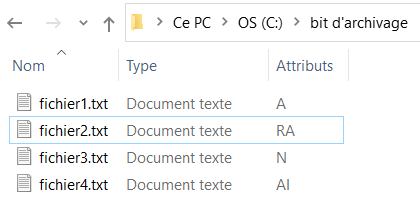

# Module 02 — Types de sauvegarde

Support « Sauvegarde, restauration, disponibilité — Types de sauvegarde », treize pages, et deux énoncés Backup Exec. Durées indiquées : 3 heures puis 1 heure.

La transcription du support et l’aide pédagogique sont séparées pour rendre leur provenance explicite.

=== "Cours Original"

    Module 2 Types de sauvegarde

    SOMMAIRE Sauvegarde à chaud vs à froid

    Méthode d’archivage – Bit d’archivage

    Sauvegarde complète

    Sauvegarde différentielle

    Sauvegarde incrémentale

    ## ROTATION DES

    Scénario de sauvegarde traditionnel GPF (Grand-père/Père/Fils) En anglais : GFS (Grand-father/Father/Son). SUPPORTS

    - La rotation Grand-père/Père/Fils est la planification de rotation des médias la plus couramment utilisée :
    - Support quotidien ➔ Fils
    - Support hebdomadaire ➔ Père
    - Support mensuel ➔ Grand-Père
    - Une stratégie de rotation GFS sur 5 jours nécessite environ 21 bandes par an.
    - Une stratégie sur 7 jours nécessite environ 23 bandes par an (deux bandes quotidiennes de plus).
    - Pour ces deux planifications, le nombre de médias nécessaires varie selon les critères de conservation spécifiés et le nombre de données sauvegardées.

    ## ROTATION DES

    Bandes Fils Quotidiennes Bandes Père Hebdomadaires Bandes Grand-Père Mensuelles

    ## SUPPORTS

    (4 jours puis recyclées) (5 semaines puis recyclées) (12 mois puis recyclées)

    Semaine 1 1 2 3 4 5 8

    Semaine 2 1 2 3 4 6

    Semaine 3 13 1 2 3 4 7

    Semaine 4 1 2 3 4 15

    Semaine 5 1 2 3 4 9 17

    Semaine 6 18 1 2 3 4 10 19

    Semaine 7 1 2 3 4 5 20

    Semaine 8 1 2 3 4

    Rotation standard avec GFS sur 5 jours (21 bandes)

    ## SAUVEGARDE

    Lors du processus de sauvegarde, les données peuvent être

    ## À CHAUD ET

    accessibles aux utilisateurs ou non. À FROID Sauvegarde à chaud : Sauvegarde à froid : les données sont sauvegardées en l'utilisateur n'a pas accès aux même temps qu'elles sont utilisées données durant tout le processus par l'utilisateur. de sauvegarde. + Immédiatement accessibles + Mise en œuvre simple + Facilement modifiables + Facile à restaurer - Mise en œuvre complexe - Interruption du service le temps de la sauvegarde

    MÉTHODE DE

    ## SAUVEGARDE

    Il existe plusieurs méthodes de sauvegarde, chacune des méthodes définies ci-après fonctionne avec des attributs de fichiers spécifiques, attribut d'archive pour Microsoft et attribut date pour Unix... Système de date Beaucoup plus simple que le bit d'archivage, une comparaison est réalisée entre la date de création, ou de modification, et la date de la dernière sauvegarde.

    ## MÉTHODE DE

    Attribut d’archive Microsoft : le bit d’archivage00 SAUVEGARDE Fichier origine Bit archive = 0

    Création-Modification fermeture

    Fichier N+1 Bit archive = 1

    sauvegarde

    Fichier N+1 Bit archive = 0

    ## MÉTHODE DE

    Sauvegarde complète

    ## SAUVEGARDE

    - Copie l'ensemble des fichiers et dossiers d'un système : impact sur le stockage important. Sauvegarde différentielle
    - La différentielle effectue d'abord une sauvegarde complète et chaque sauvegarde suivante prendra en compte les modifications apportées depuis la dernière sauvegarde complète. Sauvegarde incrémentale
    - L'incrémentale effectue d'abord une copie complète et chaque copie suivante prendra en compte les modifications apportées depuis la copie précédente.

    ## SAUVEGARDE

    Sauvegarde complète

    ## COMPLETE

    - Sauvegarde la totalité des fichiers, modifiés ou non. Elle est la base de toute solution de sauvegarde. Fonctionnement :
    - Ne se base pas sur l'attribut pour savoir quoi sauvegarder, elle sauvegarde tout !
    - Modifie l'attribut en fin de sauvegarde pour marquer le fichier.
    lun mar mer jeu ven

    ## SAUVEGARDE

    Avantages :

    ## COMPLETE

    - Restauration rapide et simple.
    - Sauvegarde la plus fiable.
    - Permet de supprimer très facilement les anciennes sauvegardes.
    Inconvénients :

    - Très gourmand en espace de stockage si l'on souhaite garder les anciennes sauvegardes.
    - Les fichiers qui n'ont pas été modifiés seront sauvegardés plusieurs fois.

    ## SAUVEGARDE

    Sauvegarde différentielle - cumulative ou T1

    - Sauvegarde les données modifiées ou ajoutées depuis la dernière
    ## DIFFERENTIELLE

    sauvegarde complète appelée « Base différentielle ». Fonctionnement :

    - Prend tous les fichiers ayant leur attribut Archive à 1.
    - Après la sauvegarde l'attribut n'est pas remis à 0, méthode dite cumulative.
    lun mar mer jeu ven Sauvegarde complète

    ## SAUVEGARDE

    Avantage :

    ## DIFFERENTIELLE

    - Restauration simple et rapide.
    - Temps de sauvegarde modéré.
    - Plus fiable qu'une sauvegarde incrémentielle.
    Inconvénients :

    - Plus lente et coûteuse qu'une sauvegarde incrémentielle.
    - Pas de rémanence sur les fichiers si un seul support de sauvegarde est utilisé.

    ## SAUVEGARDE

    Sauvegarde incrémentale

    - La sauvegarde incrémentale sauvegarde les données modifiées ou
    ## INCREMENTALE

    ajoutées depuis la dernière sauvegarde complète puis incrémentale. Fonctionnement :

    - Prend tous les fichiers ayant leurs attributs Archive à 1.
    - Après la sauvegarde l'attribut est remis à 0.
    lun mar mer jeu ven

    ## SAUVEGARDE

    Avantage :

    ## INCREMENTALE

    - L'espace de stockage.
    - Le temps de sauvegarde.
    - La consommation de la bande passante.
    Inconvénients :

    - Temps.
    - Complexité et fiabilité de la restauration des données.

    SAUVEGARDE

    ## D’UNE BASE DE

    - Une base de données est un ensemble structuré de données stockées
    ## DONNÉES

    de manière à être efficacement consultées et mises à jour.

    - Gérée par un système de gestion de base de données (SGBD).
    - Permet d'assurer l'intégrité, la disponibilité et la sécurité des données.
    - Exemple de bases de données relationnelles comme PostgreSQL ou MySQL, de bases NoSQL comme MongoDB, ou de systèmes distribués comme Cassandra.
    - Ces bases de données peuvent être déployées localement, sur des serveurs dédiés, ou dans le cloud, selon les besoins et la complexité du projet.

    La sauvegarde d'une base de données

    ## MÉTHODE DE

    Il n'y a pas de règle, chaque type de BDD dispose

    ## SAUVEGARDE :

    d’une ou plusieurs méthodes qui lui est propre.

    ## BASE DE DONNÉES

    Exemples :

    - Base SQL Server => sauvegarde via SQL Server Management Studio
    - Base MySQL=> sauvegarde via la création d'un fichier DUMP.sql
    - mysqldump -u username –p «password» [options] «database_name» «tablename» > dumpfilename.sql
    - Base Oracle => utilisation de RMAN
    - rman> backup incremental level 0 section size 512m database plus archivelog;

    SYNTHESE Méthode de Données Temps de Temps de sauvegarde sauvegardées sauvegarde restauration Sauvegarde Toutes Lent Rapide Élevé Fiabilité stockage complète Uniquement les données modifiées Volume de Nécessite Sauvegarde Le plus par rapport à la Rapide Modéré/long sauvegarde toutes les incrémentale faible précédente réduit sauvegardes sauvegarde

    Uniquement les Restauration à Sauvegarde données modifiées partir de la Sauvegarde différentielle depuis la précédente dernière volumineuse sauvegarde complète sauvegarde

    Création de job DÉMONSTRATION

    TRAVAUX TRAVAUX PRATIQUES

    ## PRATIQUES

    Mise en place de Backup Exec N°2

    ## MÉTHODE DE

    - La restauration d'éléments, que ce soit un fichier, une application, une base de données, ou un système complet est la finalité de tout
    ## RESTAURATION

    plan de sauvegarde. On n'a jamais de problème de sauvegarde, que des problèmes de restauration !

    - Les sauvegardes que l'on réalise doivent OBLIGATOIREMENT ÊTRE TESTÉES à intervalle régulier.
    - Un plan de sauvegarde ne sera considéré comme complet qu'après avoir effectué ces tests.

    MÉTHODE DE

    ## RESTAURATION

    La restauration à la demande Concerne des fichiers perdus, effacés ou altérés. Plusieurs possibilités sont disponibles :

    - Restaurer sur l'original (risque de perte des données actuelles).
    - Restaurer sur un emplacement différent du même système.
    - Protection contre l'écrasement.
    - Le plus couramment utilisé.
    - Restaurer sur un autre système.
    - Contrôle avant retour en production.
    - Palier des problèmes de stockage.
    - Restauration complète de machines virtuelles.
    - Restaurer une ancienne version via le versionning.

    MÉTHODE DE

    ## RESTAURATION

    La restauration du système d'exploitation complet d'un serveur Les solutions utilisant une méthode appelée Bare-Metal-Recovery permettent la reconstruction d’un système complet à partir d’une nouvelle unité de disques.

    Conditions et étapes 1. Architecture cible identique à l’architecture source. 2. Restauration de l'image de sauvegarde. 3. Restauration des données correspondant au Delta entre la création de l'image source et la date de la restauration.

    ## MÉTHODE DE

    La restauration d'une base de données

    ## RESTAURATION

    Il n'y a pas de règle, chaque type de BDD dispose d’une ou plusieurs méthodes de restauration qui lui est propre. Exemples :

    - Base SQL Server => restauration via SQL Server Management Studio
    - Base MySQL => restauration via l'import d'un fichier DUMP.sql mysql --user=mon_user --password=mon_password < fichier_source.sql
    - Base Oracle => restauration des fichiers depuis une sauvegarde à froid ; import datapump ; utilisation de RMAN...

    TRAVAUX TRAVAUX PRATIQUES Restauration Backup Exec PRATIQUES

    ## N°3

    Duplication

    DÉMONSTRATION

    Restauration DÉMONSTRATION


    

    ## Installation et configuration

    ## Backup Exec

    ## TP du Module 02 – Types de sauvegarde

    Avant de démarrer ce TP, il convient d’avoir suivi les modules 1 et 2 et d’avoir réalisé le TP précédent.

    Durée estimée

    3 heures

    ## Objectifs

    - Installer la solution de sauvegarde Veritas Backup Exec
    - Créer un partage iSCSI pour y stocker les sauvegardes
    - Créer une sauvegarde d’un contrôleur de domaine et d’un serveur de fichiers
    ## Énoncé

    Partie 1 :

    ## Sur srv-ad1

    - Créer un utilisateur dans l’AD
        - o Vérifier que celui-ci est opérationnel (ouverture de session)
    ## Sur srv-backup

    - Lancer l’installation de backup exec (setup fournis par le formateur).
        - o Prendre en compte les paramètres suivants pour l’installation :
    ## Langue                          Français

    ## Installation produit            Backup exec

    ## Type d’installation             Personnalisée

    Menu Installation locale – le logiciel et des fonctions backup exec Vérification environnement Faire suivant même si des warnings sont présents Ajout de licence Faire suivant – valider infobulle Configurer les options • Valeur par défaut

    - Advanced Disk-based backup feature

    - Fonction NDMP
    ## Compte de service               Admin du domaine

    Sql server Créer une instance locale de SQL Express

    ## Le temps de l’installation sur srv-backup

    - Connecter le partage iSCSI du NAS depuis le serveur srv-backup :
        - o Ouvrir l’application « initiateur iSCSI » depuis srv-backup.
        - o Allez sur l’onglet « découverte » ➔ « découvrir un portail… » ➔ ajouter l’adresse IP du serveur NAS (192.168.30.1) et laisser le port 3260 par défaut.
        - o Allez ensuite sur l’onglet « cible » puis sur « connexion », laissez les paramètres par défaut et valider.
        - o Une fois sur le statut « connecté » fermer l’application « initiateur iSCSI ».
        - o Ouvrir le gestionnaire de disque de srv-backup et formater le nouveau disque de 80 Go.
    - Ouvrir l’application Backup exec.
        - o Allez sur l’onglet « stockage » / « configurer le stockage » :
    Type de stockage Stockage basé sur disque Type de stockage sur disque Stockage sur disque Nom et description Nom : backup Description : backup sur nas Emplacement périphérique sur disque Sélectionnez le disque partagé iSCSI

    ## Écriture simultanée                             4

        - o Allez sur l’onglet « Sauvegarde et restauration » / « serveurs et hôtes virtuelles » / « Ajouter » / « Ajouter un serveur » :
    ## Ajout de serveur                              Srv-ad1

    Type de serveur Ordinateur et serveur Microsoft Windows

    ## Mise à niveau de Backup exec Agent            Oui

        - o Créer un job de sauvegarde pour le serveur srv-ad1 :
    Type de sauvegarde Stockage basé sur disque Méthode de sauvegarde Sauvegarde basée sur agent Nom et description Nom : srv-ad1 job Description : Type de sauvegarde Complète puis incrémentale Modification Pour la sauvegarde complète “effectuer une sauvegarde complète initiale en plus de la planification sélectionnée” Création du job Valider la création du job et vérifier que la tâche de sauvegarde complète démarre juste après la création

    - o Allez sur l’onglet « Sauvegarde et restauration » / « serveurs et hôtes virtuelles » / « Ajouter » / « Ajouter un serveur » :
    ## Ajout de serveur                              Srv-fic1

    Type de serveur Ordinateur et serveur Microsoft Windows

    ## Mise à niveau de Backup exec Agent            Oui

    Info : si pendant l’installation de l’agent vous obtenez l’erreur « Erreur finale : 0xe00086ce », suivre cette procédure : - Copier le dossier « C:\Program Files\Veritas\Backup Exec\Agents » depuis « srv-backup » - Coller le dossier à la racine du lecteur C: sur le serveur cible (utiliser le partage administratif c$) - Sur le serveur cible exécuter « C:\Agents\RAWSX64\setup.exe » - Une fois l’installation effectuer sur le serveur cible refaire l’ajout d’un nouveau serveur depuis SRV-Backup

        - o Créer un job de sauvegarde pour le serveur srv-fic1 :
    Type de sauvegarde Stockage basé sur disque Méthode de sauvegarde Sauvegarde basée sur agent Nom et description Nom : srv-fic1 job Description : Type de sauvegarde Complète Modification Pour la sauvegarde complète “effectuer une sauvegarde complète initiale en plus de la planification sélectionnée” Création du job Valider la création du job et vérifier que la tâche de sauvegarde complète démarre juste après la création


    ## Sauvegarde et restauration

    ## Backup Exec

    ## TP du Module 02 – Types de sauvegarde

    Avant de démarrer ce TP, il convient d’avoir suivi les modules 1 et 2 d’avoir réalisé le TP précédent.

    Durée estimée

    1 heure

    ## Objectifs

    - Restaurer un utilisateur de l’AD
    - Créer un partage NTFS pour y stocker les sauvegardes
    - Créer une sauvegarde dupliquée
    ## Énoncé

    - Après vérification de la sauvegarde complète srv-ad1 du TP précédent
        - o S'il n’y a pas d’erreur lors de la sauvegarde
        - o Se connecter sur le serveur srv-ad1 ▪ Supprimer l’utilisateur généré au début du TP précédent
        - o Depuis backup Exec effectuer une restauration granulaire en ne restaurant que l’utilisateur supprimé
        - o Une fois restauré faire directement un test de connexion avec cet utilisateur
    - Sur srv-fic1 ajouter un hdd de 45go
        - o Sur ce disque créer un dossier partagé nommé “backup-fic1” que vous partagerez
    - Sur srv-backup
        - o Ajouter le partage “backup-fic1” au pool de stockage de backup-exec
        - o Modifier le job de sauvegarde du serveur srv-ad1 pour lui ajouter les caractéristiques suivantes : ▪ Après l’exécution d’une sauvegarde complète, le job doit effectuer une duplication de la sauvegarde vers le partage “backup-fic1” ▪ Après l’exécution d’une sauvegarde incrémentale, le doit job doit effectuer une duplication de la sauvegarde vers le partage “backup-fic1”
        - o Avec l’ajout du stockage vous ferez attention aux paramètres de stockage des jobs

    o Vous lancerez de nouveau l’exécution d’une sauvegarde complète à la fin de la

    ## modification du job

=== "Cours Optimisé IA"

    Les parties ci-dessous reprennent le cours original, dans le même ordre. Les encadrés et les schémas répètent ses formulations.

    ## Parcours de lecture

    1. ROTATION DES
    2. ROTATION DES
    3. SUPPORTS
    4. SAUVEGARDE
    5. À CHAUD ET
    6. SAUVEGARDE
    7. MÉTHODE DE
    8. MÉTHODE DE
    9. SAUVEGARDE
    10. SAUVEGARDE
    11. COMPLETE
    12. SAUVEGARDE
    13. COMPLETE
    14. SAUVEGARDE
    15. DIFFERENTIELLE
    16. SAUVEGARDE
    17. DIFFERENTIELLE
    18. SAUVEGARDE
    19. INCREMENTALE
    20. SAUVEGARDE
    21. INCREMENTALE
    22. D’UNE BASE DE
    23. DONNÉES
    24. MÉTHODE DE
    25. SAUVEGARDE :
    26. BASE DE DONNÉES
    27. PRATIQUES
    28. MÉTHODE DE
    29. RESTAURATION
    30. RESTAURATION
    31. RESTAURATION
    32. MÉTHODE DE
    33. RESTAURATION
    34. N°3
    35. Installation et configuration
    36. Backup Exec
    37. TP du Module 02 – Types de sauvegarde
    38. Objectifs
    39. Énoncé
    40. Sur srv-ad1
    41. Sur srv-backup
    42. Langue                          Français
    43. Installation produit            Backup exec
    44. Type d’installation             Personnalisée
    45. Compte de service               Admin du domaine
    46. Le temps de l’installation sur srv-backup
    47. Écriture simultanée                             4
    48. Ajout de serveur                              Srv-ad1
    49. Mise à niveau de Backup exec Agent            Oui
    50. Ajout de serveur                              Srv-fic1
    51. Mise à niveau de Backup exec Agent            Oui
    52. Sauvegarde et restauration
    53. Backup Exec
    54. TP du Module 02 – Types de sauvegarde
    55. Objectifs
    56. Énoncé
    57. modification du job

    **Visuel externe**

    ```mermaid
    flowchart TD
        N1["ROTATION DES"]
        N2["ROTATION DES"]
        N3["SUPPORTS"]
        N4["SAUVEGARDE"]
        N5["À CHAUD ET"]
        N6["SAUVEGARDE"]
        N7["MÉTHODE DE"]
        N8["MÉTHODE DE"]
        N9["SAUVEGARDE"]
        N10["SAUVEGARDE"]
        N11["COMPLETE"]
        N12["SAUVEGARDE"]
        N1 --> N2
        N2 --> N3
        N3 --> N4
        N4 --> N5
        N5 --> N6
        N6 --> N7
        N7 --> N8
        N8 --> N9
        N9 --> N10
        N10 --> N11
        N11 --> N12
    ```

    Module 2 Types de sauvegarde

    SOMMAIRE Sauvegarde à chaud vs à froid

    Méthode d’archivage – Bit d’archivage

    Sauvegarde complète

    Sauvegarde différentielle

    Sauvegarde incrémentale

    ## ROTATION DES

    !!! note "À retenir"
        Scénario de sauvegarde traditionnel GPF (Grand-père/Père/Fils) En anglais : GFS (Grand-father/Father/Son).

    **Visuel externe**

    ```mermaid
    flowchart LR
        N1["Support quotidien ➔ Fils"]
        N2["Support hebdomadaire ➔ Père"]
        N3["Support mensuel ➔ Grand-Père"]
        N4["Une stratégie de rotation GFS sur 5 jours nécessite environ 21 bandes par an."]
        N1 --> N2
        N2 --> N3
        N3 --> N4
    ```

    Scénario de sauvegarde traditionnel GPF (Grand-père/Père/Fils) En anglais : GFS (Grand-father/Father/Son). SUPPORTS

    - La rotation Grand-père/Père/Fils est la planification de rotation des médias la plus couramment utilisée :
    - Support quotidien ➔ Fils
    - Support hebdomadaire ➔ Père
    - Support mensuel ➔ Grand-Père
    - Une stratégie de rotation GFS sur 5 jours nécessite environ 21 bandes par an.
    - Une stratégie sur 7 jours nécessite environ 23 bandes par an (deux bandes quotidiennes de plus).
    - Pour ces deux planifications, le nombre de médias nécessaires varie selon les critères de conservation spécifiés et le nombre de données sauvegardées.

    ## ROTATION DES

    !!! note "À retenir"
        Bandes Fils Quotidiennes Bandes Père Hebdomadaires Bandes Grand-Père Mensuelles

    Bandes Fils Quotidiennes Bandes Père Hebdomadaires Bandes Grand-Père Mensuelles

    ## SUPPORTS

    !!! note "À retenir"
        (4 jours puis recyclées) (5 semaines puis recyclées) (12 mois puis recyclées) Semaine 1 1 2 3 4 5 8 Semaine 2 1 2 3 4 6 Semaine 3 13 1 2 3 4 7 Semaine 4 1 2 3 4 15 Semaine 5 1 2 3 4 9 17 Semaine 6 18 1 2 3 4 10 19 Semaine 7 1 2 3 4 5 20 Semaine 8 1 2 3 4 Rotation standard avec GFS sur 5 jours (21 bandes)

    (4 jours puis recyclées) (5 semaines puis recyclées) (12 mois puis recyclées)

    Semaine 1 1 2 3 4 5 8

    Semaine 2 1 2 3 4 6

    Semaine 3 13 1 2 3 4 7

    Semaine 4 1 2 3 4 15

    Semaine 5 1 2 3 4 9 17

    Semaine 6 18 1 2 3 4 10 19

    Semaine 7 1 2 3 4 5 20

    Semaine 8 1 2 3 4

    Rotation standard avec GFS sur 5 jours (21 bandes)

    ## SAUVEGARDE

    !!! note "À retenir"
        Lors du processus de sauvegarde, les données peuvent être

    Lors du processus de sauvegarde, les données peuvent être

    ## À CHAUD ET

    !!! note "À retenir"
        À FROID Sauvegarde à chaud : Sauvegarde à froid : les données sont sauvegardées en l'utilisateur n'a pas accès aux même temps qu'elles sont utilisées données durant tout le processus par l'utilisateur.

    accessibles aux utilisateurs ou non. À FROID Sauvegarde à chaud : Sauvegarde à froid : les données sont sauvegardées en l'utilisateur n'a pas accès aux même temps qu'elles sont utilisées données durant tout le processus par l'utilisateur. de sauvegarde. + Immédiatement accessibles + Mise en œuvre simple + Facilement modifiables + Facile à restaurer - Mise en œuvre complexe - Interruption du service le temps de la sauvegarde

    MÉTHODE DE

    ## SAUVEGARDE

    !!! note "À retenir"
        Il existe plusieurs méthodes de sauvegarde, chacune des méthodes définies ci-après fonctionne avec des attributs de fichiers spécifiques, attribut d'archive pour Microsoft et attribut date pour Unix...

    Il existe plusieurs méthodes de sauvegarde, chacune des méthodes définies ci-après fonctionne avec des attributs de fichiers spécifiques, attribut d'archive pour Microsoft et attribut date pour Unix... Système de date Beaucoup plus simple que le bit d'archivage, une comparaison est réalisée entre la date de création, ou de modification, et la date de la dernière sauvegarde.

    ## MÉTHODE DE

    !!! note "À retenir"
        Attribut d’archive Microsoft : le bit d’archivage00 SAUVEGARDE Fichier origine Bit archive = 0 Création-Modification fermeture Fichier N+1 Bit archive = 1 sauvegarde Fichier N+1 Bit archive = 0

    Attribut d’archive Microsoft : le bit d’archivage00 SAUVEGARDE Fichier origine Bit archive = 0

    Création-Modification fermeture

    Fichier N+1 Bit archive = 1

    sauvegarde

    Fichier N+1 Bit archive = 0

    ## MÉTHODE DE

    Sauvegarde complète

    ## SAUVEGARDE

    !!! note "À retenir"
        Copie l'ensemble des fichiers et dossiers d'un système : impact sur le stockage important.

    - Copie l'ensemble des fichiers et dossiers d'un système : impact sur le stockage important. Sauvegarde différentielle
    - La différentielle effectue d'abord une sauvegarde complète et chaque sauvegarde suivante prendra en compte les modifications apportées depuis la dernière sauvegarde complète. Sauvegarde incrémentale
    - L'incrémentale effectue d'abord une copie complète et chaque copie suivante prendra en compte les modifications apportées depuis la copie précédente.

    ## SAUVEGARDE

    Sauvegarde complète

    ## COMPLETE

    - Sauvegarde la totalité des fichiers, modifiés ou non. Elle est la base de toute solution de sauvegarde. Fonctionnement :
    - Ne se base pas sur l'attribut pour savoir quoi sauvegarder, elle sauvegarde tout !
    - Modifie l'attribut en fin de sauvegarde pour marquer le fichier.
    lun mar mer jeu ven

    ## SAUVEGARDE

    Avantages :

    ## COMPLETE

    **Visuel externe**

    ```mermaid
    flowchart LR
        N1["Restauration rapide et simple."]
        N2["Sauvegarde la plus fiable."]
        N3["Permet de supprimer très facilement les anciennes sauvegardes."]
        N4["Les fichiers qui n'ont pas été modifiés seront sauvegardés plusieurs fois."]
        N1 --> N2
        N2 --> N3
        N3 --> N4
    ```

    - Restauration rapide et simple.
    - Sauvegarde la plus fiable.
    - Permet de supprimer très facilement les anciennes sauvegardes.
    Inconvénients :

    - Très gourmand en espace de stockage si l'on souhaite garder les anciennes sauvegardes.
    - Les fichiers qui n'ont pas été modifiés seront sauvegardés plusieurs fois.

    ## SAUVEGARDE

    Sauvegarde différentielle - cumulative ou T1

    - Sauvegarde les données modifiées ou ajoutées depuis la dernière

    ## DIFFERENTIELLE

    sauvegarde complète appelée « Base différentielle ». Fonctionnement :

    - Prend tous les fichiers ayant leur attribut Archive à 1.
    - Après la sauvegarde l'attribut n'est pas remis à 0, méthode dite cumulative.
    lun mar mer jeu ven Sauvegarde complète

    ## SAUVEGARDE

    Avantage :

    ## DIFFERENTIELLE

    **Visuel externe**

    ```mermaid
    flowchart LR
        N1["Restauration simple et rapide."]
        N2["Temps de sauvegarde modéré."]
        N3["Plus fiable qu'une sauvegarde incrémentielle."]
        N4["Plus lente et coûteuse qu'une sauvegarde incrémentielle."]
        N5["Pas de rémanence sur les fichiers si un seul support de sauvegarde est utilisé."]
        N1 --> N2
        N2 --> N3
        N3 --> N4
        N4 --> N5
    ```

    - Restauration simple et rapide.
    - Temps de sauvegarde modéré.
    - Plus fiable qu'une sauvegarde incrémentielle.
    Inconvénients :

    - Plus lente et coûteuse qu'une sauvegarde incrémentielle.
    - Pas de rémanence sur les fichiers si un seul support de sauvegarde est utilisé.

    ## SAUVEGARDE

    Sauvegarde incrémentale

    - La sauvegarde incrémentale sauvegarde les données modifiées ou

    ## INCREMENTALE

    ajoutées depuis la dernière sauvegarde complète puis incrémentale. Fonctionnement :

    - Prend tous les fichiers ayant leurs attributs Archive à 1.
    - Après la sauvegarde l'attribut est remis à 0.
    lun mar mer jeu ven

    ## SAUVEGARDE

    Avantage :

    ## INCREMENTALE

    **Visuel externe**

    ```mermaid
    flowchart LR
        N1["L'espace de stockage."]
        N2["Le temps de sauvegarde."]
        N3["La consommation de la bande passante."]
        N4["Temps."]
        N5["Complexité et fiabilité de la restauration des données."]
        N1 --> N2
        N2 --> N3
        N3 --> N4
        N4 --> N5
    ```

    - L'espace de stockage.
    - Le temps de sauvegarde.
    - La consommation de la bande passante.
    Inconvénients :

    - Temps.
    - Complexité et fiabilité de la restauration des données.

    SAUVEGARDE

    ## D’UNE BASE DE

    - Une base de données est un ensemble structuré de données stockées

    ## DONNÉES

    de manière à être efficacement consultées et mises à jour.

    - Gérée par un système de gestion de base de données (SGBD).
    - Permet d'assurer l'intégrité, la disponibilité et la sécurité des données.
    - Exemple de bases de données relationnelles comme PostgreSQL ou MySQL, de bases NoSQL comme MongoDB, ou de systèmes distribués comme Cassandra.
    - Ces bases de données peuvent être déployées localement, sur des serveurs dédiés, ou dans le cloud, selon les besoins et la complexité du projet.

    La sauvegarde d'une base de données

    ## MÉTHODE DE

    Il n'y a pas de règle, chaque type de BDD dispose

    ## SAUVEGARDE :

    d’une ou plusieurs méthodes qui lui est propre.

    ## BASE DE DONNÉES

    Exemples :

    - Base SQL Server => sauvegarde via SQL Server Management Studio
    - Base MySQL=> sauvegarde via la création d'un fichier DUMP.sql
    - mysqldump -u username –p «password» [options] «database_name» «tablename» > dumpfilename.sql
    - Base Oracle => utilisation de RMAN
    - rman> backup incremental level 0 section size 512m database plus archivelog;

    SYNTHESE Méthode de Données Temps de Temps de sauvegarde sauvegardées sauvegarde restauration Sauvegarde Toutes Lent Rapide Élevé Fiabilité stockage complète Uniquement les données modifiées Volume de Nécessite Sauvegarde Le plus par rapport à la Rapide Modéré/long sauvegarde toutes les incrémentale faible précédente réduit sauvegardes sauvegarde

    Uniquement les Restauration à Sauvegarde données modifiées partir de la Sauvegarde différentielle depuis la précédente dernière volumineuse sauvegarde complète sauvegarde

    Création de job DÉMONSTRATION

    TRAVAUX TRAVAUX PRATIQUES

    ## PRATIQUES

    Mise en place de Backup Exec N°2

    ## MÉTHODE DE

    - La restauration d'éléments, que ce soit un fichier, une application, une base de données, ou un système complet est la finalité de tout

    ## RESTAURATION

    plan de sauvegarde. On n'a jamais de problème de sauvegarde, que des problèmes de restauration !

    - Les sauvegardes que l'on réalise doivent OBLIGATOIREMENT ÊTRE TESTÉES à intervalle régulier.
    - Un plan de sauvegarde ne sera considéré comme complet qu'après avoir effectué ces tests.

    MÉTHODE DE

    ## RESTAURATION

    La restauration à la demande Concerne des fichiers perdus, effacés ou altérés. Plusieurs possibilités sont disponibles :

    - Restaurer sur l'original (risque de perte des données actuelles).
    - Restaurer sur un emplacement différent du même système.
    - Protection contre l'écrasement.
    - Le plus couramment utilisé.
    - Restaurer sur un autre système.
    - Contrôle avant retour en production.
    - Palier des problèmes de stockage.
    - Restauration complète de machines virtuelles.
    - Restaurer une ancienne version via le versionning.

    MÉTHODE DE

    ## RESTAURATION

    La restauration du système d'exploitation complet d'un serveur Les solutions utilisant une méthode appelée Bare-Metal-Recovery permettent la reconstruction d’un système complet à partir d’une nouvelle unité de disques.

    Conditions et étapes 1. Architecture cible identique à l’architecture source. 2. Restauration de l'image de sauvegarde. 3. Restauration des données correspondant au Delta entre la création de l'image source et la date de la restauration.

    ## MÉTHODE DE

    La restauration d'une base de données

    ## RESTAURATION

    Il n'y a pas de règle, chaque type de BDD dispose d’une ou plusieurs méthodes de restauration qui lui est propre. Exemples :

    - Base SQL Server => restauration via SQL Server Management Studio
    - Base MySQL => restauration via l'import d'un fichier DUMP.sql mysql --user=mon_user --password=mon_password < fichier_source.sql
    - Base Oracle => restauration des fichiers depuis une sauvegarde à froid ; import datapump ; utilisation de RMAN...

    TRAVAUX TRAVAUX PRATIQUES Restauration Backup Exec PRATIQUES

    ## N°3

    Duplication

    DÉMONSTRATION

    Restauration DÉMONSTRATION


    

    ## Installation et configuration

    ## Backup Exec

    ## TP du Module 02 – Types de sauvegarde

    Avant de démarrer ce TP, il convient d’avoir suivi les modules 1 et 2 et d’avoir réalisé le TP précédent.

    Durée estimée

    3 heures

    ## Objectifs

    - Installer la solution de sauvegarde Veritas Backup Exec
    - Créer un partage iSCSI pour y stocker les sauvegardes
    - Créer une sauvegarde d’un contrôleur de domaine et d’un serveur de fichiers

    ## Énoncé

    Partie 1 :

    ## Sur srv-ad1

    - Créer un utilisateur dans l’AD
        - o Vérifier que celui-ci est opérationnel (ouverture de session)

    ## Sur srv-backup

    - Lancer l’installation de backup exec (setup fournis par le formateur).
        - o Prendre en compte les paramètres suivants pour l’installation :

    ## Langue                          Français

    ## Installation produit            Backup exec

    ## Type d’installation             Personnalisée

    Menu Installation locale – le logiciel et des fonctions backup exec Vérification environnement Faire suivant même si des warnings sont présents Ajout de licence Faire suivant – valider infobulle Configurer les options • Valeur par défaut

    - Advanced Disk-based backup feature

    - Fonction NDMP

    ## Compte de service               Admin du domaine

    Sql server Créer une instance locale de SQL Express

    ## Le temps de l’installation sur srv-backup

    - Connecter le partage iSCSI du NAS depuis le serveur srv-backup :
        - o Ouvrir l’application « initiateur iSCSI » depuis srv-backup.
        - o Allez sur l’onglet « découverte » ➔ « découvrir un portail… » ➔ ajouter l’adresse IP du serveur NAS (192.168.30.1) et laisser le port 3260 par défaut.
        - o Allez ensuite sur l’onglet « cible » puis sur « connexion », laissez les paramètres par défaut et valider.
        - o Une fois sur le statut « connecté » fermer l’application « initiateur iSCSI ».
        - o Ouvrir le gestionnaire de disque de srv-backup et formater le nouveau disque de 80 Go.
    - Ouvrir l’application Backup exec.
        - o Allez sur l’onglet « stockage » / « configurer le stockage » :
    Type de stockage Stockage basé sur disque Type de stockage sur disque Stockage sur disque Nom et description Nom : backup Description : backup sur nas Emplacement périphérique sur disque Sélectionnez le disque partagé iSCSI

    ## Écriture simultanée                             4

    - o Allez sur l’onglet « Sauvegarde et restauration » / « serveurs et hôtes virtuelles » / « Ajouter » / « Ajouter un serveur » :

    ## Ajout de serveur                              Srv-ad1

    Type de serveur Ordinateur et serveur Microsoft Windows

    ## Mise à niveau de Backup exec Agent            Oui

    - o Créer un job de sauvegarde pour le serveur srv-ad1 :
    Type de sauvegarde Stockage basé sur disque Méthode de sauvegarde Sauvegarde basée sur agent Nom et description Nom : srv-ad1 job Description : Type de sauvegarde Complète puis incrémentale Modification Pour la sauvegarde complète “effectuer une sauvegarde complète initiale en plus de la planification sélectionnée” Création du job Valider la création du job et vérifier que la tâche de sauvegarde complète démarre juste après la création

    - o Allez sur l’onglet « Sauvegarde et restauration » / « serveurs et hôtes virtuelles » / « Ajouter » / « Ajouter un serveur » :

    ## Ajout de serveur                              Srv-fic1

    Type de serveur Ordinateur et serveur Microsoft Windows

    ## Mise à niveau de Backup exec Agent            Oui

    Info : si pendant l’installation de l’agent vous obtenez l’erreur « Erreur finale : 0xe00086ce », suivre cette procédure : - Copier le dossier « C:\Program Files\Veritas\Backup Exec\Agents » depuis « srv-backup » - Coller le dossier à la racine du lecteur C: sur le serveur cible (utiliser le partage administratif c$) - Sur le serveur cible exécuter « C:\Agents\RAWSX64\setup.exe » - Une fois l’installation effectuer sur le serveur cible refaire l’ajout d’un nouveau serveur depuis SRV-Backup

        - o Créer un job de sauvegarde pour le serveur srv-fic1 :
    Type de sauvegarde Stockage basé sur disque Méthode de sauvegarde Sauvegarde basée sur agent Nom et description Nom : srv-fic1 job Description : Type de sauvegarde Complète Modification Pour la sauvegarde complète “effectuer une sauvegarde complète initiale en plus de la planification sélectionnée” Création du job Valider la création du job et vérifier que la tâche de sauvegarde complète démarre juste après la création

    ## Sauvegarde et restauration

    ## Backup Exec

    ## TP du Module 02 – Types de sauvegarde

    Avant de démarrer ce TP, il convient d’avoir suivi les modules 1 et 2 d’avoir réalisé le TP précédent.

    Durée estimée

    1 heure

    ## Objectifs

    - Restaurer un utilisateur de l’AD
    - Créer un partage NTFS pour y stocker les sauvegardes
    - Créer une sauvegarde dupliquée

    ## Énoncé

    - Après vérification de la sauvegarde complète srv-ad1 du TP précédent
        - o S'il n’y a pas d’erreur lors de la sauvegarde
        - o Se connecter sur le serveur srv-ad1 ▪ Supprimer l’utilisateur généré au début du TP précédent
        - o Depuis backup Exec effectuer une restauration granulaire en ne restaurant que l’utilisateur supprimé
        - o Une fois restauré faire directement un test de connexion avec cet utilisateur
    - Sur srv-fic1 ajouter un hdd de 45go
        - o Sur ce disque créer un dossier partagé nommé “backup-fic1” que vous partagerez
    - Sur srv-backup
        - o Ajouter le partage “backup-fic1” au pool de stockage de backup-exec
        - o Modifier le job de sauvegarde du serveur srv-ad1 pour lui ajouter les caractéristiques suivantes : ▪ Après l’exécution d’une sauvegarde complète, le job doit effectuer une duplication de la sauvegarde vers le partage “backup-fic1” ▪ Après l’exécution d’une sauvegarde incrémentale, le doit job doit effectuer une duplication de la sauvegarde vers le partage “backup-fic1”
        - o Avec l’ajout du stockage vous ferez attention aux paramètres de stockage des jobs

    o Vous lancerez de nouveau l’exécution d’une sauvegarde complète à la fin de la

    ## modification du job

    ## Fiche de synthèse

    Les lignes reprennent les titres du cours et la première phrase de chaque partie.

    | Partie | Repère du cours |
    | --- | --- |
    | ROTATION DES | Scénario de sauvegarde traditionnel GPF (Grand-père/Père/Fils) En anglais : GFS (Grand-father/Father/Son). |
    | ROTATION DES | Bandes Fils Quotidiennes Bandes Père Hebdomadaires Bandes Grand-Père Mensuelles |
    | SUPPORTS | (4 jours puis recyclées) (5 semaines puis recyclées) (12 mois puis recyclées) Semaine 1 1 2 3 4 5 8 Semaine 2 1 2 3 4 6 Semaine 3 13 1 2 3 4 7 Semaine 4 1 2 3 4 15 Semaine 5 1 2… |
    | SAUVEGARDE | Lors du processus de sauvegarde, les données peuvent être |
    | À CHAUD ET | À FROID Sauvegarde à chaud : Sauvegarde à froid : les données sont sauvegardées en l'utilisateur n'a pas accès aux même temps qu'elles sont utilisées données durant tout le proc… |
    | SAUVEGARDE | Il existe plusieurs méthodes de sauvegarde, chacune des méthodes définies ci-après fonctionne avec des attributs de fichiers spécifiques, attribut d'archive pour Microsoft et at… |
    | MÉTHODE DE | Attribut d’archive Microsoft : le bit d’archivage00 SAUVEGARDE Fichier origine Bit archive = 0 Création-Modification fermeture Fichier N+1 Bit archive = 1 sauvegarde Fichier N+1… |
    | SAUVEGARDE | Copie l'ensemble des fichiers et dossiers d'un système : impact sur le stockage important. |
    | COMPLETE | Sauvegarde la totalité des fichiers, modifiés ou non. |
    | COMPLETE | Permet de supprimer très facilement les anciennes sauvegardes. |
    | SAUVEGARDE | Sauvegarde différentielle - cumulative ou T1 Sauvegarde les données modifiées ou ajoutées depuis la dernière |
    | DIFFERENTIELLE | sauvegarde complète appelée « Base différentielle ». |
    | DIFFERENTIELLE | Plus fiable qu'une sauvegarde incrémentielle. |
    | SAUVEGARDE | Sauvegarde incrémentale La sauvegarde incrémentale sauvegarde les données modifiées ou |
    | INCREMENTALE | ajoutées depuis la dernière sauvegarde complète puis incrémentale. |
    | INCREMENTALE | Complexité et fiabilité de la restauration des données. |
    | D’UNE BASE DE | Une base de données est un ensemble structuré de données stockées |
    | DONNÉES | de manière à être efficacement consultées et mises à jour. |
    | MÉTHODE DE | Il n'y a pas de règle, chaque type de BDD dispose |
    | SAUVEGARDE : | d’une ou plusieurs méthodes qui lui est propre. |
    | BASE DE DONNÉES | Exemples : Base SQL Server => sauvegarde via SQL Server Management Studio Base MySQL=> sauvegarde via la création d'un fichier DUMP.sql mysqldump -u username –p «password» [opti… |
    | MÉTHODE DE | La restauration d'éléments, que ce soit un fichier, une application, une base de données, ou un système complet est la finalité de tout |
    | RESTAURATION | On n'a jamais de problème de sauvegarde, que des problèmes de restauration ! |
    | RESTAURATION | La restauration à la demande Concerne des fichiers perdus, effacés ou altérés. |
    | RESTAURATION | La restauration du système d'exploitation complet d'un serveur Les solutions utilisant une méthode appelée Bare-Metal-Recovery permettent la reconstruction d’un système complet… |
    | RESTAURATION | Il n'y a pas de règle, chaque type de BDD dispose d’une ou plusieurs méthodes de restauration qui lui est propre. |
    | N°3 | Duplication DÉMONSTRATION Restauration DÉMONSTRATION |
    | TP du Module 02 – Types de sauvegarde | Avant de démarrer ce TP, il convient d’avoir suivi les modules 1 et 2 et d’avoir réalisé le TP précédent. |
    | Objectifs | Installer la solution de sauvegarde Veritas Backup Exec Créer un partage iSCSI pour y stocker les sauvegardes Créer une sauvegarde d’un contrôleur de domaine et d’un serveur de… |
    | Sur srv-ad1 | Créer un utilisateur dans l’AD - o Vérifier que celui-ci est opérationnel (ouverture de session) |
    | Sur srv-backup | Lancer l’installation de backup exec (setup fournis par le formateur). |
    | Type d’installation             Personnalisée | Menu Installation locale – le logiciel et des fonctions backup exec Vérification environnement Faire suivant même si des warnings sont présents Ajout de licence Faire suivant –… |
    | Compte de service               Admin du domaine | Sql server Créer une instance locale de SQL Express |
    | Le temps de l’installation sur srv-backup | Connecter le partage iSCSI du NAS depuis le serveur srv-backup : - o Ouvrir l’application « initiateur iSCSI » depuis srv-backup. |
    | Écriture simultanée                             4 | o Allez sur l’onglet « Sauvegarde et restauration » / « serveurs et hôtes virtuelles » / « Ajouter » / « Ajouter un serveur » : |
    | Ajout de serveur                              Srv-ad1 | Type de serveur Ordinateur et serveur Microsoft Windows |
    | Mise à niveau de Backup exec Agent            Oui | o Créer un job de sauvegarde pour le serveur srv-ad1 : Type de sauvegarde Stockage basé sur disque Méthode de sauvegarde Sauvegarde basée sur agent Nom et description Nom : srv-… |
    | Ajout de serveur                              Srv-fic1 | Type de serveur Ordinateur et serveur Microsoft Windows |
    | Mise à niveau de Backup exec Agent            Oui | Info : si pendant l’installation de l’agent vous obtenez l’erreur « Erreur finale : 0xe00086ce », suivre cette procédure : - Copier le dossier « C:\Program Files\Veritas\Backup… |
    | TP du Module 02 – Types de sauvegarde | Avant de démarrer ce TP, il convient d’avoir suivi les modules 1 et 2 d’avoir réalisé le TP précédent. |
    | Objectifs | Restaurer un utilisateur de l’AD Créer un partage NTFS pour y stocker les sauvegardes Créer une sauvegarde dupliquée |
    | Énoncé | Après vérification de la sauvegarde complète srv-ad1 du TP précédent - o S'il n’y a pas d’erreur lors de la sauvegarde - o Se connecter sur le serveur srv-ad1 ▪ Supprimer l’util… |
