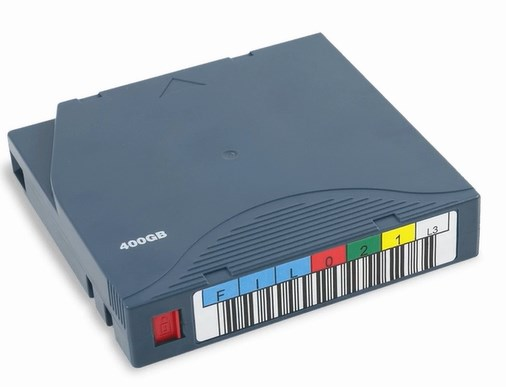
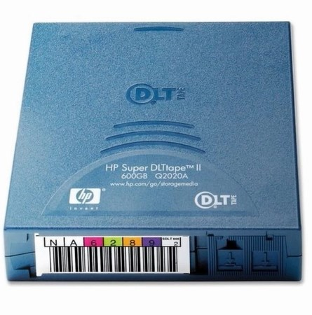

# Module 03 — Gestion du stockage

Support « Gestion du stockage », neuf pages, et énoncé Veeam. Durée indiquée du TP : 1 heure.

La transcription du support et l’aide pédagogique sont séparées pour rendre leur provenance explicite.

=== "Cours Original"

    GESTION DU STOCKAGE

    Module 03 Gestion du stockage

    SOMMAIRE Critères à respecter

    Solution DAS

    Solution NAS

    Solution SAN

    Exécution des sauvegardes

    ## INFRASTRUCTURE

    Pour mettre en place une sauvegarde, une infrastructure logicielle

    ## DE SAUVEGARDE

    et matérielle est nécessaire.

    La partie matérielle

    - Les supports de sauvegarde.
    - Les lecteurs et la robotique de sauvegarde.
    La partie logicielle

    - Le logiciel de sauvegarde.
    - Le logiciel chargé de lancer les sauvegardes, appelé ordonnanceur.

    ## LES SUPPORTS

    Il y a plusieurs critères à prendre en compte pour choisir

    ## DE SAUVEGARDE

    le ou les supports de sauvegarde les mieux adaptés au périmètre de la sauvegarde données :

    - La capacité de stockage.
    - La fiabilité du support.
    - Le temps d'accès en lecture / écriture.
    - La consommation électrique.
    - La sécurité.

    ## LES SUPPORTS

    Support Atouts Limites

    ## DE SAUVEGARDE

    CD / DVD • Peu encombrant

    - Peu coûteux BLU-RAY                                            •   Durée de vie faible
    - Simplicité d'utilisation Disque dur HDD                                          •   Sensibilité aux chocs
    - Peu coûteux
    - Simplicité d'utilisation Disque dur SSD        •   Prix en baisse                •   Plus coûteux qu’un HDD
    - Resistance au choc
    - Résistance au choc Clé USB                                            •   Capacité de stockage limitée
    - Coût faible
    Carte mémoire • Résistance aux chocs • Capacité de stockage faible

    ## LES SUPPORTS

    Support Atouts Limites

    ## DE SAUVEGARDE

    Bandes magnétiques

    - Durée de vie élevé
    - Large gamme de choix
    Technologie RDX • Simplicité d'utilisation

    - Simplicité de mise en œuvre NAS                                               • Encombrement du réseau
    - Redondance via le RAID
    - Sécurisation des données          • Problèmes d'interopérabilité SAN
    - Simplicité d'administration       • Complexité de mise en œuvre
    - Fichiers accessibles à tout Cloud                 moment
    - Données protégées

    ## DAS

    SOLUTION DAS : Direct Attached Storage

    - Les solutions de stockage de type DAS consistent à connecter directement un périphérique au serveur ou à la station de travail.
    - Il s'agit principalement d'un lecteur de bandes magnétiques mais d'autres solutions peuvent être envisagées, comme le support optique ou les disques.
    Système de Application fichier

    LES SUPPORTS

    ## DE SAUVEGARDE

    La bande magnétique

    - Support utilisé depuis 1950 pour le stockage d’informations numériques.
    - Deux types de bandes : hélicoïdale et linéaire.
    Avantages

    - Capacité de stockage importante.
    - Automatisation avec les robots de sauvegarde qui acceptent plusieurs bandes magnétiques dont le chargement est automatisé.

    LES SUPPORTS

    ## DE SAUVEGARDE

    Sauvegarde sur bande magnétique

    - DDS - DAT : DDS (Digital Data Storage) est le nom officiel de la DAT (Digital Audio Tape).
    - DLT – SDLT : Digital Linear Tape (DLT, anciennement nommée CompacTape).
    - LTO : Linear Tape-Open (ou LTO) est une technique de stockage sur bande magnétique au format ouvert.

    LES SUPPORTS DE SAUVEGARDE

    Capacité bande magnétique LES SUPPORTS DE SAUVEGARDE natif​ compressé​ natif​ compressé​ DAT DDS3​ 12​ Go 24​ Go LTO 12​ 192 To 480 To​ DAT DDS4​ 20​ Go 40​ Go LTO 11​ 96 To​ 240 To​ DAT 72​ 36​ Go 72​ Go LTO 10​ 48 To​ 120 To​ DAT 160​ 80​ Go 160​ Go LTO 9​ 18 To​ 45 To​ DLT-Tape VS1​ 80​ Go 160​ Go LTO 8​ 12 To​ 30 To​ SDLT 1​ 160​ Go 320​ Go LTO 7​ 6 To 15 To​ SDLT 2​ 300​ Go 600​ Go LTO 6​ 2,5 To​ 6,25 To​ SDLT 3 / DLT-S4​ 800​ Go 1600 Go LTO 5​ 1,5 To​ 3 To​

    ## SAN

    SOLUTION SAN : Storage Area Network

    - Réseau dédié de dispositifs de stockage, permet aux serveurs d'accéder à des espaces de stockage centralisés, comme s'ils étaient des disques durs locaux.
    - Dans un SAN, c’est le serveur qui gère le système de fichier sur les espaces de stockage auxquels il a accès.
    Application SAN de

    ## NAS

    SOLUTION NAS : Network Attached Storage

    - Appareil de stockage connecté à un réseau qui permet aux utilisateurs de sauvegarder et partager des fichiers au sein d'un réseau local.
    - Un périphérique NAS possède son propre système de fichier, généralement du CIFS (Common Internet File System) pour le monde Windows ou du NFS (Network File System) OU SAMBA pour le monde Unix/Linux.
    Système Application de LAN fichier

    ## LES SUPPORTS

    SAN NAS

    ## DE SAUVEGARDE

    Signification Storage Area Network Network Attached Storage Protocoles SCSI, Fibre Channel ou SATA. Serveur de fichiers, NFS ou CIFS. Partage de Le partage de fichier repose l’information sur le système d’exploitation. Identification Identifie les données par Adresse les données par le nom des données bloc de disque. de fichier et l’offset de l’octet. Périphériques de classe Périphérique connecté au réseau Eligibilité au serveurs dotés du canal local, doté des protocoles NFS, dispositif Fibre Channel SCSI. CIFS/SMB, HTTP ou HTTPS. Coût et Cher et plus complexe. Rentable et moins compliqué. complexité

    ## EXÉCUTION DES

    Sauvegarde locale

    ## SAUVEGARDES

    Directement réalisée sur le site d'exploitation, sur un support local, les données ne sortent pas du réseau interne de l'entreprise.

    - Serveur de stockage disponible sur le réseau.                 RAPPEL
    - Disque dur.                                                 REGLE 3–2–1
    - Bande magnétique (externalisation du support physique). Sauvegarde distante ou externalisée Réalisée en dehors du site d'exploitation, vers un site distant ou sur Internet via une connexion sécurisée, les données sortent du réseau interne de l'entreprise.

    Création de job DÉMONSTRATION

    Gestion du stockage

    Restauration du Job DÉMONSTRATION

    TRAVAUX GESTION DUPRATIQUES

    TRAVAUX TRAVAUX PRATIQUES VEEAM Sauvegarde et PRATIQUES

    ## N°4

    restauration de VM


    

    

    ## Sauvegarde et restauration

    ## VEEAM

    ## TP du Module 03 – Gestion du stockage

    Avant de démarrer ce TP, il convient d’avoir suivi les modules 1, 2 et 3 et d’avoir réalisé le TP précédent.

    Durée estimée

    1 heure

    ## Objectifs

    - Installer la solution de sauvegarde Veeam Backup & Replication
    - Sauvegarder des VM
    - Restaurer une VM
    ## Énoncé

    Sur SRV-HyperV :

    Ne pas oublier d’ouvrir le port 445 (Service Accès réseau (NP-in))

    Sur Srv-backup:

    - Désinstaller Backup Exec
    - Installer VEEAM 12 backup & replication
    - Dans Veeam menu « Inventory » ajouter le serveur HyperV : « Add Server »
    ## Name                             SRV-HyperV

    Type Microsoft Hyper-V Server (Standalone) Crédential « Add… » « SRV-HyperV\administrateur »

    ## Review                           Task limit : 4

    - Une fois l’ajout effectué, vérifier sur le serveur SRV-HyperV la présence des serveurs :
        - o SRV-AD1
        - o SRV-FIC1
    - Créer un job de sauvegarde pour le serveur srv-Fic1

    - o Menu « Home »
        - o « Backup job »
        - o «Virtual Machine »
    ## Name                            SVGD-FIC1

    ## Virtual Machine                 « Add… » « Srv-Fic1 »

    Storage Default Backup Repository

    ## Review                          Task limit : 4

        - o Exécution immédiate
    - Après vérification de la sauvegarde complète srv-fic1
        - o S'il n’y a pas d’erreur lors de la sauvegarde
        - o Supprimer le serveur srv-fic1 depuis SRV-HYPERV
        - o Depuis VEEAM effectuer une restauration complète de la VM srv-fic1
        - o Une fois la restauration terminée vérifier que tous les paramètres du serveur sont bons et opérationnels

=== "Cours Optimisé IA"

    Les parties ci-dessous reprennent le cours original, dans le même ordre. Les encadrés et les schémas répètent ses formulations.

    ## Parcours de lecture

    1. INFRASTRUCTURE
    2. DE SAUVEGARDE
    3. LES SUPPORTS
    4. DE SAUVEGARDE
    5. LES SUPPORTS
    6. DE SAUVEGARDE
    7. LES SUPPORTS
    8. DE SAUVEGARDE
    9. DAS
    10. DE SAUVEGARDE
    11. DE SAUVEGARDE
    12. SAN
    13. NAS
    14. LES SUPPORTS
    15. DE SAUVEGARDE
    16. EXÉCUTION DES
    17. SAUVEGARDES
    18. N°4
    19. Sauvegarde et restauration
    20. VEEAM
    21. TP du Module 03 – Gestion du stockage
    22. Objectifs
    23. Énoncé
    24. Name                             SRV-HyperV
    25. Review                           Task limit : 4
    26. Name                            SVGD-FIC1
    27. Virtual Machine                 « Add… » « Srv-Fic1 »
    28. Review                          Task limit : 4

    **Visuel externe**

    ```mermaid
    flowchart TD
        N1["INFRASTRUCTURE"]
        N2["DE SAUVEGARDE"]
        N3["LES SUPPORTS"]
        N4["DE SAUVEGARDE"]
        N5["LES SUPPORTS"]
        N6["DE SAUVEGARDE"]
        N7["LES SUPPORTS"]
        N8["DE SAUVEGARDE"]
        N9["DAS"]
        N10["DE SAUVEGARDE"]
        N11["DE SAUVEGARDE"]
        N12["SAN"]
        N1 --> N2
        N2 --> N3
        N3 --> N4
        N4 --> N5
        N5 --> N6
        N6 --> N7
        N7 --> N8
        N8 --> N9
        N9 --> N10
        N10 --> N11
        N11 --> N12
    ```

    GESTION DU STOCKAGE

    Module 03 Gestion du stockage

    SOMMAIRE Critères à respecter

    Solution DAS

    Solution NAS

    Solution SAN

    Exécution des sauvegardes

    ## INFRASTRUCTURE

    !!! note "À retenir"
        Pour mettre en place une sauvegarde, une infrastructure logicielle

    Pour mettre en place une sauvegarde, une infrastructure logicielle

    ## DE SAUVEGARDE

    !!! note "À retenir"
        La partie matérielle Les supports de sauvegarde.

    **Visuel externe**

    ```mermaid
    flowchart LR
        N1["Les supports de sauvegarde."]
        N2["Les lecteurs et la robotique de sauvegarde."]
        N3["Le logiciel de sauvegarde."]
        N4["Le logiciel chargé de lancer les sauvegardes, appelé ordonnanceur."]
        N1 --> N2
        N2 --> N3
        N3 --> N4
    ```

    et matérielle est nécessaire.

    La partie matérielle

    - Les supports de sauvegarde.
    - Les lecteurs et la robotique de sauvegarde.
    La partie logicielle

    - Le logiciel de sauvegarde.
    - Le logiciel chargé de lancer les sauvegardes, appelé ordonnanceur.

    ## LES SUPPORTS

    !!! note "À retenir"
        Il y a plusieurs critères à prendre en compte pour choisir

    Il y a plusieurs critères à prendre en compte pour choisir

    ## DE SAUVEGARDE

    !!! note "À retenir"
        le ou les supports de sauvegarde les mieux adaptés au périmètre de la sauvegarde données : La capacité de stockage.

    **Visuel externe**

    ```mermaid
    flowchart LR
        N1["La capacité de stockage."]
        N2["La fiabilité du support."]
        N3["Le temps d'accès en lecture / écriture."]
        N4["La consommation électrique."]
        N5["La sécurité."]
        N1 --> N2
        N2 --> N3
        N3 --> N4
        N4 --> N5
    ```

    le ou les supports de sauvegarde les mieux adaptés au périmètre de la sauvegarde données :

    - La capacité de stockage.
    - La fiabilité du support.
    - Le temps d'accès en lecture / écriture.
    - La consommation électrique.
    - La sécurité.

    ## LES SUPPORTS

    Support Atouts Limites

    ## DE SAUVEGARDE

    **Visuel externe**

    ```mermaid
    flowchart LR
        N1["Peu coûteux"]
        N2["Resistance au choc"]
        N3["Coût faible"]
        N1 --> N2
        N2 --> N3
    ```

    CD / DVD • Peu encombrant

    - Peu coûteux BLU-RAY                                            •   Durée de vie faible
    - Simplicité d'utilisation Disque dur HDD                                          •   Sensibilité aux chocs
    - Peu coûteux
    - Simplicité d'utilisation Disque dur SSD        •   Prix en baisse                •   Plus coûteux qu’un HDD
    - Resistance au choc
    - Résistance au choc Clé USB                                            •   Capacité de stockage limitée
    - Coût faible
    Carte mémoire • Résistance aux chocs • Capacité de stockage faible

    ## LES SUPPORTS

    Support Atouts Limites

    ## DE SAUVEGARDE

    **Visuel externe**

    ```mermaid
    flowchart LR
        N1["Durée de vie élevé"]
        N2["Large gamme de choix"]
        N3["Redondance via le RAID"]
        N4["Sécurisation des données • Problèmes d'interopérabilité SAN"]
        N5["Simplicité d'administration • Complexité de mise en œuvre"]
        N6["Fichiers accessibles à tout Cloud moment"]
        N7["Données protégées"]
        N1 --> N2
        N2 --> N3
        N3 --> N4
        N4 --> N5
        N5 --> N6
        N6 --> N7
    ```

    Bandes magnétiques

    - Durée de vie élevé
    - Large gamme de choix
    Technologie RDX • Simplicité d'utilisation

    - Simplicité de mise en œuvre NAS                                               • Encombrement du réseau
    - Redondance via le RAID
    - Sécurisation des données          • Problèmes d'interopérabilité SAN
    - Simplicité d'administration       • Complexité de mise en œuvre
    - Fichiers accessibles à tout Cloud                 moment
    - Données protégées

    ## DAS

    !!! note "À retenir"
        SOLUTION DAS : Direct Attached Storage Les solutions de stockage de type DAS consistent à connecter directement un périphérique au serveur ou à la station de travail.

    SOLUTION DAS : Direct Attached Storage

    - Les solutions de stockage de type DAS consistent à connecter directement un périphérique au serveur ou à la station de travail.
    - Il s'agit principalement d'un lecteur de bandes magnétiques mais d'autres solutions peuvent être envisagées, comme le support optique ou les disques.
    Système de Application fichier

    LES SUPPORTS

    ## DE SAUVEGARDE

    !!! note "À retenir"
        La bande magnétique Support utilisé depuis 1950 pour le stockage d’informations numériques.

    La bande magnétique

    - Support utilisé depuis 1950 pour le stockage d’informations numériques.
    - Deux types de bandes : hélicoïdale et linéaire.
    Avantages

    - Capacité de stockage importante.
    - Automatisation avec les robots de sauvegarde qui acceptent plusieurs bandes magnétiques dont le chargement est automatisé.

    LES SUPPORTS

    ## DE SAUVEGARDE

    !!! note "À retenir"
        Sauvegarde sur bande magnétique DDS - DAT : DDS (Digital Data Storage) est le nom officiel de la DAT (Digital Audio Tape).

    Sauvegarde sur bande magnétique

    - DDS - DAT : DDS (Digital Data Storage) est le nom officiel de la DAT (Digital Audio Tape).
    - DLT – SDLT : Digital Linear Tape (DLT, anciennement nommée CompacTape).
    - LTO : Linear Tape-Open (ou LTO) est une technique de stockage sur bande magnétique au format ouvert.

    LES SUPPORTS DE SAUVEGARDE

    Capacité bande magnétique LES SUPPORTS DE SAUVEGARDE natif​ compressé​ natif​ compressé​ DAT DDS3​ 12​ Go 24​ Go LTO 12​ 192 To 480 To​ DAT DDS4​ 20​ Go 40​ Go LTO 11​ 96 To​ 240 To​ DAT 72​ 36​ Go 72​ Go LTO 10​ 48 To​ 120 To​ DAT 160​ 80​ Go 160​ Go LTO 9​ 18 To​ 45 To​ DLT-Tape VS1​ 80​ Go 160​ Go LTO 8​ 12 To​ 30 To​ SDLT 1​ 160​ Go 320​ Go LTO 7​ 6 To 15 To​ SDLT 2​ 300​ Go 600​ Go LTO 6​ 2,5 To​ 6,25 To​ SDLT 3 / DLT-S4​ 800​ Go 1600 Go LTO 5​ 1,5 To​ 3 To​

    ## SAN

    !!! note "À retenir"
        SOLUTION SAN : Storage Area Network Réseau dédié de dispositifs de stockage, permet aux serveurs d'accéder à des espaces de stockage centralisés, comme s'ils étaient des disques durs locaux.

    SOLUTION SAN : Storage Area Network

    - Réseau dédié de dispositifs de stockage, permet aux serveurs d'accéder à des espaces de stockage centralisés, comme s'ils étaient des disques durs locaux.
    - Dans un SAN, c’est le serveur qui gère le système de fichier sur les espaces de stockage auxquels il a accès.
    Application SAN de

    ## NAS

    SOLUTION NAS : Network Attached Storage

    - Appareil de stockage connecté à un réseau qui permet aux utilisateurs de sauvegarder et partager des fichiers au sein d'un réseau local.
    - Un périphérique NAS possède son propre système de fichier, généralement du CIFS (Common Internet File System) pour le monde Windows ou du NFS (Network File System) OU SAMBA pour le monde Unix/Linux.
    Système Application de LAN fichier

    ## LES SUPPORTS

    SAN NAS

    ## DE SAUVEGARDE

    Signification Storage Area Network Network Attached Storage Protocoles SCSI, Fibre Channel ou SATA. Serveur de fichiers, NFS ou CIFS. Partage de Le partage de fichier repose l’information sur le système d’exploitation. Identification Identifie les données par Adresse les données par le nom des données bloc de disque. de fichier et l’offset de l’octet. Périphériques de classe Périphérique connecté au réseau Eligibilité au serveurs dotés du canal local, doté des protocoles NFS, dispositif Fibre Channel SCSI. CIFS/SMB, HTTP ou HTTPS. Coût et Cher et plus complexe. Rentable et moins compliqué. complexité

    ## EXÉCUTION DES

    Sauvegarde locale

    ## SAUVEGARDES

    Directement réalisée sur le site d'exploitation, sur un support local, les données ne sortent pas du réseau interne de l'entreprise.

    - Serveur de stockage disponible sur le réseau.                 RAPPEL
    - Disque dur.                                                 REGLE 3–2–1
    - Bande magnétique (externalisation du support physique). Sauvegarde distante ou externalisée Réalisée en dehors du site d'exploitation, vers un site distant ou sur Internet via une connexion sécurisée, les données sortent du réseau interne de l'entreprise.

    Création de job DÉMONSTRATION

    Gestion du stockage

    Restauration du Job DÉMONSTRATION

    TRAVAUX GESTION DUPRATIQUES

    TRAVAUX TRAVAUX PRATIQUES VEEAM Sauvegarde et PRATIQUES

    ## N°4

    restauration de VM


    

    

    ## Sauvegarde et restauration

    ## VEEAM

    ## TP du Module 03 – Gestion du stockage

    Avant de démarrer ce TP, il convient d’avoir suivi les modules 1, 2 et 3 et d’avoir réalisé le TP précédent.

    Durée estimée

    1 heure

    ## Objectifs

    - Installer la solution de sauvegarde Veeam Backup & Replication
    - Sauvegarder des VM
    - Restaurer une VM

    ## Énoncé

    Sur SRV-HyperV :

    Ne pas oublier d’ouvrir le port 445 (Service Accès réseau (NP-in))

    Sur Srv-backup:

    - Désinstaller Backup Exec
    - Installer VEEAM 12 backup & replication
    - Dans Veeam menu « Inventory » ajouter le serveur HyperV : « Add Server »

    ## Name                             SRV-HyperV

    Type Microsoft Hyper-V Server (Standalone) Crédential « Add… » « SRV-HyperV\administrateur »

    ## Review                           Task limit : 4

    - Une fois l’ajout effectué, vérifier sur le serveur SRV-HyperV la présence des serveurs :
        - o SRV-AD1
        - o SRV-FIC1
    - Créer un job de sauvegarde pour le serveur srv-Fic1

    - o Menu « Home »
        - o « Backup job »
        - o «Virtual Machine »

    ## Name                            SVGD-FIC1

    ## Virtual Machine                 « Add… » « Srv-Fic1 »

    Storage Default Backup Repository

    ## Review                          Task limit : 4

    - o Exécution immédiate
    - Après vérification de la sauvegarde complète srv-fic1
        - o S'il n’y a pas d’erreur lors de la sauvegarde
        - o Supprimer le serveur srv-fic1 depuis SRV-HYPERV
        - o Depuis VEEAM effectuer une restauration complète de la VM srv-fic1
        - o Une fois la restauration terminée vérifier que tous les paramètres du serveur sont bons et opérationnels

    ## Fiche de synthèse

    Les lignes reprennent les titres du cours et la première phrase de chaque partie.

    | Partie | Repère du cours |
    | --- | --- |
    | INFRASTRUCTURE | Pour mettre en place une sauvegarde, une infrastructure logicielle |
    | DE SAUVEGARDE | La partie matérielle Les supports de sauvegarde. |
    | LES SUPPORTS | Il y a plusieurs critères à prendre en compte pour choisir |
    | DE SAUVEGARDE | le ou les supports de sauvegarde les mieux adaptés au périmètre de la sauvegarde données : La capacité de stockage. |
    | DE SAUVEGARDE | CD / DVD • Peu encombrant Peu coûteux BLU-RAY • Durée de vie faible Simplicité d'utilisation Disque dur HDD • Sensibilité aux chocs Peu coûteux Simplicité d'utilisation Disque d… |
    | DE SAUVEGARDE | Bandes magnétiques Durée de vie élevé Large gamme de choix Technologie RDX • Simplicité d'utilisation Simplicité de mise en œuvre NAS • Encombrement du réseau Redondance via le… |
    | DAS | SOLUTION DAS : Direct Attached Storage Les solutions de stockage de type DAS consistent à connecter directement un périphérique au serveur ou à la station de travail. |
    | DE SAUVEGARDE | La bande magnétique Support utilisé depuis 1950 pour le stockage d’informations numériques. |
    | DE SAUVEGARDE | Sauvegarde sur bande magnétique DDS - DAT : DDS (Digital Data Storage) est le nom officiel de la DAT (Digital Audio Tape). |
    | SAN | SOLUTION SAN : Storage Area Network Réseau dédié de dispositifs de stockage, permet aux serveurs d'accéder à des espaces de stockage centralisés, comme s'ils étaient des disques… |
    | NAS | SOLUTION NAS : Network Attached Storage Appareil de stockage connecté à un réseau qui permet aux utilisateurs de sauvegarder et partager des fichiers au sein d'un réseau local. |
    | DE SAUVEGARDE | Signification Storage Area Network Network Attached Storage Protocoles SCSI, Fibre Channel ou SATA. |
    | SAUVEGARDES | Directement réalisée sur le site d'exploitation, sur un support local, les données ne sortent pas du réseau interne de l'entreprise. |
    | TP du Module 03 – Gestion du stockage | Avant de démarrer ce TP, il convient d’avoir suivi les modules 1, 2 et 3 et d’avoir réalisé le TP précédent. |
    | Objectifs | Installer la solution de sauvegarde Veeam Backup & Replication Sauvegarder des VM Restaurer une VM |
    | Énoncé | Sur SRV-HyperV : Ne pas oublier d’ouvrir le port 445 (Service Accès réseau (NP-in)) Sur Srv-backup: Désinstaller Backup Exec Installer VEEAM 12 backup & replication Dans Veeam m… |
    | Name                             SRV-HyperV | Type Microsoft Hyper-V Server (Standalone) Crédential « Add… » « SRV-HyperV\administrateur » |
    | Review                           Task limit : 4 | Une fois l’ajout effectué, vérifier sur le serveur SRV-HyperV la présence des serveurs : - o SRV-AD1 - o SRV-FIC1 Créer un job de sauvegarde pour le serveur srv-Fic1 o Menu « Ho… |
    | Review                          Task limit : 4 | o Exécution immédiate Après vérification de la sauvegarde complète srv-fic1 - o S'il n’y a pas d’erreur lors de la sauvegarde - o Supprimer le serveur srv-fic1 depuis SRV-HYPERV… |
