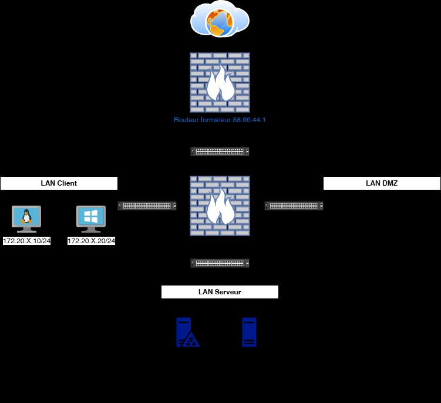
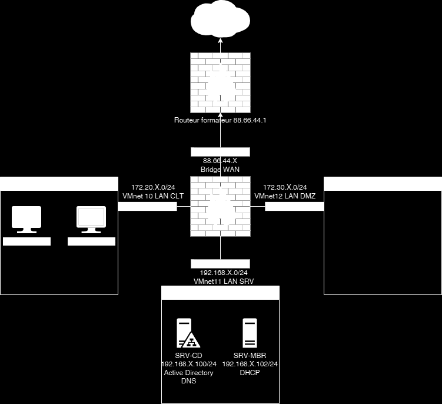

# Module 02 — Configuration du pare-feu pfSense

Semaine **1/2**. Support de cours : **Inexistant**.

[Énoncé](../../tp/17-reseau-et-securite/module-02/enonces.md) · [Correction](../../tp/17-reseau-et-securite/module-02/corrections.md) · [Révision](../../revision/17-reseau-et-securite/module-02.md) · [Kahoot préparé](../../kahoot/17-reseau-et-securite-module-02.md)

=== "Cours Original"

    Configuration du pare-feu
    Pfsense
    TD2

     Avant de démarrer ce TP, il convient d’avoir fait le TP1. Récupérer le Bundle sur distrib
     TSSR170-Réseau&Sécurité.7z

                Durée estimée

                  3 heures

    Énoncé

    Objectifs:

    Création de l’infrastructure ci-dessous et y transcrire la politique de la matrice de flux du
    TP1 dans pfSense.

    

    

    Valeurs de la capture :

    - Routeur formateur : 88.66.44.1
    - WAN : 88.66.44.X, bridge
    - LAN CLT : 172.20.X.0/24, VMnet10
    - LAN DMZ : VMnet12
    - LAN SRV : 192.168.X.0/24, VMnet11
    - SRV-CD : 192.168.X.100/24, Active Directory, DNS
    - SRV-MBR : 192.168.X.102/24, DHCP

    Installation de l’infrastructure
    Installation du serveur SRV-CD

           Utiliser le fichier Win-SRV.ovf pour deployer votre serveur Windows.

           Attribuer lui, l’adresse IP ainsi que sa passerelle définis sur le schema.
           Connectez-le sur le VMnet 11
           Renomer votre VM par SRV-CD
           Installer les rôles AD DS et le DNS, votre nom de domaine sera votre nom.eni

          Ouvrir Powershell en tant qu’Administeur de vous déplacer sur E:/scirpts puis
          exécutez les scripts dans l’ordre suivant:
          OU.ps1
          Attention modifier les fichiers Users.csv et Groups.csv avec votre nom de domaine
    avant d’éxecuter les scripts suivants.
          Users.ps1
          Groups.ps1
          AdduseronGroups.ps1

           Faites un redirecteur dans le gestionnaire DNS avec l’IP le DNS de votre salle

    Installation du serveur SRV-MBR

           Utiliser également le fichier Win-SRV.ovf

           Renomer votre serveur par: SRV-MBR
           Attribuer lui, l’adresse IP ainsi que sa passerelle définis sur le schema.
           Connectez-le sur le VMnet 11

           Joindre ce serveur à votre domaine.

           Installer le role DHCP et préparez une etendue pour le LAN client.

    Installation du routeur Pfsense

           Utiliser le fichier Routeur.ovf, le mot de passe par défaut

           Modifier les IP correspondant à votre réseau et vérifier que les différentes cartes
    sont sur les bons VMnet comme indiqué sur le schéma.

           Modifier dans les paramètres générales votre domaine et votre DNS

           Ajouter le relay DHCP pour votre LAN client.

    Installation du client Windows 10 ou 11

           Récupérer l’ISO sur Distrib puis mettre les caractéristiques suivantes :

           RAM : 3Go

    CPU : 2

           Stockage : laisser par défaut

           Réseau : VMnet10

          Vérifier que vous récupérer une adresse IP du serveur DHCP. Retourner sur votre
    serveur DHCP puis faites une réservation avec l’adresse IP indiqué sur le schéma.

    Désactiver le pare-feu Windows

    Installation du client Debian 12

    Récupérer l’ISO sur Distrib puis mettre les caractéristiques suivantes :

           RAM : 2Go

           CPU : 1

           Stockage : laisser par défaut

           Réseau : VMnet10

          Vérifier que vous récupérer une adresse IP du serveur DHCP. Retourner sur votre
    serveur DHCP puis faites une réservation avec l’adresse IP indiqué sur le schéma.

    Sur routeur Pfsense

          Mettre en place les règles de par-feu côté LANCLIENT, LANSERVER
    déterminées au TP1, les autres règles seront effectuées plus tard puis tester le bon
    fonctionnement.

    Client Windows 11

           Le joindre au domaine

    Solution
    Une solution est proposée pour ce TP sous la forme d'un PDF commenté, disponible dans les ressources à télécharger (voir la page [Correction](../../tp/17-reseau-et-securite/module-02/corrections.md)).

=== "Cours Optimisé IA"

    Le support de cours est **Inexistant**. Les OVF et les archives sont **Inexistant** sur le site.

    

    Valeurs de la capture :

    - Routeur formateur : 88.66.44.1
    - WAN : 88.66.44.X, bridge
    - LAN CLT : 172.20.X.0/24, VMnet10
    - LAN DMZ : VMnet12
    - LAN SRV : 192.168.X.0/24, VMnet11
    - SRV-CD : 192.168.X.100/24, Active Directory, DNS
    - SRV-MBR : 192.168.X.102/24, DHCP

    1. Déployer SRV-CD sur VMnet 11, rôles AD DS et DNS, domaine votredomaine.eni.
    2. Exécuter les scripts du document, après avoir adapté Users.csv et Groups.csv, puis créer le redirecteur vers le DNS de la salle.
    3. Déployer SRV-MBR sur VMnet 11, le joindre au domaine, installer DHCP et une étendue pour le LAN client.
    4. Déployer pfSense, aligner les IP et les VMnet, le domaine, le DNS et le relais DHCP.
    5. Client Windows : 3 Go, 2 CPU, VMnet10. Debian 12 : 2 Go, 1 CPU, VMnet10. Réserver l’adresse du schéma et désactiver le pare-feu Windows.
    6. Appliquer les règles du TP1 sur LANCLIENT et LANSERVER, tester, joindre le client Windows au domaine.

    La correction ajoute deux scripts et d’autres noms de fichiers : la note est en fin de correction.
