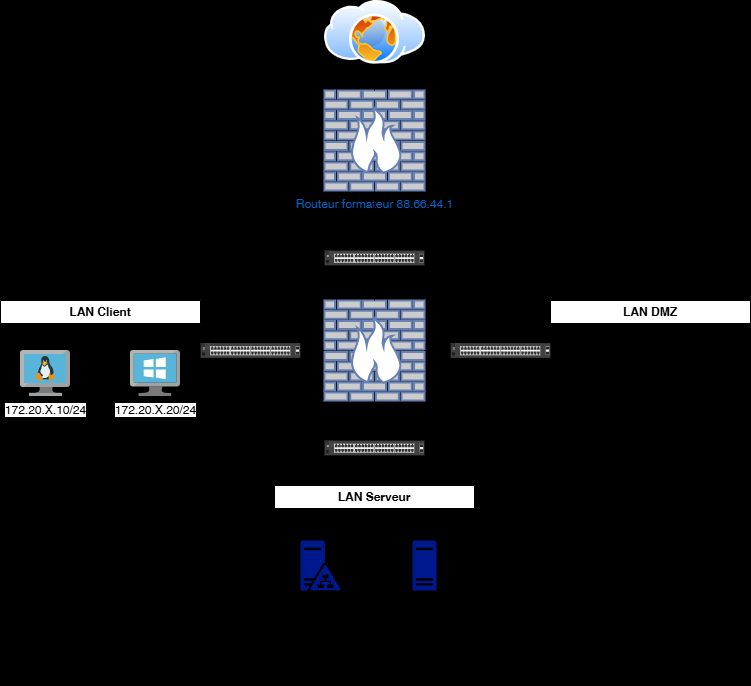
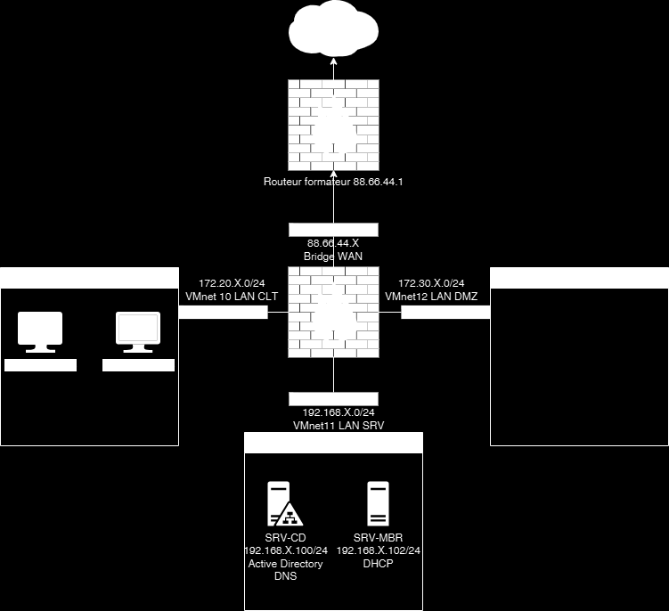

# Module 03 — Configuration du NAT

Semaine **1/2**. Support de cours : **Inexistant**.

[Énoncé](../../tp/17-reseau-et-securite/module-03/enonces.md) · [Correction](../../tp/17-reseau-et-securite/module-03/corrections.md) · [Révision](../../revision/17-reseau-et-securite/module-03.md) · [Kahoot préparé](../../kahoot/17-reseau-et-securite-module-03.md)

=== "Cours Original"

    Configuration du NAT
    Pfsense
    TD2

     Avant de démarrer ce TP,

                Durée estimée

                  2 heures

    Énoncé

    Objectifs:

    Ce cas pratique, vous donnera une compréhension approfondie de la gestion des accès
    réseau et de l'importance de la redirection NAT dans les environnements professionnels.

    

    

    Valeurs de la capture :

    - Routeur formateur : 88.66.44.1
    - WAN : 88.66.44.X, bridge
    - LAN CLT : 172.20.X.0/24, VMnet10
    - LAN DMZ : VMnet12
    - LAN SRV : 192.168.X.0/24, VMnet11
    - SRV-CD : 192.168.X.100/24, Active Directory, DNS
    - SRV-MBR : 192.168.X.102/24, DHCP

    Installation de l’infrastructure
    Connection au Routeur Formateur
    http://192.168.150.1
    identifiant: stag
    Mdp: P@ssw0rd

    Ajouter vos reseaux privés avec la gateway de votre @IP WAN
    Puis tester la connexion internet depuis vos réseaux

    Sur votre routeur Pfsense
    Mettre les règles du par-feu du TP1 sur la carte WAN
    Ajouter une redirection NAT sur le protocole RDP sur l’IP de votre serveur SRV-MBR

    Sur votre SRV-MBR

    Activer le bureau à distance avec le groupe GG-IT

    Client Windows 11

    Entre binôme tester l’accès au bureau à distance depuis le client windows. Utilser des
    utilisateurs du groupe GG-IT pour les tests.

    Solution
    Une solution est proposée pour ce TP sous la forme d'un PDF commenté, disponible dans les ressources à télécharger (voir la page [Correction](../../tp/17-reseau-et-securite/module-03/corrections.md)).

=== "Cours Optimisé IA"

    Le support de cours est **Inexistant**.

    

    Valeurs de la capture :

    - Routeur formateur : 88.66.44.1
    - WAN : 88.66.44.X, bridge
    - LAN CLT : 172.20.X.0/24, VMnet10
    - LAN DMZ : VMnet12
    - LAN SRV : 192.168.X.0/24, VMnet11
    - SRV-CD : 192.168.X.100/24, Active Directory, DNS
    - SRV-MBR : 192.168.X.102/24, DHCP

    1. Ajouter les réseaux privés sur le routeur formateur, avec la passerelle de l’adresse WAN, puis tester Internet.
    2. Sur pfSense, appliquer les règles du TP1 sur la carte WAN.
    3. Rediriger le RDP vers SRV-MBR. La correction passe par un alias.
    4. Activer le bureau à distance pour le groupe GG-IT.
    5. Tester depuis le client Windows avec un utilisateur de GG-IT.

    Les adresses et mots de passe du routeur formateur diffèrent entre l’énoncé et la correction : la note est en fin de correction.
