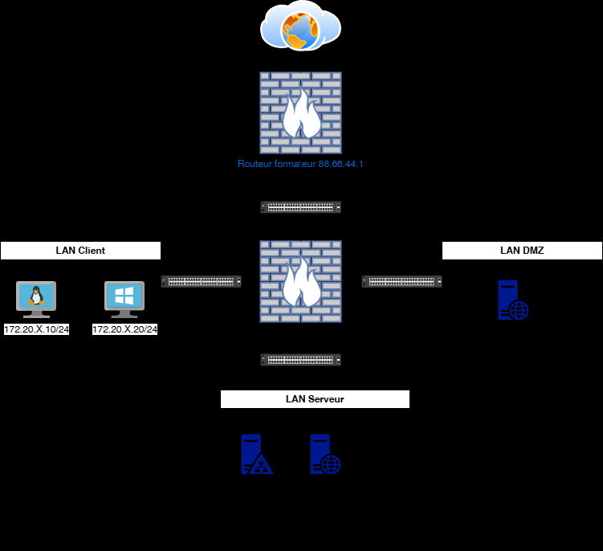
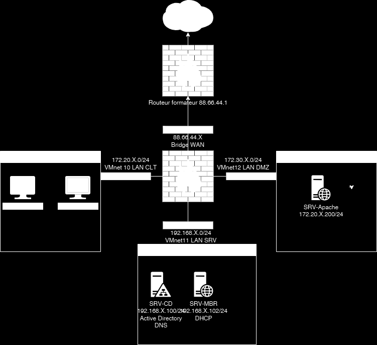

# Module 04 — Services hébergés dans une DMZ

Semaine **1/2**. Support de cours : **Inexistant**.

[Énoncé](../../tp/17-reseau-et-securite/module-04/enonces.md) · [Correction](../../tp/17-reseau-et-securite/module-04/corrections.md) · [Révision](../../revision/17-reseau-et-securite/module-04.md) · [Kahoot préparé](../../kahoot/17-reseau-et-securite-module-04.md)

=== "Cours Original"

    Services hébergés dans
    une DMZ
    TD

     Avant de démarrer ce TP, il convient d’avoir fait le TP2.

                Durée estimée

                  1 heures

    Énoncé

    Objectifs:

    Gestion de la DMZ.

    

    

    Texte visible sur la capture :

    ```text
    Routeur formafeur 88.66.44.1
    VMnet 10 LAN CLT
    VMnet12 LAN DMZ
    VMnet11 LAN SRV
    ```

    Installation du serveur WEB
    Récupérer le bunble SRV-Apache.ova

           Le mot de passe de root est P@ssw0rd

            Attribuer lui, l’adresse IP ainsi que sa passerelle définis sur le schema.
            Connectez-le sur le VMnet 12.
            Modifier les fichiers /etc/hosts et /etc/resolv.conf avec les informations de votre
    infrastructure.

           Faites son enregistrement DNS sur votre serveur SRV-CD

    Sur le SRV-DC

           Exécuter le script D:/scripts/Script-TP3-AddDnsZone.ps1 et entrer la nouvelle adresse
    IP du SRV-Apache
           Tester l’URL https://extra.votrenom.eni

    Sur du routeur Pfsense

           Faites un alias URLs pour extra.votrenom.eni

    Et ensuite une redirection NAT depuis le WAN pour accèder on site WEB A voir si fessable
           Attention aux règles de pare-feu

    Depuis votre machine hôte

           Tester l’accès au serveur WEB avec l’ip de votre WAN

    Client Windows

           Tester l’accès au serveur WEB avec le FQDN

    Solution
    Une solution est proposée pour ce TP sous la forme d'un PDF commenté, disponible dans les
    ressources à télécharger.

=== "Cours Optimisé IA"

    Le support de cours est **Inexistant**. L’image du serveur web est **Inexistant**.

    1. Déployer le serveur web sur VMnet 12, mot de passe root P@ssw0rd, et renseigner /etc/hosts et /etc/resolv.conf.
    2. Créer l’enregistrement DNS et tester https://extra.votrenom.eni.
    3. Sur pfSense, créer un alias d’URL puis une redirection NAT depuis le WAN. Surveiller les règles de pare-feu.
    4. Tester depuis l’hôte avec l’IP WAN, et depuis le client Windows avec le FQDN.
