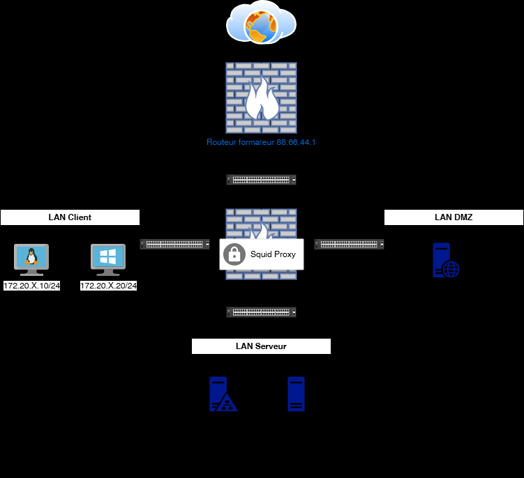
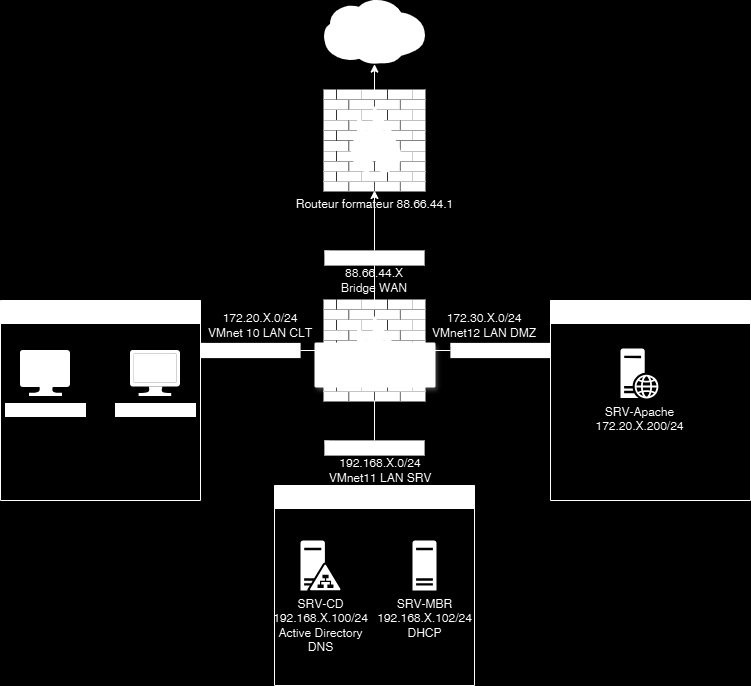

# Module 05 — Sécuriser le surf Internet

Semaine **1/2**. Support de cours : **Inexistant**.

[Énoncé](../../tp/17-reseau-et-securite/module-05/enonces.md) · [Correction](../../tp/17-reseau-et-securite/module-05/corrections.md) · [Révision](../../revision/17-reseau-et-securite/module-05.md) · [Kahoot préparé](../../kahoot/17-reseau-et-securite-module-05.md)

=== "Cours Original"

    SÉCURISER LE SURF INTERNET
    TD5

     Avant de démarrer ce TP, il convient aux CEL d’avoir regardé sur la bibliothèque  les
     vidéos « pfSense - La sécurité avec un pare-feu open source” Filtrage Web et Portail
     captif.

                Durée estimée

                  3 heures

    Énoncé

    Objectifs:

    Ce travail pratique vous permettra de mettre en place un proxy transparent avec filtrage
    web et sur pfSense, offrant ainsi un contrôle avancé sur le trafic Internet de votre réseau..

    

    Texte visible sur la capture :

    ```text
    Routeur formateur 88.66.44.1
    Squid
    ```

    

    Texte visible sur la capture :

    ```text
    Routeur formafeur 88.66.44.1
    VMnet 10 LAN CLT VMnet12 LAN DMZ
    VMnet11 LAN SRV
    ```

    Paramétrage du squid Pfsense
    1 - Configuration de Squid

           Connectez-vous à l'interface web de pfSense.

           Allez dans Services > Squid Proxy Server

           Onglet "General" :

                  Cochez "Enable Squid Proxy"

                  Sélectionnez l'interface LAN

                  Port : 3128

                  Cochez "Transparent HTTP Proxy"

           Onglet "Local Cache" :

                  Hard Disk Cache Size : 100 (ou plus selon vos besoins)

                  Cliquez sur "Save" pour chaque onglet

           Créez une règle de pare-feu pour rediriger le trafic HTTP vers Squid :

                  Allez dans Firewall > Rules > LAN

                  Ajoutez une règle :

                  Action : Pass

                  Interface : LAN

                  Protocol : TCP

    Source : LAN net

                   Destination : any

                   Destination port : HTTP

                   Redirect target IP : 127.0.0.1

                   Redirect target port : 3128

    2 : Configuration de SquidGuard

           Allez dans Services > Proxy Filter

           Onglet "General settings" :

                   Cochez "Enable"

                   Blacklist : Sélectionnez une liste noire

           Onglet "Common ACL" :

                   Créez une règle pour bloquer les sites pour adultes

           Intégrez SquidGuard à Squid :

                   Services > Squid Proxy Server > General

                   Redirect Program : /usr/local/bin/squidGuard

    3- Testez la configuration :

    Depuis votre client Windows, essayez d'accéder à un site web normal et à un site bloqué

    Vérifiez les logs dans Status > Proxy Filter

    Bonus
    Configuration d'un portail captif.

    Étape 1 Activation du portail captif

           Dans l'interface web de pfSense, allez dans Services > Captive Portal

                  Cliquez sur "Add" pour créer une nouvelle zone

                  Donnez un nom à votre zone (ex: "LAN_Portal")

                  Cochez "Enable captive portal"

                  Sélectionnez l'interface LAN

    Étape 2 : Configuration de base

           Définissez la durée de la session (ex: 60 minutes)

           Activez "Reauthenticate connected users every minute"

           Configurez "Idle timeout" (ex: 15 minutes)

           Activez "Enable logout popup window"

    Étape 3 : Personnalisation de la page d'accueil

           Dans "Portal page contents", personnalisez le HTML de la page d'accueil

           Ajoutez un logo et un message de bienvenue

    Étape 4 : Configuration de l'authentification

           Choisissez la méthode d'authentification (ex: "Local User Manager")

    Créez quelques utilisateurs de test dans System > User Manager

    Étape 5 : Règles de pare-feu

           Allez dans Firewall > Rules > LAN

    Assurez-vous qu'il existe une règle permettant le trafic vers le portail captif

    Étape 6 : Tests

    Connectez-vous au client Linux du réseau LAN

           Ouvrez un navigateur et essayez d'accéder à un site web

           Vérifiez que le portail captif s'affiche

           Authentifiez-vous avec un utilisateur de test

           Vérifiez l'accès à Internet après authentification

    Solution
    Une solution est proposée pour ce TP sous la forme d'un PDF commenté, disponible dans les
    ressources à télécharger.

=== "Cours Optimisé IA"

    Le support de cours est **Inexistant**. Les vidéos demandées aux CEL sont **Inexistant**.

    1. Activer Squid, port 3128. L’énoncé choisit l’interface LAN, le mode transparent et un cache de 100. La correction choisit LANCLIENT, un cache de 1024, sans mode transparent.
    2. Rediriger le HTTP du LAN vers 127.0.0.1:3128 si vous suivez l’énoncé.
    3. Activer SquidGuard, une liste noire, et une ACL qui bloque les sites pour adultes. La correction ajoute le jeu, l’astrologie et la liste MyfirstBlackList, et interdit un domaine imposé (exemple : site-interdit.example).
    4. Intégrer SquidGuard avec /usr/local/bin/squidGuard. Tester un site autorisé et un site bloqué. Lire Status > Proxy Filter.
    5. Bonus : portail captif (énoncé, six étapes, test depuis le client Linux) ou désactivation de Squid puis procédure remise au formateur (correction).
