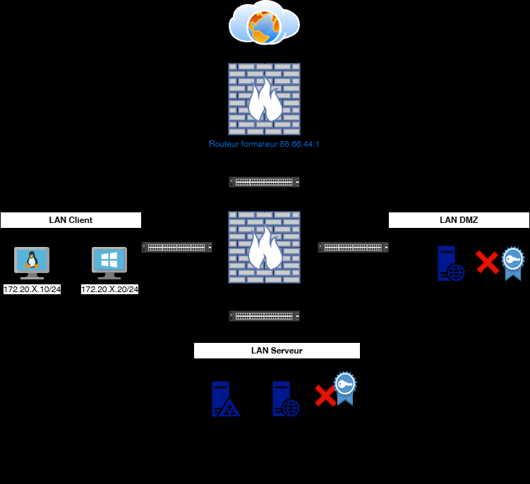
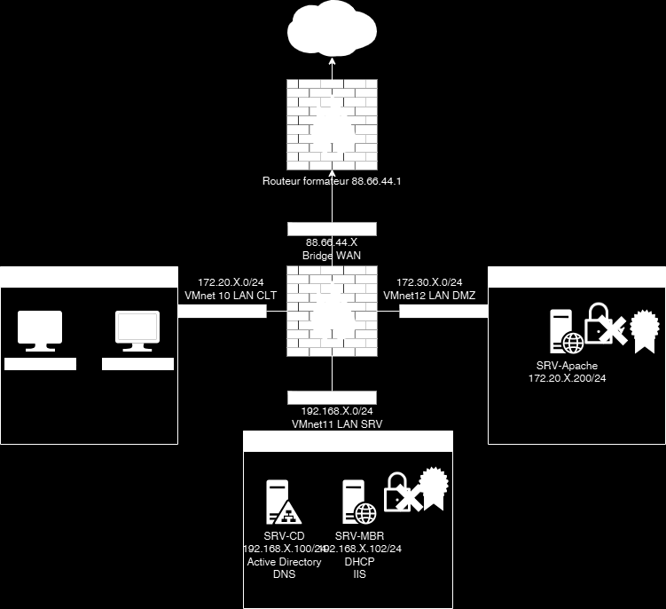
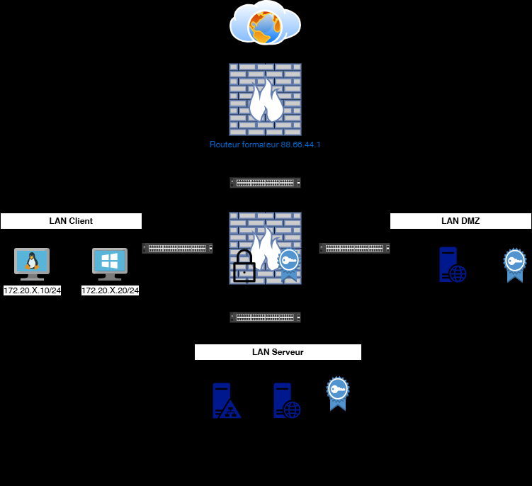
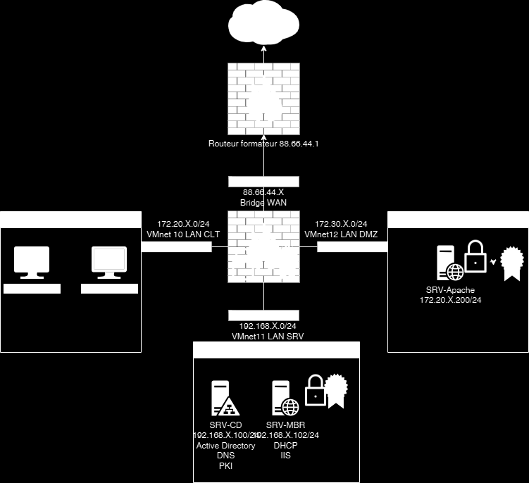

# Module 06 — Certificats autosignés et PKI privée ADCS

Semaine **2/2**. Support de cours : **Inexistant**.

[TP6](../../tp/17-reseau-et-securite/module-06/tp6/index.md) · [TP7](../../tp/17-reseau-et-securite/module-06/tp7/index.md) · [Révision](../../revision/17-reseau-et-securite/module-06.md) · [Kahoot — 20 questions](../../kahoot/17-reseau-et-securite-module-06.md)

=== "Cours Original"

    La gestion des certificats
    autosignés
    TD5

     Avant de démarrer ce TP, .

                Durée estimée

                  4 heures

    Énoncé

    Objectifs:

    Mise en place de certificats autosignés

    

    

    Valeurs de la capture :

    - Routeur formateur : 88.66.44.1
    - WAN : 88.66.44.X, bridge
    - LAN CLT : 172.20.X.0/24, VMnet10
    - LAN DMZ : VMnet12
    - LAN SRV : 192.168.X.0/24, VMnet11
    - SRV-CD : 192.168.X.100/24, Active Directory, DNS
    - SRV-MBR : 192.168.X.102/24, DHCP, IIS
    - SRV-Apache : 172.20.X.200/24

    Sur SRV-MBR
    Installer le rôle IIS et créer un certificat autosigné

    Faire un enristrement DNS vers intranet.votredomaine.lab

    Sur SRV-MBR
    Installer le Apache2 et créer un certificat autosigné

    Faire un enristrement DNS vers extranet.votredomaine.lab

    Sur le routeur PFsense
    Activer le https avec le certificat autosigné existant

    Faire un enristrement DNS vers routeur.votredomaine.lab

    Solution
    Une solution est proposée pour ce TP sous la forme d'un PDF commenté, disponible dans les ressources à télécharger (voir la page [Correction](../../tp/17-reseau-et-securite/module-06/tp6/corrections.md)).

    ## TP7

    Certificat émanant d'une
    Private-KI ADCS                                           TD5

     Avant de démarrer ce TP, .

                Durée estimée

                  4 heures

    Énoncé

    Objectifs:

    Mise en place

    

    

    Sur SRV-CD
    Exécuter le script D:/InstallationPKI.ps1

    Sur SRV-MBR
    Utiliser la clé privée du SRV-CD pour sécuriser votre URL intranet.votredomaine.lab

    Sur SRV-WEB
    Utiliser la clé privée du SRV-CD pour sécuriser votre URL extranet.votredomaine.lab

    Sur le routeur PFsense
    Utiliser la clé privée de votre formateur http://88.66.44.1 pour sécuriser votre URL
    routeur.votredomaine.lab, votre formateur vous indiquera les identifiants.

    Solution
    Une solution est proposée pour ce TP sous la forme d'un PDF commenté, disponible dans les ressources à télécharger (voir la page [Correction](../../tp/17-reseau-et-securite/module-06/tp7/corrections.md)).

=== "Cours Optimisé IA"

    Les parties ci-dessous reprennent le cours original, dans le même ordre. Les encadrés et les schémas répètent ses formulations.

    ## Parcours de lecture

    1. TP7

    La gestion des certificats
    autosignés
    TD5

     Avant de démarrer ce TP, .

                Durée estimée

                  4 heures

    Énoncé

    Objectifs:

    Mise en place de certificats autosignés

    

    

    Valeurs de la capture :

    - Routeur formateur : 88.66.44.1
    - WAN : 88.66.44.X, bridge
    - LAN CLT : 172.20.X.0/24, VMnet10
    - LAN DMZ : VMnet12
    - LAN SRV : 192.168.X.0/24, VMnet11
    - SRV-CD : 192.168.X.100/24, Active Directory, DNS
    - SRV-MBR : 192.168.X.102/24, DHCP, IIS
    - SRV-Apache : 172.20.X.200/24

    Sur SRV-MBR
    Installer le rôle IIS et créer un certificat autosigné

    Faire un enristrement DNS vers intranet.votredomaine.lab

    Sur SRV-MBR
    Installer le Apache2 et créer un certificat autosigné

    Faire un enristrement DNS vers extranet.votredomaine.lab

    Sur le routeur PFsense
    Activer le https avec le certificat autosigné existant

    Faire un enristrement DNS vers routeur.votredomaine.lab

    Solution
    Une solution est proposée pour ce TP sous la forme d'un PDF commenté, disponible dans les ressources à télécharger (voir la page [Correction](../../tp/17-reseau-et-securite/module-06/tp6/corrections.md)).

    ## TP7

    !!! note "À retenir"
        Certificat émanant d'une Private-KI ADCS TD5 Avant de démarrer ce TP, .

    Certificat émanant d'une
    Private-KI ADCS                                           TD5

     Avant de démarrer ce TP, .

                Durée estimée

                  4 heures

    Énoncé

    Objectifs:

    Mise en place

    

    

    Sur SRV-CD
    Exécuter le script D:/InstallationPKI.ps1

    Sur SRV-MBR
    Utiliser la clé privée du SRV-CD pour sécuriser votre URL intranet.votredomaine.lab

    Sur SRV-WEB
    Utiliser la clé privée du SRV-CD pour sécuriser votre URL extranet.votredomaine.lab

    Sur le routeur PFsense
    Utiliser la clé privée de votre formateur http://88.66.44.1 pour sécuriser votre URL
    routeur.votredomaine.lab, votre formateur vous indiquera les identifiants.

    Solution
    Une solution est proposée pour ce TP sous la forme d'un PDF commenté, disponible dans les ressources à télécharger (voir la page [Correction](../../tp/17-reseau-et-securite/module-06/tp7/corrections.md)).

    ## Fiche de synthèse

    Les lignes reprennent les titres du cours et la première phrase de chaque partie.

    | Partie | Repère du cours |
    | --- | --- |
    | TP7 | Certificat émanant d'une Private-KI ADCS TD5 Avant de démarrer ce TP, . |
