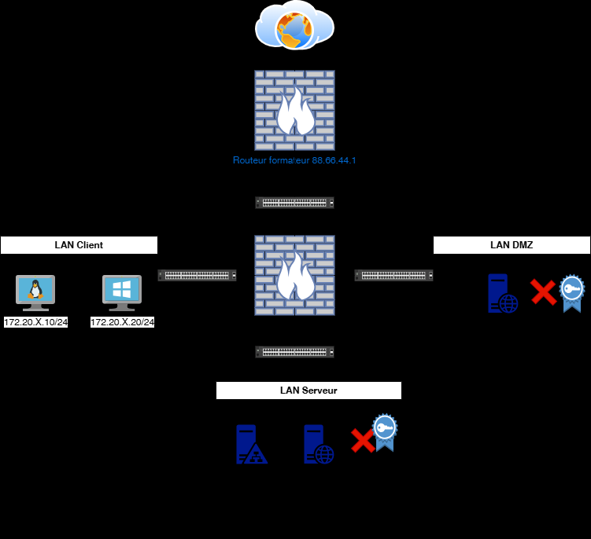
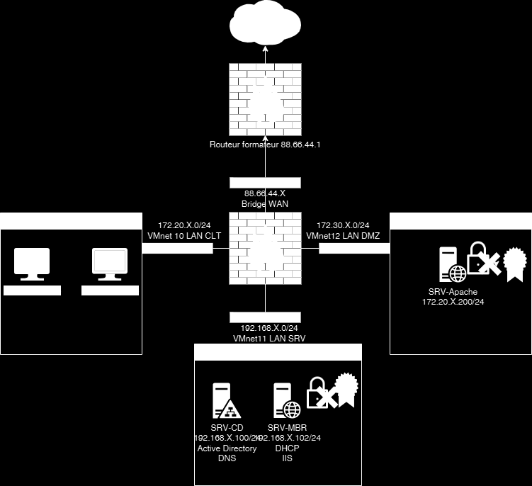
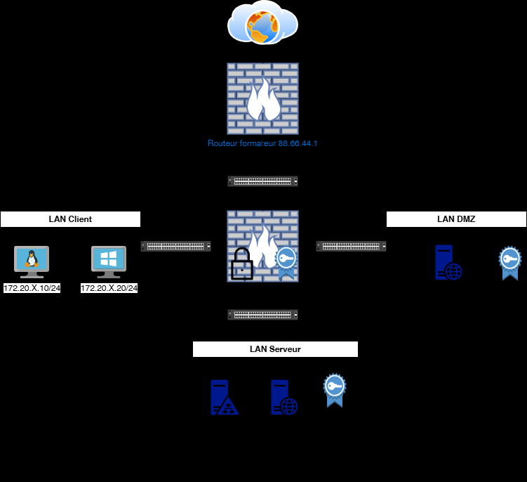
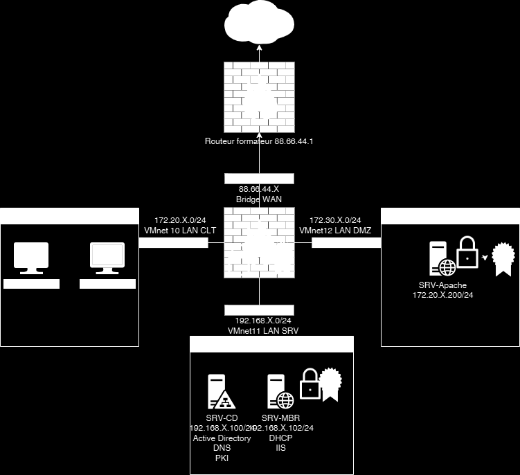

# Module 06 — Certificats autosignés et PKI privée ADCS

Semaine **2/2**. Support de cours : **Inexistant**.

[TP6](../../tp/17-reseau-et-securite/module-06/tp6/index.md) · [TP7](../../tp/17-reseau-et-securite/module-06/tp7/index.md) · [Révision](../../revision/17-reseau-et-securite/module-06.md) · [Kahoot préparé](../../kahoot/17-reseau-et-securite-module-06.md)

=== "Cours Original"

    La gestion des certificats
    autosignés
    TD5

     Avant de démarrer ce TP, .

                Durée estimée

                  4 heures

    Énoncé

    Objectifs:

    Mise en place de certificats autosignés

    

    

    Valeurs de la capture :

    - Routeur formateur : 88.66.44.1
    - WAN : 88.66.44.X, bridge
    - LAN CLT : 172.20.X.0/24, VMnet10
    - LAN DMZ : VMnet12
    - LAN SRV : 192.168.X.0/24, VMnet11
    - SRV-CD : 192.168.X.100/24, Active Directory, DNS
    - SRV-MBR : 192.168.X.102/24, DHCP, IIS
    - SRV-Apache : 172.20.X.200/24

    Sur SRV-MBR
    Installer le rôle IIS et créer un certificat autosigné

    Faire un enristrement DNS vers intranet.votredomaine.eni

    Sur SRV-MBR
    Installer le Apache2 et créer un certificat autosigné

    Faire un enristrement DNS vers extranet.votredomaine.eni

    Sur le routeur PFsense
    Activer le https avec le certificat autosigné existant

    Faire un enristrement DNS vers routeur.votredomaine.eni

    Solution
    Une solution est proposée pour ce TP sous la forme d'un PDF commenté, disponible dans les ressources à télécharger (voir la page [Correction](../../tp/17-reseau-et-securite/module-06/tp6/corrections.md)).

    ## TP7

    Certificat émanant d'une
    Private-KI ADCS                                           TD5

     Avant de démarrer ce TP, .

                Durée estimée

                  4 heures

    Énoncé

    Objectifs:

    Mise en place

    

    

    Sur SRV-CD
    Exécuter le script D:/InstallationPKI.ps1

    Sur SRV-MBR
    Utiliser la clé privée du SRV-CD pour sécuriser votre URL intranet.votredomaine.eni

    Sur SRV-WEB
    Utiliser la clé privée du SRV-CD pour sécuriser votre URL extranet.votredomaine.eni

    Sur le routeur PFsense
    Utiliser la clé privée de votre formateur http://88.66.44.1 pour sécuriser votre URL
    routeur.votredomaine.eni, votre formateur vous indiquera les identifiants.

    Solution
    Une solution est proposée pour ce TP sous la forme d'un PDF commenté, disponible dans les ressources à télécharger (voir la page [Correction](../../tp/17-reseau-et-securite/module-06/tp7/corrections.md)).

=== "Cours Optimisé IA"

    Le support de cours est **Inexistant**. Ce module réunit le TP6 et le TP7.

    

    Valeurs de la capture :

    - Routeur formateur : 88.66.44.1
    - WAN : 88.66.44.X, bridge
    - LAN CLT : 172.20.X.0/24, VMnet10
    - LAN DMZ : VMnet12
    - LAN SRV : 192.168.X.0/24, VMnet11
    - SRV-CD : 192.168.X.100/24, Active Directory, DNS
    - SRV-MBR : 192.168.X.102/24, DHCP, IIS
    - SRV-Apache : 172.20.X.200/24

    

    TP6. Certificats autosignés pour IIS, Apache et pfSense, afin de chiffrer le trafic. La correction ajoute une seconde IP 172.20.X.153/26 sur SRV-MBR, les sites www et intranet, puis sur SRV-WEB l’adresse 172.20.X.202/26, lynx, et les sites intra et internet. pfSense répond en HTTPS sur routeur.votredomaine.eni.

    TP7. Exécuter D:/InstallationPKI.ps1 sur SRV-CD, rendre certsrv fiable, puis faire signer les certificats des sites et du routeur par cette autorité. L’énoncé cite aussi http://88.66.44.1 pour la clé du formateur. Identifiants : **Inexistant**.
