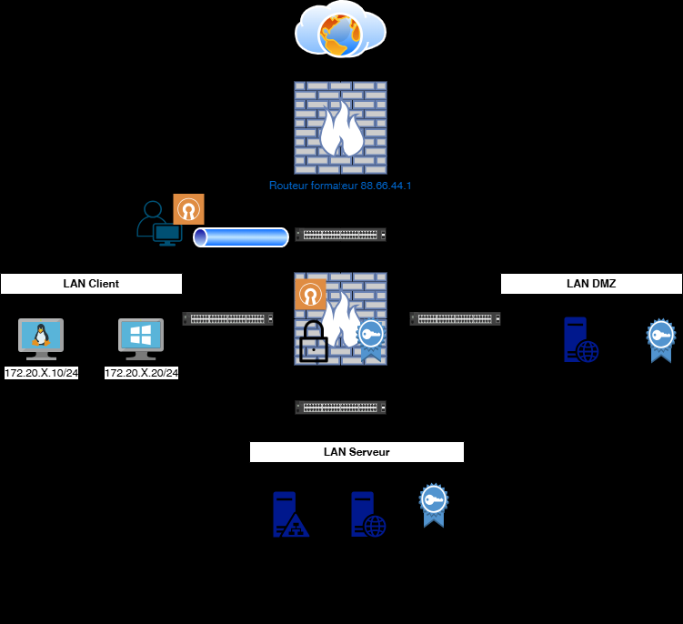
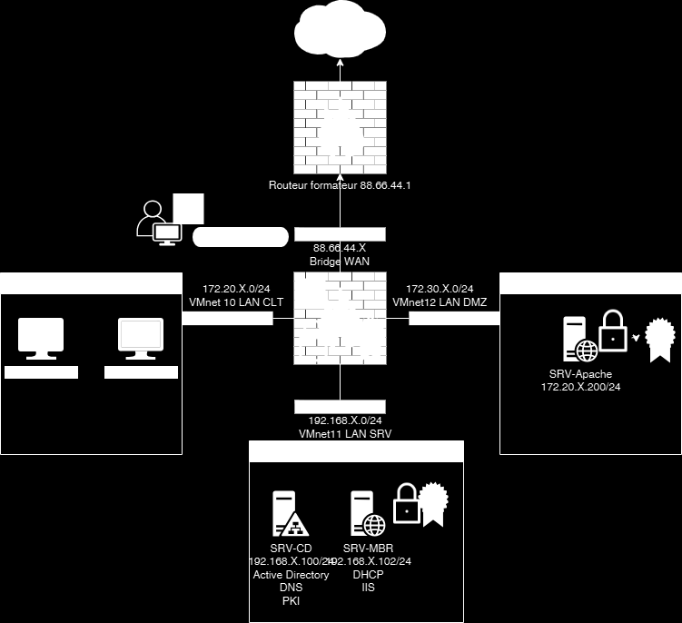

# Module 07 — Connecter les collaborateurs pour le télétravail

Semaine **2/2**. Support de cours : **Inexistant**.

[Énoncé](../../tp/17-reseau-et-securite/module-07/enonces.md) · [Correction](../../tp/17-reseau-et-securite/module-07/corrections.md) · [Révision](../../revision/17-reseau-et-securite/module-07.md) · [Kahoot préparé](../../kahoot/17-reseau-et-securite-module-07.md)

=== "Cours Original"

    Connecter les
    collaborateurs pour le
    télétravail
     TD8

     Avant de démarrer ce TP.

                Durée estimée

                  4 heures

    Énoncé

    Objectifs:

    Mise en place

    

    

    Valeurs de la capture :

    - Routeur formateur : 88.66.44.1
    - WAN : 88.66.44.X, bridge
    - LAN CLT : 172.20.X.0/24, VMnet10
    - LAN DMZ : VMnet12
    - LAN SRV : 192.168.X.0/24, VMnet11
    - SRV-CD : 192.168.X.100/24, Active Directory, DNS, PKI
    - SRV-MBR : 192.168.X.102/24, DHCP, IIS
    - SRV-Apache : 172.20.X.200/24

    Sur SRV-CD
    https://wireguard.how/client/debian/

    Solution
    Une solution est proposée pour ce TP sous la forme d'un PDF commenté, disponible dans les ressources à télécharger (voir la page [Correction](../../tp/17-reseau-et-securite/module-07/corrections.md)).

=== "Cours Optimisé IA"

    Le support de cours est **Inexistant**. Le fichier d’installation client n’est pas publié.

    

    Valeurs de la capture :

    - Routeur formateur : 88.66.44.1
    - WAN : 88.66.44.X, bridge
    - LAN CLT : 172.20.X.0/24, VMnet10
    - LAN DMZ : VMnet12
    - LAN SRV : 192.168.X.0/24, VMnet11
    - SRV-CD : 192.168.X.100/24, Active Directory, DNS, PKI
    - SRV-MBR : 192.168.X.102/24, DHCP, IIS
    - SRV-Apache : 172.20.X.200/24

    1. Vérifier le ping des adresses WAN entre binômes. Les CEL sortent le client Windows sur le réseau bridge, reprennent l’adresse de CLT-NAT et éteignent CLT-NAT.
    2. Sur pfSense, si le LDAP n’est plus là : autorité de certification, certificat serveur, authentification LDAP, serveur OpenVPN, client OpenVPN.
    3. Échanger le fichier d’installation et tester chacun son tour.
    4. Paramétrer WireGuard et le pair CLT-NAT. Renouveler les clés, activer le routage, puis joindre le serveur web en SSH. Les commandes citées sont sur https://wireguard.how/client/debian/.
