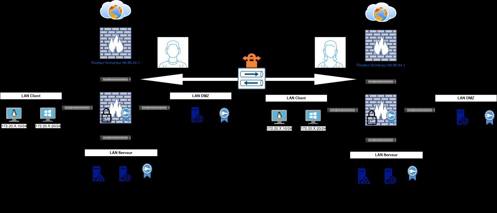
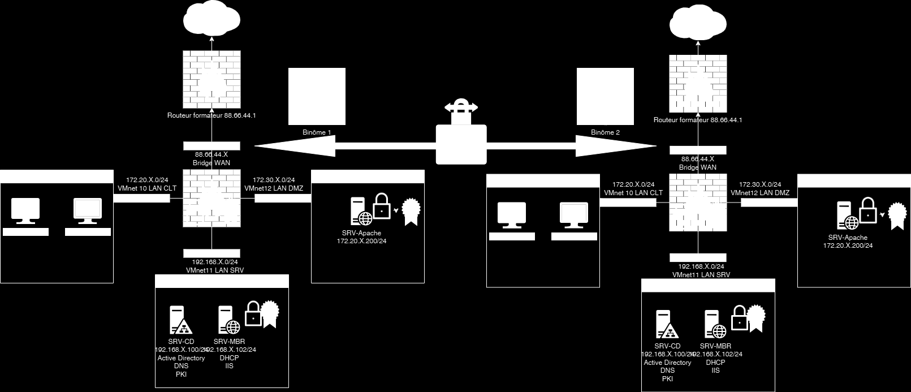

# Module 08 — Connecter les collaborateurs site à site

Semaine **2/2**. Support de cours : **Inexistant**.

[Énoncé](../../tp/17-reseau-et-securite/module-08/enonces.md) · [Correction](../../tp/17-reseau-et-securite/module-08/corrections.md) · [Révision](../../revision/17-reseau-et-securite/module-08.md) · [Kahoot préparé](../../kahoot/17-reseau-et-securite-module-08.md)

=== "Cours Original"

    Connecter les
    collaborateurs site à site
     TD9

     Avant de démarrer ce TP, .

                Durée estimée

                  4 heures

    Énoncé

    Objectifs:

    Mise en place

    

    

    Texte visible sur la capture :

    ```text
    Routeur formafeur 88.66.44.1
    VMnet 10 LAN CLT
    VMnet12 LAN DMZ
    VMnet11 LAN SRV
    ```

    Sur le routeur PFsense
    En binôme pour salle

    Mise en place d’un deuxième PFsense pour CEL

    Solution
    Une solution est proposée pour ce TP sous la forme d'un PDF commenté, disponible dans les
    ressources à télécharger.

=== "Cours Optimisé IA"

    Le support de cours est **Inexistant**. Il faut deux pfSense et un LAN derrière chacun. En salle, le travail est en binôme. Les CEL mettent en place un deuxième pfSense.

    1. Créer le tunnel IPsec.
    2. Phase 1 IKE sur les deux pfSense, puis phase 2 ESP.
    3. Définir les réseaux locaux et distants.
    4. Règles de pare-feu du VPN, autorisation du trafic IPsec, puis du trafic entre les LAN.
    5. Vérifier l’état du tunnel, la connectivité, puis les logs.

    Les algorithmes et les clés ne sont pas écrits dans le texte : **Inexistant**. Ils sont sur les captures de la correction.
