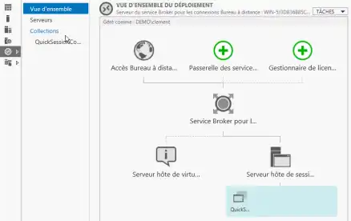

# Module 02 — Remote Desktop Services

Semaine du 16 au 20 novembre 2026. Les vidéos citées par les énoncés sont **Inexistant**.

[Travaux](../../tp/18-services-transverses-microsoft/module-02/index.md) · [Révision](../../revision/18-services-transverses-microsoft/module-02.md) · [Kahoot — 20 questions](../../kahoot/18-services-transverses-microsoft-module-02.md)

=== "Cours Original"

    ## Objectifs

    - Identifier les composants et protocoles associés aux services de bureau à distance.
    - Mettre en œuvre les services de bureau à distance.

    ## Principe de fonctionnement

    Dans le modèle client lourd, les applications sont installées sur les postes de travail des utilisateurs.

    - La puissance de ceux-ci impacte le fonctionnement de l’application.
    - La gestion des applications est à faire sur les postes.

    Le schéma de l’infrastructure décentralisée place la gestion, les traitements et applications, et les ressources sur les postes.

    Dans le modèle client léger, les utilisateurs peuvent travailler depuis de simples terminaux.

    - L’installation, la configuration et la gestion des applications sont réalisées sur les serveurs les hébergeant.
    - La puissance nécessaire est fournie par les serveurs.

    Le schéma de l’infrastructure centralisée relie des terminaux / clients légers aux traitements et applications, à la gestion et aux ressources.

    ## Échanges de flux

    Dans une infrastructure client léger :

    - une partie et/ou la totalité des outils sont déportées vers les serveurs ;
    - le support de transmission utilisé est le réseau ;
    - le protocole utilisé pour les échanges de flux dépend de la solution choisie.

    Le schéma oppose les périphériques d’entrée (clavier/souris) et de sortie (écran), reliés par le réseau.

    ## Avantages du client léger

    - Pour réduire les coûts : coût d’acquisition du matériel et de maintenance, consommation énergétique.
    - Pour un meilleur service : simplification du support et du déploiement.
    - En réponse à des contraintes spécifiques : desserte réseau limitée, milieux hostiles.
    - Accroître la sécurité de l’infrastructure : limite les données locales et la propagation des virus.

    ## Limites d’une infrastructure centralisée

    - Attention à la criticité des serveurs : l’incidence de l’indisponibilité de serveurs peut être accrue.
    - Dépendance d’une desserte réseau disponible et fiable.
    - Non adapté aux applications utilisées par un seul utilisateur.
    - Attention à l’impact sur l’environnement de travail des utilisateurs. Un accompagnement est nécessaire.

    ## Services apportés par RDS

    Le service RDS permet de mettre à disposition des utilisateurs :

    - un environnement de bureau complet ou des applications déportées ;
    - une ou plusieurs machines virtuelles hébergées (VDI).

    ## Caractéristiques du service

    Le service RDS est un service multisession et multi-utilisateurs. Il permet des accès multiples à des environnements dédiés.

    | Sigle | Sens écrit dans le support |
    |---|---|
    | RDS | Remote Desktop Services : les services d’accès distant. Rôle à installer sur un serveur Microsoft afin de fournir à de multiples utilisateurs des environnements de travail. |
    | RDP | Remote Desktop Protocol : protocole d’accès distant. Protocole utilisé afin de véhiculer via le réseau des informations entre un serveur d’accès distant et ses clients. |

    ## Principales solutions

    Lorsque la décision de mise en place d’une architecture client léger est prise, il reste à déterminer sur quels outils celle-ci s’appuiera. Parmi les solutions disponibles sur le marché :

    | Solution | Éditeur |
    |---|---|
    | Citrix Virtual Apps and Desktops | Citrix |
    | Remote Desktop Services | Microsoft |
    | Parallels Remote Application Server | Parallels |
    | VMware Horizon | VMware |

    ## Réflexion préalable à l’installation

    Avant de procéder à l’installation du service, la connaissance des étapes et éléments prenant part au processus est indispensable. Les diapositives suivantes illustrent le type et le scénario de déploiement, puis les rôles et services de rôles RDS. Avant tout déploiement vous devez avoir déterminé quels serveurs RDS fourniront quels services.

    ## Type et scénario de déploiement

    | Type | Usage écrit |
    |---|---|
    | Déploiement standard | Utilisé pour déployer le service RDS sur un ensemble de serveurs (permet le ciblage des services de rôle sur les serveurs souhaités). |
    | Démarrage rapide | Utilisé pour déployer les services RDS sur un serveur unique. |

    | Scénario | Usage écrit |
    |---|---|
    | Déploiement de bureaux basés sur une session | Le service RDS ainsi configuré permettra l’utilisation de bureaux virtuels publiés et d’applications publiées. |
    | Déploiement de bureaux basés sur un ordinateur virtuel | Permet de mettre en place une solution de VDI afin de mettre à disposition des utilisateurs des machines virtuelles complètes via le service RDS. |

    ## Services de rôle RDS

    Le rôle RDS est réparti sur cinq services. Ces services de rôles peuvent être assurés par un même serveur RDS ou répartis sur plusieurs serveurs RDS. Les quatre sélectionnés sont nécessaires au fonctionnement d’une infrastructure RDS de bureaux virtuels et d’applications.

    ## Processus d’installation

    - Installer sur les serveurs de l’infrastructure RDS le rôle des services de bureau à distance, ainsi que les services de rôle souhaités.
    - À l’issue des installations, sélectionner un type de déploiement (standard ou rapide) puis définir un scénario de déploiement.

    ## Démonstration

    Installation du rôle RDS.

    ## Outils de gestion du service

    Depuis Windows Server 2012, les composants graphiques de gestion du rôle sont intégrés au gestionnaire de serveur.

    

    Le module RemoteDesktop permet la gestion exhaustive du service RDS dans l’environnement PowerShell. Principales cmdlets pour le déploiement et la configuration du service :

    | Cmdlet | Rôle écrit |
    |---|---|
    | `New-RDSessionDeployment` | Déploiement et configuration des services de rôle RDS pour les bureaux basés sur une session. |
    | `New-RDSessionCollection` | Création d’une collection. |
    | `New-RDRemoteApp` | Publication d’une application RemoteApp. |

    Ces deux derniers éléments sont détaillés dans les diapositives suivantes.

    ## Création d’une collection

    À l’issue du processus d’installation, la création d’une collection permet de regrouper un ensemble de serveurs fournissant des services ciblés. La configuration de collection est nécessaire pour la fourniture du service de bureaux distants et pour la publication d’applications. Elle peut se configurer depuis le Gestionnaire de serveur.

    ## Client d’accès

    Il existe différents clients d’accès. L’outil Connexion Bureau à distance est intégré directement aux systèmes Microsoft. Le bouton Afficher les options permet de configurer notamment l’utilisation de ressources locales et l’utilisation d’écrans multiples.

    

    ## Gestion des connexions

    Depuis le Gestionnaire de serveur, sur le rôle RDS / Collections, cibler la collection souhaitée. Dans la partie CONNEXIONS, les utilisateurs connectés sont listés. Des actions sont possibles via le clic droit sur un utilisateur.

    ## Démonstration

    Utilisation du bureau à distance.

    ## TP

    Mise en œuvre d’un bureau à distance. Module 2 - Atelier 2.

    ## Conclusion

    - Vous connaissez les composants d’une infrastructure de services de Bureau à distance.
    - Vous savez déployer les rôles RDS essentiels et les gérer via les interfaces dédiées.
    - Vous maîtrisez le concept de COLLECTION, élément indispensable avant tout déploiement d’une session à distance.

=== "Cours Optimisé IA"

    Le support compare deux modèles, puis installe RDS. Les faits ci-dessous sont ceux des diapositives.

    Le client lourd installe les applications sur les postes : leur puissance et leur maintenance comptent. Le schéma décentralisé laisse gestion, traitements et ressources sur les postes.

    Le client léger déplace installation, configuration, gestion et puissance vers les serveurs. Les terminaux envoient clavier et souris, et reçoivent l’écran, à travers le réseau. Le protocole dépend de la solution.

    Avantages écrits : coût et énergie, support et déploiement, desserte limitée ou milieu hostile, moins de données locales et moins de propagation de virus. Limites écrites : criticité des serveurs, dépendance au réseau, mauvais choix pour une application mono-utilisateur, accompagnement des utilisateurs.

    RDS est multisession et multi-utilisateurs. Il fournit un bureau ou des applications, ou des machines VDI. RDS est le rôle, RDP le protocole.

    | Solution | Éditeur |
    |---|---|
    | Citrix Virtual Apps and Desktops | Citrix |
    | Remote Desktop Services | Microsoft |
    | Parallels Remote Application Server | Parallels |
    | VMware Horizon | VMware |

    Avant l’installation, choisir quel serveur porte quel service. Standard vise plusieurs serveurs, le démarrage rapide un seul. Le scénario session publie bureaux et applications. Le scénario ordinateur virtuel publie des VM complètes.

    Le rôle se répartit en cinq services. Quatre sont indiqués comme nécessaires aux bureaux virtuels et aux applications. On installe le rôle et les services, puis on choisit le type et le scénario.

    Depuis Windows Server 2012, le gestionnaire de serveur porte les consoles. Le module PowerShell RemoteDesktop expose `New-RDSessionDeployment`, `New-RDSessionCollection` et `New-RDRemoteApp`.

    

    La collection regroupe les serveurs d’un service et précède le bureau distant comme la publication. Le client intégré est Connexion Bureau à distance ; Afficher les options règle les ressources locales et les écrans.

    

    Les connexions se lisent dans RDS / Collections, partie CONNEXIONS, avec un menu contextuel par utilisateur. L’atelier 2 est la mise en œuvre d’un bureau à distance.

## Pour pratiquer et réviser

- [Fiche de révision](../../revision/18-services-transverses-microsoft/module-02.md)
- [Kahoot — 20 questions](../../kahoot/18-services-transverses-microsoft-module-02.md)
- [Sommaire du cours](index.md)
