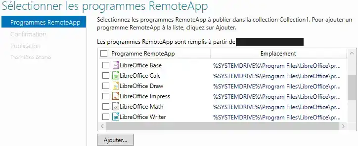
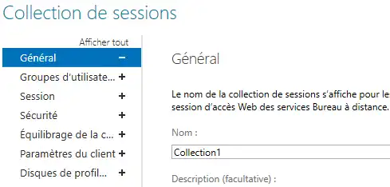
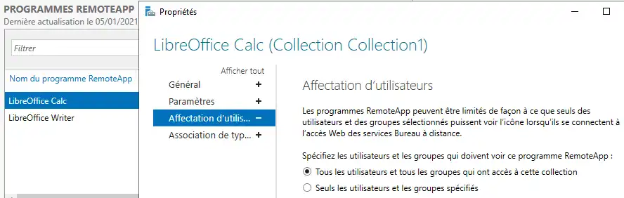

# Module 03 — Publication d’applications

Semaine du 16 au 20 novembre 2026. Les vidéos citées par les énoncés sont **Inexistant**.

[Travaux](../../tp/18-services-transverses-microsoft/module-03/index.md) · [Révision](../../revision/18-services-transverses-microsoft/module-03.md) · [Kahoot — 20 questions](../../kahoot/18-services-transverses-microsoft-module-03.md)

=== "Cours Original"

    ## Objectifs

    - Publier des applications via les services de Bureau à distance.
    - Gérer les connexions à distance.

    ## Principe de la publication d’applications

    La publication d’applications fait partie des services pris en charge par RDS. La solution RemoteApp rend transparent pour l’utilisateur le lancement d’applications depuis un serveur RDS. Le schéma de la diapositive est titré « Applications publiées ».

    ## Étapes de mise en œuvre

    Depuis le Gestionnaire de serveur, sur le rôle RDS / Collections, cibler la collection souhaitée. Dans la partie PROGRAMMES REMOTEAPP, choisir la tâche Publier des programmes RemoteApp.

    Depuis l’assistant, sélectionner dans la liste les programmes à publier. Le bouton Ajouter permet d’aller chercher un exécutable non listé.

    

    ## Mise à disposition des programmes publiés

    Côté utilisateur, plusieurs méthodes peuvent être utilisées pour accéder à une application publiée :

    - depuis un navigateur via le portail Accès Bureau à distance par le Web (RD Web Access) ;
    - depuis le menu Démarrer avec le composant Connexions RemoteApp et Bureau à distance situé dans le panneau de configuration.

    ## Accès Bureau à distance par le Web

    Le service Accès Bureau à distance par le web (RDS-Web-Access) doit être installé. Il s’appuie sur IIS pour son fonctionnement. Une fois le service installé, l’accès du client au portail se fait via une connexion à `https://nom_du_serveur/RDWeb`. Une fois authentifié, l’utilisateur peut ensuite lancer l’application souhaitée.

    ## Connexions RemoteApp et Bureau à distance

    Lancer la console depuis le menu Démarrer ou le Panneau de configuration. Configurer l’URL de connexion avec la fonction Accéder aux programmes RemoteApp et aux services Bureau à distance :

    `https://nom_FQDN_du_serveur/RDWeb/Feed/webfeed.aspx`

    

    Les raccourcis RemoteApp apparaissent dans un répertoire Work Resources dans le menu Démarrer. Attention : pour que cela soit fonctionnel, le certificat serveur doit avoir été déployé sur le client.

    ## Démonstration

    Utilisation des RemoteApp.

    ## Configuration avancée des collections

    La configuration globale des applications publiées est accessible depuis les propriétés de la collection. Dans ces paramètres sont configurables :

    - les utilisateurs autorisés ;
    - les paramètres de session ;
    - les paramètres de connexion ;
    - les disques de profil utilisateur.

    Chaque application dispose également de ses propres propriétés.

    

    ## Filtrage et restrictions

    - Depuis les propriétés de la collection pour configurer un ensemble de programmes.
    - Depuis les propriétés de publication du programme.

    

    ## TP

    Mise en œuvre des RemoteApp. Module 3 - Atelier 3.

    ## Pour aller plus loin

    Authentification unique (SSO) : configuration du serveur RDS par stratégie de domaine pour éviter la double authentification. Paramètre : Autoriser la délégation d’informations d’identification par défaut.

    Gestion de licences : des licences d’accès client (CAL) pour le service RDS sont nécessaires pour permettre aux utilisateurs de bénéficier de ce service. Cela nécessite le déploiement du rôle et l’utilisation de la console Gestionnaire de licences des services Bureau à distance.

    Rôle Passerelle des services Bureau à distance : permet l’accès à l’infrastructure RDS depuis l’extérieur via le protocole HTTPS. Rôle complémentaire à installer sur un serveur dédié. Le schéma place les clients, un pare-feu, RD Web Access, RD Gateway, un second pare-feu, le broker, les hôtes RDSH et RDVH, le stockage de fichiers, Active Directory et le serveur de licences.

    Rôle Service Broker pour les connexions Bureau à distance : suit les sessions utilisateurs d’un ensemble de serveurs RDS. Permet la répartition de charges et la reconnexion des utilisateurs à leur session existante.

    ## Conclusion

    - Vous savez mettre à disposition des applications avec les RemoteApps.
    - Vous êtes en mesure d’appliquer une restriction d’utilisation des RemoteApps (filtrage).

=== "Cours Optimisé IA"

    RemoteApp publie une application du serveur RDS sans montrer le bureau entier. Le support donne deux chemins utilisateur, puis le filtrage.

    1. Dans RDS / Collections, partie PROGRAMMES REMOTEAPP, lancer Publier des programmes RemoteApp. Cocher la liste, ou Ajouter un exécutable absent.

    

    2. L’utilisateur ouvre soit `https://nom_du_serveur/RDWeb` (RDS-Web-Access, appuyé sur IIS), soit Connexions RemoteApp et Bureau à distance avec `https://nom_FQDN_du_serveur/RDWeb/Feed/webfeed.aspx`.

    

    3. Les raccourcis se rangent dans Work Resources. Le certificat serveur doit déjà être sur le client.
    4. Les propriétés de la collection règlent les utilisateurs, la session, la connexion et les disques de profil. Chaque programme a aussi ses propriétés, dont l’affectation d’utilisateurs.

    

    

    Le support cite ensuite, sans les dérouler dans l’atelier : le SSO par la délégation d’informations d’identification par défaut, les CAL RDS, la passerelle HTTPS sur un serveur dédié, et le broker qui suit les sessions, répartit la charge et reconnecte. Le schéma nomme clients, pare-feu, RD Web Access, RD Gateway, broker, RDSH, RDVH, stockage, Active Directory et serveur de licences.

    L’atelier 3 est la mise en œuvre des RemoteApp.

## Pour pratiquer et réviser

- [Fiche de révision](../../revision/18-services-transverses-microsoft/module-03.md)
- [Kahoot — 20 questions](../../kahoot/18-services-transverses-microsoft-module-03.md)
- [Sommaire du cours](index.md)
