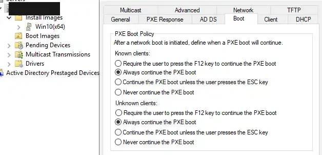

# Module 05 — Windows Deployment Services

Semaine du 16 au 20 novembre 2026. Les vidéos citées par les énoncés sont **Inexistant**.

[Travaux](../../tp/18-services-transverses-microsoft/module-05/index.md) · [Révision](../../revision/18-services-transverses-microsoft/module-05.md) · [Kahoot préparé](../../kahoot/18-services-transverses-microsoft-module-05.md)

=== "Cours Original"

    ## Objectifs

    Mettre en œuvre le service de déploiement WDS.

    ## Présentation du service WDS

    WDS est un service disponible en tant que rôle de Windows Server. Il dispose d’une console de gestion. Le service peut aussi être géré via PowerShell : `Get-Command -module WDS`.

    Ce service peut :

    - fournir les informations nécessaires à l’amorçage de postes clients via le réseau ;
    - héberger des images d’amorçage et d’installation et les transmettre aux clients ;
    - intégrer des pilotes à des images.

    ## WDS – Prérequis de mise en œuvre

    Un service DHCP doit être installé pour que les postes clients à déployer puissent démarrer depuis le réseau. Le service de résolution de noms DNS doit aussi être présent et configuré. WDS est généralement mis en œuvre dans un contexte de domaine Active Directory, mais il peut être installé hors contexte de domaine Active Directory.

    ## WDS et DHCP

    Pour que les postes à déployer récupèrent les paramètres nécessaires à leur adressage réseau et au contact du serveur de déploiement WDS, le serveur DHCP et le serveur WDS travaillent conjointement.

    Le schéma numérote les échanges : 1 DHCP DISCOVER, 2 DHCP OFFER (dont une offre marquée `[60] PXECLIENT`), 3/4 DHCP REQUEST/ACK vers le DHCP, 5/6 DHCP REQUEST/ACK vers le WDS avec `[66] TFTP Server Host name` et `[67] Boot File Name`.

    Options DHCP à fournir : 6 – DNS Server, 15 – Domain Name.

    

    ## WDS – Installation du service

    Le rôle peut être installé via PowerShell ou via le gestionnaire de serveur. Lors de l’installation du rôle, les services de rôle suivants sont proposés :

    - Serveur de déploiement ;
    - Serveur de transport.

    Si le service WDS est mis en œuvre pour le déploiement, les deux services de rôle doivent être installés. L’implémentation du service de rôle de serveur de transport seul est réservée à des cas particuliers, comme le transfert de fichiers via multicast (non abordé dans le cadre de ce cours).

    ## WDS – Configuration initiale du service

    Une fois le rôle WDS installé, son assistant de configuration permet d’en établir la configuration initiale. Pour lancer l’assistant, ouvrir la console de gestion, faire un clic droit sur le serveur puis sur Configure Server. Renseigner :

    - le contexte de mise en œuvre du service, en ou hors contexte de domaine ;
    - le dossier de partage des données du service (images) : prévoir un espace disque dédié et disposant d’une capacité suffisante ;
    - la configuration de restriction de réponse du serveur PXE : pour tous ou ciblage (non mis en œuvre dans ce cours).

    ## Démonstration

    Déployer WDS.

    ## WDS – Configuration globale du service

    Depuis les propriétés du serveur, un ensemble de paramètres liés à son fonctionnement peuvent être configurés.

    Zoom sur le comportement DHCP. Si le service DHCP est installé sur le serveur WDS :

    - le service WDS ne doit pas écouter sur les ports du DHCP ;
    - le serveur DHCP doit fournir les options liées aux services de déploiement.

    Dans ce cas, cocher les cases. Sinon, ne pas cocher les cases.

    Zoom sur la configuration du comportement du client PXE. Si l’on souhaite que les clients DHCP accrochent le PXE sans action particulière, le paramétrage suivant est à réaliser. La capture montre la stratégie de réponse PXE.

    

    ## WDS – Images de démarrage et d’installation

    Le partage du service WDS dispose d’une structure pouvant contenir une ou plusieurs images de démarrage et une ou plusieurs images d’installation.

    L’image de démarrage correspond à l’image d’un système d’exploitation minimaliste chargé de procéder à l’installation : WinPE. Le schéma place l’étape 1 en TFTP (request file, puis transfert du fichier) vers cette image de démarrage.

    L’image d’installation est l’image du système qui sera installée sur le poste. Le schéma l’appelle étape 2, encore en TFTP.

    ## WDS – Ajout d’image de démarrage

    Depuis la console de gestion WDS, faire un clic droit sur le conteneur d’images de démarrage. Cliquer sur Ajouter une image de démarrage. Indiquer le chemin du fichier WIM souhaité. Cela peut être le fichier `boot.wim` du répertoire Sources du média d’installation de Windows.

    ## WDS – Ajout d’image d’installation

    Depuis sa console de gestion, faire un clic droit sur le conteneur d’images d’installation. Cliquer sur Ajouter une image d’installation. Une image d’installation doit être associée à un groupe d’images. Si celui-ci n’est pas créé en amont, l’assistant permet de le créer. Indiquer le chemin de l’image WIM :

    - le fichier `install.wim` du média d’installation ;
    - ou le chemin d’une image WIM précédemment capturée ;
    - ou toute autre image WIM d’installation.

    Si le fichier WIM ciblé contient plusieurs images, sélectionner la ou les images souhaitées.

    

    ## Démonstration

    Configurer WDS.

    ## TP

    Mise en œuvre de WDS. Module 5 - Atelier 4.

    ## WDS – Suite ou fin ?

    Les éléments abordés permettent de disposer d’un service de déploiement minimaliste. Cela permet de démarrer les postes clients à déployer via le réseau (PXE) pour accéder à un environnement de déploiement, et de réaliser une installation avec interaction utilisateur depuis cet environnement.

    Une mise en place minimaliste du service WDS suffit pour la réalisation du premier atelier pratique. Elle ne constitue pas un service de déploiement abouti pour un contexte d’entreprise. Elle peut être complétée par la solution MDT pour disposer d’un service de déploiement complet.

    ## WDS – Pour aller plus loin

    Pour compléter l’infrastructure WDS, les points suivants vont être abordés : les images de capture, les fichiers de réponses, la gestion des pilotes. Ces notions sont utiles pour la mise en place du service WDS seul. Avec la solution MDT, c’est en dehors du service WDS que ces besoins sont gérés.

    ## WDS – Images de capture

    Une image de capture est associée à une image de boot. Créer une image de boot dédiée à la capture et l’ajouter au service WDS. Puis, depuis celle-ci, faire un clic droit et choisir Créer une image de capture. L’assistant se lance. Renseigner un nom et un chemin de stockage de l’image à capturer.

    

    Le poste dont le système d’exploitation est à capturer doit au préalable avoir été préparé et un Sysprep doit avoir été réalisé. Démarrer le poste à capturer depuis le réseau (PXE) puis choisir l’image de capture précédemment configurée. L’assistant de capture d’images se charge.

    Après avoir ciblé le volume sur lequel se trouve le système d’exploitation à capturer, associer un nom à cette image. Renseigner ensuite le chemin du répertoire local dans lequel sera stockée l’image de capture durant sa création, et le groupe d’images dans lequel sera stockée la capture dans WDS.

    ## WDS – Fichiers de réponse

    Dans le cadre d’utilisation d’un service WDS seul (sans MDT), des fichiers de réponses pourront être créés afin d’automatiser le processus d’installation. Plusieurs scénarios sont possibles :

    - partir d’un exemple de fichier et l’adapter à ses besoins ;
    - récupérer depuis PowerShell Gallery la commande `New-ShieldingDataAnswerFile` et l’utiliser pour générer le fichier ;
    - utiliser l’assistant Gestion d’installation (WSIM) disponible dans ADK.

    Les fichiers de réponses contiennent des paramètres permettant d’interagir sur l’intégralité du processus d’installation.

    Un fichier de réponse peut être lié à une image de démarrage s’il contient des informations concernant l’étape 1, windowsPE, du processus d’installation. Dans ce cas, le fichier `unattend.xml` est à stocker dans le répertoire WDSClientUnattend du partage WDS. Il est à configurer depuis l’onglet Client du serveur. Ce fichier est appliqué au chargement de l’image de boot de l’architecture sélectionnée.

    Un fichier de réponse peut être lié à une image d’installation s’il contient des informations concernant les étapes 2 à 7 du processus d’installation. Sur l’image d’installation ciblée, depuis l’onglet Général, cocher la case Autoriser l’image à s’installer sans assistance et indiquer le fichier de réponse à utiliser. Ce fichier sera appliqué lors du déploiement de cette image.

    ## Conclusion

    - Vous connaissez les concepts et méthodes de déploiement Microsoft.
    - Vous savez configurer le service WDS pour des besoins en déploiement basiques.
    - Vous maîtrisez le déploiement depuis une image d’installation.

=== "Cours Optimisé IA"

    WDS est le rôle Windows Server qui amorce les postes par le réseau, héberge les images et peut y intégrer des pilotes. La console existe ; `Get-Command -module WDS` liste aussi les commandes.

    DHCP et DNS sont prérequis. Le domaine Active Directory est le cas général, pas une obligation. DHCP et WDS se partagent les offres : DISCOVER, OFFER, REQUEST/ACK. L’offre PXE porte l’option 60 `PXECLIENT`, puis 66 (serveur TFTP) et 67 (fichier de boot). Les options 6 et 15 restent le DNS et le nom de domaine.

    

    Installer les deux services de rôle, déploiement et transport, dès que WDS sert à déployer. Le transport seul est le cas multicast, hors cours.

    L’assistant Configure Server demande le contexte de domaine, le dossier des images et la restriction PXE. Le ciblage PXE n’est pas mis en œuvre dans ce cours. Si DHCP est sur le même serveur, cocher les cases : ne pas écouter les ports DHCP, et faire fournir les options par DHCP. Sinon, ne pas les cocher. La capture suivante est le comportement du client PXE.

    

    L’image de démarrage est un WinPE chargé en TFTP. L’image d’installation est le système, deuxième transfert TFTP. On ajoute `boot.wim` depuis Sources, puis une image d’installation rattachée à un groupe : `install.wim`, une capture, ou un autre WIM. S’il contient plusieurs images, on choisit.

    

    Ce WDS minimaliste suffit à l’atelier 4 : boot PXE et installation interactive. Le support le dit insuffisant pour l’entreprise et le complète par MDT. Images de capture, fichiers de réponses et pilotes servent au WDS seul ; avec MDT, ces besoins sortent de WDS.

    La capture part d’une image de boot, clic droit, Créer une image de capture, nom et chemin. Le poste source a été préparé et sysprepé, puis démarré en PXE sur cette image. On nomme le volume, le dossier local de création et le groupe WDS.

    

    Sans MDT, le fichier de réponses vient d’un exemple, de `New-ShieldingDataAnswerFile`, ou de WSIM dans l’ADK. Lié au boot (étape windowsPE), `unattend.xml` va dans WDSClientUnattend et se désigne dans l’onglet Client. Lié à l’installation (étapes 2 à 7), la case Autoriser l’image à s’installer sans assistance désigne le fichier sur l’image.

    L’atelier du support s’intitule Mise en œuvre de WDS, module 5, atelier 4.
