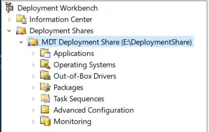
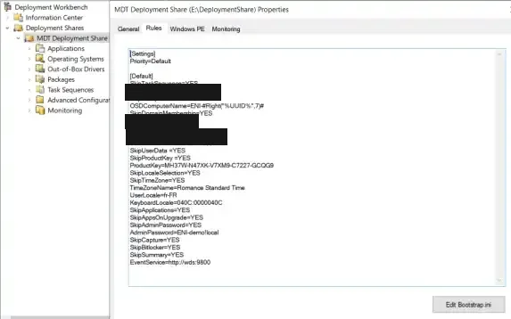
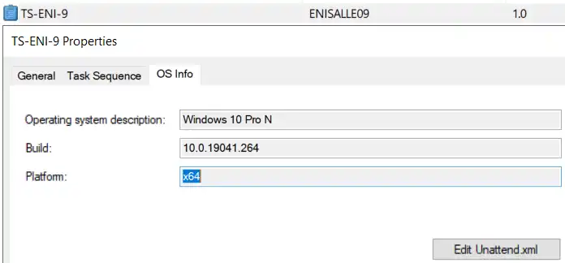

# Module 06 — Microsoft Deployment Toolkit

Semaine du 16 au 20 novembre 2026. Les vidéos citées par les énoncés sont **Inexistant**.

[Travaux](../../tp/18-services-transverses-microsoft/module-06/index.md) · [Révision](../../revision/18-services-transverses-microsoft/module-06.md) · [Kahoot — 20 questions](../../kahoot/18-services-transverses-microsoft-module-06.md)

Les exemples de fichiers de réponse contiennent des mots de passe et une clé de produit. Ils sont remplacés par `[masqué]`. Les noms de domaine de laboratoire (`deploy.lab`) sont conservés comme valeurs techniques.

=== "Cours Original"

    ## Objectifs

    Automatiser les tâches de déploiement avec les outils MDT.

    ## MDT – En appui aux services de déploiement

    MDT représente un ensemble d’outils permettant d’automatiser le processus de déploiement de postes. Il complète les services de déploiement WDS. MDT dispose de son arborescence de partage de ressources via les « Partages de déploiement » :

    - qui contiennent les images d’installation à déployer ;
    - qui sont accessibles via des images de démarrage (Lite Touch) générées par MDT ;
    - dans lequel sont stockés des séquences de tâches et des fichiers de paramètres à des fins d’automatisation.

    ## MDT - Présentation du fonctionnement

    Le schéma enchaîne trois étapes. Étape 1 : WDS, requête TFTP puis transfert du fichier LightTouchPE, image de démarrage. Étape 2 : WinPE joint le partage de déploiement MDT. Étape 3 : image WIM à déployer et séquence de tâches.

    ## MDT – Prérequis

    MDT nécessite des composants complémentaires : Windows ADK (Windows Assessment and Deployment Kit) et WinPE (Windows Preinstallation Environment).

    Procédure d’installation écrite :

    - télécharger les dernières versions sur le site de Microsoft ;
    - lancer l’installeur, qui nécessite une connexion Internet ; un mode hors ligne est proposé ;
    - sélectionner les composants souhaités pour ADK, au minimum les fonctionnalités cochées sur la diapositive.

    ## MDT – Le partage de déploiement

    Le partage de déploiement est la base de la configuration de MDT. À ce partage sont associés la création d’une image de démarrage, les systèmes d’exploitation à déployer et les séquences de tâches. En complément : des pilotes et des applications à déployer.

    

    Pour créer un partage de déploiement :

    - lancer la console de gestion de MDT « Deployment Workbench » ;
    - clic droit sur Deployment Share puis New Deployment Share ;
    - indiquer le chemin du dossier de déploiement, qui pourra être créé s’il est inexistant, le nom et la description du partage ;
    - prévoir un espace disque suffisant.

    

    L’assistant propose ensuite de passer un ensemble d’étapes d’installation. Les choix sélectionnés sont traduits en paramètres de configuration dans le fichier CustomSettings.ini, abordé dans les diapositives suivantes.

    Les paramétrages sont disponibles dans les propriétés du partage de déploiement.

    | Onglet | Contenu écrit |
    |---|---|
    | General | Paramètres généraux et activation du multicast (via WDS). |
    | Rules | Configuration des fichiers Bootstrap.ini et CustomSettings.ini. |
    | Windows PE | Paramétrage des médias de démarrage (x86 et x64). |
    | Monitoring | Activation du suivi des déploiements dans la console de gestion. |

    

    

    

    ## MDT – Windows PE

    Média nécessaire à l’initialisation des séquences de tâches de MDT. Généré à partir du partage de déploiement. Formats WIM et ISO disponibles, pour les architectures 32 et 64 bits. Fichiers stockés dans le répertoire Boot de l’arborescence du partage de déploiement. Paramétrage dans les propriétés du partage, onglet Windows PE. Ajout de fonctionnalités et de pilotes complémentaires possible. Une mise à jour du partage de déploiement est nécessaire après toute modification.

    ## MDT – Systèmes d’exploitation

    Une image de système d’exploitation à déployer doit être associée au partage de déploiement. Pour en ajouter une, faire un clic droit sur le conteneur Operating Systems puis Importer. L’assistant propose d’indiquer un chemin de média d’installation, le chemin d’un fichier WIM ciblé, ou d’aller chercher dans les images intégrées au service WDS. Quand un fichier WIM contient plusieurs images, il est possible de supprimer les images de systèmes non souhaitées.

    ## Démonstration

    Installer MDT.

    ## MDT – Les fichiers CustomSettings et Bootstrap

    Les fichiers Bootstrap.ini et CustomSettings.ini contiennent un ensemble de règles s’appliquant pendant le processus de déploiement. Ces règles engendrent la réalisation d’actions et de paramétrages. Exemple de points de configuration d’un partage de déploiement :

    ```ini
    SkipComputerBackup=NO
    SkipProductKey=YES
    SkipAdminPassword vaut YES
    SkipCapture=NO
    SkipBitLocker=NO
    ```

    Ces fichiers sont dans le répertoire Control du partage de déploiement. Ils sont accessibles depuis ce répertoire ou peuvent être édités via la console MDT. Ils sont complémentaires. Bootstrap.ini est pris en compte lors du chargement du média WinPE. CustomSettings.ini est pris en compte lors de la phase de déploiement. Le schéma aligne 1 - UEFI, 2 - WinPE (Bootstrap.ini) et 3 - Déploiement (CustomSettings.ini).

    Depuis les propriétés du partage, onglet Rules, sont affichés les paramètres de CustomSettings.ini. Il est possible d’éditer Bootstrap.ini.

    ## MDT – Bootstrap.ini

    Ce fichier contient les informations nécessaires à l’environnement Windows PE, pour permettre l’accès au partage de déploiement et, optionnellement, pour paramétrer l’environnement WinPE. Pour la prise en compte des modifications, il est nécessaire, dans MDT, de mettre à jour le partage de déploiement, ce qui régénère l’image de boot MDT, puis, dans WDS, de remplacer l’image de démarrage correspondante.

    Exemple écrit. Le mot de passe est `[masqué]`.

    ```ini
    [Settings]
    Priority=Default
    [Default]
    DeployRoot=\\WDS\DeploymentShare$
    UserID=mdt
    UserDomain=deploy.lab
    UserPassword=[masqué]
    KeyboardLocale=fr-FR
    KeyboardLocalePE=040c:0000040c
    SkipBDDWelcome=YES
    ```

    ## MDT – CustomSettings.ini

    Un grand nombre de paramètres peut être renseigné dans ce fichier. L’exemple permet d’automatiser le processus de déploiement du système à déployer. La mise à jour de ce fichier ne requiert pas la mise à jour du partage de déploiement. Les paramètres présentés sont repris dans la diapositive suivante.

    | Famille | Paramètres écrits |
    |---|---|
    | Interactivité de l’installeur | `SkipTaskSequence` vaut YES, `TaskSequenceID=LABSALLE09`, `SkipUserData` vaut YES, `SkipApplications` vaut YES, `SkipAppsOnUpgrade` vaut YES, `SkipAdminPassword` vaut YES, `AdminPassword=[masqué]` |
    | Paramètres régionaux | `SkipLocaleSelection` vaut YES, `SkipTimeZone` vaut YES, `UserLocale=fr-FR`, `KeyboardLocale=040C:0000040C`, `TimeZoneName=Romance Standard Time` |
    | Autres sauts | `SkipCapture` vaut YES, `SkipBitlocker` vaut YES, `SkipSummary` vaut YES |
    | Nommage et domaine | `SkipComputerName` vaut YES, `OSDComputerName=LAB-DEMO`, `SkipDomainMembership` vaut YES, `JoinDomain=deploy.lab`, `DomainAdmin=mdt`, `DomainAdminDomain=deploy.lab`, `DomainAdminPassword=[masqué]` |

    
    | Activation | `SkipProductKey` vaut YES, commentaire « clé KMS pour W10 Pro N », `ProductKey=[masqué]` |

    ## Démonstration

    Bootstrap.ini et CustomSettings.ini.

    ## MDT – Restreindre l’accès au partage de déploiement

    L’accès aux ressources du partage de déploiement peut être restreint. Un compte de service peut être utilisé, au moyen d’entrées de contrôle d’accès configurées sur le partage ou via les autorisations NTFS.

    ```ini
    DeployRoot=\\WDS\DeploymentShare$
    UserID=mdt
    UserDomain=deploy.lab
    UserPassword=[masqué]
    ```

    Le support demande de veiller à la cohérence des informations d’authentification et des règles de restriction d’accès. Si un compte de domaine est utilisé, il pourra aussi servir à l’intégration au domaine du poste déployé.

    ## MDT – La séquence de tâches

    Durant le processus de déploiement, un ensemble d’actions est réalisé. La séquence de tâches permet d’automatiser la réalisation de ces actions. Elle est nécessaire au processus de déploiement. Elle est directement liée au choix du système d’exploitation à déployer. Pour la création, l’assistant utilise des modèles. La création génère des fichiers de réponse utilisés par l’installeur : Unattend.xml et ts.xml.

    Lors de la création, en fonction du modèle choisi, différentes questions sont posées : elles sont regroupées par catégories. À l’issue, la séquence peut être éditée, complétée, modifiée.

    ## Démonstration

    Accès au partage et séquence de tâches.

    ## MDT – Séquence de tâches et fichiers de réponses

    Tous les paramètres liés à la séquence de tâches ne sont pas affichés lors de l’édition, certains sont reportés dans les fichiers de réponses. L’édition du fichier Unattend.xml est proposée depuis l’onglet OS Info des propriétés de la séquence de tâches.

    Le contenu des fichiers de réponse peut être minimaliste, en réponse à des besoins de déploiement basiques. Il peut aussi être beaucoup plus complet pour répondre à des besoins pointus d’un service de déploiement. Dans ce cours, nous ne détaillerons pas les possibilités de personnalisation de ces fichiers.

    ## MDT – Monitoring

    Permet le suivi des déploiements depuis la console. Se configure dans les propriétés du partage, onglet Monitoring, désactivé par défaut. Ajoute une directive EventService dans CustomSettings.ini :

    `EventService=http://W19-MDT1:9800`

    Se visualise dans le nœud Monitoring du partage de déploiement, pour le suivi des postes déployés et de l’avancement des séquences de tâches.

    ## MDT – Bascule des MAJ MDT vers WDS

    Lorsque des modifications sont apportées dans MDT, il peut être nécessaire de mettre à jour le média d’installation LiteTouch.wim : clic droit sur le partage de déploiement et choisir Update Deployment Share. Les modifications apportées doivent ensuite être apportées à l’image de démarrage du service WDS. Le chemin du fichier est à renseigner.

    ## MDT – Problématiques et méthodes d’analyses

    Le processus d’installation est complet et complexe, nombreuses sont les problématiques qui peuvent affecter le bon fonctionnement du service. Les problématiques bloquantes peuvent survenir notamment lors de la mise en œuvre initiale. Ce support de cours n’a pas pour vocation de lister l’ensemble des problématiques qui peuvent être rencontrées et leurs solutions. Les éléments présentés sur les diapositives suivantes donnent des méthodes de base pour leur analyse.

    ## MDT – Journaux de déploiement

    L’exploitation des journaux permet d’analyser les problématiques rencontrées sur les services de déploiement. En cas d’erreurs en amont de l’application de l’image d’installation sur un poste, une invite de commande permet de lancer notepad.

    L’accès à une invite de commandes est aussi possible quand le déploiement se bloque sur erreur en cours de processus, avec « Shift » + « F10 ». Une fois l’image de déploiement appliquée, si le système n’est pas opérationnel, passer par le média d’installation, Dépannage, Invite de commande, pour ensuite lancer notepad.

    | Fichier | Rôle écrit |
    |---|---|
    | `X:\MININT\SMSOSD\OSDLOGS\BDD.log` | Journal d’activités et d’erreurs de MDT |
    | `C:\MININT\SMSOSD\OSDLOGS\BDD.log` | Journal d’activités et d’erreurs de MDT |
    | `C:\Windows\Panther\setuperr.log` | Journaux relatifs aux actions de paramétrage effectuées pendant l’installation |
    | `C:\Windows\Panther\setupact.log` | Journaux relatifs aux actions de paramétrage effectuées pendant l’installation |

    L’analyse permet d’identifier l’étape problématique.

    ## TP

    Mise en œuvre de MDT. Module 6 - Atelier 5.

    ## MDT – Pour aller plus loin

    Vous disposez maintenant d’un service de déploiement automatisé pour déployer vos postes. Ce service peut être complété afin de prendre en charge le déploiement d’applications et pilotes.

    ## Déploiement d’applications

    MDT prend en charge le déploiement d’applications après celui du système. Cette fonctionnalité peut aussi bien être utilisée pour déployer des pilotes que des applications. Elle se met en œuvre depuis le répertoire Applications du Deployment Shares. Au besoin, créer une structure afin d’organiser les applications, puis lancer l’assistant d’installation d’applications.

    Étape 1, Application Type : indiquer si l’on fournit l’installeur à l’assistant, qui se charge de l’importer dans la structure du partage de déploiement ; si l’application est à disposition sur un partage réseau ; ou s’il s’agit d’un groupe d’applications.

    Renseigner ensuite successivement les caractéristiques de l’application, le chemin de répertoire dans lequel se trouve l’installeur (créer un répertoire dédié), le nom du dossier qui sera créé dans l’arborescence du partage et contiendra l’installeur, et la commande permettant l’installation silencieuse et non interactive de l’application.

    Modification de CustomSettings.ini. Le support montre le rendu de la fenêtre de sélection, dans ce cas-ci `SkipApplications` vaut NO.

    ## MDT – Gestion des pilotes

    Les pilotes sont nécessaires lors de la phase de boot (contrôleur réseau et stockage ; généralement les pilotes natifs sont suffisants) et lors du déploiement de l’OS (contrôleur vidéo, son, etc.). Import dans « Out-of-Box Drivers », avec possibilité de classement par marque / modèle / OS. Intérêt de disposer d’un parc client le plus homogène.

    Pour la prise en compte lors de la phase de boot, par défaut tous les drivers liés au réseau sont embarqués dans le WinPE. On peut cibler les drivers à installer en utilisant des profils différents.

    ## Démonstration

    Monitoring et MAJ LiteTouchPe.wim. Le titre de la diapositive écrit LiteTouchPe.wim.

    ## TP

    Déploiement d’une application et driver. Module 6 - Atelier 6.

    ## Conclusion

    - Vous savez utiliser MDT et configurer des séquences de tâches pour automatiser le déploiement des systèmes Windows.
    - Vous savez également implémenter le déploiement d’une application et driver.

=== "Cours Optimisé IA"

    Les parties ci-dessous reprennent le cours original, dans le même ordre. Les encadrés et les schémas répètent ses formulations.

    ## Parcours de lecture

    1. Objectifs
    2. MDT – En appui aux services de déploiement
    3. MDT - Présentation du fonctionnement
    4. MDT – Prérequis
    5. MDT – Le partage de déploiement
    6. MDT – Windows PE
    7. MDT – Systèmes d’exploitation
    8. Démonstration
    9. MDT – Les fichiers CustomSettings et Bootstrap
    10. MDT – Bootstrap.ini
    11. MDT – CustomSettings.ini
    12. Démonstration
    13. MDT – Restreindre l’accès au partage de déploiement
    14. MDT – La séquence de tâches
    15. Démonstration
    16. MDT – Séquence de tâches et fichiers de réponses
    17. MDT – Monitoring
    18. MDT – Bascule des MAJ MDT vers WDS
    19. MDT – Problématiques et méthodes d’analyses
    20. MDT – Journaux de déploiement
    21. TP
    22. MDT – Pour aller plus loin
    23. Déploiement d’applications
    24. MDT – Gestion des pilotes
    25. Démonstration
    26. TP
    27. Conclusion

    **Visuel externe**

    ```mermaid
    flowchart TD
        N1["Objectifs"]
        N2["MDT – En appui aux services de déploiement"]
        N3["MDT - Présentation du fonctionnement"]
        N4["MDT – Prérequis"]
        N5["MDT – Le partage de déploiement"]
        N6["MDT – Windows PE"]
        N7["MDT – Systèmes d’exploitation"]
        N8["Démonstration"]
        N9["MDT – Les fichiers CustomSettings et Bootstrap"]
        N10["MDT – Bootstrap.ini"]
        N11["MDT – CustomSettings.ini"]
        N12["Démonstration"]
        N1 --> N2
        N2 --> N3
        N3 --> N4
        N4 --> N5
        N5 --> N6
        N6 --> N7
        N7 --> N8
        N8 --> N9
        N9 --> N10
        N10 --> N11
        N11 --> N12
    ```

    ## Objectifs

    !!! note "À retenir"
        Automatiser les tâches de déploiement avec les outils MDT.

    Automatiser les tâches de déploiement avec les outils MDT.

    ## MDT – En appui aux services de déploiement

    !!! note "À retenir"
        MDT représente un ensemble d’outils permettant d’automatiser le processus de déploiement de postes.

    MDT représente un ensemble d’outils permettant d’automatiser le processus de déploiement de postes. Il complète les services de déploiement WDS. MDT dispose de son arborescence de partage de ressources via les « Partages de déploiement » :

    - qui contiennent les images d’installation à déployer ;
    - qui sont accessibles via des images de démarrage (Lite Touch) générées par MDT ;
    - dans lequel sont stockés des séquences de tâches et des fichiers de paramètres à des fins d’automatisation.

    ## MDT - Présentation du fonctionnement

    !!! note "À retenir"
        Étape 1 : WDS, requête TFTP puis transfert du fichier LightTouchPE, image de démarrage.

    Le schéma enchaîne trois étapes. Étape 1 : WDS, requête TFTP puis transfert du fichier LightTouchPE, image de démarrage. Étape 2 : WinPE joint le partage de déploiement MDT. Étape 3 : image WIM à déployer et séquence de tâches.

    ## MDT – Prérequis

    !!! note "À retenir"
        MDT nécessite des composants complémentaires : Windows ADK (Windows Assessment and Deployment Kit) et WinPE (Windows Preinstallation Environment).

    MDT nécessite des composants complémentaires : Windows ADK (Windows Assessment and Deployment Kit) et WinPE (Windows Preinstallation Environment).

    Procédure d’installation écrite :

    - télécharger les dernières versions sur le site de Microsoft ;
    - lancer l’installeur, qui nécessite une connexion Internet ; un mode hors ligne est proposé ;
    - sélectionner les composants souhaités pour ADK, au minimum les fonctionnalités cochées sur la diapositive.

    ## MDT – Le partage de déploiement

    !!! note "À retenir"
        Le partage de déploiement est la base de la configuration de MDT.

    **Visuel externe**

    ```mermaid
    flowchart LR
        N1["lancer la console de gestion de MDT « Deployment Workbench » ;"]
        N2["clic droit sur Deployment Share puis New Deployment Share ;"]
        N3["prévoir un espace disque suffisant."]
        N1 --> N2
        N2 --> N3
    ```

    Le partage de déploiement est la base de la configuration de MDT. À ce partage sont associés la création d’une image de démarrage, les systèmes d’exploitation à déployer et les séquences de tâches. En complément : des pilotes et des applications à déployer.

    

    Pour créer un partage de déploiement :

    - lancer la console de gestion de MDT « Deployment Workbench » ;
    - clic droit sur Deployment Share puis New Deployment Share ;
    - indiquer le chemin du dossier de déploiement, qui pourra être créé s’il est inexistant, le nom et la description du partage ;
    - prévoir un espace disque suffisant.

    

    L’assistant propose ensuite de passer un ensemble d’étapes d’installation. Les choix sélectionnés sont traduits en paramètres de configuration dans le fichier CustomSettings.ini, abordé dans les diapositives suivantes.

    Les paramétrages sont disponibles dans les propriétés du partage de déploiement.

    | Onglet | Contenu écrit |
    |---|---|
    | General | Paramètres généraux et activation du multicast (via WDS). |
    | Rules | Configuration des fichiers Bootstrap.ini et CustomSettings.ini. |
    | Windows PE | Paramétrage des médias de démarrage (x86 et x64). |
    | Monitoring | Activation du suivi des déploiements dans la console de gestion. |

    

    

    

    ## MDT – Windows PE

    !!! note "À retenir"
        Média nécessaire à l’initialisation des séquences de tâches de MDT.

    Média nécessaire à l’initialisation des séquences de tâches de MDT. Généré à partir du partage de déploiement. Formats WIM et ISO disponibles, pour les architectures 32 et 64 bits. Fichiers stockés dans le répertoire Boot de l’arborescence du partage de déploiement. Paramétrage dans les propriétés du partage, onglet Windows PE. Ajout de fonctionnalités et de pilotes complémentaires possible. Une mise à jour du partage de déploiement est nécessaire après toute modification.

    ## MDT – Systèmes d’exploitation

    !!! note "À retenir"
        Une image de système d’exploitation à déployer doit être associée au partage de déploiement.

    Une image de système d’exploitation à déployer doit être associée au partage de déploiement. Pour en ajouter une, faire un clic droit sur le conteneur Operating Systems puis Importer. L’assistant propose d’indiquer un chemin de média d’installation, le chemin d’un fichier WIM ciblé, ou d’aller chercher dans les images intégrées au service WDS. Quand un fichier WIM contient plusieurs images, il est possible de supprimer les images de systèmes non souhaitées.

    ## Démonstration

    Installer MDT.

    ## MDT – Les fichiers CustomSettings et Bootstrap

    !!! note "À retenir"
        Les fichiers Bootstrap.ini et CustomSettings.ini contiennent un ensemble de règles s’appliquant pendant le processus de déploiement.

    Les fichiers Bootstrap.ini et CustomSettings.ini contiennent un ensemble de règles s’appliquant pendant le processus de déploiement. Ces règles engendrent la réalisation d’actions et de paramétrages. Exemple de points de configuration d’un partage de déploiement :

    ```ini
    SkipComputerBackup=NO
    SkipProductKey=YES
    SkipAdminPassword vaut YES
    SkipCapture=NO
    SkipBitLocker=NO
    ```

    Ces fichiers sont dans le répertoire Control du partage de déploiement. Ils sont accessibles depuis ce répertoire ou peuvent être édités via la console MDT. Ils sont complémentaires. Bootstrap.ini est pris en compte lors du chargement du média WinPE. CustomSettings.ini est pris en compte lors de la phase de déploiement. Le schéma aligne 1 - UEFI, 2 - WinPE (Bootstrap.ini) et 3 - Déploiement (CustomSettings.ini).

    Depuis les propriétés du partage, onglet Rules, sont affichés les paramètres de CustomSettings.ini. Il est possible d’éditer Bootstrap.ini.

    ## MDT – Bootstrap.ini

    Ce fichier contient les informations nécessaires à l’environnement Windows PE, pour permettre l’accès au partage de déploiement et, optionnellement, pour paramétrer l’environnement WinPE. Pour la prise en compte des modifications, il est nécessaire, dans MDT, de mettre à jour le partage de déploiement, ce qui régénère l’image de boot MDT, puis, dans WDS, de remplacer l’image de démarrage correspondante.

    Exemple écrit. Le mot de passe est `[masqué]`.

    ```ini
    [Settings]
    Priority=Default
    [Default]
    DeployRoot=\\WDS\DeploymentShare$
    UserID=mdt
    UserDomain=deploy.lab
    UserPassword=[masqué]
    KeyboardLocale=fr-FR
    KeyboardLocalePE=040c:0000040c
    SkipBDDWelcome=YES
    ```

    ## MDT – CustomSettings.ini

    Un grand nombre de paramètres peut être renseigné dans ce fichier. L’exemple permet d’automatiser le processus de déploiement du système à déployer. La mise à jour de ce fichier ne requiert pas la mise à jour du partage de déploiement. Les paramètres présentés sont repris dans la diapositive suivante.

    | Famille | Paramètres écrits |
    |---|---|
    | Interactivité de l’installeur | `SkipTaskSequence` vaut YES, `TaskSequenceID=LABSALLE09`, `SkipUserData` vaut YES, `SkipApplications` vaut YES, `SkipAppsOnUpgrade` vaut YES, `SkipAdminPassword` vaut YES, `AdminPassword=[masqué]` |
    | Paramètres régionaux | `SkipLocaleSelection` vaut YES, `SkipTimeZone` vaut YES, `UserLocale=fr-FR`, `KeyboardLocale=040C:0000040C`, `TimeZoneName=Romance Standard Time` |
    | Autres sauts | `SkipCapture` vaut YES, `SkipBitlocker` vaut YES, `SkipSummary` vaut YES |
    | Nommage et domaine | `SkipComputerName` vaut YES, `OSDComputerName=LAB-DEMO`, `SkipDomainMembership` vaut YES, `JoinDomain=deploy.lab`, `DomainAdmin=mdt`, `DomainAdminDomain=deploy.lab`, `DomainAdminPassword=[masqué]` |

    
    | Activation | `SkipProductKey` vaut YES, commentaire « clé KMS pour W10 Pro N », `ProductKey=[masqué]` |

    ## Démonstration

    Bootstrap.ini et CustomSettings.ini.

    ## MDT – Restreindre l’accès au partage de déploiement

    L’accès aux ressources du partage de déploiement peut être restreint. Un compte de service peut être utilisé, au moyen d’entrées de contrôle d’accès configurées sur le partage ou via les autorisations NTFS.

    ```ini
    DeployRoot=\\WDS\DeploymentShare$
    UserID=mdt
    UserDomain=deploy.lab
    UserPassword=[masqué]
    ```

    Le support demande de veiller à la cohérence des informations d’authentification et des règles de restriction d’accès. Si un compte de domaine est utilisé, il pourra aussi servir à l’intégration au domaine du poste déployé.

    ## MDT – La séquence de tâches

    Durant le processus de déploiement, un ensemble d’actions est réalisé. La séquence de tâches permet d’automatiser la réalisation de ces actions. Elle est nécessaire au processus de déploiement. Elle est directement liée au choix du système d’exploitation à déployer. Pour la création, l’assistant utilise des modèles. La création génère des fichiers de réponse utilisés par l’installeur : Unattend.xml et ts.xml.

    Lors de la création, en fonction du modèle choisi, différentes questions sont posées : elles sont regroupées par catégories. À l’issue, la séquence peut être éditée, complétée, modifiée.

    ## Démonstration

    Accès au partage et séquence de tâches.

    ## MDT – Séquence de tâches et fichiers de réponses

    Tous les paramètres liés à la séquence de tâches ne sont pas affichés lors de l’édition, certains sont reportés dans les fichiers de réponses. L’édition du fichier Unattend.xml est proposée depuis l’onglet OS Info des propriétés de la séquence de tâches.

    Le contenu des fichiers de réponse peut être minimaliste, en réponse à des besoins de déploiement basiques. Il peut aussi être beaucoup plus complet pour répondre à des besoins pointus d’un service de déploiement. Dans ce cours, nous ne détaillerons pas les possibilités de personnalisation de ces fichiers.

    ## MDT – Monitoring

    Permet le suivi des déploiements depuis la console. Se configure dans les propriétés du partage, onglet Monitoring, désactivé par défaut. Ajoute une directive EventService dans CustomSettings.ini :

    `EventService=http://W19-MDT1:9800`

    Se visualise dans le nœud Monitoring du partage de déploiement, pour le suivi des postes déployés et de l’avancement des séquences de tâches.

    ## MDT – Bascule des MAJ MDT vers WDS

    Lorsque des modifications sont apportées dans MDT, il peut être nécessaire de mettre à jour le média d’installation LiteTouch.wim : clic droit sur le partage de déploiement et choisir Update Deployment Share. Les modifications apportées doivent ensuite être apportées à l’image de démarrage du service WDS. Le chemin du fichier est à renseigner.

    ## MDT – Problématiques et méthodes d’analyses

    Le processus d’installation est complet et complexe, nombreuses sont les problématiques qui peuvent affecter le bon fonctionnement du service. Les problématiques bloquantes peuvent survenir notamment lors de la mise en œuvre initiale. Ce support de cours n’a pas pour vocation de lister l’ensemble des problématiques qui peuvent être rencontrées et leurs solutions. Les éléments présentés sur les diapositives suivantes donnent des méthodes de base pour leur analyse.

    ## MDT – Journaux de déploiement

    L’exploitation des journaux permet d’analyser les problématiques rencontrées sur les services de déploiement. En cas d’erreurs en amont de l’application de l’image d’installation sur un poste, une invite de commande permet de lancer notepad.

    L’accès à une invite de commandes est aussi possible quand le déploiement se bloque sur erreur en cours de processus, avec « Shift » + « F10 ». Une fois l’image de déploiement appliquée, si le système n’est pas opérationnel, passer par le média d’installation, Dépannage, Invite de commande, pour ensuite lancer notepad.

    | Fichier | Rôle écrit |
    |---|---|
    | `X:\MININT\SMSOSD\OSDLOGS\BDD.log` | Journal d’activités et d’erreurs de MDT |
    | `C:\MININT\SMSOSD\OSDLOGS\BDD.log` | Journal d’activités et d’erreurs de MDT |
    | `C:\Windows\Panther\setuperr.log` | Journaux relatifs aux actions de paramétrage effectuées pendant l’installation |
    | `C:\Windows\Panther\setupact.log` | Journaux relatifs aux actions de paramétrage effectuées pendant l’installation |

    L’analyse permet d’identifier l’étape problématique.

    ## TP

    Mise en œuvre de MDT. Module 6 - Atelier 5.

    ## MDT – Pour aller plus loin

    Vous disposez maintenant d’un service de déploiement automatisé pour déployer vos postes. Ce service peut être complété afin de prendre en charge le déploiement d’applications et pilotes.

    ## Déploiement d’applications

    MDT prend en charge le déploiement d’applications après celui du système. Cette fonctionnalité peut aussi bien être utilisée pour déployer des pilotes que des applications. Elle se met en œuvre depuis le répertoire Applications du Deployment Shares. Au besoin, créer une structure afin d’organiser les applications, puis lancer l’assistant d’installation d’applications.

    Étape 1, Application Type : indiquer si l’on fournit l’installeur à l’assistant, qui se charge de l’importer dans la structure du partage de déploiement ; si l’application est à disposition sur un partage réseau ; ou s’il s’agit d’un groupe d’applications.

    Renseigner ensuite successivement les caractéristiques de l’application, le chemin de répertoire dans lequel se trouve l’installeur (créer un répertoire dédié), le nom du dossier qui sera créé dans l’arborescence du partage et contiendra l’installeur, et la commande permettant l’installation silencieuse et non interactive de l’application.

    Modification de CustomSettings.ini. Le support montre le rendu de la fenêtre de sélection, dans ce cas-ci `SkipApplications` vaut NO.

    ## MDT – Gestion des pilotes

    Les pilotes sont nécessaires lors de la phase de boot (contrôleur réseau et stockage ; généralement les pilotes natifs sont suffisants) et lors du déploiement de l’OS (contrôleur vidéo, son, etc.). Import dans « Out-of-Box Drivers », avec possibilité de classement par marque / modèle / OS. Intérêt de disposer d’un parc client le plus homogène.

    Pour la prise en compte lors de la phase de boot, par défaut tous les drivers liés au réseau sont embarqués dans le WinPE. On peut cibler les drivers à installer en utilisant des profils différents.

    ## Démonstration

    Monitoring et MAJ LiteTouchPe.wim. Le titre de la diapositive écrit LiteTouchPe.wim.

    ## TP

    Déploiement d’une application et driver. Module 6 - Atelier 6.

    ## Conclusion

    - Vous savez utiliser MDT et configurer des séquences de tâches pour automatiser le déploiement des systèmes Windows.
    - Vous savez également implémenter le déploiement d’une application et driver.

    ## Fiche de synthèse

    Les lignes reprennent les titres du cours et la première phrase de chaque partie.

    | Partie | Repère du cours |
    | --- | --- |
    | Objectifs | Automatiser les tâches de déploiement avec les outils MDT. |
    | MDT – En appui aux services de déploiement | MDT représente un ensemble d’outils permettant d’automatiser le processus de déploiement de postes. |
    | MDT - Présentation du fonctionnement | Étape 1 : WDS, requête TFTP puis transfert du fichier LightTouchPE, image de démarrage. |
    | MDT – Prérequis | MDT nécessite des composants complémentaires : Windows ADK (Windows Assessment and Deployment Kit) et WinPE (Windows Preinstallation Environment). |
    | MDT – Le partage de déploiement | Le partage de déploiement est la base de la configuration de MDT. |
    | MDT – Windows PE | Média nécessaire à l’initialisation des séquences de tâches de MDT. |
    | MDT – Systèmes d’exploitation | Une image de système d’exploitation à déployer doit être associée au partage de déploiement. |
    | MDT – Les fichiers CustomSettings et Bootstrap | Les fichiers Bootstrap.ini et CustomSettings.ini contiennent un ensemble de règles s’appliquant pendant le processus de déploiement. |
    | MDT – Bootstrap.ini | Ce fichier contient les informations nécessaires à l’environnement Windows PE, pour permettre l’accès au partage de déploiement et, optionnellement, pour paramétrer l’environnem… |
    | MDT – CustomSettings.ini | Un grand nombre de paramètres peut être renseigné dans ce fichier. |
    | MDT – Restreindre l’accès au partage de déploiement | L’accès aux ressources du partage de déploiement peut être restreint. |
    | MDT – La séquence de tâches | Durant le processus de déploiement, un ensemble d’actions est réalisé. |
    | MDT – Séquence de tâches et fichiers de réponses | Tous les paramètres liés à la séquence de tâches ne sont pas affichés lors de l’édition, certains sont reportés dans les fichiers de réponses. |
    | MDT – Monitoring | Permet le suivi des déploiements depuis la console. |
    | MDT – Bascule des MAJ MDT vers WDS | Lorsque des modifications sont apportées dans MDT, il peut être nécessaire de mettre à jour le média d’installation LiteTouch.wim : clic droit sur le partage de déploiement et c… |
    | MDT – Problématiques et méthodes d’analyses | Le processus d’installation est complet et complexe, nombreuses sont les problématiques qui peuvent affecter le bon fonctionnement du service. |
    | MDT – Journaux de déploiement | L’exploitation des journaux permet d’analyser les problématiques rencontrées sur les services de déploiement. |
    | MDT – Pour aller plus loin | Vous disposez maintenant d’un service de déploiement automatisé pour déployer vos postes. |
    | Déploiement d’applications | MDT prend en charge le déploiement d’applications après celui du système. |
    | MDT – Gestion des pilotes | Les pilotes sont nécessaires lors de la phase de boot (contrôleur réseau et stockage ; généralement les pilotes natifs sont suffisants) et lors du déploiement de l’OS (contrôleu… |
    | Démonstration | Le titre de la diapositive écrit LiteTouchPe.wim. |
    | TP | Déploiement d’une application et driver. |
    | Conclusion | Vous savez utiliser MDT et configurer des séquences de tâches pour automatiser le déploiement des systèmes Windows. |
