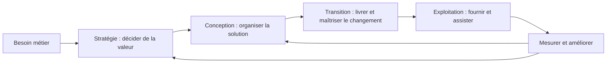

# Fiche de révision — Module 01 — Présentation d’ITIL et historique

## Comprendre la logique de services

ITIL fournit un vocabulaire et des bonnes pratiques pour organiser les services informatiques autour des besoins métier. Le technicien ne se limite donc pas à « faire fonctionner un serveur » : il contribue à un résultat utilisable, soutenable et mesurable pour un client.

| Notion | Question à se poser | Exemple pédagogique externe |
|---|---|---|
| Efficacité | Le résultat attendu est-il atteint ? | Les commerciaux peuvent consulter leurs commandes. |
| Efficience | Quelles ressources ont été nécessaires ? | Le résultat est obtenu sans multiplier les interventions manuelles. |
| Projet | Quel changement livrer, avec quelle échéance ? | Déployer un nouveau portail de commandes. |
| Service | Quel résultat fournir dans la durée ? | Maintenir ce portail disponible avec assistance et suivi. |
| Référentiel de pratiques | Comment organiser le travail ? | S’appuyer sur ITIL et adapter les pratiques au contexte. |
| Norme d’exigences | Quels critères faut-il satisfaire ? | Évaluer un système de management des services selon ISO/IEC 20000-1. |

Le support présente la bibliothèque historique, l’évolution d’une informatique fournisseuse de moyens vers une informatique fournisseuse de services, le forum d’utilisateurs itSMF, les acteurs de formation et de certification, puis le cycle de vie v3. Les cinq publications étudiées sont **stratégie, conception, transition, exploitation et amélioration continue**. L’amélioration accompagne l’ensemble du cycle : elle ne se limite pas à sa dernière étape.

## Repères historiques et précisions externes

Le cours suit principalement **ITIL v3** et son introduction historique à ITIL 4. Les dates, noms d’organismes et affirmations sur la propriété du référentiel dans l’Original décrivent le support ; ils ne constituent pas un annuaire actuel. En novembre 2026, PeopleCert documente aussi **ITIL (Version 5)** et sa transition depuis ITIL 4. Il serait donc trompeur de présenter ITIL 4 comme le dernier état du référentiel. Cette sensibilisation ne remplace pas un programme de certification actuel.

La phrase du support « ITIL 4 n’est pas une nouvelle version » demande à être contextualisée : ITIL 4 apporte une évolution du cadre, intégrant notamment les approches Agile, Lean et les environnements numériques. Il faut distinguer cet apport de la structure historique en cinq publications utilisée dans les modules suivants.

ISO 9001 concerne le management de la qualité dans de nombreux secteurs ; ISO/IEC 20000-1 définit les exigences d’un système de management des services. **ITIL n’est pas une norme ISO**, et suivre ITIL ne certifie pas automatiquement une organisation. La formulation « treize processus » du support ne doit pas être transformée en définition générale de la norme actuelle.

## Retenir puis vérifier

**1. Référentiel et norme sont-ils synonymes ?**

??? success "Réponse expliquée"
    Non : bonnes pratiques et exigences normatives répondent à des objectifs distincts.

**2. Quelle différence entre efficacité et efficience ?**

??? success "Réponse expliquée"
    Atteindre le résultat ; puis examiner les ressources consommées pour y parvenir.

**3. Pourquoi mesurer le service après livraison ?**

??? success "Réponse expliquée"
    Pour vérifier la valeur réellement fournie et décider des améliorations.

## Pour pratiquer

- [Cours et supports originaux](../../modules/06-sensibilisation-itil-gestion-parc/module-01-presentation-d-itil-et-historique.md)
