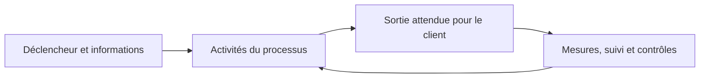

# Fiche de révision — Module 02 — La gestion des services

## Le service crée de la valeur grâce à deux conditions

L’**utilité** répond à « ce service m’aide-t-il à faire mon travail ? » ; la **garantie** répond à « puis-je compter sur lui dans les conditions prévues ? ». Une application utile mais souvent indisponible crée peu de valeur. Un système parfaitement disponible mais inutile au métier n’en crée pas davantage.

| Utilité | Garantie à préciser dans l’engagement |
|---|---|
| Améliorer les performances du métier | Disponibilité et heures de service |
| Supprimer une contrainte | Capacité et performances suffisantes |
| Répondre à un besoin réel | Continuité et sécurité |

**Précision externe :** la définition du support sur les coûts et risques signifie que le client n’a pas à gérer lui-même certains coûts et risques propres à la réalisation du service. Elle ne signifie pas que le service est gratuit ou que tout risque disparaît.

## Acteurs, processus, fonctions et rôles

| Acteur du support | Responsabilité à comprendre |
|---|---|
| Fournisseur interne, partagé ou externe | Fournir le service ; distinguer équipe interne, service partagé et prestataire externe. |
| Client | Exprimer les besoins, négocier et valider les engagements ; il peut représenter les utilisateurs. |
| Utilisateur | Utiliser le service et signaler les besoins ou difficultés. |
| Propriétaire de service | Suivre le service dans sa durée de vie, ses résultats, améliorations et relations client. |
| Gestionnaire de service | Coordonner la démarche et les responsables concernés. |

Un **processus** décrit des activités organisées : entrées, déclencheur, sorties, clients, objectifs, rôles, outils, contrôles et mesures. Une **fonction** regroupe des personnes et des moyens ; elle peut participer à plusieurs processus. Les quatre fonctions v3 du support sont le centre de services, la gestion technique, la gestion des opérations et la gestion des applications. Un **rôle** décrit une responsabilité dans une activité ; il ne se confond pas avec un poste ou un titre hiérarchique.

## Lire une matrice RACI sans confondre les lettres

| Lettre | Sens pratique | Contrôle |
|---|---|---|
| R — Responsible | Réalise l’activité et rend compte de son exécution | Au moins un acteur pour que le travail soit effectué. |
| A — Accountable | Assume la responsabilité finale | Identifier un responsable clairement désigné pour l’activité. |
| C — Consulted | Apporte un avis, échange dans les deux sens | Consulter les personnes dont l’avis est nécessaire. |
| I — Informed | Reçoit l’information utile | Prévoir qui doit connaître l’avancement ou le résultat. |

**Précision externe :** le support indique au moins un C et un I par action ; cela ne constitue pas une obligation universelle de RACI. Une activité peut n’avoir aucun consulté ou informé distinct. La matrice doit rester utile et éviter la consultation systématique de tout le monde.

## Retenir puis vérifier

**1. Qui utilise et qui négocie le service ?**

??? success "Réponse expliquée"
    L’utilisateur utilise ; le client exprime et négocie les besoins.

**2. Un processus est-il une équipe ?**

??? success "Réponse expliquée"
    Non, c’est une organisation d’activités ; les fonctions lui apportent des moyens.

**3. Qui réalise dans RACI ?**

??? success "Réponse expliquée"
    R ; A porte la responsabilité finale.

**4. Disponibilité élevée suffit-elle à créer de la valeur ?**

??? success "Réponse expliquée"
    Non : il faut aussi une utilité correspondant au besoin.

## Pour pratiquer

- [Cours et supports originaux](../../modules/06-sensibilisation-itil-gestion-parc/module-02-la-gestion-des-services.md)
