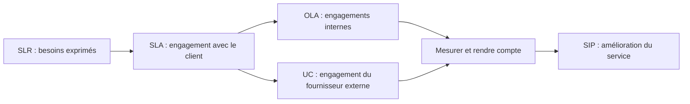

# Fiche de révision — Module 03 — Stratégie et conception des services

## De la décision stratégique à une solution exploitable

La **stratégie** choisit les services qui apporteront de la valeur en tenant compte du marché, des demandes et des moyens disponibles. La **conception** transforme ce choix en exigences, architecture, processus, responsabilités et mesures. Un choix technique intervient après la compréhension du résultat attendu.

| Processus de stratégie étudié | Décision ou information utile |
|---|---|
| Gestion de la stratégie | Positionnement, objectifs et capacités de l’organisation. |
| Portefeuille des services | Services envisagés, en exploitation et retirés ; coûts et valeur. |
| Demande | Besoins actuels et futurs, évolutions des métiers et usages. |
| Gestion financière | Coûts, financement et prix éventuel. |
| Relation métier | Confiance, satisfaction et compréhension des besoins. |

Le catalogue décrit les services proposés ; le portefeuille couvre une perspective plus large. Les **4 P de stratégie** du support sont perspective, positionnements, plans et pérennisation des comportements. Ils se distinguent des **4 P de conception : personnes, processus, produits et partenaires**.

### Relier les coûts à la décision

Le **ROI** compare le bénéfice attendu à l’investissement ; le **TCO** prend en compte le coût total de possession. Considérer les achats directs, les coûts indirects et les coûts souvent oubliés, tels que formation insuffisante ou interventions répétées. Le prix n’est pas simplement le coût d’achat d’un équipement. La conception peut choisir une réalisation interne, une sous-traitance, une TMA, une infogérance, un BPO, une fourniture de service par un ASP ou un recours à l’expertise KPO ; ces termes historiques sont détaillés dans les repères du support.

## Les huit processus de conception étudiés

| Processus | Vérification concrète |
|---|---|
| Coordination de la conception | Les différentes équipes travaillent sur des exigences cohérentes. |
| Catalogue des services | Le service, ses conditions et sa disponibilité sont décrits et à jour. |
| Niveaux de services | Les engagements sont compris, mesurables et soutenus par les accords nécessaires. |
| Disponibilité | Les engagements et les points uniques de défaillance sont examinés. |
| Capacité | Les besoins métier futurs, le service actuel et les composants sont dimensionnés. |
| Continuité | Le service peut être maintenu ou repris selon les besoins métier ; les plans sont testés. |
| Sécurité | Les règles protègent disponibilité, confidentialité, intégrité et besoins d’authenticité et de preuve. |
| Fournisseurs | Contrats, performances, litiges et fin de relation sont maîtrisés. |

Pour la capacité, distinguer **BCM** (besoins métier), **SCM** (capacité du service) et **CCM** (capacité des composants). Pour la continuité, le **BIA** évalue les impacts métier ; le **PCA** organise la poursuite d’activité ; le **PRA** prépare la reprise informatique. Un plan documentaire non testé apporte une garantie limitée.

## SLR, SLA, OLA et UC

Le SLA précise le service, horaires de support, performances, disponibilité, continuité, sécurité, changements, mise en production, suivi, responsabilités du client, dates et conditions financières. Les OLA et UC doivent permettre de tenir cet engagement global. **Précision externe :** leurs structures ne sont pas nécessairement identiques ; adapter le contenu aux responsabilités et dépendances réelles.

| Terme | Distinction utile |
|---|---|
| Fiabilité | Fonctionner durablement avec peu de défaillances. |
| Maintenabilité | Pouvoir remettre le service en état efficacement. |
| Résilience | Continuer à rendre un service malgré certaines défaillances. |
| Serviceability | Capacité des fournisseurs à assurer leurs engagements de support. |
| Recoverability | Capacité de restauration ; elle n’exige pas nécessairement une reconfiguration automatique. |

**Précision externe :** la signature électronique est un moyen possible de contribuer à l’authenticité et à la preuve ; elle n’est pas la définition de l’authenticité. L’intégrité concerne aussi les altérations accidentelles. Les numéros 1 à 11 du dessin de disponibilité de l’Original sont des repères à compléter : le support ne fournit pas leur légende, donc aucune légende n’est attribuée au document source ici.

## TP — arrivée d’un commercial

Deux sujets et leurs deux corrections sont fournis. Commencer par le schéma de stratégie, puis détailler la conception : stock, mobilier, électricité, réseau, identité, comptes, téléphonie, poste, déploiement et livraison. La correction de conception détaille **13 étapes**, de la disponibilité du matériel à sa livraison, avec les contrôles et la mise à jour du CMS. Vérifier chaque prérequis avant la livraison, puis les tests utilisateur. Les tableaux et la procédure intégrale figurent dans l’Original et dans les pages de TP liées ci-dessous.

## Retenir puis vérifier

**1. Catalogue et portefeuille couvrent-ils les mêmes services ?**

??? success "Réponse expliquée"
    Le portefeuille inclut aussi les services envisagés et retirés.

**2. Qui signe le SLA ?**

??? success "Réponse expliquée"
    Le fournisseur et le client selon leurs responsabilités.

**3. Que vérifie un OLA ?**

??? success "Réponse expliquée"
    Les contributions internes nécessaires au respect du SLA.

**4. BIA et PRA ont-ils le même objectif ?**

??? success "Réponse expliquée"
    Non : impacts métier pour le BIA ; organisation de la reprise informatique pour le PRA.

## Pour pratiquer

- [Cours et supports originaux](../../modules/06-sensibilisation-itil-gestion-parc/module-03-strategie-et-conception-des-services.md)
- [Travaux pratiques du module](../../tp/itil/module-03/index.md)
