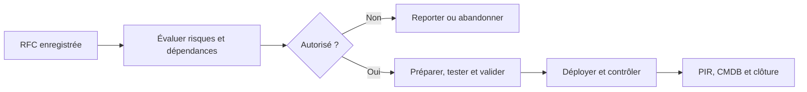

# Révision — Module 04 — Transition des services

## Préparer un changement que l’exploitation saura prendre en charge

La transition réalise, construit, teste, valide et déploie les services conçus. Elle prépare aussi les équipes, la documentation et les utilisateurs. Livrer un composant sans procédure de support, sans test ou sans retour arrière peut déplacer la panne vers l’exploitation.

| Processus étudié | Résultat attendu |
|---|---|
| Changements | Demandes évaluées, autorisées selon les responsabilités et suivies. |
| Actifs et configurations | CI identifiés, relations connues et données à jour. |
| Planification et support à la transition | Ressources et calendrier cohérents. |
| Évaluation | Effets, risques et résultats du changement examinés. |
| Validation et tests | Recette fonctionnelle, performance, exploitabilité et service vérifiées. |
| Déploiements et mises en production | Version contrôlée, transfert à l’exploitation et utilisateurs préparés. |
| Connaissances | Informations fiables, accessibles et réellement utilisées. |

## Formuler une RFC avec les sept R

Un changement ajoute, modifie ou retire un CI ou un service. Une RFC identifie le demandeur, la date, le périmètre, la priorité proposée, les risques, les dates et les ressources nécessaires. Les **sept R** aident à examiner la demande : **Raised** (qui demande), **Reason** (pourquoi), **Return** (bénéfice), **Risks**, **Resources**, **Responsible** et **Relationship** avec les autres changements.

| Type | Traitement |
|---|---|
| Standard | Connu, documenté, peu risqué et préautorisé selon une procédure établie. |
| Normal | Évaluation et autorisation adaptées avant réalisation. Le CAB apporte avis et expertise. |
| Urgent | Procédure d’urgence avec autorité désignée, contrôles proportionnés et traçabilité. |

**Précisions externes :** urgent ne signifie pas « aucun test ni documentation ». L’autorité de changement dépend de l’organisation ; le CAB est un comité consultatif, pas nécessairement l’autorité finale de tous les changements. La **PIR** est une revue après mise en œuvre, et non la définition d’un comité permanent.

## CI, CMDB, CMS, DML et SKMS

Un **CI** est un élément géré pour fournir le service : matériel, logiciel, réseau, téléphonie, infrastructure, documentation, procédure, contrat ou ressource pertinente. Définir son type, ses attributs, ses relations et sa référence de configuration (*baseline*).

| Outil ou ensemble | Usage |
|---|---|
| CMDB — Configuration Management Database | Enregistrements des éléments de configuration et de leurs relations. |
| CMS — Configuration Management System | Ensemble d’informations et d’outils de gestion de configuration, pouvant fédérer plusieurs CMDB. |
| DML — Definitive Media Library | Médias logiciels de référence contrôlés, documentation et informations associées. |
| SKMS — Service Knowledge Management System | Ensemble organisé pour gérer et exploiter les connaissances du service. |

Le développement « Content Management System » associé au CMS dans certaines pages du support est une confusion : **dans ce contexte, CMS signifie Configuration Management System**. Définir d’abord périmètre, politique, granularité, responsables et outils, puis charger les données et former les équipes. Ensuite contrôler les modifications, produire les états et auditer la fiabilité des données. Une CMDB très remplie mais obsolète reste peu utile.

## Choisir le déploiement et préparer la connaissance

Les axes **push/pull**, **big bang/par phases**, **manuel/automatique** répondent à des questions différentes. Une diffusion automatique peut être faite par phases. Prévoir nommage, versions, responsabilités, informations aux utilisateurs, formation, procédures d’exploitation, critères de succès et retour arrière.

Pour la connaissance, partir des besoins et de la fiabilité de l’information : architecture, outils, procédures de maintenance, responsables, promotion, formation et mesures d’utilisation. Compter les articles ne prouve pas qu’ils aident les techniciens ; observer leur usage et leurs résultats.

## TP — documenter la transition

Le sujet et sa correction fournie décrivent des documents de changement : les tableaux originaux doivent être renseignés dans l’ordre. Justifier les choix, les personnes consultées, les tests, la validation et les preuves de mise en production. La grille de priorité du support est un **exemple**, pas un engagement applicable à toutes les organisations. Le lien « priorité = impact × urgence » désigne ici un croisement dans une matrice ; il ne faut pas multiplier arbitrairement les codes numériques.

## Vérifier ses acquis

**Mini-quiz.** 1. À quoi sert une baseline ? 2. Quelle différence entre CMS et CMDB ? 3. Un changement urgent échappe-t-il à toute autorisation ? 4. Push et big bang sont-ils synonymes ?

??? success "Réponses commentées"
    1. À disposer d’une référence de configuration maîtrisée.
    2. Le CMS est l’ensemble de gestion ; une CMDB contient des enregistrements et relations.
    3. Non : appliquer le circuit d’urgence et conserver les preuves.
    4. Non : initiative de diffusion et rythme de déploiement sont deux axes distincts.

- [Cours et supports originaux](../../modules/06-sensibilisation-itil-gestion-parc/module-04-transition-des-services.md)
