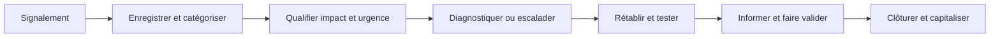

# Révision — Module 06 — Exploitation des services

## L’exploitation fournit le service et traite les sollicitations

Elle coordonne les activités quotidiennes pour tenir les engagements : exploiter, superviser, piloter, soutenir et maintenir. Elle cherche un équilibre entre stabilité et évolution, réactivité et anticipation, coûts et qualité. Elle produit aussi des mesures utilisables par l’amélioration continue.

Les quatre fonctions v3 sont le **centre de services**, la **gestion technique**, la **gestion des opérations** et la **gestion des applications**. Le centre de services constitue un point de contact et coordonne le suivi utilisateur. Le centre d’appels traite principalement les communications ; le centre d’assistance apporte du dépannage ; le centre de services adopte une relation plus large avec les services et le métier.

## Choisir une organisation du support

| Architecture étudiée | Atout | Point d’attention |
|---|---|---|
| Locale | Proximité et connaissance du contexte | Mutualisation et cohérence entre sites. |
| Centralisée | Ressources et procédures regroupées | Relation à distance et maintien du contexte local. |
| Virtuelle | Compétence mobilisée indépendamment du lieu | Outils partagés, organisation et connaissance communes. |
| Qui suit le soleil | Relais entre zones horaires pour étendre la couverture | Passages de relais, langue et procédures d’escalade. |

Dimensionner selon périmètre, horaires, typologie des appels, périodes de charge et moyens disponibles. Le standard téléphonique, serveur vocal, couplage téléphonie-informatique, CRM et libre-service s’intègrent aux outils de configuration et de connaissance (CMS, KEDB, SKMS). Ces outils facilitent le travail ; ils ne remplacent pas une procédure de prise en charge.

## Distinguer cinq processus

| Processus | Objet principal | Exemple pédagogique externe |
|---|---|---|
| Exécution des requêtes | Réaliser une demande de service prévue et autorisée | Installer un logiciel approuvé. |
| Accès | Accorder ou retirer les droits autorisés selon les règles | Affecter un accès validé, avec traçabilité. |
| Incidents | Rétablir rapidement le niveau de service convenu | Restaurer l’accès à une messagerie en panne. |
| Problèmes | Analyser et traiter les causes et récurrences | Rechercher pourquoi la panne revient chaque semaine. |
| Événements | Détecter et traiter les changements d’état pertinents | Examiner une alerte de capacité avant interruption. |

Le catalogue des requêtes décrit les demandes possibles, profils autorisés et circuits. Pour les accès, distinguer identité, groupe, rôle et autorisation ; la demande d’un utilisateur ne constitue pas à elle seule une validation de droits. Pour un incident, un contournement peut rétablir l’usage avant que la cause soit supprimée.

## Traiter un incident de façon vérifiable

Le ticket conserve le contexte, les actions et le résultat. L’**impact** décrit les conséquences métier ; l’**urgence** le délai acceptable pour agir ; la **priorité** résulte du croisement défini par l’organisation. Les délais 1 h, 8 h, 24 h et 48 h du support sont des exemples : appliquer les SLA réellement convenus. Un incident majeur peut nécessiter une procédure de crise et une communication spécifique.

L’**escalade fonctionnelle** mobilise une compétence ou un niveau de support adapté ; l’**escalade hiérarchique** mobilise les responsables pour arbitrage, ressources ou situation majeure. Un transfert doit inclure diagnostic, actions tentées et preuves ; le demandeur doit conserver un suivi clair.

### Problèmes, erreurs connues et événements

La gestion des problèmes peut être réactive ou proactive. Elle enregistre, classe, priorise et analyse les causes, documente les contournements et propose des changements si nécessaire. **Précision externe :** distinguer un problème en cours d’analyse d’une erreur connue documentée ; la KEDB sert à réutiliser le diagnostic et les contournements disponibles, pas à remplacer toute la base de connaissances.

Le support distingue événement normal, exception, avertissement et alerte. Définir seuils, filtrage, notification, action automatique éventuelle, intervention et clôture. Tous les événements ne sont pas des incidents ; une alerte nécessite une qualification. Les seuils doivent être adaptés et testés pour éviter de noyer le support dans des notifications inutiles.

## Vérifier ses acquis

**Mini-quiz.** 1. Faut-il trouver la cause avant tout rétablissement ? 2. Qui autorise l’accès ? 3. Toute alerte est-elle un incident ? 4. Escalader signifie-t-il perdre le suivi utilisateur ?

??? success "Réponses commentées"
    1. Non : un contournement maîtrisé peut rétablir le service avant l’analyse complète.
    2. L’autorité prévue par la politique et le circuit de validation.
    3. Non : qualifier l’état et ses effets.
    4. Non : transmettre les preuves et maintenir la coordination du suivi.

- [Cours et supports originaux](../../modules/06-sensibilisation-itil-gestion-parc/module-06-exploitation-des-services.md)
