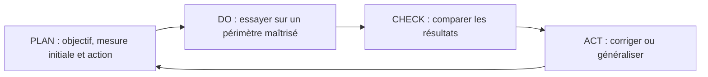

# Fiche de révision — Module 07 — Amélioration continue des services

## Améliorer à partir des résultats réels

L’amélioration continue analyse les résultats des engagements (SLA, OLA, UC), les tendances, la satisfaction et les audits. Elle identifie, priorise et suit les actions pour améliorer qualité, fiabilité, relation client et efficacité des méthodes de gestion. Une amélioration doit avoir un objectif et une façon de vérifier son effet.

| Repère du support | Usage |
|---|---|
| KPI — Key Performance Indicator | Mesurer une performance liée à un objectif. |
| CSF — Critical Success Factor | Identifier une condition essentielle de réussite. |
| Base de référence | Comparer l’évolution à une situation initiale documentée. |
| Mesure technique | Observer le fonctionnement des composants. |
| Mesure de processus | Observer délais, qualité et exécution des activités. |
| Mesure de service | Rendre compte du résultat utile au client. |

**Précision externe :** toutes les métriques techniques ne doivent pas être envoyées brutes au client, mais elles peuvent soutenir l’explication d’un résultat de service. Adapter le niveau de détail au besoin du destinataire.

## La roue de Deming en pratique

**Cas externe :** de nombreux tickets de connexion sont mal renseignés. Mesurer d’abord la proportion de tickets complets et les retours nécessaires. Tester un formulaire guidé sur un service, comparer qualité et délai, puis ajuster avant généralisation. Le nombre de formulaires créés est une activité ; la baisse des échanges inutiles et l’amélioration du délai sont des résultats à vérifier.

Prévoir un responsable, une échéance, les ressources, les risques et les critères de succès. Conserver les résultats de l’essai et les limites de la comparaison : une baisse de charge peut provenir d’une période creuse plutôt que de l’action testée.

## Retenir puis vérifier

**1. Pourquoi conserver une référence initiale ?**

??? success "Réponse expliquée"
    Pour comparer l’avant et l’après sur des critères cohérents.

**2. Que signifie CHECK ?**

??? success "Réponse expliquée"
    Vérifier les résultats par rapport aux objectifs et mesures prévus.

**3. Plus d’articles dans la base prouve-t-il une amélioration ?**

??? success "Réponse expliquée"
    Non : mesurer aussi usage, fiabilité et effet sur le service.

## Pour pratiquer

- [Cours et supports originaux](../../modules/06-sensibilisation-itil-gestion-parc/module-07-amelioration-continue-des-services.md)
