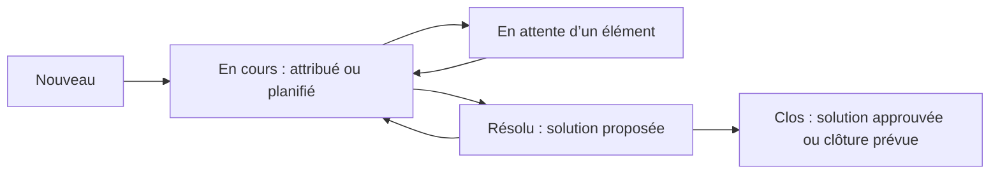

# Révision — Module 09 — Assistance avec GLPI

## Le ticket assure la continuité du traitement

GLPI centralise incidents et demandes, assure le suivi des échanges et relie les interventions au parc et à la connaissance. Un ticket apporte **traçabilité, communication, répartition du travail et détection des récurrences**. Il doit contenir assez d’informations pour qu’un autre technicien puisse reprendre le dossier.

| Information à recueillir | Utilité |
|---|---|
| Demandeur, coordonnées et entité | Identifier la personne et le périmètre autorisé. |
| Type, catégorie, titre et description | Distinguer demande et incident, puis comprendre le besoin. |
| Symptômes, date, étendue et conséquences | Qualifier l’impact et l’urgence. |
| Équipement ou CI concerné | Relier le dossier au parc et aux dépendances. |
| Actions, résultats et pièces utiles | Éviter de recommencer les mêmes essais. |
| Affectation, échéances et suivi | Rendre la prise en charge vérifiable. |

Les entrées du support sont le portail GLPI (interface anonyme si configurée, simplifiée ou standard), un collecteur de courriels et le téléphone avec saisie par le technicien. Ces canaux doivent aboutir à un enregistrement cohérent ; un appel seul ne conserve pas tout l’historique.

## Lire les états sans confondre affectation et résolution

Ce schéma est une **aide externe** ; la matrice des transitions dépend du profil et de la configuration. « Résolu » signifie qu’une solution a été proposée ; « Clos » signifie que le traitement est finalisé selon le circuit prévu. Les règles peuvent prévoir une fermeture automatique après un délai. Vérifier les autorisations réelles avant d’affirmer qu’un acteur peut changer un statut.

## Attribution, observateurs, validations et engagements

L’**attribution** désigne l’utilisateur, le groupe ou le fournisseur chargé du traitement. Les **observateurs** suivent les informations sans prendre nécessairement en charge l’intervention. Une escalade technique doit transmettre un diagnostic exploitable. La validation répond à une autorisation prévue ; elle se distingue de l’approbation finale de la solution.

Le **SLA** encadre les engagements convenus ; les échéances de prise en charge et de résolution doivent être comprises et suivies. Selon le paramétrage, une échéance dépassée déclenche des actions ou une escalade ; elle ne supprime pas le ticket. Impact, urgence et priorité sont distincts et la matrice de calcul est configurable.

| Trace dans le traitement | Contenu utile |
|---|---|
| Suivi | Échanges, informations et comptes rendus de progression. |
| Tâche | Action réalisée ou planifiée, intervenant et résultat. |
| Document | Pièce nécessaire, lisible et correctement protégée. |
| Solution | Diagnostic retenu, correction ou contournement, tests et limites. |

La clôture suit l’approbation ou les règles de traitement prévues. Si la solution est refusée, recueillir le motif et poursuivre l’analyse. Relier le CI concerné aide les statistiques et le diagnostic ; la qualité de cette relation dépend d’une CMDB entretenue.

## Capitaliser dans la base de connaissances

Le support décrit création d’article, cibles, visibilité publique ou non, révisions, restrictions temporelles, liens avec tickets et CI, catégories et FAQ. **Un article sans cible peut rester non publié** dans le fonctionnement montré : vérifier le résultat avec le profil destinataire. Distinguer visibilité d’édition, visibilité de consultation et exposition éventuelle d’une FAQ ; protéger les données personnelles et les informations d’accès.

## TP — exploitation des services

Le sujet et sa correction de **17 pages** sont fournis : ils couvrent le traitement et les contrôles de tickets et de connaissances. Réaliser d’abord le sujet dans le laboratoire, conserver les identifiants de tickets et les preuves attendues, puis comparer étape par étape avec la correction originale. Les captures correspondent à la version du laboratoire ; chercher la fonction équivalente plutôt qu’un emplacement d’écran identique.

## Vérifier ses acquis

**Mini-quiz.** 1. Attribué signifie-t-il résolu ? 2. Quelle différence entre observateur et technicien affecté ? 3. Une solution proposée clôture-t-elle toujours immédiatement ? 4. Pourquoi tester l’article avec un autre profil ?

??? success "Réponses commentées"
    1. Non : le travail a un responsable, le résultat reste à obtenir.
    2. L’un suit l’information ; l’autre prend en charge le traitement.
    3. Non : approbation ou règle de clôture s’applique selon la configuration.
    4. Pour vérifier les droits et la visibilité réellement obtenus.

- [Cours et supports originaux](../../modules/06-sensibilisation-itil-gestion-parc/module-09-assistance-avec-glpi.md)
