# Démonstrations — Module 01

[Retour au TP](index.md)

## Démonstration · Fiche démo 1 - Présentation du langage PowerShell-PowerShell Core · 2 pages transcrites

Transcription du support du Drive. Les formulations historiques et les exemples du document sont conservés. Les valeurs d’accès du laboratoire sont indiquées comme « fourni par le formateur ». Les adresses de messagerie personnelles utilisent example.com.

### Présentation du langage PowerShell, PowerShell Core

Démonstration 01 du module 1

L’objectif de cette démonstration est de vous montrer comment installer PowerShell Core sur un système Windows 10.

### Déroulement

- Récupérer l’archive d’installation sur le dépôt GitHub officiel PowerShell : https://github.com/PowerShell/PowerShell/releases
- Télécharger la version compatible avec votre plateforme actuelle.
- Réaliser une installation par défaut

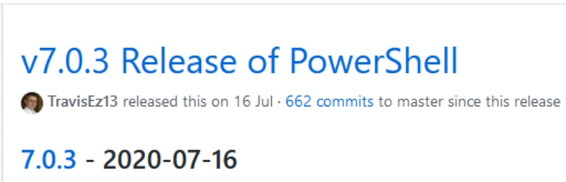

Capture du support « Fiche démo 1 - Présentation du langage PowerShell-PowerShell Core »

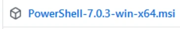

Capture du support « Fiche démo 1 - Présentation du langage PowerShell-PowerShell Core »

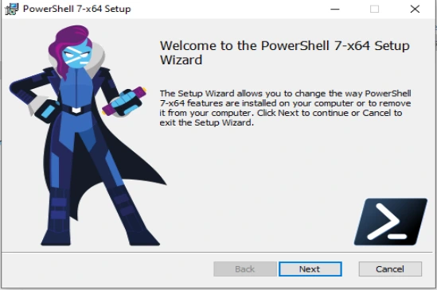

Capture du support « Fiche démo 1 - Présentation du langage PowerShell-PowerShell Core »

- Vous disposez d’un nouveau Shell reconnaissable à son icône et à l’en-tête de la console.
- La commande $PSVersionTable permet de connaître la version actuelle du Shell.
- La version de PowerShell installé par défaut est la 5.1 sur Windows 10.
- Elle est reconnaissable par l’icône :

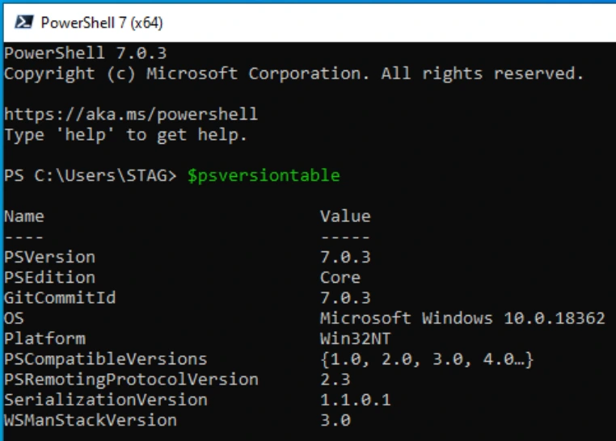

Capture du support « Fiche démo 1 - Présentation du langage PowerShell-PowerShell Core »

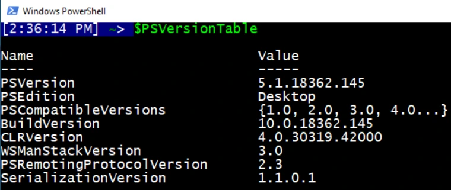

Capture du support « Fiche démo 1 - Présentation du langage PowerShell-PowerShell Core »

Référence du document : 1YxE6EJXvuIyx3sOVGFQdtbrkogxJDTwd · SHA-256 7b237af3ee799c19…

## Démonstration · Fiche démo 2 - Les Cmdlets · 1 pages transcrites

Transcription du support du Drive. Les formulations historiques et les exemples du document sont conservés. Les valeurs d’accès du laboratoire sont indiquées comme « fourni par le formateur ». Les adresses de messagerie personnelles utilisent example.com.

### Les Cmdlets

Démonstration 02 du module 1

L’objectif de cette démonstration est de vous faire découvrir la constitution d’une Cmdlet.

### Déroulement

- Une Cmdlet est toujours constituée d’un Verbe définissant une action puis du caractère «-»
- Elle se termine toujours par un nom décrivant un objet Windows.

Pour obtenir la liste des verbes disponible on utilise la Cmdlet Get-Verb

Chaque Cmdlet dispose de paramètres ; ils s’utilisent en ajoutant le caractère « - » puis le nom du paramètre.

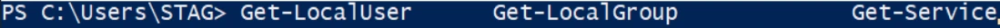

Capture du support « Fiche démo 2 - Les Cmdlets »

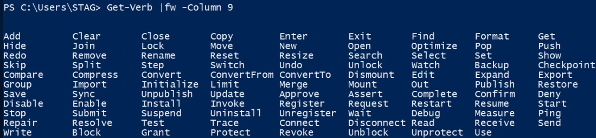

Capture du support « Fiche démo 2 - Les Cmdlets »

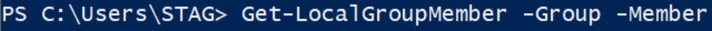

Capture du support « Fiche démo 2 - Les Cmdlets »

Référence du document : 1dI6jQ02IqlHIKSyHM0KpW0JOi1OtfI1s · SHA-256 85f9d555b636e5cf…

## Démonstration · Fiche démo 3 - Get-Command · 2 pages transcrites

Transcription du support du Drive. Les formulations historiques et les exemples du document sont conservés. Les valeurs d’accès du laboratoire sont indiquées comme « fourni par le formateur ». Les adresses de messagerie personnelles utilisent example.com.

### Get-Command

Démonstration 03 du module 1

L’objectif de cette démonstration est de vous présenter la commande Get-Command.

### Déroulement

- Pour obtenir la liste de toutes les commandes disponibles, utiliser la Cmdlet Get-Command

Le nombre de commandes disponible est très important. Nous avons ici un aperçu des commandes disponibles.

Afin de filtrer le résultat de sortie, utiliser le caractère * sur le paramètre Name.

Pour filtrer les commandes sur le verbe d’action, utiliser le caractère * sur le paramètre verb.

#### Commandes visibles dans les captures

```
Get-Command
Get-Command -Name *-service
```

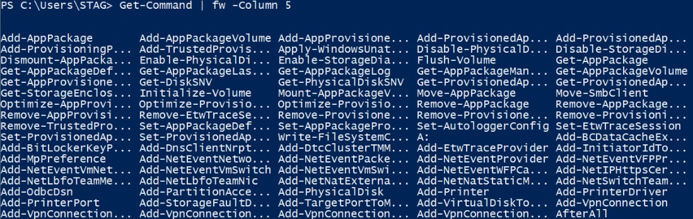

Capture du support « Fiche démo 3 - Get-Command »

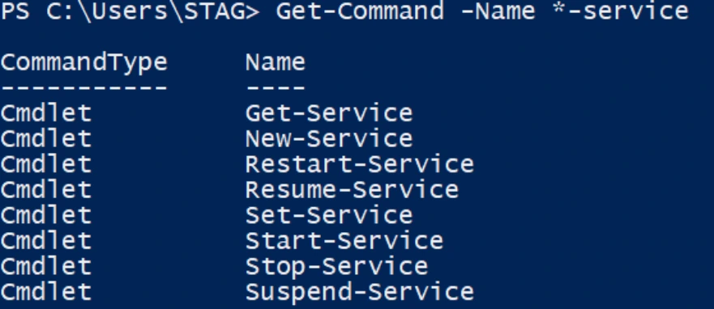

Capture du support « Fiche démo 3 - Get-Command »

```
Nous avons toutes les commandes qui utilisent le verbe New.
```

#### Commandes visibles dans les captures

```
Get-Command -Verb New
```

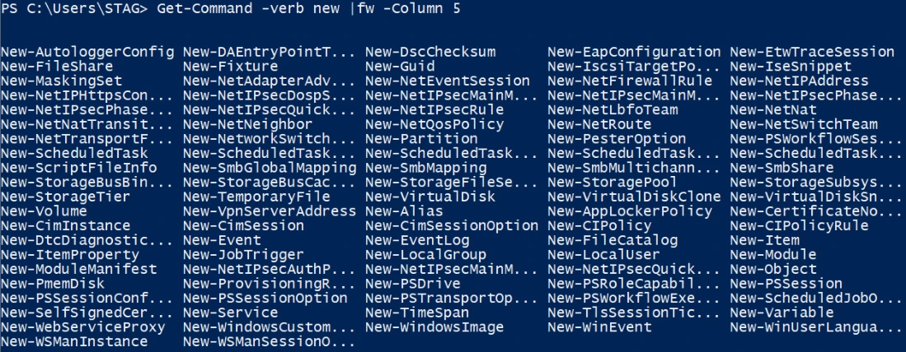

Capture du support « Fiche démo 3 - Get-Command »

Référence du document : 12_QrHqEHxOQM1w2aNQ_TM7aV59-onssx · SHA-256 11db6cec8822a159…

## Démonstration · Fiche démo 4 - Get-Help · 4 pages transcrites

Transcription du support du Drive. Les formulations historiques et les exemples du document sont conservés. Les valeurs d’accès du laboratoire sont indiquées comme « fourni par le formateur ». Les adresses de messagerie personnelles utilisent example.com.

### Get-Help

Démonstration 04 du module 1

```
L’objectif de cette démonstration est de vous présenter la commande Get-Help.
```

### Déroulement

- Pour comprendre le fonctionnement d’une commande, on utilise la Cmdlet Get-Help suivie de la Cmdlet sur laquelle on souhaite obtenir de l’aide.

Le résultat dépend de plusieurs facteurs. En fonction de la langue du système d’exploitation, de la mise à jour des fichiers d’aide ainsi que de la commande, le contenu peut différer.

Ici nous avons un fichier d’aide très restreint. Il est possible, en fournissant des paramètres additionnels d’obtenir d’autres informations.

Le paramètre -Full permet d’obtenir la totalité de l’aide disponible.

#### Commandes visibles dans les captures

```
Get-Help Get-Command
```

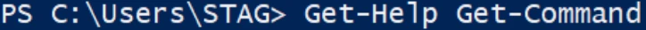

Capture du support « Fiche démo 4 - Get-Help »

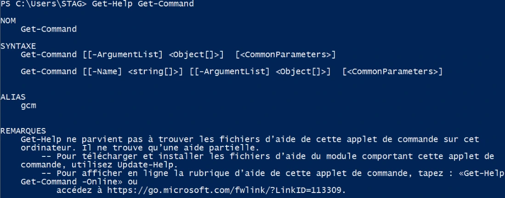

Capture du support « Fiche démo 4 - Get-Help »

Le résultat est complet ; toutes les sections de l’aide sont affichées.

Pour améliorer la lecture, il est possible de spécifier le nom d’un paramètre ou d’une section.

Le paramètre -ShowWindow va ouvrir une nouvelle fenêtre et inclure les informations de l’aide. Il rajoute également un champ de recherche.

#### Commandes visibles dans les captures

```
Get-Help Get-Command -Full
Get-Help Get-Command -Parameter Verb
```

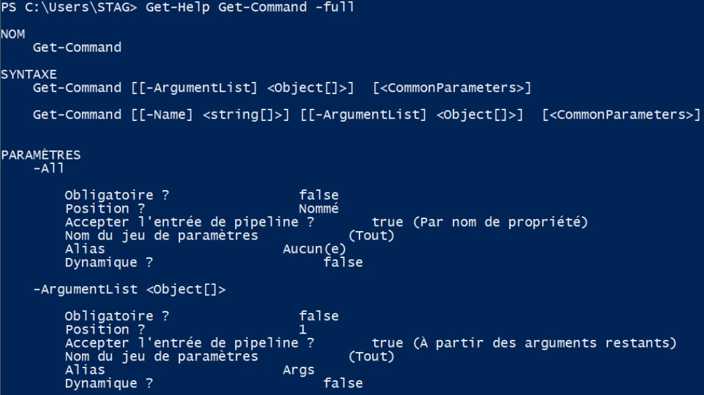

Capture du support « Fiche démo 4 - Get-Help »

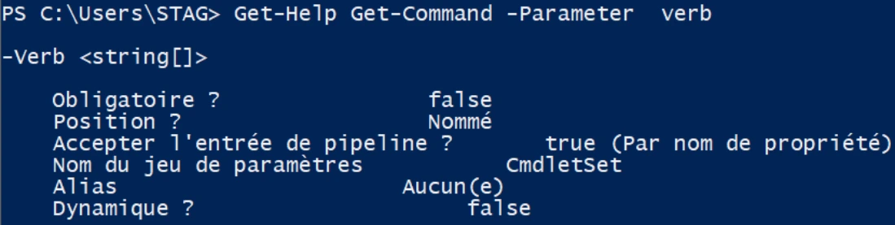

Capture du support « Fiche démo 4 - Get-Help »

Pour obtenir la dernière version disponible, il est possible de consulter la version mise à disposition par Microsoft en ligne. Il faut toutefois disposer d’un navigateur web et d’une connexion à Internet autorisant l’accès au site Microsoft.

#### Commandes visibles dans les captures

```
Get-Help Get-Command -ShowWindow
Get-Help Get-Command -Online
```

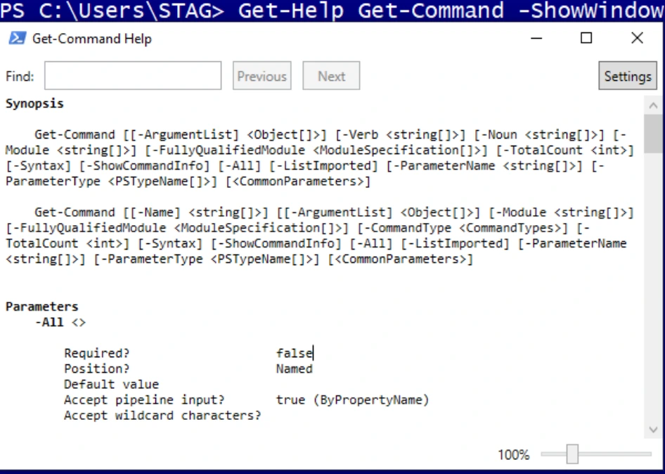

Capture du support « Fiche démo 4 - Get-Help »

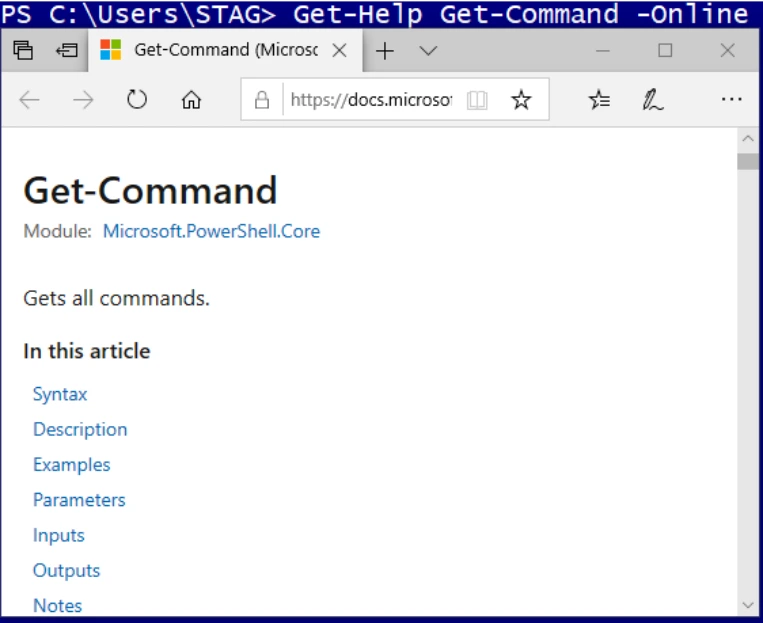

Capture du support « Fiche démo 4 - Get-Help »

PowerShell dispose d’une aide sur ses propres fonctionnalités.

Les sections d’aide de la console PowerShell sont accessibles par la commande Get-Help, suivie du terme About_ puis de la section recherchée.

#### Commandes visibles dans les captures

```
Get-Help about_Command_Syntax
```

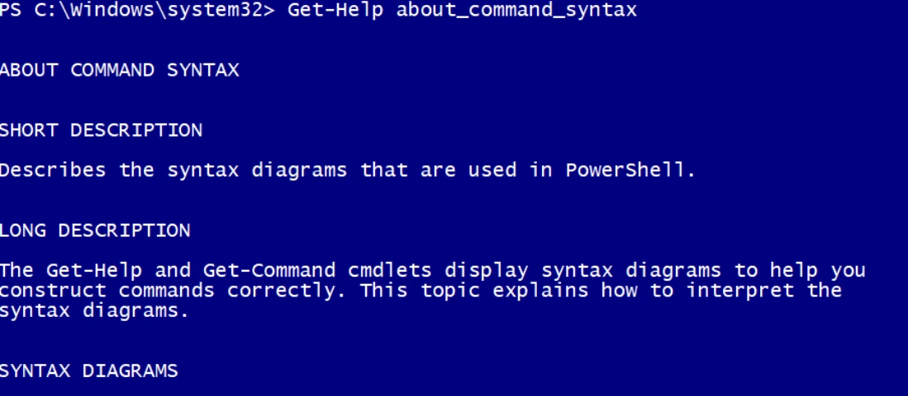

Capture du support « Fiche démo 4 - Get-Help » (partie 1/2)

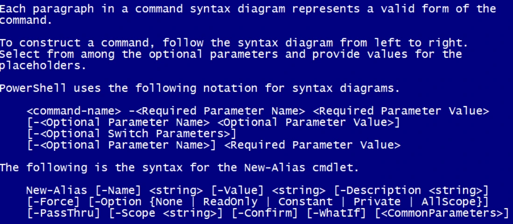

Capture du support « Fiche démo 4 - Get-Help » (partie 2/2)

Référence du document : 1ZIjSGUvTZh_I7sTPGSqDuL_RLVWIfDGZ · SHA-256 8ec1b775fc0c7086…

## Démonstration · Fiche démo 5 - Update-Help · 2 pages transcrites

Transcription du support du Drive. Les formulations historiques et les exemples du document sont conservés. Les valeurs d’accès du laboratoire sont indiquées comme « fourni par le formateur ». Les adresses de messagerie personnelles utilisent example.com.

### Update-Help

Démonstration 05 du module 1

```
L’objectif de cette démonstration est de vous présenter la commande Update-Help.
```

### Déroulement

- Pour disposer de l’aide la plus à jour disponible, on utilise la commande Update-Help qui peut rechercher les fichiers d’aide disponibles à partir du service Windows Update ou d’une source locale.

La commande va rechercher sur les fichiers d’aide des commandes à disposition.

```
 Update-Help nécessite une console PowerShell avec les droits
d’administration.
Il est possible d’indiquer une source locale ou un chemin réseau avec le paramètre
SourcePatch. Il est également possible de choisir la langue des fichiers d’aide disponibles.
```

Pour obtenir des fichiers d’aide PowerShell, il est possible d’exporter ses fichiers avec la commande Save-Help.

#### Commandes visibles dans les captures

```
Update-Help
```

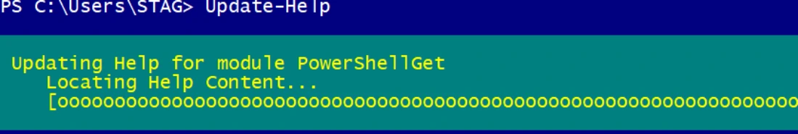

Capture du support « Fiche démo 5 - Update-Help »


Capture du support « Fiche démo 5 - Update-Help »

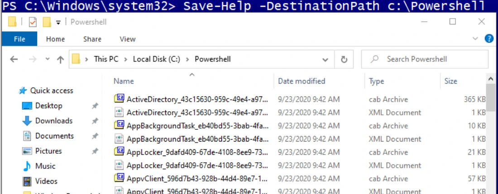

Capture du support « Fiche démo 5 - Update-Help » (partie 1/2)

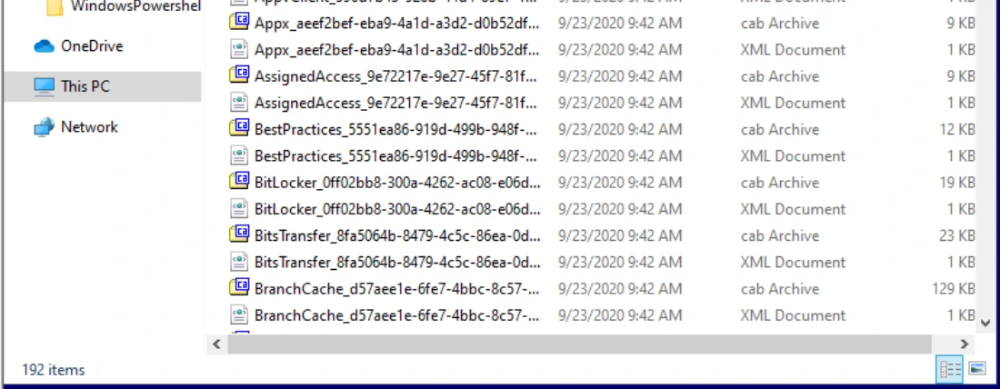

Capture du support « Fiche démo 5 - Update-Help » (partie 2/2)

Référence du document : 1RICbdwT8fAe4J4-4kmb6gy3NmJTLmEwD · SHA-256 7d0ec37b5f85c6c4…

## Démonstration · Fiche démo 6 - La protection · 1 pages transcrites

Transcription du support du Drive. Les formulations historiques et les exemples du document sont conservés. Les valeurs d’accès du laboratoire sont indiquées comme « fourni par le formateur ». Les adresses de messagerie personnelles utilisent example.com.

### La protection

Démonstration 06 du module 1

L’objectif de cette démonstration est de vous présenter la protection contre l’exécution des scripts indésirables.

### Déroulement

- Par défaut l’exécution de scripts PowerShell est restreinte aux scripts signés numériquement.

```
o Afin d’exécuter des scripts de test non signés, il faut modifier la règle de restriction des
```

scripts du système Windows.

```
o Pour obtenir le niveau de restriction actuelle du système, on utilise la commande Get-
ExecutionPolicy.
```

Set-ExecutionPolicy nécessite une console PowerShell avec les droits d’administration.

Pour modifier la restriction, on passe par la commande Set-ExecutionPolicy.

Une confirmation est demandée car il s’agit d’un paramètre de sécurité.

#### Commandes visibles dans les captures

```
Get-ExecutionPolicy
Set-ExecutionPolicy Unrestricted
```

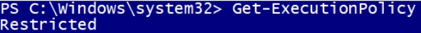

Capture du support « Fiche démo 6 - La protection »

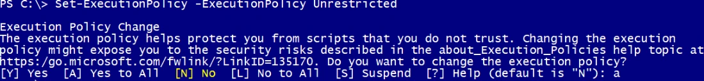

Capture du support « Fiche démo 6 - La protection »

Référence du document : 1fD9YtRzs0KoafARjOehaE2oHA4iRHUsy · SHA-256 96ddc610aa3fa732…

## Démonstration · Fiche démo 7 - Les modules · 2 pages transcrites

Transcription du support du Drive. Les formulations historiques et les exemples du document sont conservés. Les valeurs d’accès du laboratoire sont indiquées comme « fourni par le formateur ». Les adresses de messagerie personnelles utilisent example.com.

### Les modules

Démonstration 07 du module 1

L’objectif de cette démonstration est de vous présenter la notion de module.

### Déroulement

- Les modules sont des fichiers portant l’extension .PSM1
- La commande Get-Module permet d’obtenir la liste des modules actuellement disponibles dans la console.

Pour ajouter un module à la console PowerShell,l il faut ajouter le fichier PSM1 dans un emplacement valide. Pour connaître les emplacements valides, on utilise la commande :

```
$env :PsModulePath
```

On place ensuite le fichier PSM1 ou un dossier contenant un ensemble de fichiers.

Dans l’exemple, on utilise le module AWS permettant de gérer une infrastructure Amazon Web Services depuis la console PowerShell.

#### Commandes visibles dans les captures

```
Get-Module
$env:PSModulePath
```

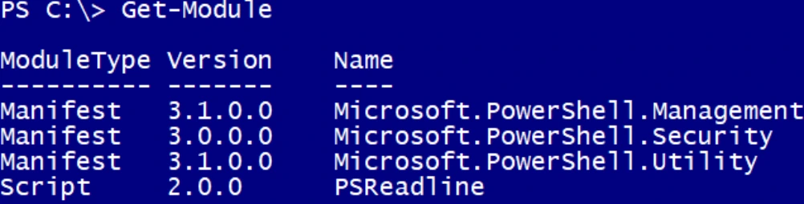

Capture du support « Fiche démo 7 - Les modules »

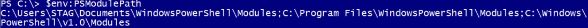

Capture du support « Fiche démo 7 - Les modules »

On importe ensuite le module dans la console avec la commande Import-Module.

On vérifie ensuite la bonne prise en charge avec la commande Get-Command -module AWSPOWERSHELL.

Le paramètre Measure-Object permet de compter le nombre de commandes.

Le module AwsPowershell ajoute presque 8000 commandes dans la console PowerShell.

#### Commandes visibles dans les captures

```
Import-Module -Name AWSPowerShell
Get-Command -Module AWSPowerShell | Measure-Object
```

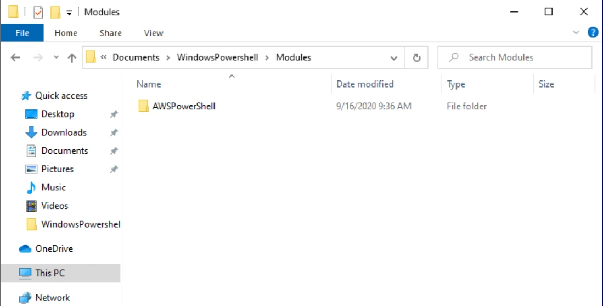

Capture du support « Fiche démo 7 - Les modules »


Capture du support « Fiche démo 7 - Les modules »

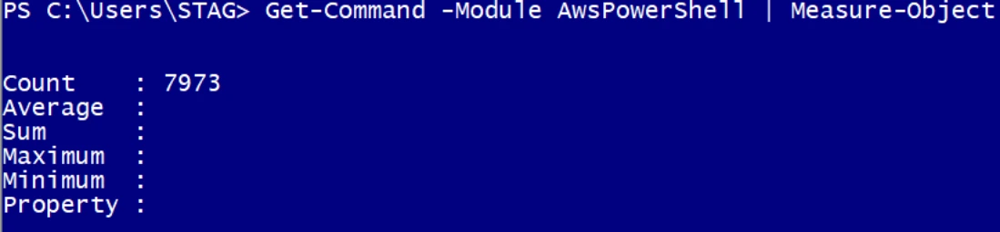

Capture du support « Fiche démo 7 - Les modules »

Référence du document : 1auDKYAA3_naumjziK-geVgf51NZMt3ng · SHA-256 ab0f08a2fd50e986…

## Démonstration · Fiche démo 8 - La personnalisation de la console · 3 pages transcrites

Transcription du support du Drive. Les formulations historiques et les exemples du document sont conservés. Les valeurs d’accès du laboratoire sont indiquées comme « fourni par le formateur ». Les adresses de messagerie personnelles utilisent example.com.

### La personnalisation de la console

Démonstration 08 du module 1

L’objectif de cette démonstration est de montrer que la console PowerShell peut s‘adapter aux besoins de chaque utilisateur.

### Déroulement

- La personnalisation de la console PowerShell se fait en faisant un clic droit sur le bandeau de la fenêtre.
- Il est possible de modifier la police, la taille les couleurs de fond…

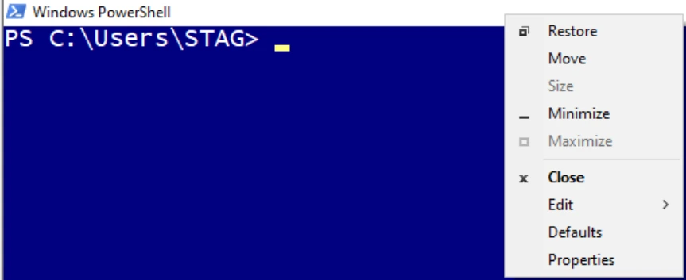

Capture du support « Fiche démo 8 - La personnalisation de la console »

La personnalisation de la console peut se faire avec l’aide d’un profil qui est un script PowerShell. Ce script sera exécuté à chaque lancement de la console.

Pour générer le fichier de profil, on utilise une commande PowerShell.

Le fichier est généré dans le dossier documents de l’utilisateur actuel.

Chaque utilisateur dispose de son propre profil.

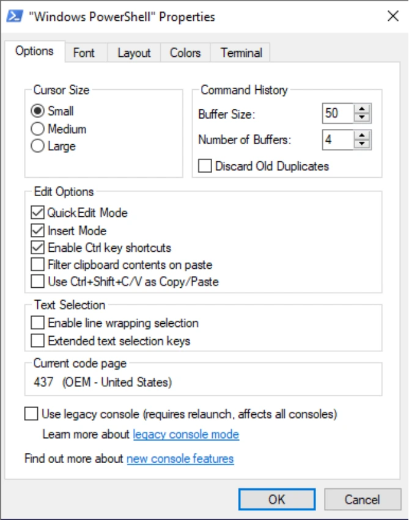

Capture du support « Fiche démo 8 - La personnalisation de la console »

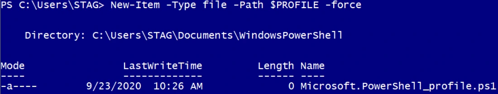

Capture du support « Fiche démo 8 - La personnalisation de la console »

Dans cet exemple on personnalise la console avec un bandeau d’accueil qui affiche le nom de l’utilisateur actuel ainsi que l’heure est la date.

Il est également possible de modifier le Prompt.

Le résultat est un prompt personnalisé.

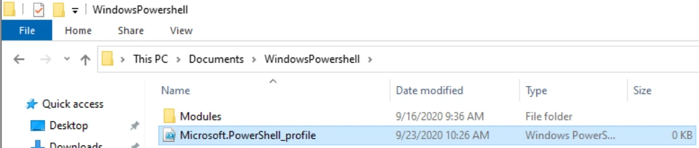

Capture du support « Fiche démo 8 - La personnalisation de la console »

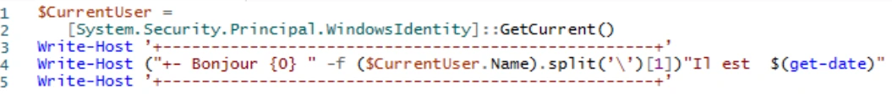

Capture du support « Fiche démo 8 - La personnalisation de la console »

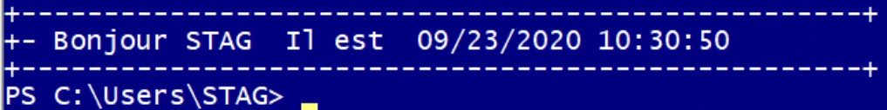

Capture du support « Fiche démo 8 - La personnalisation de la console »

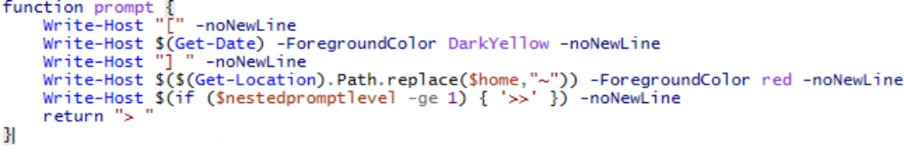

Capture du support « Fiche démo 8 - La personnalisation de la console »

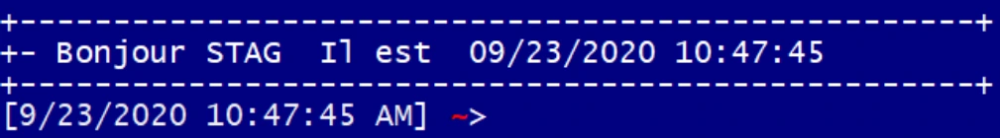

Capture du support « Fiche démo 8 - La personnalisation de la console »

Référence du document : 13xgz6ZrucWrrpleg5N3Jd1rM4brh2R3u · SHA-256 c8b83fe89809ce20…
