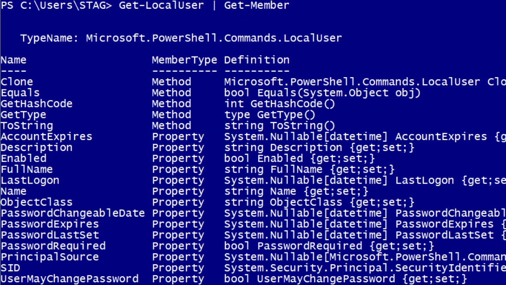
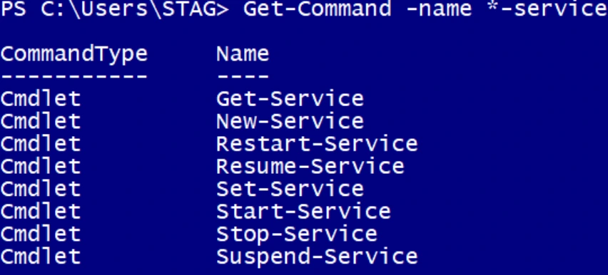
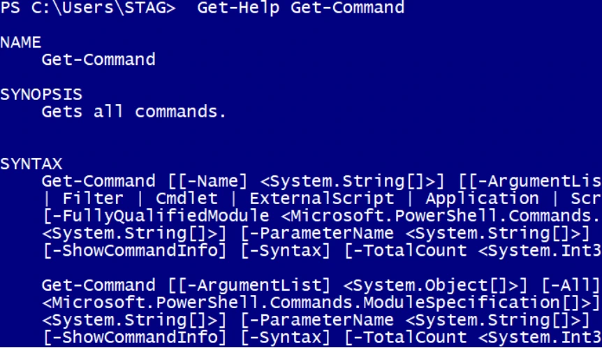
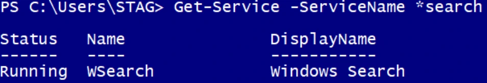
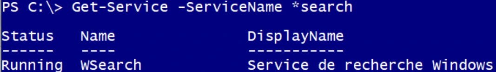
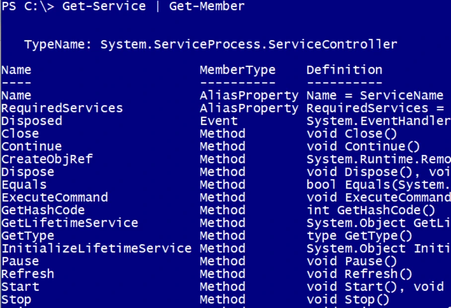
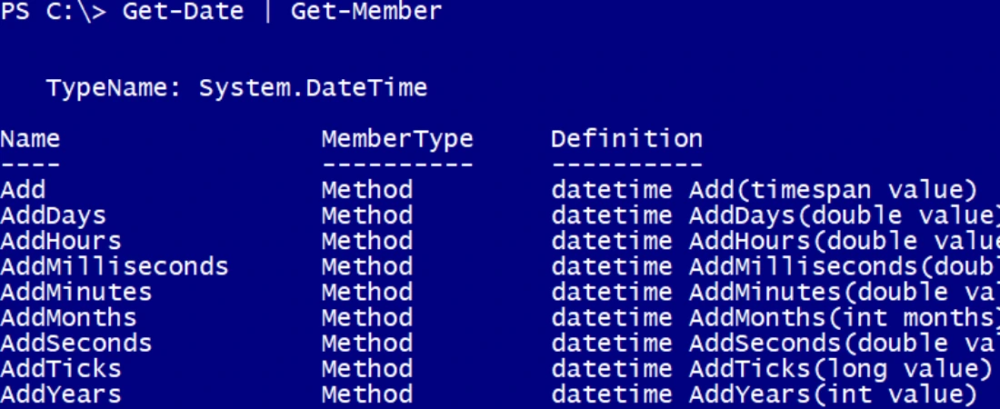
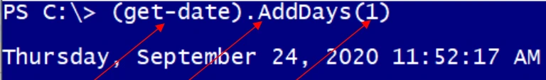
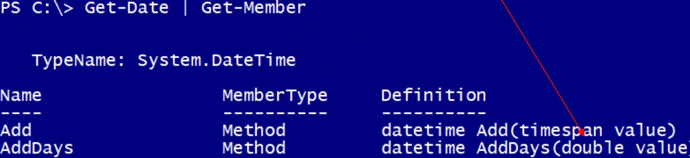

# Démonstrations — Module 02

[Retour au TP](index.md)

## Démonstration · Fiche démo 1 - Get-Member · 2 pages transcrites

Transcription du support du Drive. Les formulations historiques et les exemples du document sont conservés. Les valeurs d’accès du laboratoire sont indiquées comme « fourni par le formateur ». Les adresses de messagerie personnelles utilisent example.com.

### Get-Member

Démonstration 01 du module 2

```
L’objectif de cette démonstration est de présenter la commande Get-Member qui permet de
visualiser les informations d’un objet PowerShell.
```

### Déroulement

- Toute commande PowerShell agit sur un objet du système Windows. La commande Get-member permet de connaître trois informations fondamentales sur l’objet en cours.

On obtient le type d’objet Paramètre TypeName.

La colonne MemberType renseigne sur les méthodes et les propriétés qui composent notre objet.

La commande Get-Member fait partie des trois commandes dites clés pour utiliser PowerShell

#### Commandes visibles dans les captures

```
Get-LocalUser | Get-Member
```



Capture du support « Fiche démo 1 - Get-Member »

comme langage d’administration de système. Pour rappel les commandes clés sont :

Get-Command

Get-Help

Get-Member

Une bonne connaissance de ces trois commandes est essentielle.

#### Commandes visibles dans les captures

```
Get-Command -Name *-service
Get-Help Get-Command
```



Capture du support « Fiche démo 1 - Get-Member »



Capture du support « Fiche démo 1 - Get-Member »

Référence du document : 1Q8B3yCRRfLODG9poBxUvigyimrtsAYFg · SHA-256 f4986df6713d8bef…

## Démonstration · Fiche démo 2 - Les propriétés · 2 pages transcrites

Transcription du support du Drive. Les formulations historiques et les exemples du document sont conservés. Les valeurs d’accès du laboratoire sont indiquées comme « fourni par le formateur ». Les adresses de messagerie personnelles utilisent example.com.

### Les propriétés

Démonstration 02 du module 2

L’objectif de cette démonstration est de vous présenter les propriétés.

### Déroulement

Chaque objet PowerShell contient des propriétés. La liste de ses propriétés est définie par le type d’objet auquel il appartient.

- Le type de propriétés est indiqué par la commande Get-Member dans la colonne Definition.
- Connaître le type de propriété est essentiel pour pouvoir la manipuler.

La propriété Description est de type String ; elle n’accepte donc que les chaînes de caractères.

La propriété PasswordRequired est type Bool ; elle n’accepte que les valeurs de type booléen.

Pour modifier les valeurs d’une propriété, on va dans un premier temps choisir l’objet sur lequel on souhaite modifier la valeur de la propriété.

#### Commandes visibles dans les captures

```
Get-LocalUser | Get-Member
```


Capture du support « Fiche démo 2 - Les propriétés »

On indique à la commande Get-Service que l’on souhaite uniquement les services contenant search en fin de nom de service.

On obtient la valeur de la propriété DisplayName ici Windows Search.

Pour modifier la valeur, il faut disposer de l’objet de la propriété et de la valeur. On utilise en suite la commande permettant de modifier les valeurs de propriété de l’objet Service.

La commande Set-Service est associée au nom de l’objet service puis à la propriété à modifier et enfin à la valeur de la propriété souhaitée.

La propriété DisplayName est de type String ; nous lui indiquons donc une chaîne de caractères encadrée par les symboles ‘’ ou double quote.

La commande L’objet La propriété La valeur de type « String »

On vérifie la bonne prise en compte de la modification.

La modification d’un objet système nécessite une console avec les droits d’administration

#### Commandes visibles dans les captures

```
Get-Service -ServiceName *search
Set-Service -ServiceName Wsearch -DisplayName "Service de recherche windows"
Get-Service -ServiceName *search
```



Capture du support « Fiche démo 2 - Les propriétés »


Capture du support « Fiche démo 2 - Les propriétés »



Capture du support « Fiche démo 2 - Les propriétés »

Référence du document : 1TMjGZOgeMyCZiXLYdPiiNrL_fQ_1CMnl · SHA-256 6d99a86e47a7b23a…

## Démonstration · Fiche démo 3 - Les méthodes · 2 pages transcrites

Transcription du support du Drive. Les formulations historiques et les exemples du document sont conservés. Les valeurs d’accès du laboratoire sont indiquées comme « fourni par le formateur ». Les adresses de messagerie personnelles utilisent example.com.

### Les méthodes

Démonstration 03 du module 2

L’objectif de cette démonstration est de vous présenter ce que sont les méthodes.

### Déroulement

De la même façon qu’un objet contient des propriétés, les méthodes qu’il contient vont permettre d’effectuer des actions sur la totalité de l’objet, sur une propriété ou de faire des actions de conversion par exemple.

- Les méthodes sont révélées par la commande Get-Member.
- Les méthodes sont des actions à la différence des propriétés qui, elles, sont statiques.

La méthode Start a une portée sur tout l’objet service.

L’utilisation d’une méthode se fait en ayant les informations à disposition telles que l’objet sur lequel on souhaite exécuter la méthode ou la propriété de l’objet sur laquelle on va exécuter cette méthode.

#### Commandes visibles dans les captures

```
Get-Service | Get-Member
```



Capture du support « Fiche démo 3 - Les méthodes »

```
L’objet System.DateTime dispose de méthodes permettant de faire varier les valeurs obtenues par
```

la commande Get-Date.

Pour ajouter un jour au résultat, on utilise la méthode Add-Days suivie du nombre de jours que l’on souhaite ajouter.

L’objet la méthode la valeur

L’objet est contenu entre parenthèses ; il est suivi d’un point puis de la méthode, ce qui indique que l’on utilise la méthode de cet objet.

La valeur fournie entre parenthèses de la méthode doit être d’un type utilisable par la méthode.

#### Commandes visibles dans les captures

```
Get-Date | Get-Member
(Get-Date).AddDays(1)
```



Capture du support « Fiche démo 3 - Les méthodes »



Capture du support « Fiche démo 3 - Les méthodes »



Capture du support « Fiche démo 3 - Les méthodes »

Référence du document : 1tgwX51FKJ8Rir-NZAix7etPRe6HWF8bv · SHA-256 cffd3435671bffbd…
