# Démonstrations — Module 04

[Retour au TP](index.md)

## Démonstration · Fiche démo 1 - Les variables · 3 pages transcrites

Transcription du support du Drive. Les formulations historiques et les exemples du document sont conservés. Les valeurs d’accès du laboratoire sont indiquées comme « fourni par le formateur ». Les adresses de messagerie personnelles utilisent example.com.

### Les variables

Démonstration 01 du module 4

L’objectif de cette démonstration est de découvrir en quoi, comme tout langage-objet, PowerShell utilise les variables qui permettent de stocker des données dans la mémoire vive de l’ordinateur puis de les réutiliser dans d’autre commande.

### Déroulement

- La console PowerShell dispose de variables réservées comme nous avons pu le voir avec

```
$PSItem. Nous allons étudier les façons de travailler avec les variables.
```

- La commande Get-Variable permet de connaître toutes les variables disponibles actuellement dans la console PowerShell.
- Pour déclarer une nouvelle variable, on utilise le caractère $ suivi du symbole = puis de la valeur à attribuer à la variable.

Attention au type de variable ! Le fait d’attribuer la valeur 1 type la variable en INT.

Pour obtenir le type de variable, on utilise la méthode getType()

Le paramètre FullName permet d’afficher le type complet de la variable.

```
Lorsque l’on souhaite déclarer une variable de type String qui va contenir une chaîne de
caractères, il faut encadrer les caractères avec des doubles quotes.
```

La variable $b est de type SystemString car la valeur 1 est encadrée avec des doubles quotes.

#### Commandes visibles dans les captures

```
Get-Variable
$a = 1
$a.GetType().FullName
$b = "1"
$b.GetType().FullName
```

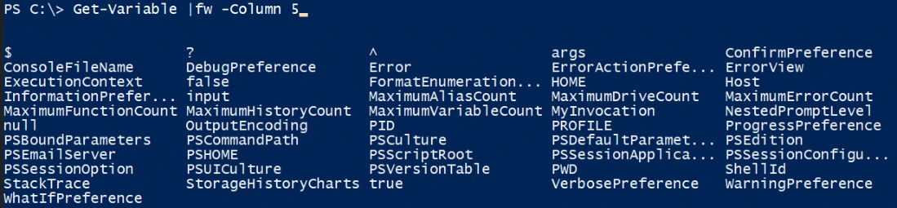

Capture du support « Fiche démo 1 - Les variables »

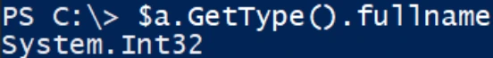

Capture du support « Fiche démo 1 - Les variables »

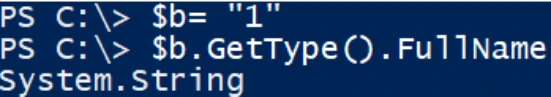

Capture du support « Fiche démo 1 - Les variables »

Les variables vont contenir également des objets, qui par la suite vont être réutilisés dans d’autres traitements.

Pour contenir des objets dans une variable, on déclare la variable puis on assigne un résultat de commande à cette variable.

On obtient une variable de type System.Object qui contient le résultat de la commande Get- Aduser.

Lorsque la variable est déclarée, elle est utilisable dans la console.

Pour visualiser son contenu, il suffit de saisir son nom précédé du $.

La variable peut également servir de conteneur à une saisie dans la console. Elle va être combinée à la commande Read-Host

La variable peut être utilisable avec la commande Write-Host pour afficher le contenu dans une chaîne de caractères avec des outils de mise en forme.

La valeur de la variable $choix est affichée dans la chaîne de caractères.

Les variables de type System.Object peuvent être utilisées pour afficher une ou plusieurs propriétés d’un ou des objets qu’elles contiennent.

On utilise le . à la suite de la variable pour indiquer le nom de la propriété à afficher.

#### Commandes visibles dans les captures

```
$u = Get-ADUser -Filter *
$u.GetType().FullName
$choix = Read-Host "Veuillez saisir votre choix"
$choix
```

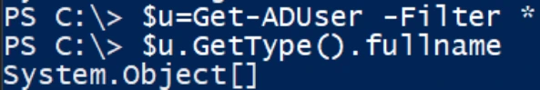

Capture du support « Fiche démo 1 - Les variables »

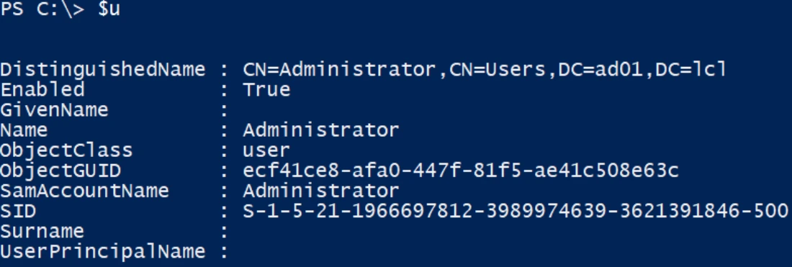

Capture du support « Fiche démo 1 - Les variables »

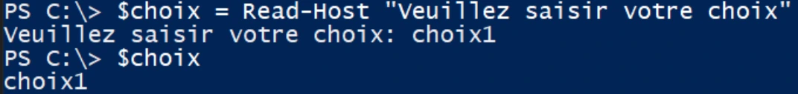

Capture du support « Fiche démo 1 - Les variables »

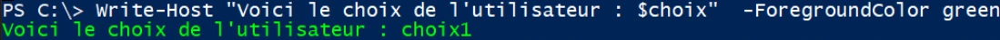

Capture du support « Fiche démo 1 - Les variables »

Il est possible de sélectionner un seul objet dans la variable en lui indiquant une valeur d’index.

On sélectionne un seul objet avec les [] puis on sélectionne une seule propriété avec le .

Avec les variables de type Objet on peut également se servir des méthodes contenues dans le type d’objet.

La variable $d utilise la méthode de conversion ToString pour convertir une valeur de type DateTime renvoyée par la commande Get-Date.

```
En fin de conversion, on obtient une valeur de type string utilisable dans une commande Write-
Host.
```

#### Commandes visibles dans les captures

```
$s[4].Name
$s[4]
```

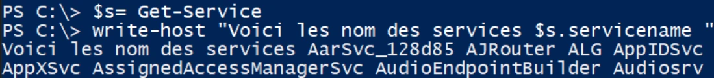

Capture du support « Fiche démo 1 - Les variables »

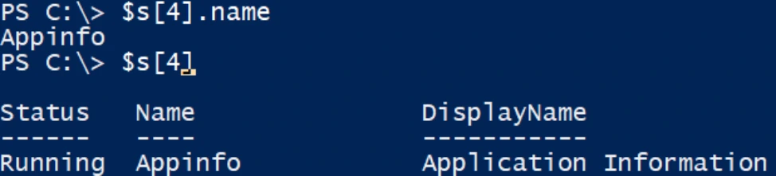

Capture du support « Fiche démo 1 - Les variables »

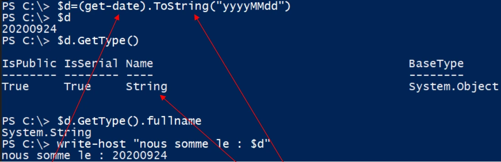

Capture du support « Fiche démo 1 - Les variables »

Référence du document : 1TVcJwMjiSWdewednfJRSYM6Xkq15PPAy · SHA-256 3ea1f706e7f2d3a6…

## Démonstration · Fiche démo 2 - Les types de variables · 3 pages transcrites

Transcription du support du Drive. Les formulations historiques et les exemples du document sont conservés. Les valeurs d’accès du laboratoire sont indiquées comme « fourni par le formateur ». Les adresses de messagerie personnelles utilisent example.com.

### Les types de variables

Démonstration 02 du module 4

L’objectif de cette démonstration est de découvrir comment nous pouvons lier les variables entre elles, en gardant à l’esprit que les variables doivent être de type identique.

### Déroulement

- Dans le cas où nous disposons de deux variables de même type, la variable contenant le résultat sera du même type que les variables d’origine.
- Voici ce qu’il est possible de faire avec des variables de type String

Les variables de type String peuvent être fusionnées pour obtenir une chaîne de caractères.

On récupère les valeurs des propriétés avec le « . » puis on le stocke en variable.

La variable finale conserve le type SystemString et hérite des variables $e et $f.

Le type de variable int va interpréter les chiffres et va permettre d’utiliser les opérateurs mathématiques.

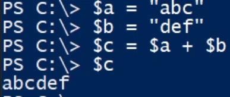

Capture du support « Fiche démo 2 - Les types de variables »

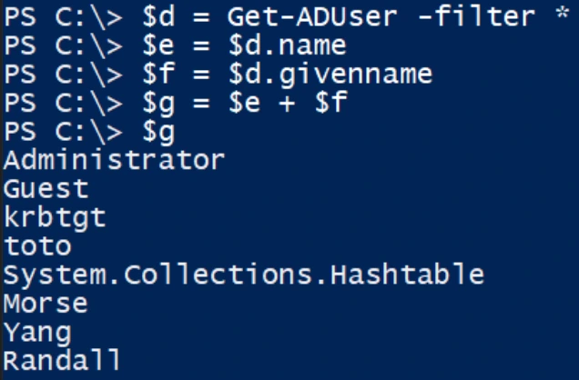

Capture du support « Fiche démo 2 - Les types de variables »

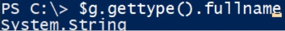

Capture du support « Fiche démo 2 - Les types de variables »

```
Il est possible de récupérer une valeur de type Int sur un objet.
```

Cette méthode appliquée à la variable $g arrondit le nombre de décimales à la valeur indiquée entre les parenthèses.

Le troisième type de variable est le type Array qui permet de stocker des valeurs en leur attribuant un index.

La variable $array est de type System.Object car les variables de type Array sont utilisées pour stocker des objets sur des résultats de commande comme Get-Aduser.

```
L’avantage de ces variables est qu’il est possible de leur appliquer des méthodes (puisqu’étant de
type System.Object)
```

Attention la méthode Replace est sensible à la casse sur les valeurs entre les parenthèses.

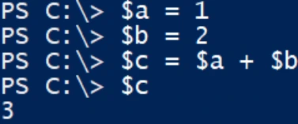

Capture du support « Fiche démo 2 - Les types de variables »

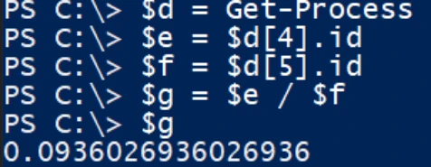

Capture du support « Fiche démo 2 - Les types de variables »

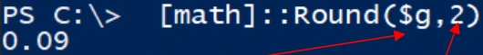

Capture du support « Fiche démo 2 - Les types de variables »

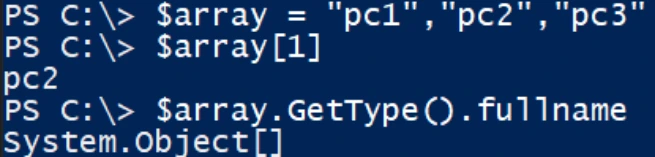

Capture du support « Fiche démo 2 - Les types de variables »

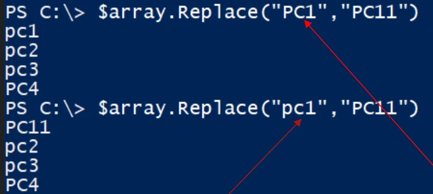

Capture du support « Fiche démo 2 - Les types de variables »

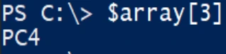

Capture du support « Fiche démo 2 - Les types de variables »

Attention également à l’indexation qui débute à 0 ; ainsi la valeur d’index 3 pointe vers la quatrième valeur du tableau.

```
Toutefois la variable de type array est statique ; le nombre de valeurs ne peut être diminué.
```

Référence du document : 1OjFFSdwFMyoRG43DHB7P0K9pEjlD-XE9 · SHA-256 b52c4648eb00d1f5…

## Démonstration · Fiche démo 3 - La variable ArrayList · 1 pages transcrites

Transcription du support du Drive. Les formulations historiques et les exemples du document sont conservés. Les valeurs d’accès du laboratoire sont indiquées comme « fourni par le formateur ». Les adresses de messagerie personnelles utilisent example.com.

### La variable ArrayList

Démonstration 03 du module 4

Pour pallier le problème de taille fixe des variables de type Array, il existe un autre type de variable, le type ArrayList, qui permet plus de liberté dans la gestion des valeurs qu’elle contient.

### Déroulement

- Une variable de type ArrayList doit être déclarée de la sorte :

```
o Elle ne peut pas se déclarer en fonction de la valeur qu’elle reçoit.
o Maintenant que nous disposons d’une variable de type ArrayList nous lui
```

indiquons les valeurs à prendre en compte

Le chiffre indiqué est celui de l’index de la valeur ajoutée.

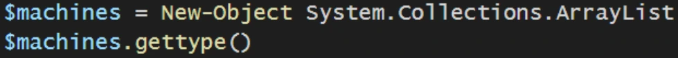

Capture du support « Fiche démo 3 - La variable ArrayList »

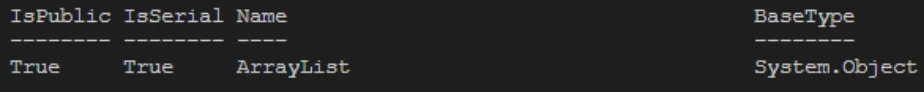

Capture du support « Fiche démo 3 - La variable ArrayList »

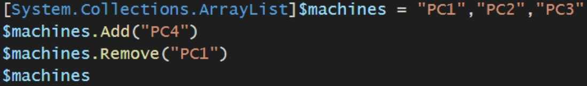

Capture du support « Fiche démo 3 - La variable ArrayList »

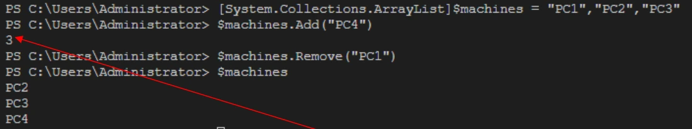

Capture du support « Fiche démo 3 - La variable ArrayList »

Référence du document : 1ANjHIeqY1XBCbpnrZkrdUBHgJm6D5nBp · SHA-256 86f631bd04c6cc53…

## Démonstration · Fiche démo 4 - Les structures - If - Else - ElseIf · 3 pages transcrites

Transcription du support du Drive. Les formulations historiques et les exemples du document sont conservés. Les valeurs d’accès du laboratoire sont indiquées comme « fourni par le formateur ». Les adresses de messagerie personnelles utilisent example.com.

### Les structures : If, Else, ElseIf

Démonstration 04 du module 4

L’objectif de cette démonstration est de montrer comment les variables permettent de manipuler des objets, des valeurs de propriétés à l’aide de conditions appliquées à ces variables pour déclencher ou non d’autres commandes ou méthodes.

### Déroulement

- La structure If est essentielle, car elle conditionne l’exécution d’une commande en fonction de la réponse à un test.
- Le résultat du test peut être soit « Vrai » soit « Faux », mais aucune autre valeur.
- Le test est effectué entre les parenthèses. Dans notre exemple on teste la valeur de la variable

```
$x.
```

Si la valeur est supérieure à 0 alors le test répond « Vrai ». Dans ce cas, la commande entre les accolades est exécutée.

Dans cet exemple $x n’est pas supérieur à 0, donc le test répond « Faux » : aucune commande ne sera exécutée.

```
Si l’on souhaite exécuter une commande lorsque le test est « Faux », alors il faut ajouter le paramètre
Else à la structure If.
```

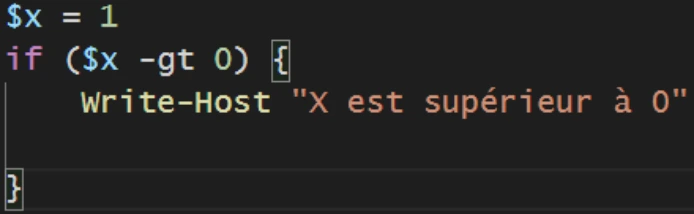

Capture du support « Fiche démo 4 - Les structures - If - Else - ElseIf »

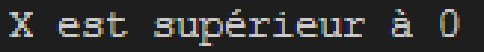

Capture du support « Fiche démo 4 - Les structures - If - Else - ElseIf »

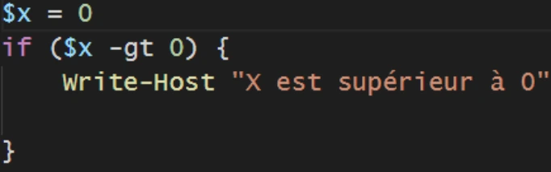

Capture du support « Fiche démo 4 - Les structures - If - Else - ElseIf »

Dans le cas où le test initial est « Faux », il est possible de faire un test secondaire via l’utilisation du paramètre ElseIf.

Le test secondaire peut vérifier une autre variable que la variable présente dans le test initial.

```
Si le second test répond « Vrai », alors la commande entre les accolades du ElseIf sera exécutée.
```

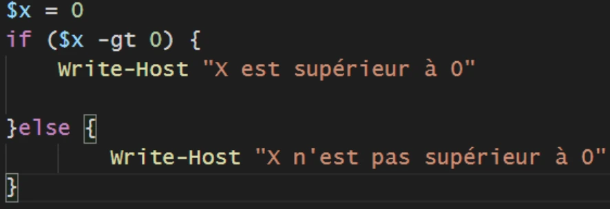

Capture du support « Fiche démo 4 - Les structures - If - Else - ElseIf »

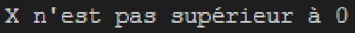

Capture du support « Fiche démo 4 - Les structures - If - Else - ElseIf »

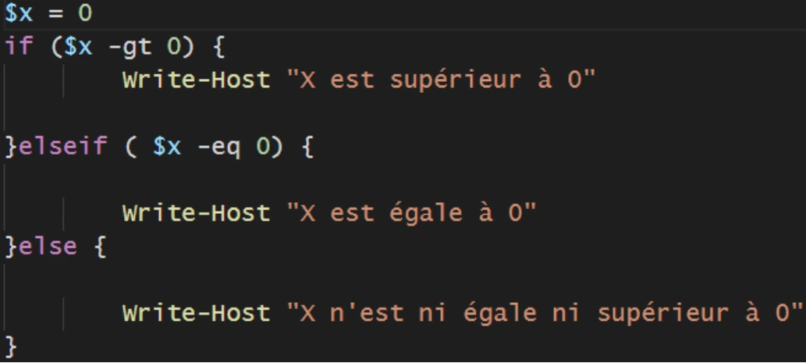

Capture du support « Fiche démo 4 - Les structures - If - Else - ElseIf »


Capture du support « Fiche démo 4 - Les structures - If - Else - ElseIf »

Avec une valeur négative, les deux tests répondent « Faux ». C’est donc la valeur du Else qui sera prise en compte.

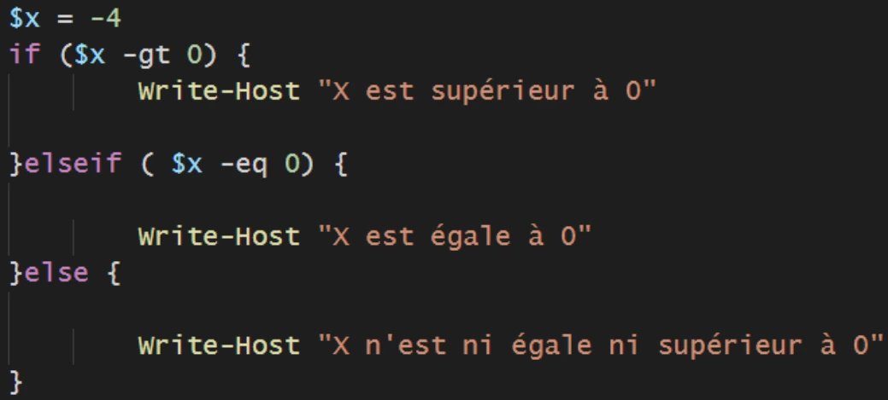

Capture du support « Fiche démo 4 - Les structures - If - Else - ElseIf »

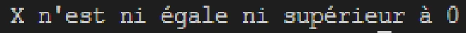

Capture du support « Fiche démo 4 - Les structures - If - Else - ElseIf »

Référence du document : 1CEt9g9piknHUSPHvnsJ5EhyDDhyHRIIz · SHA-256 7e59feafc016da3d…

## Démonstration · Fiche démo 5 - Les structures - While · 2 pages transcrites

Transcription du support du Drive. Les formulations historiques et les exemples du document sont conservés. Les valeurs d’accès du laboratoire sont indiquées comme « fourni par le formateur ». Les adresses de messagerie personnelles utilisent example.com.

### Les structures : While

Démonstration 05 du module 4

Les boucles sont des structures essentielles dans un langage et PowerShell n’y échappe pas. L’objectif de cette démonstration est de montrer comment la boucle While exécute des commandes, sous réserve que son test renvoie une réponse « Vrai » (si la réponse au test passe à « Faux », la boucle s’arrête).

### Déroulement

- La boucle While commence par un test, puis si la réponse est « Vraie », elle boucle une série de commandes.
- La boucle tourne tant que la réponse au test est « Vraie »

Pour déterminer un nombre de tours de boucle maximum, on va initier une variable dite de « Comptage » qui à chaque tour de boucle va s’incrémenter.

Lorsque la valeur de la variable de comptage atteint la limite, la boucle s’arrête.

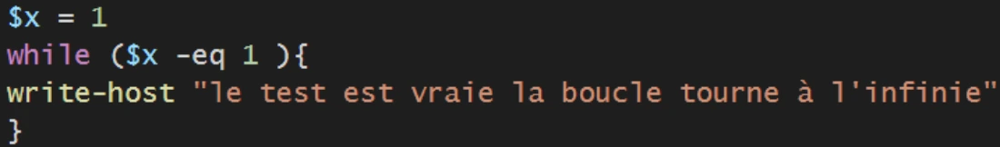

Capture du support « Fiche démo 5 - Les structures - While »

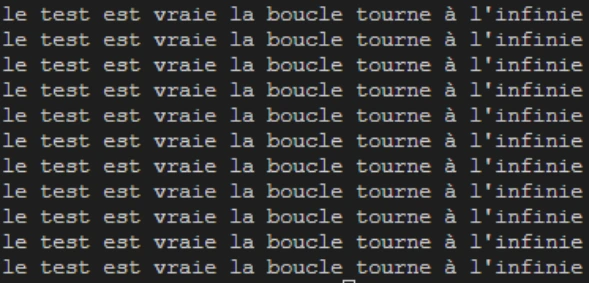

Capture du support « Fiche démo 5 - Les structures - While »

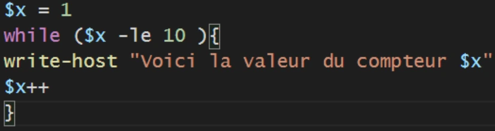

Capture du support « Fiche démo 5 - Les structures - While »

Lorsque la variable atteint la valeur « 10 » la boucle s’arrête.

La boucle s’utilise beaucoup comme vérificateur de valeur saisie par un utilisateur. En effet, tant que la valeur souhaitée n’est pas atteinte, la boucle ne s’arrête pas.

```
Combiné à la commande Read-Host, la valeur saisie est testée à chaque tour de boucle, si la
valeur est conforme, on sort de la boucle.
```

Tant que la lettre est différente de « Q » on boucle.

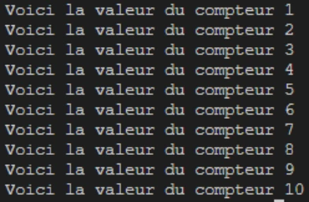

Capture du support « Fiche démo 5 - Les structures - While »

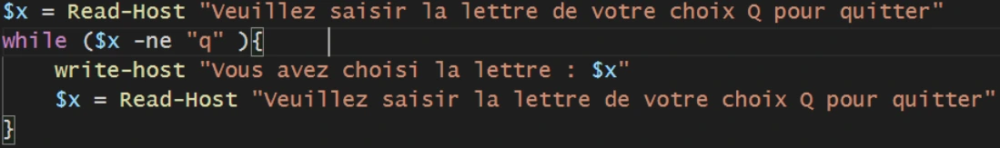

Capture du support « Fiche démo 5 - Les structures - While »

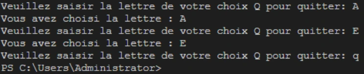

Capture du support « Fiche démo 5 - Les structures - While »

Référence du document : 1PQk0Fu-Ogyu2Am_36GonkntA7jSlrP2q · SHA-256 b4d4318541db71cf…

## Démonstration · Fiche démo 6 - Les structures - Do-While - Do-Until · 2 pages transcrites

Transcription du support du Drive. Les formulations historiques et les exemples du document sont conservés. Les valeurs d’accès du laboratoire sont indiquées comme « fourni par le formateur ». Les adresses de messagerie personnelles utilisent example.com.

### Les structures : Do-While et Do-Until

Démonstration 06 du module 4

La boucle nécessite une valeur de variable à tester pour commencer à boucler. Cela est parfois impossible car la variable à tester peut-être déclarée à l’intérieur même de la boucle.

```
L’objectif de cette démonstration est de montrer que la boucle Do-While permet un tour de
boucle initiale sans condition. La condition sera faite en sortie de boucle et, en fonction de la
réponse, d’autres tours de boucle (ou aucun) seront effectués.
```

### Déroulement

- La boucle Do-While va continuer à boucler tant que le test final va répondre « Vrai » ; dès que le test répond « faux », la boucle s’arrête.
- La boucle tourne tant que la réponse au test est « Vraie »

Pour le Do-until, le sens est inversé au niveau de la condition : on boucle tant que le test répond « Faux ».

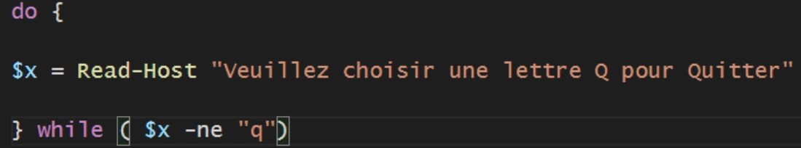

Capture du support « Fiche démo 6 - Les structures - Do-While - Do-Until »

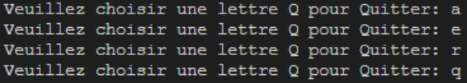

Capture du support « Fiche démo 6 - Les structures - Do-While - Do-Until »

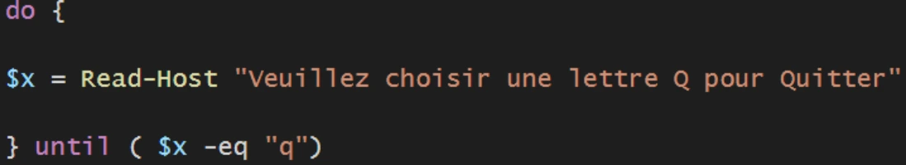

Capture du support « Fiche démo 6 - Les structures - Do-While - Do-Until »

Pour bien différencier les deux structures, il faut penser à certains types de tests qui ne peuvent pas être inversés par des opérateurs de comparaison comme les booléens.

Dans le premier cas $x est égale à $False. Until boucle à l’infini. Dans le second cas, Until ne boucle pas.

```
Nous avons le comportement inverse avec While
```

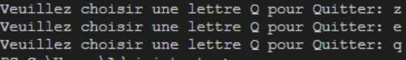

Capture du support « Fiche démo 6 - Les structures - Do-While - Do-Until »

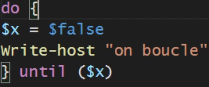

Capture du support « Fiche démo 6 - Les structures - Do-While - Do-Until »

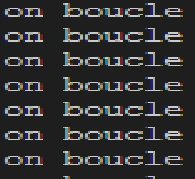

Capture du support « Fiche démo 6 - Les structures - Do-While - Do-Until »

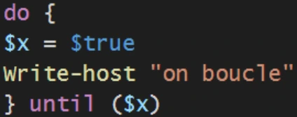

Capture du support « Fiche démo 6 - Les structures - Do-While - Do-Until »

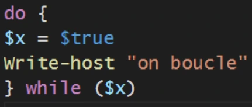

Capture du support « Fiche démo 6 - Les structures - Do-While - Do-Until »

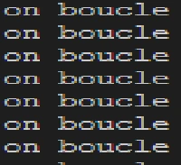

Capture du support « Fiche démo 6 - Les structures - Do-While - Do-Until »

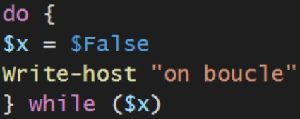

Capture du support « Fiche démo 6 - Les structures - Do-While - Do-Until »

Référence du document : 1ikLiim6Ss5HZkOkk8p3oDJtG-jGjKooj · SHA-256 7274e1473abc23a1…

## Démonstration · Fiche démo 7 - Les structures - Foreach · 2 pages transcrites

Transcription du support du Drive. Les formulations historiques et les exemples du document sont conservés. Les valeurs d’accès du laboratoire sont indiquées comme « fourni par le formateur ». Les adresses de messagerie personnelles utilisent example.com.

### Les structures : Foreach

Démonstration 07 du module 4

L’objectif de cette démonstration est de vous montrer le fonctionnement la boucle Foreach.

### Déroulement

La boucle Foreach est la boucle qui s’utilise avec des variables de type Array et ArrayList.

En effet la boucle fonctionne avec un index qui va parcourir les variables et traiter les valeurs contenues dans chaque index du tableau.

Le nombre de tours de boucle dépend du nombre de valeurs contenues dans la variable.

- La structure Foreach est employée pour exprimer les propriétés d’un ou de plusieurs objets contenus dans une variable.
- Reprenons l’exemple de la variable Array :

```
Trois index sont présents dans la variable $array donc trois tours de boucle.
A chaque tour de boucle, la valeur de l’index $i prend la valeur de l’index suivant dans le tableau.
```

Avec une variable de type ArrayList, nous allons explorer des objets.

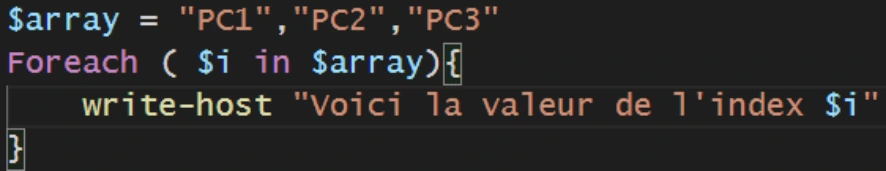

Capture du support « Fiche démo 7 - Les structures - Foreach »

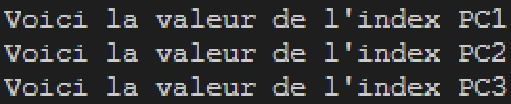

Capture du support « Fiche démo 7 - Les structures - Foreach »

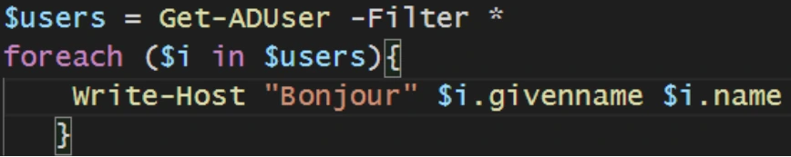

Capture du support « Fiche démo 7 - Les structures - Foreach »

A chaque tour de boucle, l’index contient un objet, ici un utilisateur Active Directory. On spécifie les propriétés de l’objet avec le « . ».

La structure Foreach accepte des commandes « action ». Ces actions sont décidées la plupart du temps pour donner suite à un test venant d’une structure If.

Avec l’action BREAK la boucle s’arrête si elle détecte un des quatre comptes indiqués dans la condition du If.

Avec l’action CONTINUE la boucle continue sans traiter l’objet qui a répondu « Vrai » au test.


Capture du support « Fiche démo 7 - Les structures - Foreach »


Capture du support « Fiche démo 7 - Les structures - Foreach »


Capture du support « Fiche démo 7 - Les structures - Foreach »

Référence du document : 18m5Utae9SKmg9nacgq7o0-8yJ-pQLr8Z · SHA-256 9e3f186cbd71d16e…

## Démonstration · Fiche démo 8 - Les structures - Switch · 2 pages transcrites

Transcription du support du Drive. Les formulations historiques et les exemples du document sont conservés. Les valeurs d’accès du laboratoire sont indiquées comme « fourni par le formateur ». Les adresses de messagerie personnelles utilisent example.com.

### Les structures : Switch

Démonstration 08 du module 4

La condition If permet de tester et de définir des commandes à exécuter en fonction d’un résultat « Vrai » ou « Faux ». Le If se limite à un ou deux tests maximum, au-delà il faut passer par la structure Switch. L’objectif de cette démonstration est de voir que le Switch permet de définir une action précise en fonction de la saisie d’une valeur.

### Déroulement

- Pour utiliser un Switch, il faut définir la variable qui va être testée.
- Ensuite, on déclare les valeurs ainsi que les actions à effectuer en fonction de la valeur.

Le Switch teste, au moyen d’expressions régulières, la variable $choix. Pour cela, il faut ajouter le paramètre Regex à la commande Switch.

En cas de caractère non identifié par les deux premières conditions, c’est la sortie par défaut qui est exécutée.

La structure Switch accède, comme la structure Foreach, les actions Continue et Break.


Capture du support « Fiche démo 8 - Les structures - Switch »


Capture du support « Fiche démo 8 - Les structures - Switch »


Capture du support « Fiche démo 8 - Les structures - Switch »


Capture du support « Fiche démo 8 - Les structures - Switch »

```
Si le groupe est User, il sera non testé. Les autres groupes seront testés ensuite.
```

La structure Switch est largement utilisée pour constituer des menus à choix multiple.


Capture du support « Fiche démo 8 - Les structures - Switch »


Capture du support « Fiche démo 8 - Les structures - Switch »


Capture du support « Fiche démo 8 - Les structures - Switch »


Capture du support « Fiche démo 8 - Les structures - Switch »

Référence du document : 1ci0EpL_sZg3PtmUJ3ogC65yHpgr7jaWg · SHA-256 242ea33e6c9c0d19…

## Démonstration · Fiche démo 9 - L'imbrication · 1 pages transcrites

Transcription du support du Drive. Les formulations historiques et les exemples du document sont conservés. Les valeurs d’accès du laboratoire sont indiquées comme « fourni par le formateur ». Les adresses de messagerie personnelles utilisent example.com.

### L’imbrication

Démonstration 09 du module 4

Les structures sont faites pour être imbriquées les unes avec les autres afin de répondre à un besoin. L’objectif de cette démonstration est de vous donner un exemple.

### Déroulement

- Nous allons combiner plusieurs structures afin de créer un menu interactif.
- Ce menu doit être intégré dans une boucle qui s’arrêtera lorsque l’utilisateur appuiera sur une touche assignée à la sortie du menu.
- La variable « choix » est réinitialisée à chaque tour de boucle. Cela permet de ne pas garder en mémoire la valeur du choix précédent.


Capture du support « Fiche démo 9 - L'imbrication »


Capture du support « Fiche démo 9 - L'imbrication »

Référence du document : 18XS11dIOrl1c15hmDq6Vw-OnN01TASLm · SHA-256 a81cef7bd65e2076…
