# Démonstrations — Module 05

[Retour au TP](index.md)

## Démonstration · Fiche démo 4 - L’enchaînement des commandes · 1 pages transcrites

Transcription du support du Drive. Les formulations historiques et les exemples du document sont conservés. Les valeurs d’accès du laboratoire sont indiquées comme « fourni par le formateur ». Les adresses de messagerie personnelles utilisent example.com.

### L’enchaînement des commandes.

Démonstration 04 du module 5

L’objectif de cette démonstration est de montrer comment faciliter la lisibilité d’un en répartissant les commandes sur plusieurs lignes.

### Déroulement

- A la différence du Pipe, le « ; » va permettre d’enchaîner des commandes sur une ligne sans interaction entre les commandes.

Les deux commandes sont exécutées à la suite l’une de l’autre.

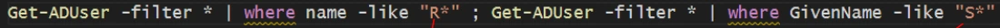

Capture du support « Fiche démo 4 - L’enchaînement des commandes »

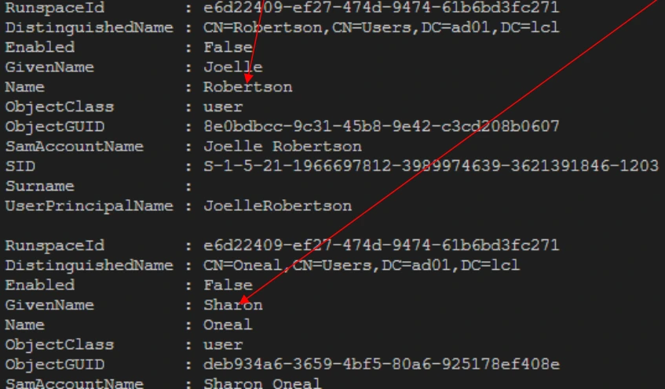

Capture du support « Fiche démo 4 - L’enchaînement des commandes »

Référence du document : 1msnp8HOamq7PvQWZpe7g5zXblgF2g4C6 · SHA-256 472e85477d6cfa58…

## Démonstration · Fiche démo 1 - Les IDE - ISE · 4 pages transcrites

Transcription du support du Drive. Les formulations historiques et les exemples du document sont conservés. Les valeurs d’accès du laboratoire sont indiquées comme « fourni par le formateur ». Les adresses de messagerie personnelles utilisent example.com.

### Les IDE : ISE

Démonstration 01 du module 5

L’objectif de cette démonstration est de vous présenter les atouts de l’outil de scripting fourni par Microsoft avec le système Windows ISE.

### Déroulement

- ISE est l’acronyme de « Integrated Scripting Environnement », ce qui signifie qu’il s’agit d’un outil totalement dédié à la réalisation de scripts.
- Seul le langage PowerShell est supporté.

Trois zones de travail :

- La zone de Script qui va contenir les lignes de codes
- La console de sortie qui va afficher les résultats des commandes du script.
- La fenêtre de commande qui répertorie toutes les commandes disponibles actuellement.

La personnalisation des zones de travail se fait par le menu Tools - Options

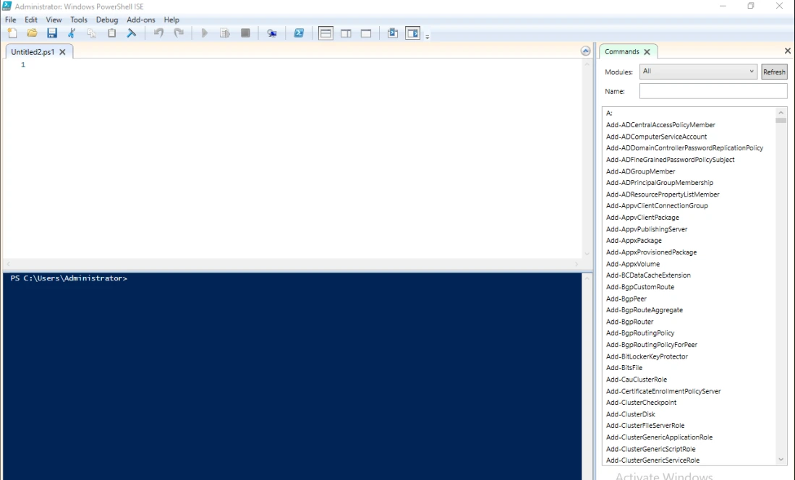

Capture du support « Fiche démo 1 - Les IDE - ISE »

Parmi toutes les options disponibles, la coloration syntaxique, la police et la taille de police sont regroupées dans le premier onglet.

La complétion automatique permet de fournir l’ensemble des CmdLets ou des paramètres disponibles.

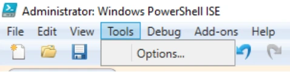

Capture du support « Fiche démo 1 - Les IDE - ISE »

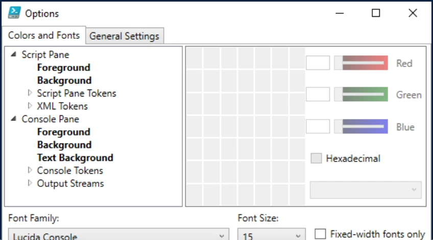

Capture du support « Fiche démo 1 - Les IDE - ISE » (partie 1/2)

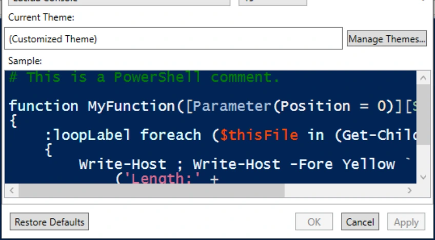

Capture du support « Fiche démo 1 - Les IDE - ISE » (partie 2/2)

Les paramètres disponibles sont affichés à la suite de la CmdLet saisie.

En fonction du thème choisi, la coloration des éléments de votre script va se faire automatiquement. La mise en place de ce code couleur permet en un coup d’œil de se rendre compte d’une erreur de syntaxe.

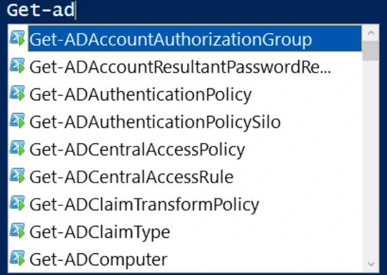

Capture du support « Fiche démo 1 - Les IDE - ISE »

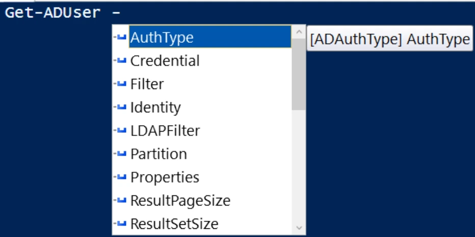

Capture du support « Fiche démo 1 - Les IDE - ISE »

Structures Variables Valeurs Propriétés Commentaires

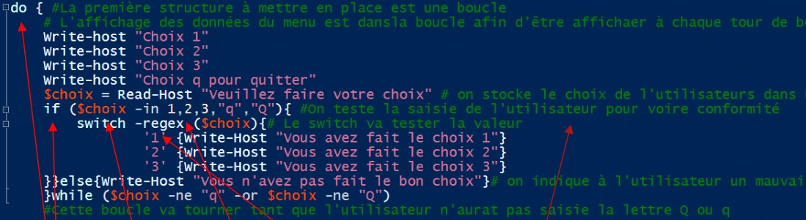

Capture du support « Fiche démo 1 - Les IDE - ISE »

Référence du document : 1jhk6S20gVugGv6FhqzIYfE-6_DGn8Bbs · SHA-256 e3959bd5eb3b45b1…

## Démonstration · Fiche démo 2 - Visual Studio Code · 2 pages transcrites

Transcription du support du Drive. Les formulations historiques et les exemples du document sont conservés. Les valeurs d’accès du laboratoire sont indiquées comme « fourni par le formateur ». Les adresses de messagerie personnelles utilisent example.com.

### Visual Studio Code

Démonstration 02 du module 5

Visual Stusdio Code est un IDE multiplateforme et gratuit. Fourni par Microsoft, il est adaptable quel que soit le système d’exploitation. De plus, il supporte la plupart des langages, qu’ils soient objet ou non. Il fonctionne sur le principe de modules qui enrichissent les fonctionnalités et la prise en charge des langages. L’objectif de cette démonstration est de vous présenter cet outil.

### Déroulement

- La version utilisée est la 1.49.1.
- En plus des environnements habituels dans un IDE, on retrouve des éléments qui facilitent le traitement d’un script.
- La console supporte plusieurs versions de PowerShell.

La première console utilise PowerShell intégré qui est en version 5.1

La seconde utilise la console PowerShell Core qui est version 7.0.3

Tout comme ISE, Visual Studio Code dispose de la gestion des thèmes de couleur, de la coloration syntaxique en fonction des éléments du script ainsi que d’une autocomplétion accessible avec la touche Tabulation.

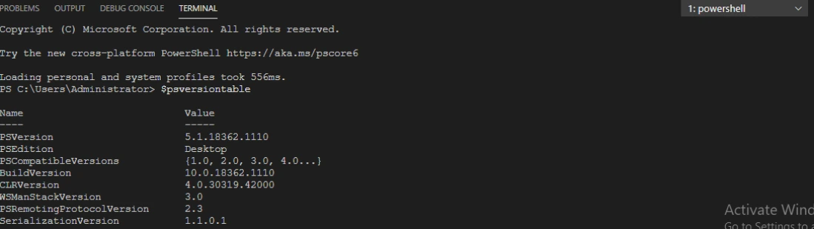

Capture du support « Fiche démo 2 - Visual Studio Code »

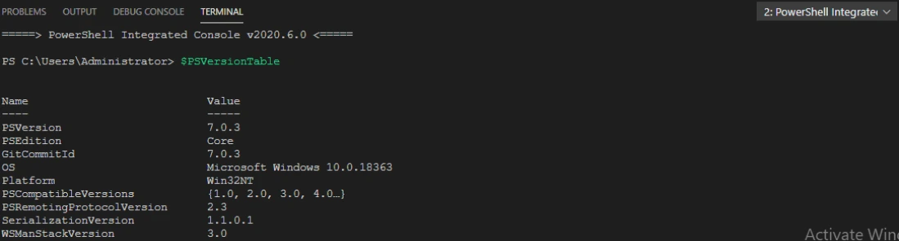

Capture du support « Fiche démo 2 - Visual Studio Code »

Il apporte en plus une suite de modules gratuits ou payants incluant de nombreux outils utiles à la gestion des erreurs par exemple ou à l’exécution en parallèle de plusieurs scripts.

Il est également possible de lier le logiciel à un compte GitHub afin de travailler à partir d’un dépôt de scripts personnels en ligne.

- La première étape est d’installer l’extension GitHub sur votre IDE.
- Ensuite, il suffit de créer un compte sur www.github.com puis de créer un repository.
- Puis connecter le compte Visual Studio Code

Si aucune fenêtre de connexion automatique ne s’ouvre, vous pouvez cliquer en bas à sur cette icône.

Puis cliquer ici pour ouvrir la page de connexion.

Vous pouvez maintenant utiliser votre espace en ligne pour stocker vos scripts et le partager avec d’autres personnes. La plateforme GitHub contient également des centaines de milliers de scripts, de modules d’exemple, de fichiers d’aide, etc.

Voir la procédure fournie par Microsoft pour l’utilisation de GitHub : https://code.visualstudio.com/docs/editor/github

#### Connexion à GitHub

Le formulaire « Sign in to GitHub » demande « Username or email address » et « Password ». L’identifiant et le mot de passe sont fournis par le formateur. Valider avec « Sign in ». « Forgot password? » ouvre la récupération du mot de passe.

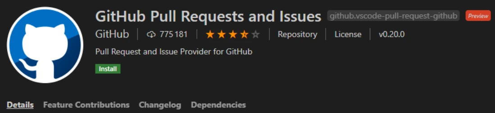

Capture du support « Fiche démo 2 - Visual Studio Code »

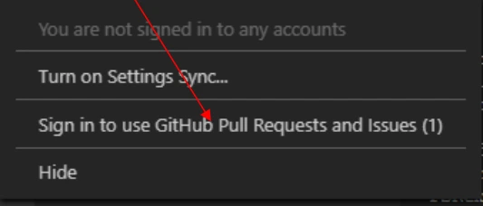

Capture du support « Fiche démo 2 - Visual Studio Code »

Référence du document : 1DqRH9OgYnWgOWbtsyQwPSbcGCTPsF-TT · SHA-256 14e74914d49ef1eb…

## Démonstration · Fiche démo 3 - Les commentaires · 1 pages transcrites

Transcription du support du Drive. Les formulations historiques et les exemples du document sont conservés. Les valeurs d’accès du laboratoire sont indiquées comme « fourni par le formateur ». Les adresses de messagerie personnelles utilisent example.com.

### Les commentaires

Démonstration 03 du module 5

Aussi importants qu’une plateforme de partage de script, les commentaires donnent du relief aux scripts. Ils permettent de comprendre les missions d’un ensemble de commandes et sont essentiels pour s’assurer que les résultats produits par le script correspondent aux résultats attendus. L’objectif de cette démonstration est de vous présenter l’utilisation des commentaires dans un script.

### Déroulement

- Le dièse est le caractère qui va démarrer la chaîne de commentaires ; tous les caractères suivants ne seront pas interprétés par la console.
- La première façon de commenter une commande est de démarrer un nouveau commentaire avec un dièse.

Le commentaire peut se placer en fin de commande.

- La seconde façon de commenter est d’indiquer une zone de commentaire.

Toutes les commandes de la zone ne seront pas interprétées par la console.

Le chevron suivi du dièse ouvre la zone de commentaire, la zone se referme avec un dièse puis un chevron fermant.

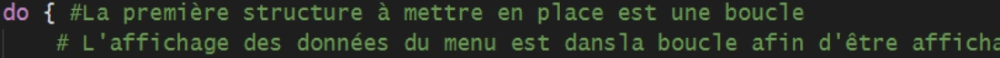

Capture du support « Fiche démo 3 - Les commentaires »

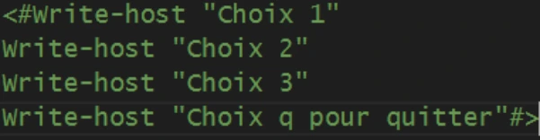

Capture du support « Fiche démo 3 - Les commentaires »

Référence du document : 1yZ-bLVuSHF_5-_WhLRLBene2PyxND7DR · SHA-256 b4856c7f64122850…

## Démonstration · Fiche démo 5 - La gestion des erreurs · 2 pages transcrites

Transcription du support du Drive. Les formulations historiques et les exemples du document sont conservés. Les valeurs d’accès du laboratoire sont indiquées comme « fourni par le formateur ». Les adresses de messagerie personnelles utilisent example.com.

### La gestion des erreurs

Démonstration 05 du module 5

Une erreur sur une commande peut facilement bloquer toute l’exécution d’un script. L’objectif de cette démonstration est de montrer que toutes les commandes disposent d’un paramètre permettant d’indiquer l’action de la console en cas d’erreur d’exécution d’une commande.

### Déroulement

- Le paramètre ErrorAction indique le comportement de la console en cas d’erreur.

Avec la valeur continue

Avec la valeur SilentlyContinue, l’erreur n’apparaît plus sur la console.

#### Commandes visibles dans les captures

```
$p = ConvertTo-SecureString -AsPlainText -Force "fourni par le formateur"
Set-ADAccountPassword -NewPassword $p -Identity Barron -ErrorAction Continue
Get-ADUser -Filter * | Where-Object Name -Like "Barron"
```

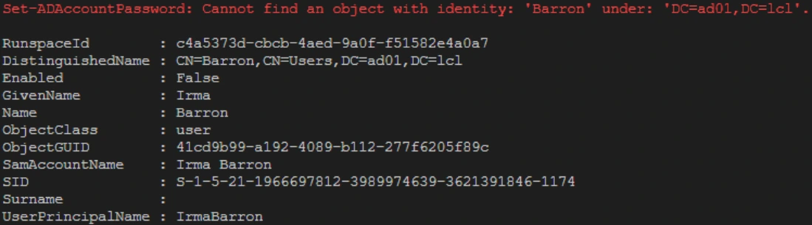

Capture du support « Fiche démo 5 - La gestion des erreurs »

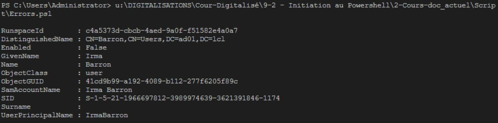

Capture du support « Fiche démo 5 - La gestion des erreurs »

La valeur Stop arrête immédiatement l’exécution du script.

Les erreurs, même non affichées dans la console, sont stockées dans une variable $Error.

Le paramètre ErrorVariable permet de spécifier une autre variable.

```
Il est possible de déterminer le comportement général des erreurs dans la console en modifiant la
variable $ErrorActionPreference.
```

Toutes les erreurs seront affichées, mais ne bloqueront pas l’exécution du script.

#### Commandes visibles dans les captures

```
Get-ChildItem C:\Users\lab -ErrorAction Continue -ErrorVariable $erreurs
$erreurs
$ErrorActionPreference = "SilentlyContinue"
```

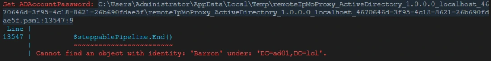

Capture du support « Fiche démo 5 - La gestion des erreurs »

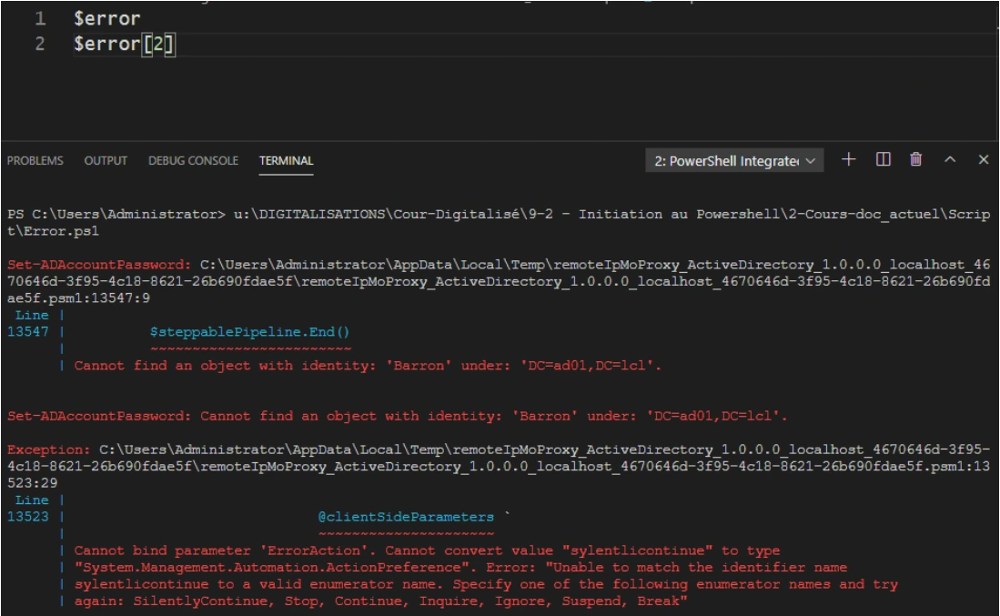

Capture du support « Fiche démo 5 - La gestion des erreurs »

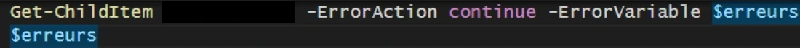

Capture du support « Fiche démo 5 - La gestion des erreurs »

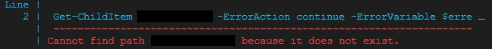

Capture du support « Fiche démo 5 - La gestion des erreurs »

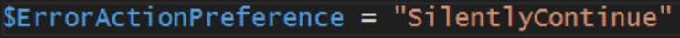

Capture du support « Fiche démo 5 - La gestion des erreurs »

Référence du document : 1u7ZS6VCu6ni6Uy0uAHWirDuRvmhzji8e · SHA-256 240a1fd65e5af2db…

## Démonstration · Fiche démo 6 - Le Try Catch Finally · 2 pages transcrites

Transcription du support du Drive. Les formulations historiques et les exemples du document sont conservés. Les valeurs d’accès du laboratoire sont indiquées comme « fourni par le formateur ». Les adresses de messagerie personnelles utilisent example.com.

### Le Try Catch Finally

Démonstration 06 du module 5

L’objectif de cette démonstration est de vous présenter la structure dédiée à la gestion des erreurs. Cette structure exécute des commandes en fonction du résultat d’un test initial.

### Déroulement

- La première étape est le try qui va exécuter une commande. Si la commande réussit, le résultat est affiché, sinon c’est la commande contenue dans le catch qui est exécutée à la place.

Le paramètre ErrorAction avec la valeur Stop permet à la valeur contenue dans la structure

```
Catch de s’exécuter sans afficher le message d’erreur.
Sans le paramètre ErrorAction la structure Catch n’est pas exécutée et le message d’erreur
apparaît en sortie.
```

La structure Try-Catch-Finally s’utilise pour effectuer des tests sur des objets ou des valeurs de propriétés des objets. Pour faciliter ces tests, il est courant de coupler la structure avec le Foreach.

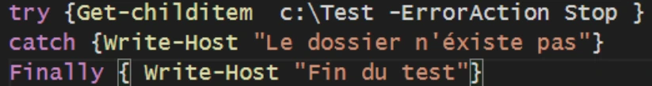

Capture du support « Fiche démo 6 - Le Try Catch Finally »

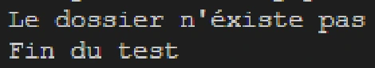

Capture du support « Fiche démo 6 - Le Try Catch Finally »

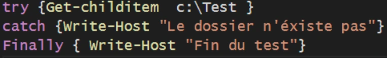

Capture du support « Fiche démo 6 - Le Try Catch Finally »

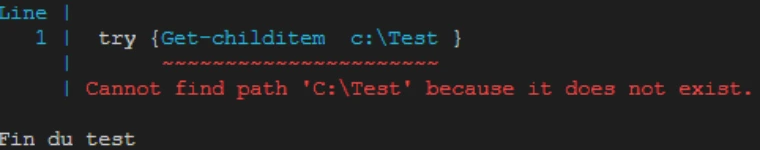

Capture du support « Fiche démo 6 - Le Try Catch Finally »

On utilise uniquement la structure Try pour effectuer le test sur une propriété.

A chaque utilisateur testé, on affiche un message de fin de test.

Pour les utilisateurs qui n’ont pas de prénom, la réponse du test est « Vraie », pour les autres, la réponse « Faux » est envoyée.

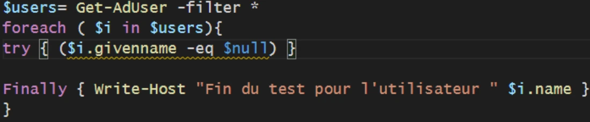

Capture du support « Fiche démo 6 - Le Try Catch Finally »

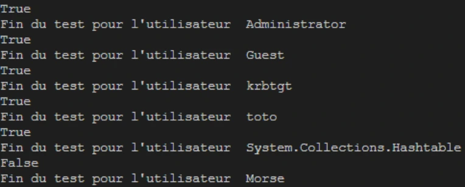

Capture du support « Fiche démo 6 - Le Try Catch Finally »

Référence du document : 1myPFNqRLDLOB17q_q3N-tPIiwSuxtfqM · SHA-256 52d8a029fe69f304…

## Démonstration · Fiche démo 7 - Les fonctions · 2 pages transcrites

Transcription du support du Drive. Les formulations historiques et les exemples du document sont conservés. Les valeurs d’accès du laboratoire sont indiquées comme « fourni par le formateur ». Les adresses de messagerie personnelles utilisent example.com.

### Les fonctions

Démonstration 07 du module 5

L’objectif de cette démonstration est de vous présenter l’utilisation des fonctions.

### Déroulement

Pour faciliter la réalisation d’un script, il est nécessaire de mettre en place des fonctions dans lesquelles des commandes seront enregistrées pour les réutiliser facilement.

Cela permet de ne pas répéter les lignes de commandes à plusieurs reprises dans un script.

- Une fonction se déclare avec la commande Function et le nom attribué à la fonction.
- Le nom d’une fonction ne doit pas contenir de caractère réservé comme le $ ou autre signe de ponctuation.

La fonction Hello affiche les valeurs des variables d’environnement du système.

Pour appeler cette fonction, il suffit de saisir le nom de la fonction sans commande préalable.

Le caractère `n permet le saut de ligne.

Les fonctions sont capables de recevoir des paramètres et de les intégrer sous forme de variables.

La valeur de ses variables sera transmise lors de l’appel de la fonction.

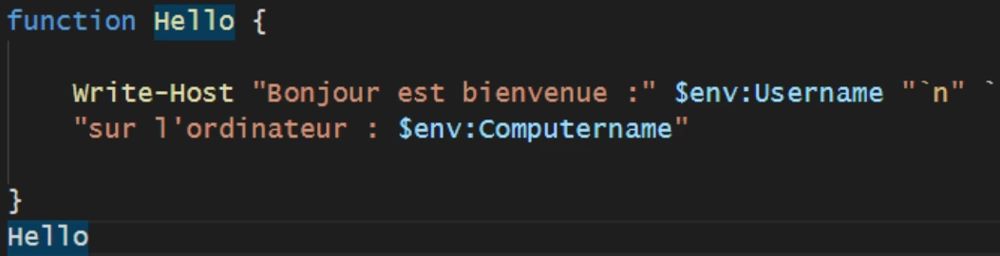

Capture du support « Fiche démo 7 - Les fonctions »

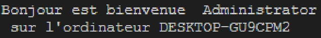

Capture du support « Fiche démo 7 - Les fonctions »

On déclare la fonction FindUsers avec le paramètre $i qui va contenir l’utilisateur à rechercher. Puis on renvoie le résultat dans la variable $r.

On appelle la fonction avec le paramètre Morse ; la fonction effectue la recherche et renvoie l’utilisateur.

Si aucun utilisateur n’est trouvé, la fonction renvoie un message d’utilisateur non trouvé.

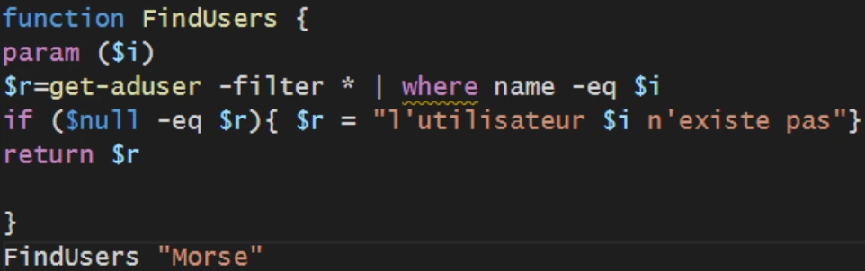

Capture du support « Fiche démo 7 - Les fonctions »

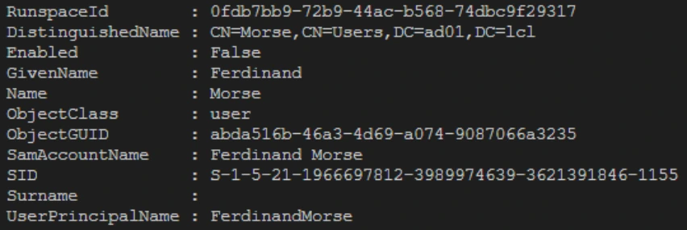

Capture du support « Fiche démo 7 - Les fonctions »

Référence du document : 1LzNEOJTJPLUKr1-gwadDYT8iC4mbk1cu · SHA-256 4e4eb0dc7896d70a…

## Démonstration · Fiche démo 8 - Le Remoting · 2 pages transcrites

Transcription du support du Drive. Les formulations historiques et les exemples du document sont conservés. Les valeurs d’accès du laboratoire sont indiquées comme « fourni par le formateur ». Les adresses de messagerie personnelles utilisent example.com.

### Le Remoting

Démonstration 08 du module 5

PowerShell utilise la gestion de session à distance pour exécuter des commandes sur un ordinateur distant. Le Remoting utilise le protocole WS-Man et le service WinRM. Il est nécessaire de contrôler l’état du service avant de tenter d’ouvrir une session sur un ordinateur distant.

### Déroulement

- La première commande à utiliser est Enable-PsRemonting sur la machine à contrôler à distance.
- Il est nécessaire de rajouter le paramètre SkipNetworkCheck pour éviter des refus en cas de profil réseau de type public.

La commande configure le service WinRM. Elle ajoute également une exception dans le pare-feu Windows puis redémarre le service WinRM.

Pour initier une session à distance, on utilise la commande New-Pssession avec en paramètre le nom ou l’adresse IP de la machine cible.

Nous avons désormais une session distante ouverte entre notre client et le serveur SRV01 ; cette session possède un ID.

Pour exécuter des commandes avec cette session distante, on utilise la commande Enter- Pssession puis l’Id de la session souhaitée.

On indique l’Id de la session ouverte précédemment.

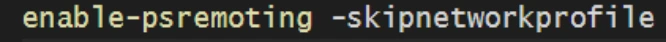

Capture du support « Fiche démo 8 - Le Remoting »

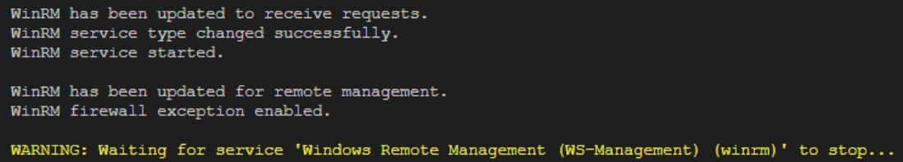

Capture du support « Fiche démo 8 - Le Remoting »

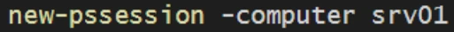

Capture du support « Fiche démo 8 - Le Remoting »

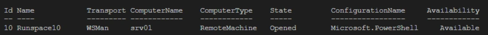

Capture du support « Fiche démo 8 - Le Remoting »

Désormais le prompt indique le nom de la machine sur laquelle les commandes seront exécutées.

Il n’est pas possible de faire de saut avec le Remoting. Lorsque vous avez ouvert une session sur une machine distante, il n’est pas possible d’ouvrir une session sur une autre machine à partir de cette machine distante.

Toute session doit être ouverte à partir de la machine cliente d’origine.

Référence du document : 1YfT53VmPiMe-ADKZeM6pDgFFPvK1dUQJ · SHA-256 a22b94ae18fc53de…

## Démonstration · Fiche démo 9 - Le Invoke-Command · 1 pages transcrites

Transcription du support du Drive. Les formulations historiques et les exemples du document sont conservés. Les valeurs d’accès du laboratoire sont indiquées comme « fourni par le formateur ». Les adresses de messagerie personnelles utilisent example.com.

### Le Invoke-Command

Démonstration 09 du module 5

L’objectif de cette démonstration est de découvrir l’utilisation de la commande Invoke- Command.

### Déroulement

Une fois le principe de Remoting acquis, il est possible avec PowerShell de demander l’exécution de commandes sur des machines distantes, sans ouvrir de session préalable. Cela permet un gain de temps lorsque l’on souhaite effectuer des modifications identiques à un groupe de machines.

- Il est nécessaire de connaître les noms ou adresses IP des machines à atteindre avant de lancer la commande.
- Attention au système de droits dans un environnement Active Directory. Il faut des droits d’administration.

On recherche le nombre de commandes disponibles sur la machine « SRV01 »

Il est possible de passer des variables locales dans la commande afin de transmettre des valeurs à une machine distante.

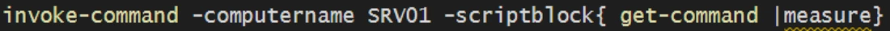

Capture du support « Fiche démo 9 - Le Invoke-Command »

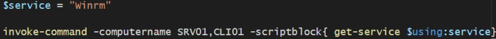

Capture du support « Fiche démo 9 - Le Invoke-Command »

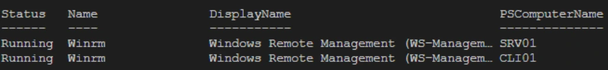

Capture du support « Fiche démo 9 - Le Invoke-Command »

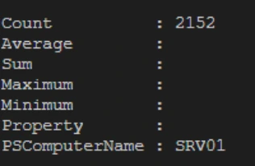

Capture du support « Fiche démo 9 - Le Invoke-Command »

Référence du document : 1YmMFepqTffjh8cb2Hz8y2y6hHgE1-ltO · SHA-256 e86f24a161a48c0f…
