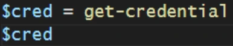
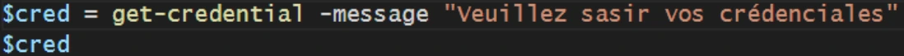
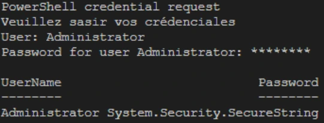
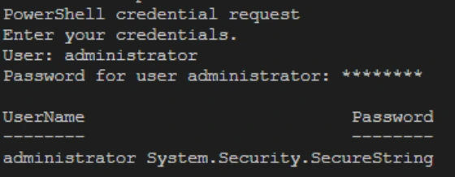

# Démonstrations — Module 06

[Retour au TP](index.md)

## Démonstration · Fiche démo 1 - L’authentification · 1 pages transcrites

!!! note "À retenir"
    Les formulations historiques et les exemples du document sont conservés.

Transcription du support du Drive. Les formulations historiques et les exemples du document sont conservés. Les valeurs d’accès du laboratoire sont indiquées comme « fourni par le formateur ». Les adresses de messagerie personnelles utilisent example.com.

### L’authentification

!!! note "À retenir"
    Démonstration 01 du module 6 La gestion des droits est essentielle dans la gestion des scripts.

Démonstration 01 du module 6

La gestion des droits est essentielle dans la gestion des scripts. PowerShell autorise la gestion des droits avec la commande Get-Credentials. Cette commande masque le champ mot de passe pour éviter de transmettre des mots de passe en clair dans le script.

### Déroulement

!!! note "À retenir"
    Cette commande va afficher un pop-up à l’écran pour capturer les credential utilisateur.

- Cette commande va afficher un pop-up à l’écran pour capturer les credential utilisateur.
- Ces credential sont ensuite traités par le script ou la commande puis disparaissent à la fin de la commande ou du script.

A l’exécution de la commande, l’utilisateur est invité à saisir son nom d’utilisateur ainsi que son mot de passe qui est masqué.

Si on affiche la variable contenant les credentials, on ne voit pas les credential mais le type de variable.

Pour personnaliser le message, on utilise le paramètre Message suivi de la chaîne de caractères souhaitée.

Capture du support « Fiche démo 1 - L’authentification »

Capture du support « Fiche démo 1 - L’authentification »

Capture du support « Fiche démo 1 - L’authentification »

Capture du support « Fiche démo 1 - L’authentification »

Référence du document : 1kOpSxGLzrh9-b7m5MxFUtLav3uWCwZfs · SHA-256 aef1cc439e5b4969…
