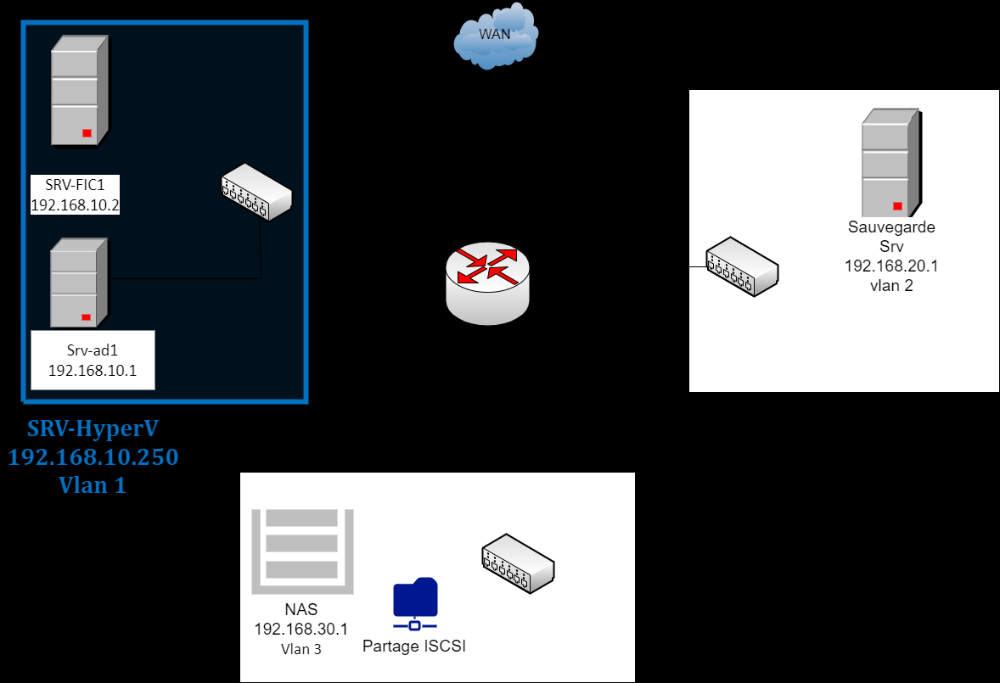
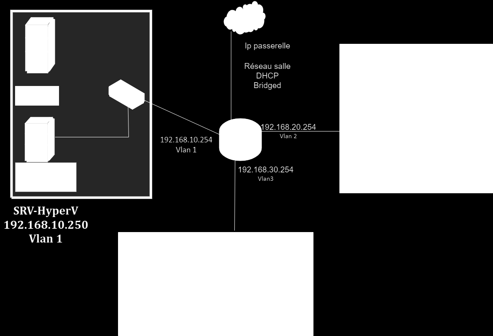

# Énoncé · Création de l’infrastructure

## Création de l'infrastructure

## TP du Module 01 – Concepts, enjeux et définitions

Avant de démarrer ce TP, il convient d’avoir suivi le module 1. Pour ce module l’accès au gestionnaire Hyper-V est nécessaire sur votre machine de salle. Vous devez avoir accès au partage distrib.

## Durée estimée

## 1 heure

## Objectifs

- Installer le rôle HyperV sur le poste de salle
- Déployer l’infrastructure sous HyperV pour l’exécution des ateliers
## Énoncé

En vous basant sur les informations fournies ci-dessous, vous importerez l’environnement de maquettage via les bundles disponible dans : R:\Distrib\Bundles\TSSR\RES24_0160B - Sauvegarde & restauration

Import des machines virtuelles dans l’environnement Hyper-V:

- Créez une arborescence de stockage de machine virtuelle sur le disque D:\ de votre machine de salle. Chaque machine virtuelle sera stockée dans un dossier dédié.
- Importez les machines virtuelles suivantes (voir lien ci-dessus) :
- Les machines SRV-AD1 et SRV-FIC1 ne sont pas à importer, elles sont intégrées au serveur SRV-HyperV
Mot de Nom Type systèmes Domaine Login passe Windows Serveur Srv-backup Mondomaine.local Administrateur Pa$$w0rd SRV-Nas Freebsd – truenas Mondomaine.local admin *

Routeur Freebsd - pfsense Mondomaine.local admin * Windows Serveur SRV-HyperV WORKGROUP Administrateur *

Windows Serveur SRV-AD1 Mondomaine.local Administrateur * Windows Serveur SRV-FIC1 Mondomaine.local Administrateur *

| Nom | Type systèmes | Domaine | Login | Mot de passe |
|---|---|---|---|---|
| Srv-backup | Windows Serveur 2019 | Mondomaine.local | Administrateur | Pa$$w0rd |
| SRV-Nas | Freebsd – truenas | Mondomaine.local | admin | * |
| Routeur | Freebsd - pfsense | Mondomaine.local | admin | * |
| SRV-HyperV | Windows Serveur 2019 | WORKGROUP | Administrateur | * |
| SRV-AD1 | Windows Serveur 2019 | Mondomaine.local | Administrateur | * |
| SRV-FIC1 | Windows Serveur 2019 | Mondomaine.local | Administrateur | * |

Schéma de l’infrastructure :

Vérification après import : L’objectif est de contrôler que notre infrastructure est opérationnelle et de finaliser certaines configurations.

Allumer toutes les VM de notre infrastructure.

- Ouvrir une session sur toutes vos VM :
    - o Administrateur / Pa$$w0rd

- Depuis srv-backup
    - o Vérifier la connectivité vers les serveurs suivants et ajuster les pare-feu Windows au besoin : ▪ SRV-AD1 ▪ SRV- Fic1 ▪ SRV-NAS
    - o Préparation du NAS depuis SRV_Backup
    - o Ouvrir chrome, vérifier que le portail web du serveur NAS est opérationnel ▪ URL : https://192.168.30.1 ▪ Login : admin / Pa$$w0rd ▪ Dans le menu « paramètres systèmes » - « Console » effectuer la commande « sudo wbinfo -t » pour vérifier que l’intégration AD est ok. ▪ Aller sur le menu « service » et activer le service « ISCSI ».
- Sur srv-fic1
    - o Se connecter sur la VM : ▪ Administrateur ▪ Pa$$w0rd
    - o Effectuer les pings suivants : ▪ srv-ad1 ▪ srv-backup ▪ truenas

[Pas-à-pas commenté](../../../modules/16-sauvegarde-et-restauration/module-01-concept-enjeux-et-definition.md) · [Correction inexistante](corrections.md)
