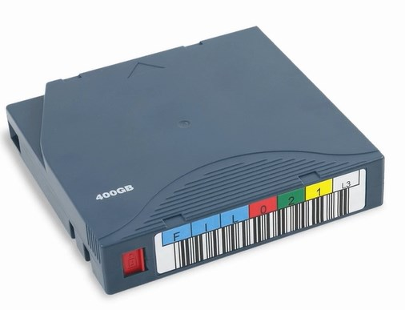

# Énoncé · Sauvegarde et restauration Veeam

## Sauvegarde et restauration

## VEEAM

## TP du Module 03 – Gestion du stockage

Avant de démarrer ce TP, il convient d’avoir suivi les modules 1, 2 et 3 et d’avoir réalisé le TP précédent.

Durée estimée

1 heure

## Objectifs

- Installer la solution de sauvegarde Veeam Backup & Replication
- Sauvegarder des VM
- Restaurer une VM
## Énoncé

Sur SRV-HyperV :

Ne pas oublier d’ouvrir le port 445 (Service Accès réseau (NP-in))

Sur Srv-backup:

- Désinstaller Backup Exec
- Installer VEEAM 12 backup & replication
- Dans Veeam menu « Inventory » ajouter le serveur HyperV : « Add Server »
## Name                             SRV-HyperV

Type Microsoft Hyper-V Server (Standalone) Crédential « Add… » « SRV-HyperV\administrateur »

## Review                           Task limit : 4

- Une fois l’ajout effectué, vérifier sur le serveur SRV-HyperV la présence des serveurs :
    - o SRV-AD1
    - o SRV-FIC1
- Créer un job de sauvegarde pour le serveur srv-Fic1

- o Menu « Home »
    - o « Backup job »
    - o «Virtual Machine »
## Name                            SVGD-FIC1

## Virtual Machine                 « Add… » « Srv-Fic1 »

Storage Default Backup Repository

## Review                          Task limit : 4

    - o Exécution immédiate
- Après vérification de la sauvegarde complète srv-fic1
    - o S'il n’y a pas d’erreur lors de la sauvegarde
    - o Supprimer le serveur srv-fic1 depuis SRV-HYPERV
    - o Depuis VEEAM effectuer une restauration complète de la VM srv-fic1
    - o Une fois la restauration terminée vérifier que tous les paramètres du serveur sont bons et opérationnels

[Correction inexistante](corrections.md)
