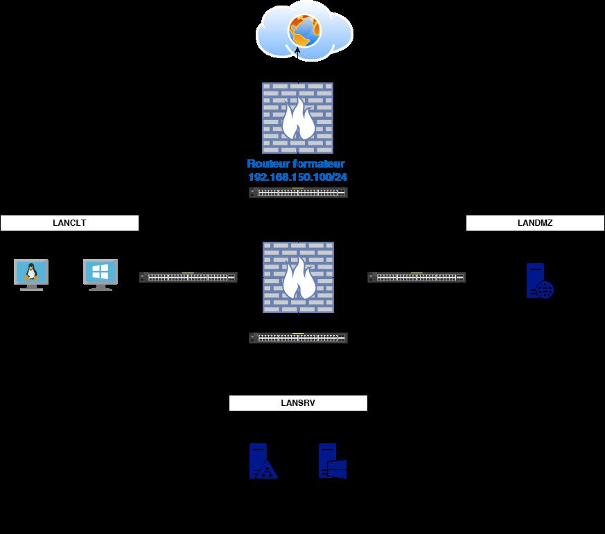
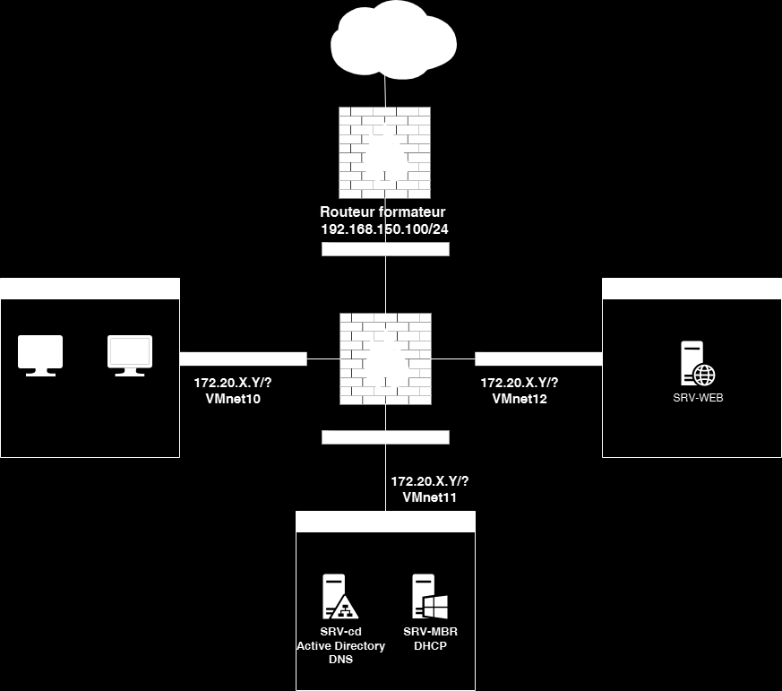
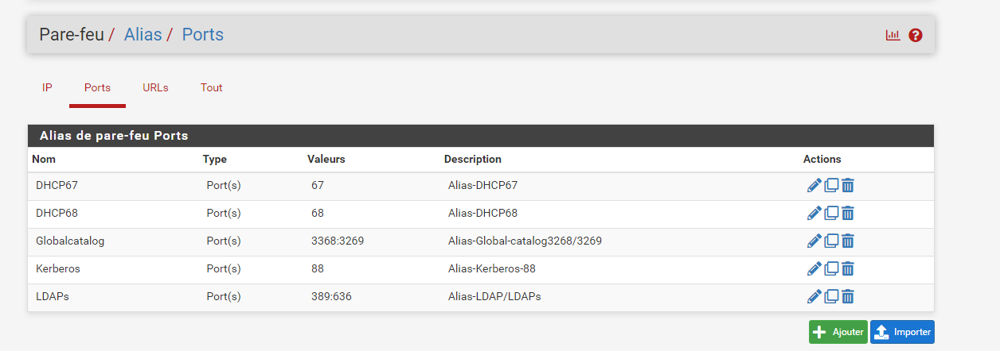
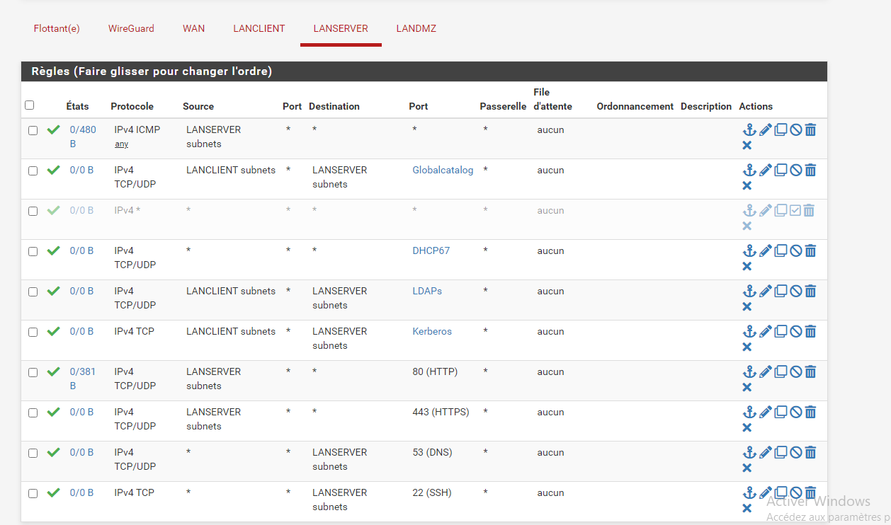
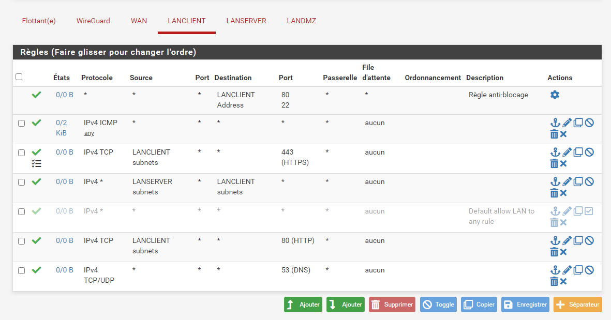

# Correction — TP1 — Étudier les besoins de l'entreprise en termes de flux de sorties vers internet

Étudier les besoins de
l'entreprise en termes de
flux de sorties vers internet
TD1

 Avant de démarrer ce TP, il convient d’avoir récupéré le fichiers « Règles de pare-feu.xlsx »
 et d’avoir choisi une plage d’adressage dans le fichier « List-IP-Stagiaires.xlsx » déposé
 dans Teams.

            Durée estimée

                 1h

Énoncé

Objectifs:

Ce exercice vise à mettre en place une infrastructure réseau sécurisée pour une
entreprise, en séparant les réseaux internes et en contrôlant les flux vers Internet.
Vous travaillerez en binômes pour analyser le schéma réseau ci-dessous et y déterminer
les règles de pare-feu appropriées dans le fichier excel fourni par votre formateur.

Valeurs de la capture :

- Routeur formateur : 192.168.150.100/24
- VMnet10, VMnet11 et VMnet12
- SRV-CD : Active Directory, DNS
- SRV-MBR : DHCP
- SRV-WEB

Dans le fichier List-IP-Stagiaires.xlsx

Attribuez-vous une colonne des adressages réseaux

En partant de la plage Lan « Global /24 » calculer : 172.20.2.0/24

                        Lan SRV /26                  Lan Client /25    Lan DMZ /26

 Plage d’adresses       172.20.2.128 -               172.20.2.0 -      172.20.2.192 -
 disponibles            172.20.2.191 /26             172.20.2.127/25   172.20.2.255 /26

 IP routeur sera        190                          126               254
 l’avant dernière de
 sa plage

 IP du SRV-CD sera la   150
 21ième adresse
 disponible de son
 réseau

 IP du SRV-MBR sera     152
 la 23ième adresse
 disponible de son
 réseau

 IP du SRV-WEB sera                                                    200
 la 7ième adresse
 disponible de son
 réseau

 IP du CLT-WIN sera                                  10
 la 9ième adresse
 disponible de son
 réseau

 IP du CLT-DEB sera                                  12
 la 11ième adresse
 disponible de son
 réseau

En binôme ou seul, analyser en profondeur un schéma réseau fourni en y ajoutant vos
adresses, le fichier SchémaRéseauTP1.drawio vous est mis disposition pour le modifier.

Identifier les différents segments du réseau et leurs besoins en termes de communication.

Déterminer les flux de données nécessaires entre les différents segments et vers l'extérieur
en n'ouvrant que les ports strictement nécessaires pour des services ou applications
spécifiques tout en bloquant le trafic non autorisé.

Justifier chaque règle proposée en expliquant son rôle dans la sécurité globale du réseau.

Remplissez le fichier « Règles de pare-feu.xlsx » qui vous sera remis par votre formateur,

Solution
Une solution est proposée pour ce TP sous la forme d'un PDF commenté (correction reproduite ci-dessous).

Note : l’énoncé place SRV-WEB, CLT-WIN et CLT-DEB aux 8e, 10e et 12e adresses. Cette correction les place aux 7e, 9e et 11e, avec les valeurs 200, 10 et 12 pour l’exemple 172.20.2.0/24.
