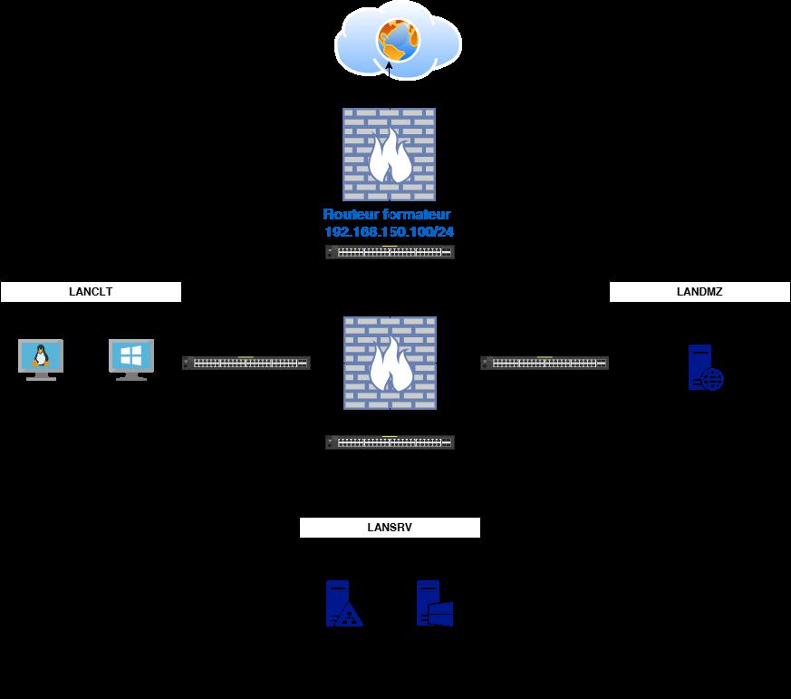
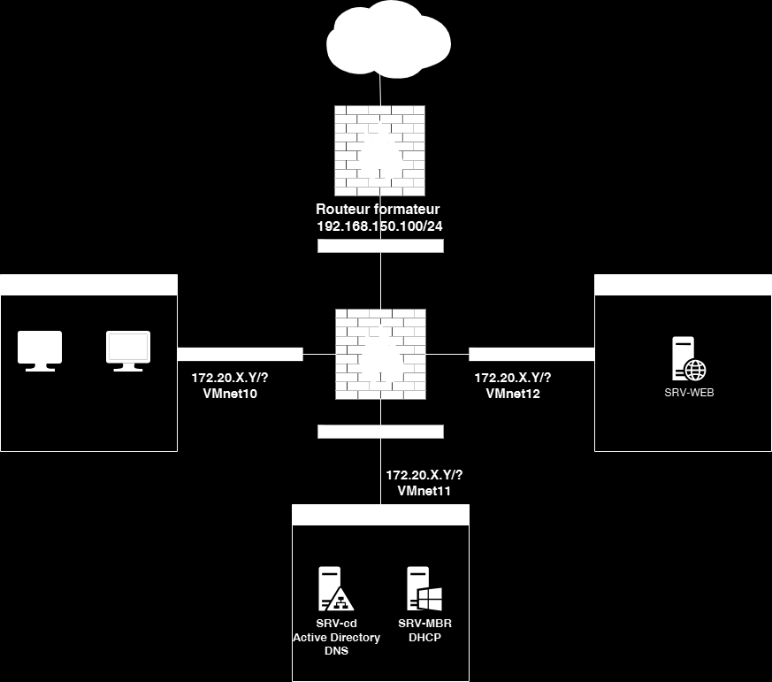
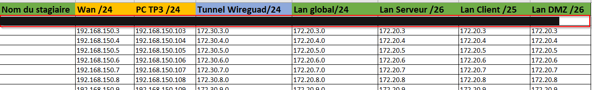

# Énoncé — TP1 — Étudier les besoins de l'entreprise en termes de flux de sorties vers internet

Étudier les besoins de
l'entreprise en termes de
flux de sorties vers internet
TP1

 Avant de démarrer ce TP, il convient d’avoir récupéré le fichiers « Règles de pare-feu.xlsx »
 et d’avoir choisi une plage d’adressage dans le fichier « List-IP-Stagiaires.xlsx » déposé
 dans Teams.

            Durée estimée

                 2h

Énoncé

Objectifs :

Cet exercice vise à définir des règles des flux réseaux dans une infrastructure, en séparant
les réseaux internes et en contrôlant les flux vers Internet.
Si possible, vous travaillerez en binômes pour analyser le schéma réseau ci-dessous et
déterminerez les règles de pare-feu appropriées. Elles seront à reporter dans le fichier
Excel fourni par votre formatrice ou formateur.

Valeurs de la capture :

- Routeur formateur : 192.168.150.100/24
- VMnet10, VMnet11 et VMnet12
- SRV-CD : Active Directory, DNS
- SRV-MBR : DHCP
- SRV-WEB

Dans le fichier List-IP-Stagiaires.xlsx

Attribuez-vous une colonne des adressages réseaux

En partant de la plage « Lan Global /24 » calculer :

                           Lan SRV /26                   Lan Client /25   Lan DMZ /26

 Plage d’adresses
 disponibles

 IP routeur sera
 l’avant dernière de
 sa plage

 IP du SRV-CD sera la
 21ième adresse
 disponible de son
 réseau

 IP du SRV-MBR sera
 la 23ième adresse
 disponible de son
 réseau

 IP du SRV-WEB sera
 la 8ième adresse
 disponible de son
 réseau

 IP du CLT-WIN sera
 la 10ième adresse
 disponible de son
 réseau

 IP du CLT-DEB sera
 la 12ième adresse
 disponible de son
 réseau

Mettre à jour le schéma en y ajoutant vos adresses, le fichier « SchémaRéseauTP1.drawio »
vous est mis disposition pour le modifier.

Identifier les différents segments du réseau et leurs besoins en termes de communication.

Déterminer les flux de données nécessaires entre les différents segments et vers l'extérieur
en n'ouvrant que les ports strictement nécessaires pour des services ou applications
spécifiques tout en bloquant le trafic non autorisé.

Justifier chaque règle proposée en expliquant son rôle dans la sécurité globale du réseau.

Remplissez le fichier « Règles de pare-feu.xlsx » qui vous sera remis par votre formateur.

Les colonnes en vert pour les actions “permit” et en rouges pour les actions “deny”.

Solution
Une solution est proposée pour ce TP sous la forme d'un PDF commenté (voir la page [Correction](corrections.md)).
