# Correction — TP2 — Configuration du pare-feu Pfsense

Configuration du pare-feu
Pfsense
TD2 du Module 1

 Avant de démarrer ce TP, il convient d’avoir fait le TP1. Récupérer le Bundles sur distrib le
 fichier BundlesStagiaires.7z

             Durée estimée

              3-4 heures

Énoncé

Objectifs:

Création de l’infrastructure ci-dessous et y transcrire la politique de la matrice de flux du
TP1 dans pfSense.

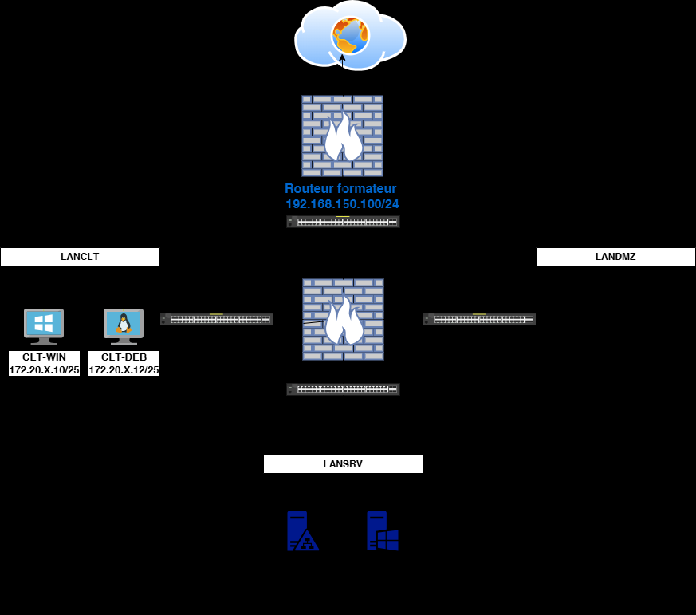

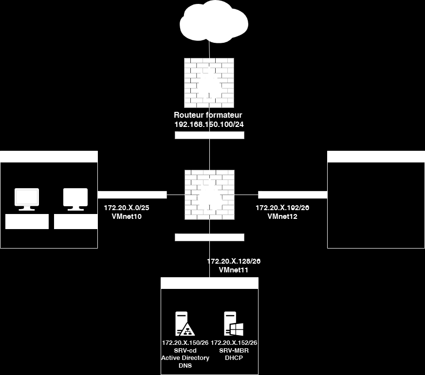

Installation de l’infrastructure
Installation du serveur SRV-CD

       Utiliser le fichier Base-SRV-WIN2022.ovf pour deployer votre serveur Windows.

       Attribuer lui, l’adresse IP ainsi que sa passerelle définis sur le schema.
       Connectez-le sur le VMnet 11

       Renomer votre VM par SRV-CD

       Votre nom de domaine sera votre nom.eni
       Utiliser les scripts suivants :

       Ouvrir Powershell en tant qu’Administeur de vous déplacer sur D:/scirpts puis
       exécutez les scripts dans l’ordre suivant:

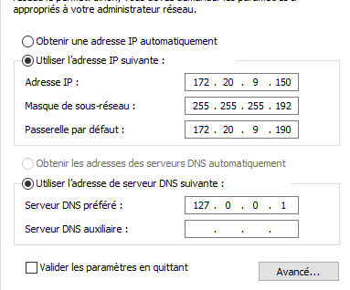

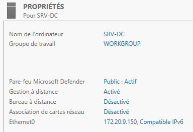

Install-DNS-ADDS.ps1

       DNS-Zone-Inversées.ps1

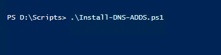

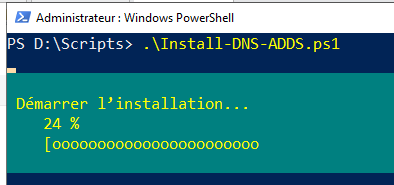

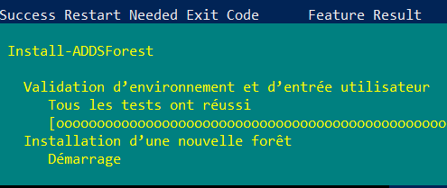

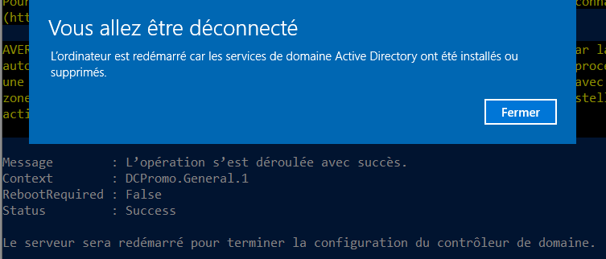

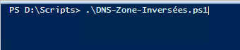

OU.ps1

      Attention modifier les fichiers Users.csv et Groups.csv avec votre nom de domaine
avant d’éxecuter les scripts suivants.
      Users.ps1

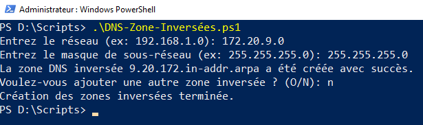

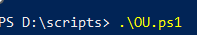

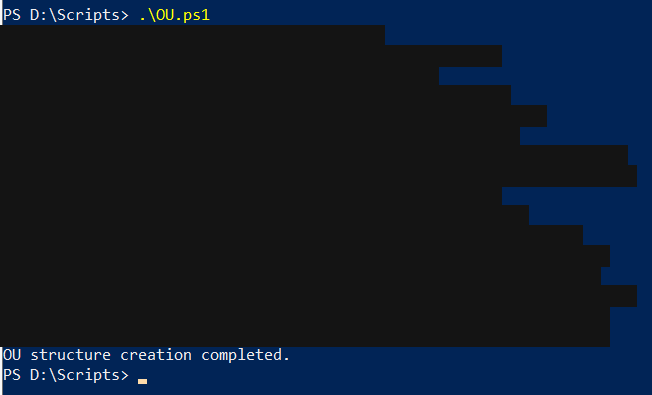

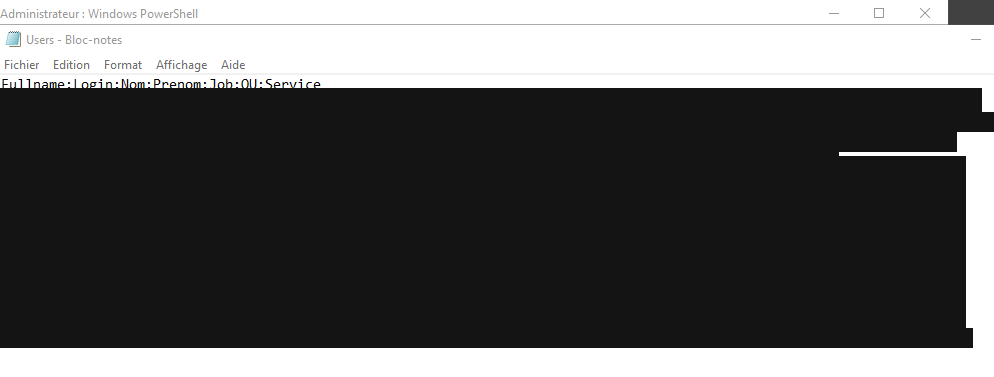

./

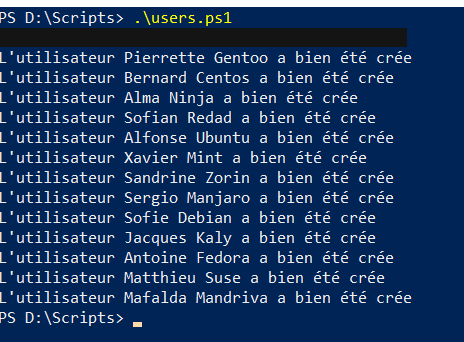

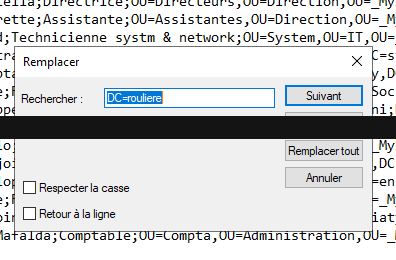

Groups.ps1

       AdduseronGroups.ps1

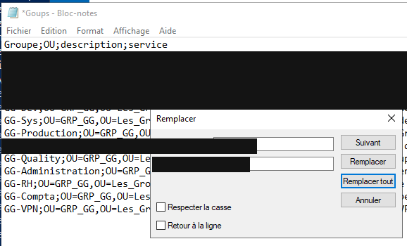

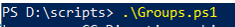

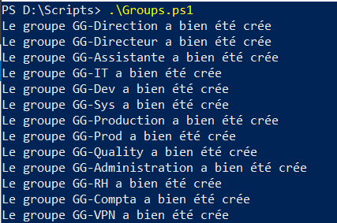

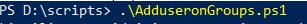

Faites un redirecteur dans le gestionnaire DNS avec l’IP le DNS de votre salle

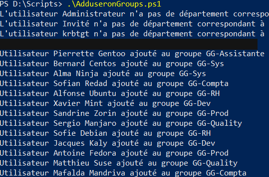

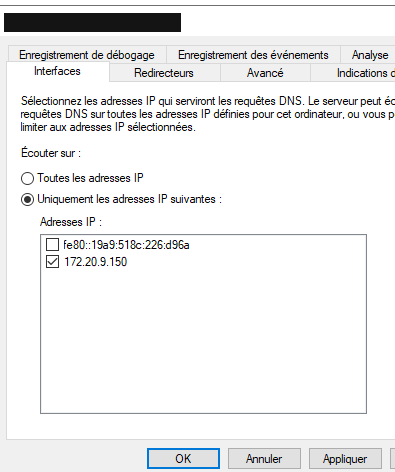

Installation du serveur SRV-MBR

       Utiliser également le fichier Base-SRV-WIN2022.ovf

       Renomer votre serveur par: SRV-MBR
       Attribuer lui, l’adresse IP ainsi que sa passerelle définis sur le schema.

       Connectez-le sur le VMnet 11

       Joindre ce serveur à votre domaine avec l’utilisatrice Alma Ninja.

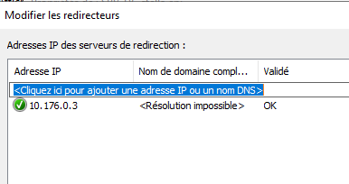

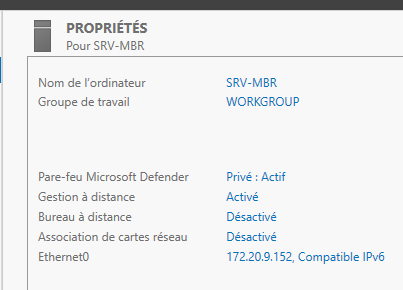

Installer en tant qu’administrateur du domaine sur ce serveur, le rôle DHCP et
préparez une etendue pour le LAN client.

Installation du routeur Pfsense

       Utiliser le fichier Routeur-Stagiaire.ovf le mot de passe par défaut

       Modifier les IP correspondant à votre réseau et vérifier que les différentes cartes
sont sur les bons VMnet comme indiqué sur le schéma.

Valeurs de la capture :

- Nom de l’ordinateur : SRV-MBR
- Domaine : votrenom.eni
- Groupe de travail : WORKGROUP

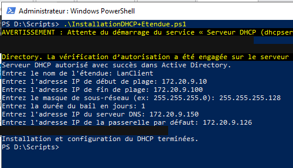

Modifier dans les paramètres générales votre domaine et votre DNS

       Ajouter le relay DHCP pour votre LAN client.

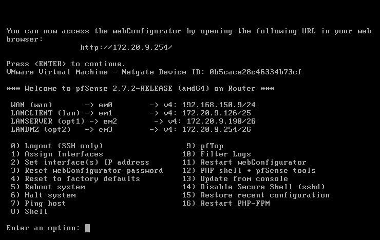

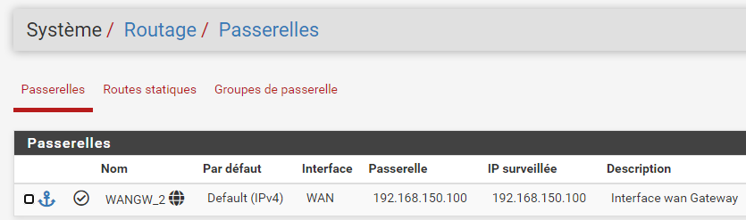

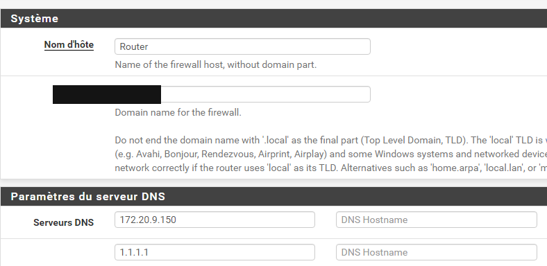

Installation du client Windows 10

       Récupérer l’ISO sur Distrib puis mettre les caractéristiques suivantes :

       RAM : 3Go

       CPU : 2

       Stockage : laisser par défaut

       Réseau : VMnet10

      Vérifier que vous récupérer une adresse IP du serveur DHCP. Retourner sur votre
serveur DHCP puis faites une réservation avec l’adresse IP indiqué sur le schéma.

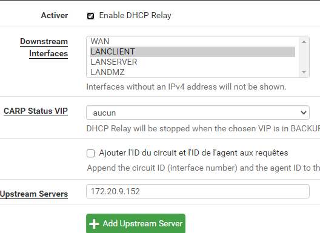

Désactiver le pare-feu Windows

Installation du client Debian 12

Récupérer l’ISO sur Distrib puis mettre les caractéristiques suivantes :

       RAM : 2Go

       CPU : 1

       Stockage : laisser par défaut

       Réseau : VMnet10

      Vérifier que vous récupérer une adresse IP du serveur DHCP. Retourner sur votre
serveur DHCP puis faites une réservation avec l’adresse IP indiqué sur le schéma.

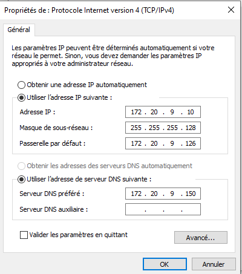

Sur routeur Pfsense

      Mettre en place les règles de pare-feu côté LANCLIENT, LANSERVER
déterminées au TP1, les autres règles seront effectuées plus tard puis tester le bon
fonctionnement.

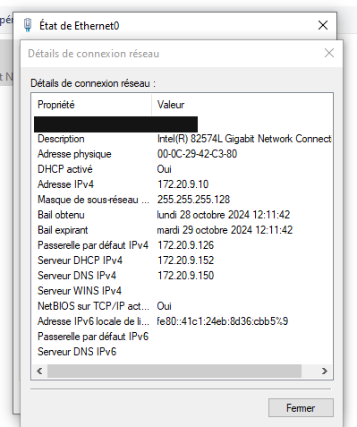

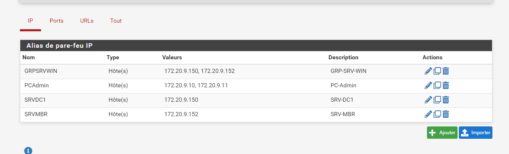

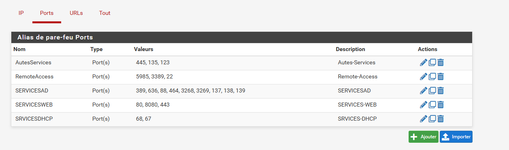

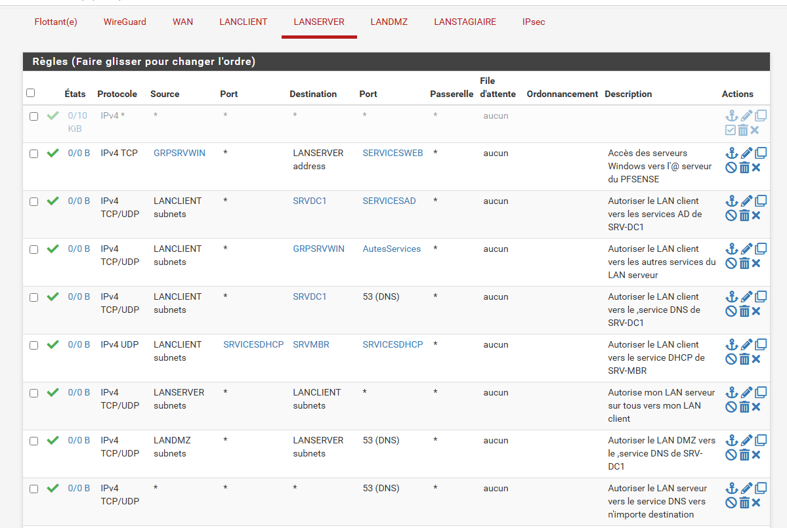

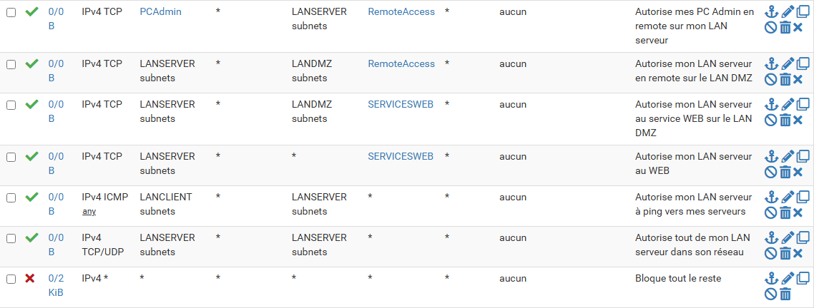

Client Windows 11

       Le joindre au domaine

Solution
Une solution est proposée pour ce TP sous la forme d'un PDF commenté (correction reproduite ci-dessous).

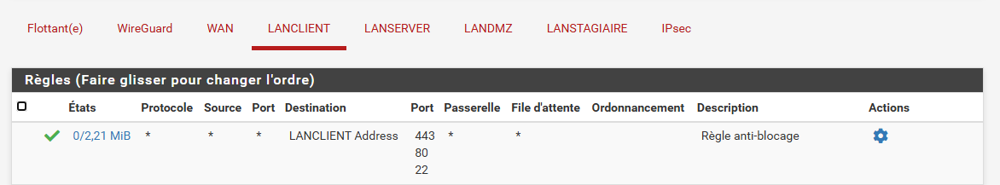

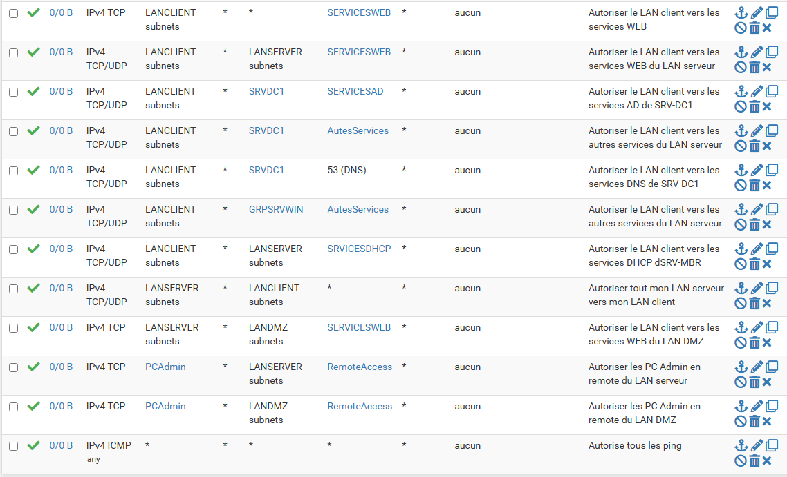

Note : l’énoncé nomme l’archive TSSR170-Réseau&Sécurité.7z, l’OVF Win-SRV.ovf, le routeur Routeur.ovf et le dossier E:/scirpts. Cette correction nomme BundlesStagiaires.7z, Base-SRV-WIN2022.ovf, Routeur-Stagiaire.ovf et D:/scirpts, et ajoute Install-DNS-ADDS.ps1 puis DNS-Zone-Inversées.ps1.
