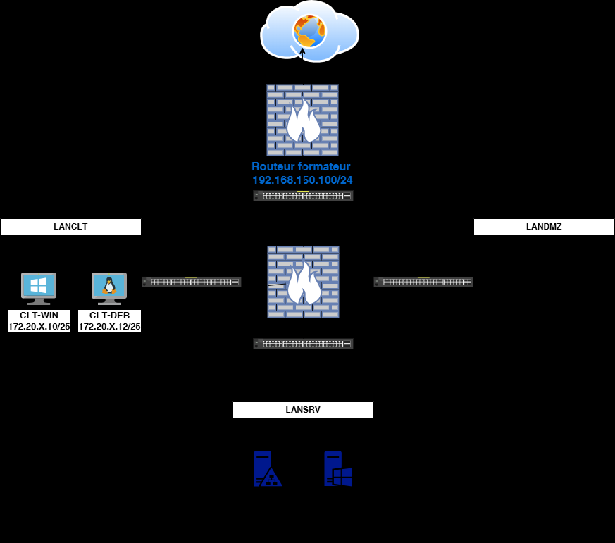
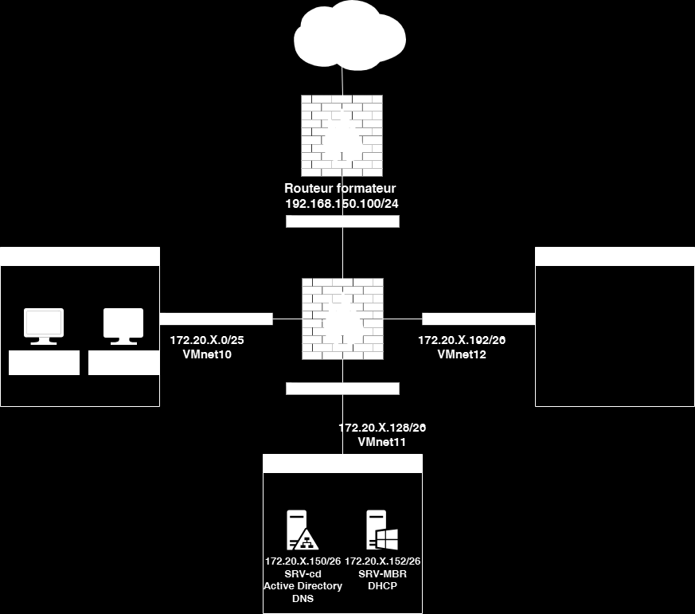
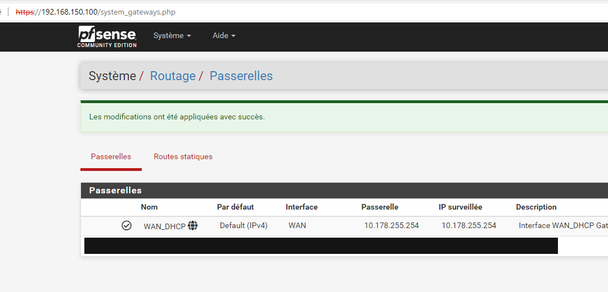
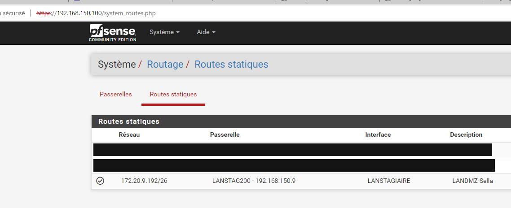
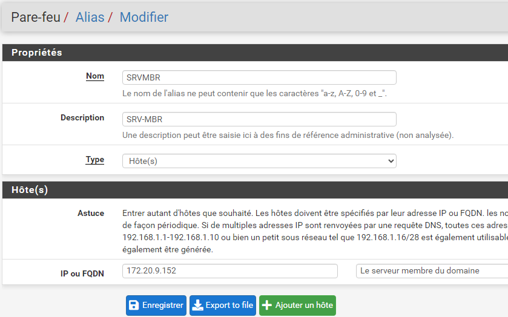
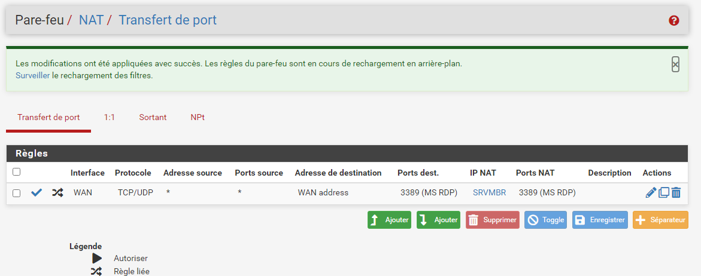
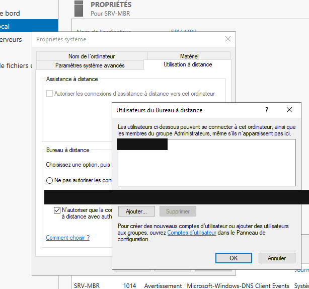
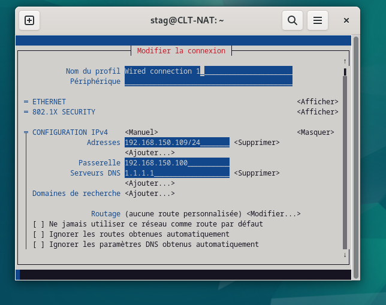
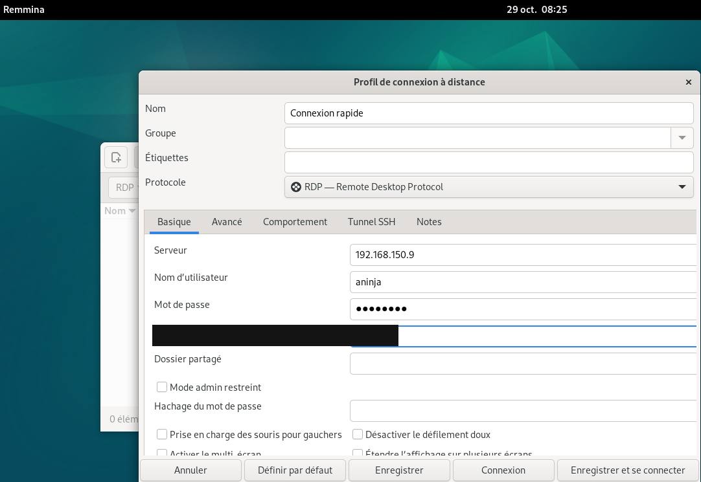
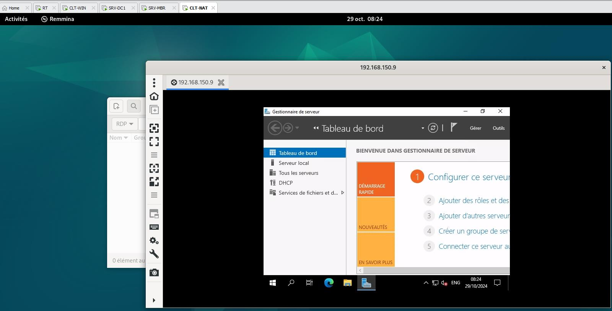

# Correction — TP3 — Configuration du NAT Pfsense


Solution-Configuration du
NAT Pfsense
TD3 du Module 1

 Avant de démarrer ce TP, avoir réalisé les TP précédents.

            Durée estimée

              2 heures

Énoncé

Objectifs:

Ce cas pratique, vous donnera une compréhension approfondie de la gestion des accès
réseau et de l'importance de la redirection NAT dans les environnements professionnels.





Texte visible sur la capture :

```text
192.168.150.100/24
VMnet10
VMnet12
VMnet11
```

Installation de l’infrastructure
Connection au Routeur Formateur
http://192.168.150.100
identifiant: stag
Mdp: stag

Ajouter les routes statiques de vos reseaux privés avec la gateway de votre @IP WAN

Puis tester la connexion internet depuis vos réseaux

Sur votre routeur Pfsense
Mettre les règles du par-feu du TP1 sur la carte WAN
Faire un alias du SRV-MBR



Texte visible sur la capture :

```text
H#tps;//192.168.150.100/system_gateways.php
Système / Routage / Passerelles
Passerelles Routes statiques
Nom Par défaut Interface Passerelle IP surveillée Description
wan_pHcp & Default (IPv4)  WAN 10.178.255.254 10.178.255.254 Interface WAN_DHCP Gat
```



Texte visible sur la capture :

```text
Réseau Passerelle Interface Description
172209.192/26 LANSTAG200 - 192.168.150.9 LANSTAGIAIRE LANDMZ-Sella
```

Ajouter une redirection NAT sur le protocole RDP sur l’Alias de votre serveur SRV-MBR

Sur votre SRV-MBR

Activer le bureau à distance avec le groupe GG-IT



Texte visible sur la capture :

```text
Pare-feu / Alias / Modifier
Le nom de l'alias ne peut contenir que les caractères "a
192.168.1.1-192.168.1.10 ou bien un petit sous réseau tel que 192.168.1.16/28 est également utilisabl
172.20.9.152 Le serveur membre du domaine
```



Client Windows ou depuis la VM CLT-NAT

Récupérer la VM CLT-NAT.ovf puis changer l’@IP comme indiqué dans le fichier

ID :stag

Pwd : P@ssw0rd



Entre binôme ou depuis CLT-NAT tester l’accès au bureau à distance depuis le client
windows. Utilser des utilisateurs du groupe GG-IT pour les tests.



Solution
Une solution est proposée pour ce TP sous la forme d'un PDF commenté.



Texte visible sur la capture :

```text
Serveur 192.168.150.9
Mot de passe
Hachage du mot de passe
```



Note : l’énoncé ouvre le routeur formateur sur http://192.168.150.1 avec le mot de passe P@ssw0rd et redirige le RDP vers l’IP de SRV-MBR. Cette correction ouvre http://192.168.150.100 avec le mot de passe stag et redirige vers un alias.
