# Correction — TP4 — Services hébergés dans une DMZ

Solutions-Services hébergés
dans une DMZ
TD4 Module 1

 Avant de démarrer ce TP,avoir réalisé les précédents.

            Durée estimée

             2-3 heures

Énoncé

Objectifs: Explorer les aspects essentiels de la mise en place et de la gestion de solutions
                    et services hébergés dans une DMZ (Demilitarized Zone)

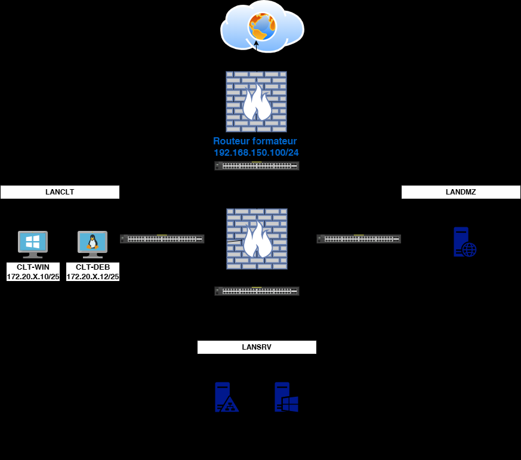

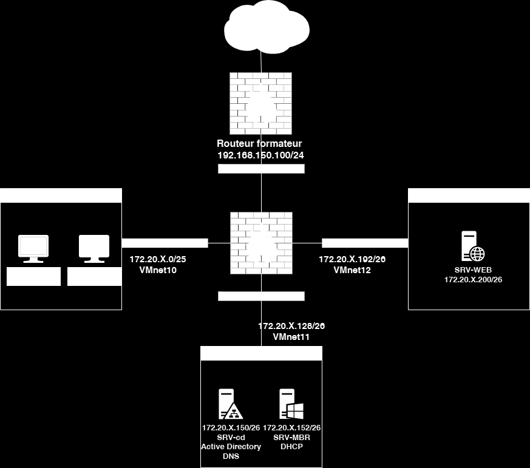

Installation du serveur WEB
Récupérer le bundle SRV-WEB.ovf

       Le mot de passe de root est P@ssw0rd

       Attribuer lui, l’adresse IP ainsi que sa passerelle définis sur le schema.

        Connectez-le sur le VMnet 12.
        Modifier les fichiers /etc/hosts et /etc/resolv.conf avec les informations de votre
infrastructure.

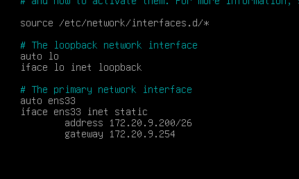

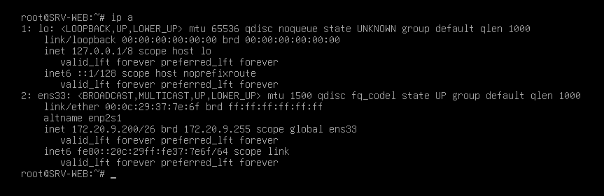

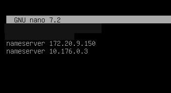

Sur le SRV-DC

Il faut faire un enregistrement DNS sur extra.votrenom.eni
Exécuter le script D:/scripts/AddDnsZone.ps1 et entrer la nouvelle adresse IP du SRV-Apache

       Tester l’URL https://extra.votrenom.eni

Sur du routeur Pfsense

Faites un alias URLs pour extra.votrenom.eni

Et ensuite une redirection NAT depuis le WAN pour accèder on site WEB depuis l’extérieur.
Attention aux règles de pare-feu

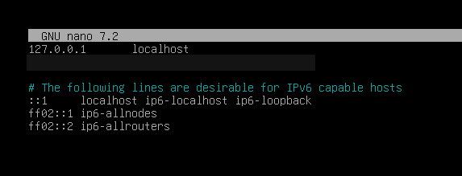

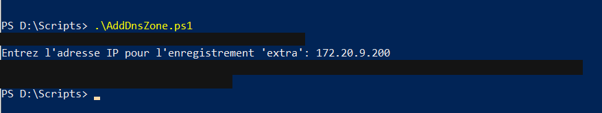

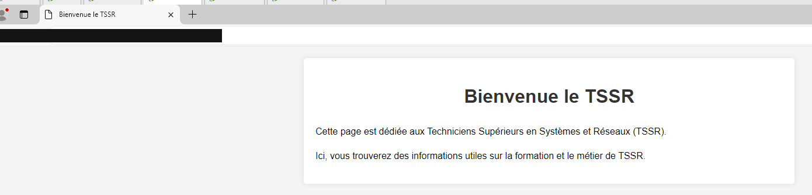

Depuis votre machine hôte ou depuis le VM CLT-NAT

       Tester l’accès au serveur WEB avec l’@IP de votre WAN entre binôme

Client Windows

       Tester l’accès au serveur WEB avec le FQDN en interne

Solution
Une solution est proposée pour ce TP sous la forme d'un PDF commenté, disponible dans les ressources à télécharger (correction reproduite ci-dessous).

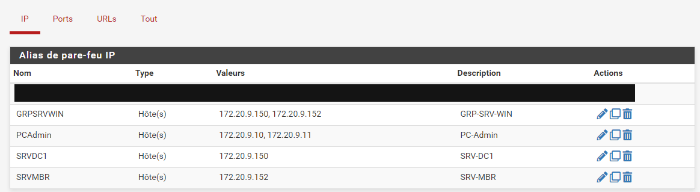

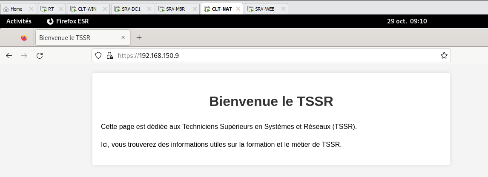

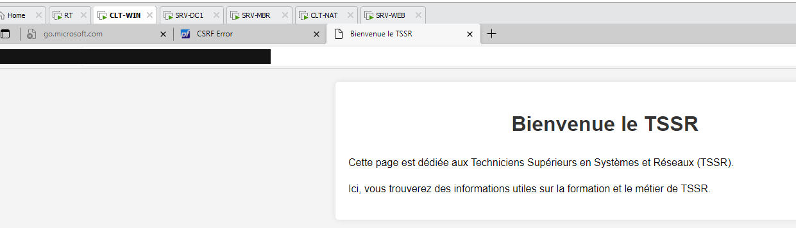

ressources à télécharger.

Note : l’énoncé déploie SRV-Apache.ova et le script Script-TP3-AddDnsZone.ps1. Cette correction déploie SRV-WEB.ovf et le script AddDnsZone.ps1. L’URL testée est la même.
